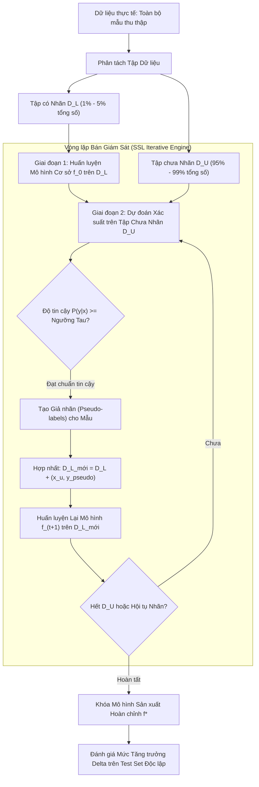

# Tổng quan về Học bán giám sát (Semi-Supervised Learning)

## Purpose

Trong bối cảnh bùng nổ dữ liệu hiện nay, việc thu thập dữ liệu thô chưa gán nhãn (Unlabeled Data - $`D_U`$) trở nên cực kỳ dễ dàng và chi phí rất thấp (hàng triệu ảnh trên Internet, hàng tỷ văn bản, hàng trăm gigabyte tín hiệu cảm biến). Ngược lại, việc gán nhãn chuẩn xác cho dữ liệu (Labeled Data - $`D_L`$) lại là một quy trình vô cùng đắt đỏ, tốn kém thời gian và bắt buộc phải phụ thuộc vào các chuyên gia trình độ cao (ví dụ: bác sĩ chuyên khoa chẩn đoán khối u trên phim chụp X-quang, chuyên gia ngôn ngữ học gán nhãn ngữ nghĩa, hay kỹ sư an ninh mạng điều tra mã độc).

Nếu chỉ áp dụng **Học có giám sát (Supervised Learning)** trên tập nhãn ít ỏi $`D_L`$, mô hình sẽ có phương sai lớn và rất dễ bị quá khớp (Overfitting). Nếu chỉ áp dụng **Học không giám sát (Unsupervised Learning)** trên toàn bộ dữ liệu, mô hình chỉ tìm được các cụm hình học tự nhiên mà không phục vụ trực tiếp cho mục tiêu dự đoán cụ thể của bài toán nghiệp vụ.

**Học bán giám sát (Semi-Supervised Learning - SSL)** là cầu nối hoàn hảo giữa hai thế giới:
1. **Khai thác đồng thời $`D_L`$ và $`D_U`$:** Tận dụng triệt để tập nhãn nhỏ $`D_L`$ để định hướng mục tiêu dự đoán, kết hợp với tập chưa nhãn khổng lồ $`D_U`$ ($`|D_U| \gg |D_L|`$) để khám phá cấu trúc hình học và phân phối biên duyên $`P(X)`$ của toàn bộ không gian dữ liệu.
2. **Cải thiện độ chính xác và tính tổng quát hóa:** Dữ liệu chưa nhãn giúp nắn chỉnh lại ranh giới quyết định (Decision Boundary), kéo đường phân tách đi qua các vùng không gian có mật độ điểm thấp (Low-Density Regions), từ đó giảm thiểu đáng kể lỗi kỳ vọng trên dữ liệu mới. [1][2]

---

## Input

Không gian bài toán Học bán giám sát bao gồm hai tập dữ liệu độc lập:

1. **Tập dữ liệu Đã Gán Nhãn (Labeled Dataset - $`D_L`$):**
   * Tập gồm $`n_l`$ mẫu quan sát:

$$
D_L = \lbrace (x_1, y_1), (x_2, y_2), \dots, (x_{n_l}, y_{n_l}) \rbrace \subset \mathcal{X} \times \mathcal{Y}
$$

   * Trong đó $`x_i \in \mathbb{R}^p`$ là vector đặc trưng và $`y_i \in \lbrace 1, 2, \dots, C \rbrace`$ (hoặc $`y_i \in \mathbb{R}`$ trong bài toán hồi quy) là nhãn chuẩn thực tế.
2. **Tập dữ liệu Chưa Gán Nhãn (Unlabeled Dataset - $`D_U`$):**
   * Tập gồm $`n_u`$ mẫu quan sát chỉ chứa vector đặc trưng mà không có nhãn:

$$
D_U = \lbrace x_{n_l + 1}, x_{n_l + 2}, \dots, x_{n_l + n_u} \rbrace \subset \mathcal{X}
$$

   * Đặc thù quy mô: Thông thường $`n_u \gg n_l`$ (ví dụ: $`n_l = 100`$ mẫu có nhãn, nhưng $`n_u = 50,000`$ mẫu chưa nhãn). Tỷ lệ nhãn $`\alpha = \frac{n_l}{n_l + n_u}`$ thường chỉ dao động từ 0.1% đến 5%.
3. **Yêu cầu phân phối I.I.D. đồng nhất:**
   * Cả $`D_L`$ và $`D_U`$ đều phải được lấy mẫu độc lập từ cùng một phân phối biên xác suất tiềm ẩn $`P(X)`$. Nếu phân phối của $`D_U`$ bị lệch nghiêm trọng so với $`D_L`$ (Covariate Shift / Domain Shift), dữ liệu chưa nhãn có thể gây phản tác dụng (Negative Transfer).

---

## Output

Mô hình học máy sau khi kết thúc huấn luyện bán giám sát xuất ra:

1. **Hàm Quy luật Dự đoán (Inductive Predictor):**
   * Hàm ánh xạ $`f: \mathcal{X} \to \mathcal{Y}`$ có khả năng suy luận nhãn cho bất kỳ điểm dữ liệu mới nào phát sinh trong tương lai ngoài cả $`D_L`$ và $`D_U`$.
2. **Nhãn Suy diễn cho Tập Chưa Nhãn (Transductive Predictions):**
   * Vector nhãn dự đoán $`\hat{y}_U = [\hat{y}_{n_l + 1}, \dots, \hat{y}_{n_l + n_u}]^\top`$ được gán trực tiếp cho chính các quan sát trong $`D_U`$.
3. **Độ Tin cậy Dự đoán (Prediction Confidence / Pseudo-labels):**
   * Xác suất hậu nghiệm $`P(y \mid x)`$ thể hiện mức độ tự tin của mô hình trên từng mẫu dữ liệu chưa nhãn.

---

## Evaluation metrics

Đánh giá một hệ thống Học bán giám sát đòi hỏi phải so sánh đối chứng chặt chẽ với các baseline chuẩn mực:

1. **Mức Tăng trưởng Hiệu năng so với Baseline Có Giám sát (Performance Gain - $`\Delta`$):**

$$
\Delta = \text{Metric}_{\text{SSL}}(D_{\text{test}}) - \text{Metric}_{\text{Supervised}}(D_{\text{test}})
$$

   * Trong đó:
     * $`\text{Metric}_{\text{Supervised}}`$ là điểm số của mô hình khi **chỉ huấn luyện duy nhất trên tập $`D_L`$** (chẳng hạn Accuracy, F1-Score).
     * $`\text{Metric}_{\text{SSL}}`$ là điểm số khi huấn luyện kết hợp cả $`D_L`$ và $`D_U`$.
   * **Điều kiện thành công:** $`\Delta > 0`$ một cách có ý nghĩa thống kê (Statistical Significance với $`p\text{-value} < 0.05`$). Nếu $`\Delta \le 0`$, hệ thống rơi vào hiện tượng **Chuyển giao Tiêu cực (Negative Transfer)**: việc nạp thêm dữ liệu chưa nhãn làm hỏng ranh giới đã học từ tập nhãn thật.
2. **Độ Chính xác của Giả nhãn (Pseudo-Label Precision):**
   * Tỷ lệ các nhãn giả do mô hình tự gán trên $`D_U`$ trùng khớp với nhãn thực tế bị ẩn đi:

$$
\text{Precision}_{\text{pseudo}} = \frac{1}{|D_U|} \sum_{i \in D_U} \mathbb{I}(\hat{y}_i = y_i^{\ast})
$$

   * Đây là chỉ số quan trọng nhất kiểm soát hiện tượng lan truyền sai số (Confirmation Bias).
3. **Hiệu suất Khai thác Nhãn (Label Efficiency Ratio):**
   * Tỷ lệ số lượng mẫu nhãn mà phương pháp có giám sát thuần túy cần có để đạt được cùng một mức độ chính xác tương đương mô hình SSL.

---

## How it works

### 1. Ba Giả Định Vàng của Học Bán Giám Sát (The Three Foundational Assumptions)

Dữ liệu chưa nhãn $`D_U`$ chỉ có thể giúp ích cho bài toán dự đoán nhãn $`Y`$ nếu phân phối biên $`P(X)`$ thực sự chứa đựng thông tin về phân phối có điều kiện $`P(Y \mid X)`$. Nền tảng toán học của Học bán giám sát dựa trên 3 giả định kinh điển (Chapelle et al., 2006):

```text
 1. Giả định Mượt (Smoothness)      2. Giả định Cụm (Cluster)        3. Giả định Đa tạp (Manifold)
    ┌─────────────────────────┐       ┌─────────────────────────┐       ┌─────────────────────────┐
    │  x1 ●                   │       │   ●●●●       ▲▲▲▲       │       │        ●●●              │
    │     \ d nhỏ             │       │  ● Cụm 1 ●   ▲ Cụm 2 ▲  │       │       ●   ●  Đa tạp     │
    │      ● x2               │       │   ●●●●       ▲▲▲▲       │       │      ●     ● cong       │
    │                         │       │        \ Ranh giới /    │       │     ●       ●           │
    │ => y1 cùng nhãn với y2  │       │       (Vùng thưa điểm)  │       │                         │
    └─────────────────────────┘       └─────────────────────────┘       └─────────────────────────┘
```

#### A. Giả định Độ Mượt (Smoothness Assumption)
Nếu hai điểm dữ liệu $`x_1`$ và $`x_2`$ nằm gần nhau trong một vùng không gian có mật độ điểm cao, thì nhãn của chúng $`y_1`$ và $`y_2`$ phải có xác suất rất cao là giống nhau. Ngược lại, nếu hai điểm bị phân tách bởi một vùng không gian thưa thớt (mật độ thấp), nhãn của chúng có thể khác nhau.

#### B. Giả định Cụm và Ranh giới Mật độ Thấp (Cluster / Low-Density Separation Assumption)
Dữ liệu có xu hướng hình thành các cụm tự nhiên rời rạc. Các điểm trong cùng một cụm thuộc về cùng một lớp. Hệ quả trực tiếp: **Ranh giới quyết định (Decision Boundary) tối ưu bắt buộc phải đi qua các vùng không gian có mật độ điểm cực thấp**, tránh cắt ngang qua giữa các cụm đông đúc. Dữ liệu chưa nhãn $`D_U`$ chỉ ra chính xác các cụm nằm ở đâu để mô hình không đặt ranh giới chia cắt chúng.

#### C. Giả định Đa tạp (Manifold Assumption)
Dữ liệu quan sát trong không gian nhiều chiều $`\mathbb{R}^p`$ thực chất nằm trên hoặc rất gần một đa tạp Riemann phi tuyến (Manifold) có số chiều thực tế thấp hơn nhiều ($`d \ll p`$). Dữ liệu chưa nhãn $`D_U`$ giúp tái dựng hình học của đa tạp này, cho phép tính khoảng cách trắc địa (Geodesic Distance) men theo đường cong mặt đa tạp thay vì đo khoảng cách Euclid thẳng xuyên không gian.

---

### 2. So sánh Toàn diện Bốn Trường phái Học máy

```text
+-----------------------+-------------------+-------------------+-------------------+-------------------+
| Tiêu chí              | Học có giám sát   | Học không giám sát| Học bán giám sát  | Học chuyển vị     |
|                       | (Supervised)      | (Unsupervised)    | (Semi-Supervised) | (Transductive)    |
+-----------------------+-------------------+-------------------+-------------------+-------------------+
| 1. Dữ liệu huấn luyện | Chỉ D_L (Có nhãn) | Chỉ D_U (Chưa nhãn| Cả D_L và D_U     | Cả D_L và D_U     |
| 2. Mục tiêu đầu ra    | Hàm f(x) tổng quát| Cụm / Chiều giảm  | Hàm f(x) tổng quát| Chỉ nhãn của D_U  |
| 3. Dự đoán điểm mới   | Có (Inductive)    | Có                | Có (Inductive)    | Không (Chuyển vị) |
| 4. Chi phí nhãn       | Rất cao           | Bằng 0            | Thấp              | Thấp              |
+-----------------------+-------------------+-------------------+-------------------+-------------------+
```

---

### 3. Phân loại Các Họ Phương Pháp Học Bán Giám Sát Chính (Taxonomy)

Theo cấu trúc bài giảng [ML_Chapter4_new.pdf](<../Tài liệu học tập/ML_Chapter4_new.pdf>), các phương pháp bán giám sát được phân thành 5 nhóm lớn:

1. **Phương pháp Đóng gói (Wrapper Methods):**
   * Sử dụng một mô hình có giám sát làm lõi nền tảng. Mô hình tự dự đoán trên $`D_U`$, chọn các dự đoán tự tin nhất làm **Giả nhãn (Pseudo-labels)** để nạp ngược lại vào tập train. Tiêu biểu: **Self-Training**, **Co-Training** (2 góc nhìn), **Tri-Training** (3 mô hình bỏ phiếu).
2. **Phương pháp Dựa trên Đồ thị (Graph-Based Methods):**
   * Biểu diễn toàn bộ $`D_L \cup D_U`$ thành đồ thị tương đồng $`G = (V, E)`$. Nhãn được lan truyền dọc theo các cạnh đồ thị từ các node có nhãn sang các node chưa có nhãn. Tiêu biểu: **Label Propagation**, **Label Spreading**.
3. **Mở rộng Ranh giới Mật độ Thấp (Low-Density Separation):**
   * Cưỡng ép siêu phẳng phân cách đi qua khe hở thưa thớt nhất của dữ liệu chưa nhãn. Tiêu biểu: **Semi-Supervised SVM (S3VM / Transductive SVM)**.
4. **Mô hình Sinh (Generative Models):**
   * Mô hình hóa phân phối đồng thời $`P(X, Y) = P(Y)P(X \mid Y)`$, coi nhãn của $`D_U`$ là biến ẩn (Latent Variable) và giải bằng thuật toán EM. Tiêu biểu: **Semi-Supervised GMM**, **Variational Autoencoders (VAE)**.
5. **Ràng buộc Nhất quán trong Deep Learning (Consistency Regularization):**
   * Ép mô hình đưa ra dự đoán nhất quán khi thêm nhiễu nhẹ vào dữ liệu chưa nhãn ($`f(x) \approx f(x + \epsilon)`$). Tiêu biểu: **FixMatch**, **MixMatch**.

---

## Data used

Học bán giám sát phát huy tối đa sức mạnh trong các lĩnh vực có sự chênh lệch lớn giữa dữ liệu thô và dữ liệu dán nhãn:

1. **Chẩn đoán Hình ảnh Y tế (Medical Imaging):**
   * Có hàng trăm nghìn ảnh chụp CT/MRI tại các bệnh viện, nhưng chỉ có vài trăm ảnh được hội chẩn và gán nhãn chi tiết bởi bác sĩ đầu ngành. SSL tận dụng ảnh chưa nhãn để học cấu trúc giải phẫu học cơ thể trước khi phân loại bệnh lý.
2. **Phân tích Cảm xúc Văn bản (Sentiment Analysis & NLP):**
   * Hàng triệu bình luận đánh giá sản phẩm trên các sàn thương mại điện tử chưa được gán nhãn. Sử dụng Self-Training giúp mở rộng từ vựng cảm xúc nhanh chóng mà không cần nhân công gán nhãn thủ công.
3. **Nhận dạng Tiếng nói (Speech Recognition) và Âm học:**
   * Hàng nghìn giờ ghi âm giọng nói tự nhiên được đưa vào huấn luyện bán giám sát để học biểu diễn ngữ âm (Acoustic Representations).
4. **Phát hiện Mã độc và An ninh Mạng (Cybersecurity):**
   * Lưu lượng mạng bình thường và file thực thi khổng lồ mỗi ngày. SSL giúp phát hiện các biến thể mã độc mới (Zero-day Exploits) dựa trên sự lệch pha mật độ.

---

## Design

### 1. Kiến trúc Quy trình Huấn luyện Bán Giám Sát Tiêu Chuẩn



---

### 2. Minh họa Triển khai Mã nguồn Thực nghiệm với Scikit-learn

```python
import numpy as np
from sklearn.datasets import load_breast_cancer
from sklearn.model_selection import train_test_split
from sklearn.preprocessing import StandardScaler
from sklearn.semi_supervised import SelfTrainingClassifier
from sklearn.linear_model import LogisticRegression
from sklearn.metrics import accuracy_score, f1_score

# 1. Tải tập dữ liệu thực nghiệm
X_raw, y_true = load_breast_cancer(return_X_y=True)
scaler = StandardScaler()
X = scaler.fit_transform(X_raw)

# 2. Phân tách tập huấn luyện (80%) và tập kiểm tra độc lập (20%)
X_train, X_test, y_train, y_test = train_test_split(
    X, y_true, test_size=0.20, random_state=42, stratify=y_true
)

# 3. Giả lập kịch bản Bán giám sát: Chỉ giữ lại 10% nhãn thật, 90% còn lại gán nhãn -1 (Chưa nhãn)
np.random.seed(42)
labeled_ratio = 0.10
n_train = len(y_train)
n_labeled = int(n_train * labeled_ratio)

unlabeled_indices = np.random.choice(n_train, size=n_train - n_labeled, replace=False)
y_train_ssl = np.copy(y_train)
y_train_ssl[unlabeled_indices] = -1  # Trong scikit-learn, nhãn -1 đại diện cho mẫu chưa có nhãn

print(f"Tổng số mẫu train: {n_train}")
print(f"Số mẫu có nhãn thật (D_L): {n_labeled}")
print(f"Số mẫu chưa có nhãn (D_U): {len(unlabeled_indices)}")

# 4. Huấn luyện Baseline Có giám sát thuần túy (Chỉ nhìn thấy D_L)
labeled_mask = y_train_ssl != -1
base_model = LogisticRegression(random_state=42)
base_model.fit(X_train[labeled_mask], y_train_ssl[labeled_mask])
y_pred_base = base_model.predict(X_test)
base_f1 = f1_score(y_test, y_pred_base)
print(f"\n[Baseline] F1-Score khi chỉ học trên D_L: {base_f1:.4f}")

# 5. Huấn luyện Mô hình Bán giám sát Self-Training kết hợp cả D_L và D_U
ssl_model = SelfTrainingClassifier(
    base_estimator=LogisticRegression(random_state=42),
    threshold=0.85, # Ngưỡng tự tin tối thiểu để chấp nhận giả nhãn
    criterion='threshold',
    verbose=True
)
ssl_model.fit(X_train, y_train_ssl)
y_pred_ssl = ssl_model.predict(X_test)
ssl_f1 = f1_score(y_test, y_pred_ssl)

# 6. Đánh giá Mức Tăng trưởng Hiệu năng Delta
delta = ssl_f1 - base_f1
print(f"[Semi-Supervised] F1-Score khi khai thác cả D_L và D_U: {ssl_f1:.4f}")
print(f"=> Mức tăng trưởng hiệu năng Delta: {delta:+.4f} ({delta*100:+.2f}%)")
```

---

## Nguồn

- [1] Chapelle, O., Schölkopf, B., & Zien, A. (Eds.). (2006). *Semi-Supervised Learning*. MIT Press, Cambridge, MA.
- [2] Zhu, X., & Goldberg, A. B. (2009). *Introduction to Semi-Supervised Learning*. Synthesis Lectures on Artificial Intelligence and Machine Learning, Morgan & Claypool Publishers.
- [3] Van Engelen, J. E., & Hoos, H. H. (2020). *A survey on semi-supervised learning*. Machine Learning, 109(2), 373-440.
- [4] [scikit-learn User Guide: Semi-Supervised Learning](https://scikit-learn.org/stable/modules/semi_supervised.html).

