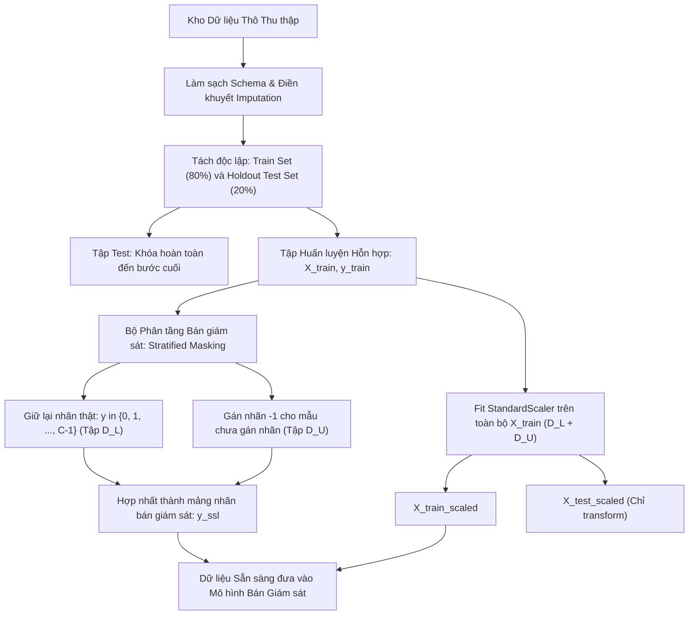

# Tiền xử lý và Chuẩn bị Dữ liệu trước Huấn luyện Bán Giám sát

## Purpose

Trong Học bán giám sát, giai đoạn tiền xử lý dữ liệu (Data Preprocessing) đóng vai trò sống còn và có tính chất phức tạp hơn nhiều so với học có giám sát truyền thống. Sự hiện diện đồng thời của hai khối dữ liệu — một khối rất nhỏ đã có nhãn ($`D_L`$) và một khối khổng lồ chưa có nhãn ($`D_U`$) — đặt ra những thách thức kỹ thuật đặc thù:

1. **Kiểm soát Ranh giới Rò rỉ Thông tin (Data Leakage Boundary):** Trong Học bán giám sát, ta có được phép sử dụng các mẫu trong $`D_U`$ để tính giá trị trung bình $`\bar{x}`$ và phương sai $`\sigma^2`$ khi chuẩn hóa dữ liệu (`StandardScaler`) hay không? (Câu trả lời là **CÓ**, vì $`D_U`$ là một phần của tập huấn luyện; nhưng **TUYỆT ĐỐI KHÔNG** được để rò rỉ bất kỳ thông tin nào từ tập kiểm tra $`D_{\text{test}}`$).
2. **Xử lý Mất cân bằng Lớp Cực đoan trong Tập Nhãn Nhỏ ($`D_L`$ Class Imbalance):** Khi số lượng mẫu có nhãn rất ít (ví dụ chỉ có 50 mẫu), một lớp hiếm có thể hoàn toàn không có mẫu nào trong $`D_L`$, khiến thuật toán hoàn toàn mù quáng về sự tồn tại của lớp đó.
3. **Chuẩn hóa Quy ước Định dạng Dữ liệu (Scikit-learn SSL Format Convention):** Trong hệ sinh thái scikit-learn và các thư viện chuẩn công nghiệp, toàn bộ dữ liệu $`D_L`$ và $`D_U`$ được gộp chung vào một ma trận đặc trưng $`X`$, trong đó các mẫu chưa có nhãn bắt buộc phải được gán giá trị nhãn là số nguyên đặc biệt $`-1`$. [1][2]

---

## Input

Dữ liệu đầu vào cần chuẩn bị trước khi đưa vào pipeline bán giám sát:

1. **Tập dữ liệu Thô Hỗn hợp:**
   * Tập $`n_l`$ mẫu có nhãn: $`D_L = \lbrace (x_i, y_i) \rbrace_{i=1}^{n_l}`$ với $`y_i \in \lbrace 0, 1, \dots, C - 1 \rbrace`$.
   * Tập $`n_u`$ mẫu chưa nhãn: $`D_U = \lbrace x_j \rbrace_{j=n_l + 1}^{n_l + n_u}`$.
2. **Tỷ lệ Phân bổ Nhãn (Label Fraction - $`\alpha`$):**
   * Tỷ lệ phần trăm mẫu được gán nhãn thực tế $`\alpha = \frac{n_l}{n_l + n_u} \in (0, 1)`$.
3. **Quy tắc Kiểm tra Độ lệch Phân phối (Covariate Shift Audit):**
   * Kiểm tra giả định liệu $`D_L`$ và $`D_U`$ có thực sự cùng xuất phát từ một phân phối biên duyên $`P(X)`$ hay không. Nếu $`D_L`$ được chọn lọc theo một quy luật thiên lệch (ví dụ: chỉ gán nhãn các mẫu dễ nhận biết ở trung tâm cụm), mô hình sẽ bị thiên lệch ranh giới quyết định.

---

## Output

Dữ liệu sau khi hoàn thành chuỗi tiền xử lý:

1. **Ma trận Đặc trưng Hợp nhất Đã Chuẩn hóa:**
   * $`X_{\text{train}} \in \mathbb{R}^{(n_l + n_u) \times p}`$: Ma trận chứa toàn bộ các mẫu của $`D_L`$ xếp trước và $`D_U`$ xếp sau (hoặc xáo trộn ngẫu nhiên), các đặc trưng đã được scale về cùng thang đo (Z-score).
2. **Vector Nhãn Bán Giám Sát Chuẩn hóa ($`y_{\text{train}}`$):**
   * Vector độ dài $`n = n_l + n_u`$:

$$
y_i = \begin{cases} y_i^{\ast} \in \lbrace 0, 1, \dots, C - 1 \rbrace & \text{nếu } x_i \in D_L \\ -1 & \text{nếu } x_i \in D_U \end{cases}
$$

3. **Mặt nạ Boolean Phân định (Mask Array):**
   * Mảng Boolean `is_labeled` độ dài $`n`$ với giá trị `True` cho các mẫu thuộc $`D_L`$ và `False` cho các mẫu thuộc $`D_U`$.

---

## Evaluation metrics

Các thước đo định lượng để kiểm tra chất lượng dữ liệu trước khi bước vào huấn luyện:

1. **Tỷ lệ Mất cân bằng Nhãn trong $`D_L`$ (Imbalance Ratio - $`\text{IR}`$):**

$$
\text{IR} = \frac{\max_{c} |D_{L, c}|}{\min_{c} |D_{L, c}|}
$$

   * Nếu $`\text{IR} > 5.0`$ trên tập nhãn nhỏ, bắt buộc phải áp dụng chiến lược Stratified Sampling để tái cân bằng, nếu không mô hình Self-Training sẽ chỉ tự gán giả nhãn cho lớp đa số, làm tuyệt chủng lớp thiểu số.
2. **Khoảng cách Phân phối Kolmogorov-Smirnov (KS-Distance):**
   * Đo lường độ sai lệch phân phối giữa đặc trưng $`j`$ trong tập $`D_L`$ so với $`D_U`$:

$$
D_{\text{KS}} = \sup_x |F_{L, j}(x) - F_{U, j}(x)|
$$

   * Nếu giá trị $`p\text{-value} < 0.01`$ trên nhiều đặc trưng, chứng tỏ có hiện tượng rò rỉ lấy mẫu thiên lệch (Sampling Selection Bias) giữa tập có nhãn và chưa nhãn.
3. **Mức độ Bao phủ Không gian của $`D_L`$ (Spatial Coverage Ratio):**
   * Khoảng cách trung bình từ một điểm bất kỳ trong $`D_U`$ tới điểm có nhãn gần nhất trong $`D_L`$.

---

## How it works

### 1. Phân Tách Tập Dữ liệu Đúng Thứ Tự (Splitting Architecture)

Một trong những sai lầm chết người nhất trong thực hành Học bán giám sát là: *Lấy toàn bộ dữ liệu thô đưa vào pipeline bán giám sát, sau đó mới chia tập test để đánh giá*. Hành động này làm rò rỉ toàn bộ hình học của tập test vào trong quá trình huấn luyện, làm mất tính khách quan khoa học.

Quy trình phân chia dữ liệu bắt buộc phải tuân thủ đúng thứ tự 3 bước sau:

```text
                                  TOÀN BỘ DỮ LIỆU THU THẬP
                                             │
                        ┌────────────────────┴────────────────────┐
                        ▼                                         ▼
            [ 1. TẬP HUẤN LUYỆN CHÍNH ]                  [ 2. TẬP TEST ĐỘC LẬP ]
                 (80% tổng dữ liệu)                         (20% tổng dữ liệu)
                        │                                  (Khóa kín tuyệt đối)
            ┌───────────┴───────────┐
            ▼                       ▼
      [ Tập Nhãn D_L ]      [ Tập Chưa Nhãn D_U ]
       (10% của Train)        (90% của Train)
```

1. **Bước 1: Tách riêng Tập Test Độc lập ($`D_{\text{test}}`$):**
   * Tách ngay từ đầu 20% dữ liệu có nhãn làm tập test độc lập. Tập test này **tuyệt đối không được xuất hiện trong $`D_L`$ lẫn $`D_U`$**. Nó chỉ được mở ra duy nhất một lần ở bước đánh giá cuối cùng.
2. **Bước 2: Phân chia $`D_{\text{train}}`$ thành $`D_L`$ và $`D_U`$:**
   * Trong 80% dữ liệu train còn lại, ta chọn ra một lượng nhỏ mẫu để giữ lại nhãn thật ($`D_L`$). Phần còn lại bị **xóa nhãn (masking thành $`-1`$)** để đóng vai trò là tập chưa nhãn $`D_U`$.
3. **Bước 3: Chuẩn hóa Thang đo (Scaling Policy):**
   * Bộ `StandardScaler` được phép gọi `fit(X_train)` trên toàn bộ $`D_L \cup D_U`$ (vì cả hai đều thuộc tập huấn luyện hợp lệ). Nhưng sau đó nó chỉ được dùng `transform()` trên $`D_{\text{test}}`$.

---

### 2. Kỹ thuật Phân tầng Bán giám sát (Stratified Semi-Supervised Sampling)

Khi số lượng mẫu có nhãn $`n_l`$ rất nhỏ, phương pháp lấy mẫu ngẫu nhiên đơn giản (Simple Random Sampling) rất dễ bỏ sót các lớp hiếm. Kỹ thuật **Stratified Sampling** phân chia đồng đều tỷ lệ $`\alpha`$ trên từng lớp mục tiêu:

$$
n_{l, c} = \max\left(1, \text{round}\left( \alpha \cdot |D_c| \right)\right), \quad \forall c \in \lbrace 0, 1, \dots, C-1 \rbrace
$$

Điều này đảm bảo mỗi lớp đều có ít nhất một số lượng mẫu hạt giống nhất định (ví dụ tối thiểu 5 mẫu mỗi lớp) để thuật toán có đủ thông tin khởi tạo ranh giới.

---

## Data used

Quy trình chuẩn bị dữ liệu bán giám sát được áp dụng trên các dạng dữ liệu thực tế sau:

1. **Dữ liệu Dạng Bảng (Tabular Data):**
   * Các bảng dữ liệu khách hàng ngân hàng nơi chỉ có một phần nhỏ khách hàng đã có lịch sử vỡ nợ (nhãn có sẵn), còn lại hàng triệu khách hàng mới chưa rõ xếp hạng tín dụng.
2. **Dữ liệu Văn bản (Text & NLP):**
   * Hàng trăm nghìn văn bản tin tức hoặc hợp đồng pháp lý chưa phân loại. Tiền xử lý bao gồm trích xuất đặc trưng TF-IDF hoặc embedding vector nhúng trước khi gán nhãn $`-1`$ cho tập văn bản thô.
3. **Dữ liệu Hình ảnh và Thị giác:**
   * Tập ảnh lớn được thu thập từ camera giám sát giao thông. Chỉ có vài trăm ảnh được chuyên gia đóng khung và gán nhãn các loại xe; toàn bộ ảnh còn lại là $`D_U`$.

---

## Design

### 1. Sơ đồ Luồng Tiền Xử lý Dữ liệu Bán Giám Sát Chuẩn Công Nghiệp



---

### 2. Mã nguồn Kỹ thuật Phân tầng và Tiền xử lý Chuẩn Scikit-learn

```python
import numpy as np
from sklearn.datasets import load_wine
from sklearn.model_selection import train_test_split
from sklearn.preprocessing import StandardScaler

def prepare_semi_supervised_data(X_raw, y_raw, label_ratio=0.15, test_size=0.20, random_state=42):
    """
    Tiền xử lý và chia tách dữ liệu bán giám sát chuẩn mực.
    Đảm bảo:
    1. Tập test hoàn toàn độc lập và giữ nguyên 100% nhãn thật.
    2. Tập train được phân tầng chính xác để giữ lại đúng label_ratio mẫu nhãn cho mỗi lớp.
    3. Các mẫu chưa nhãn trong tập train được gán nhãn -1 theo chuẩn scikit-learn.
    4. Bộ chuẩn hóa StandardScaler chỉ fit trên tập train.
    """
    # Bước 1: Tách riêng tập Test độc lập
    X_train_raw, X_test_raw, y_train_raw, y_test = train_test_split(
        X_raw, y_raw, test_size=test_size, stratify=y_raw, random_state=random_state
    )

    # Bước 2: Chuẩn hóa thang đo (Fit trên tập train, transform trên cả train và test)
    scaler = StandardScaler()
    X_train = scaler.fit_transform(X_train_raw)
    X_test = scaler.transform(X_test_raw)

    # Bước 3: Tạo mảng nhãn bán giám sát y_ssl ban đầu gán toàn bộ là -1 (chưa nhãn)
    y_ssl = np.full_like(y_train_raw, fill_value=-1)

    # Bước 4: Phân tầng để chọn ra đúng tỷ lệ mẫu có nhãn cho từng lớp
    np.random.seed(random_state)
    classes = np.unique(y_train_raw)

    labeled_indices = []
    for c in classes:
        # Lấy danh sách chỉ số các mẫu thuộc lớp c trong tập train
        class_indices = np.where(y_train_raw == c)[0]
        n_class_samples = len(class_indices)

        # Tính số lượng mẫu cần giữ lại nhãn cho lớp c (ít nhất 2 mẫu)
        n_labeled = max(2, int(np.round(n_class_samples * label_ratio)))

        # Chọn ngẫu nhiên không hoàn lại các mẫu có nhãn
        chosen_indices = np.random.choice(class_indices, size=n_labeled, replace=False)
        labeled_indices.extend(chosen_indices)

        # Gán lại nhãn thật cho các mẫu được chọn
        y_ssl[chosen_indices] = y_train_raw[chosen_indices]

    labeled_indices = np.array(labeled_indices)
    unlabeled_indices = np.setdiff1d(np.arange(len(y_train_raw)), labeled_indices)

    return X_train, y_ssl, X_test, y_test, labeled_indices, unlabeled_indices

# ==========================================
# THỬ NGHIỆM THỰC THI TRÊN WINE DATASET
# ==========================================
X_raw, y_raw = load_wine(return_X_y=True)

X_train, y_ssl, X_test, y_test, idx_l, idx_u = prepare_semi_supervised_data(
    X_raw, y_raw, label_ratio=0.10, test_size=0.20, random_state=42
)

print(f"Tổng số mẫu tập Train: {len(X_train)}")
print(f"  + Số mẫu ĐÃ GÁN NHÃN (D_L): {len(idx_l)} ({len(idx_l)/len(X_train)*100:.1f}%)")
print(f"  + Số mẫu CHƯA GÁN NHÃN (D_U, nhãn = -1): {len(idx_u)} ({len(idx_u)/len(X_train)*100:.1f}%)")
print(f"Tổng số mẫu tập Test giữ riêng: {len(X_test)} (100% có nhãn)")

# Kiểm tra phân bố số lượng mẫu có nhãn trong D_L theo từng lớp
unique_classes, counts = np.unique(y_ssl[idx_l], return_counts=True)
print(f"\nPhân bố số lượng mẫu nhãn theo lớp trong D_L: {dict(zip(unique_classes, counts))}")
```

---

## Nguồn

- [1] Chapelle, O., Schölkopf, B., & Zien, A. (2006). *Semi-Supervised Learning* (Chapter 1: Introduction and Assumptions). MIT Press.
- [2] [scikit-learn Documentation: Semi-supervised learning input specifications](https://scikit-learn.org/stable/modules/semi_supervised.html).
- [3] Japkowicz, N., & Stephen, S. (2002). *The class imbalance problem: A systematic study*. Intelligent Data Analysis, 6(5), 429-449.

