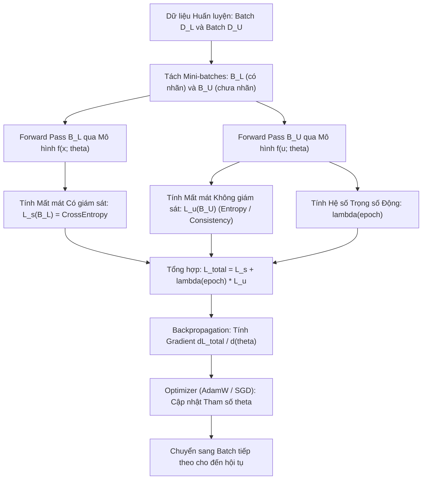

# Chiến lược Huấn luyện trong Học bán giám sát (Training Strategies & Loss Formulations)

## Purpose

Trong Học có giám sát, mục tiêu huấn luyện chỉ đơn giản là tối thiểu hóa hàm mất mát thực nghiệm (Empirical Risk) trên tập dữ liệu có nhãn. Tuy nhiên, trong **Học bán giám sát (Semi-Supervised Learning)**, mô hình phải đối mặt với một bài toán tối ưu hóa đa mục tiêu: vừa phải khớp tốt với tập nhãn chuẩn ít ỏi $`D_L`$, vừa phải khai thác các đặc tính hình học và cấu trúc phân phối của tập chưa nhãn khổng lồ $`D_U`$.

Tài liệu này hệ thống hóa các chiến lược huấn luyện cốt lõi:
1. **Thiết lập Hàm Mất mát Hỗn hợp (Joint Loss Formulation):** Cân bằng giữa thành phần Mất mát Có giám sát ($`\mathcal{L}_s`$) và thành phần Mất mát Không giám sát ($`\mathcal{L}_u`$) thông qua hệ số đánh đổi linh hoạt $`\lambda(t)`$.
2. **Chiến lược Lịch trình Tăng Trọng số (Weight Ramp-up Schedule):** Tại sao trong các epoch đầu tiên, ta bắt buộc phải đặt $`\lambda = 0`$ (giai đoạn Khởi động - Warm-up Phase), và chỉ tăng dần $`\lambda`$ theo thời gian? Kỹ thuật này ngăn chặn hiện tượng mô hình chưa học chuẩn các nhãn thật đã vội vã đưa các giả nhãn sai lệch vào làm hỏng toàn bộ không gian tham số.
3. **Chính quy hóa Tối thiểu hóa Entropy (Entropy Minimization):** Cưỡng ép mô hình đưa ra các dự đoán dứt khoát trên dữ liệu chưa nhãn, gián tiếp đẩy ranh giới quyết định ra xa khỏi các vùng mật độ cao. [1][2]

---

## Input

Dữ liệu và cấu hình phục vụ hàm mất mát trong quá trình huấn luyện:

1. **Các Batch Dữ liệu Hỗn hợp (Mixed Mini-batches):**
   * Batch có nhãn: $`B_L = \lbrace (x_i, y_i) \rbrace_{i=1}^{B_l} \subset D_L`$.
   * Batch chưa nhãn: $`B_U = \lbrace u_j \rbrace_{j=1}^{B_u} \subset D_U`$.
   * Thông thường trong Deep Learning bán giám sát, tỷ lệ batch $`\mu = \frac{B_u}{B_l}`$ được chọn từ $`1`$ đến $`7`$ (số lượng mẫu chưa nhãn trong mỗi mini-batch gấp nhiều lần mẫu có nhãn).
2. **Hàm Mất mát Có Giám sát Cơ sở ($`\mathcal{L}_s`$):**
   * Ví dụ: Hàm Cross-Entropy cho bài toán phân loại, hoặc hàm Mean Squared Error (MSE) cho bài toán hồi quy.
3. **Cấu hình Lịch trình Tăng trọng số ($`\lambda(t)`$):**
   * Ngưỡng trọng số tối đa $`\lambda_{\max}`$ và độ dài giai đoạn khởi động $`T_{\text{warmup}}`$ (tính bằng số epoch hoặc số bước lặp steps).

---

## Output

Kết quả sinh ra sau các vòng lặp tối ưu hóa:

1. **Bộ Tham số Mô hình Hội tụ ($`\theta^{\ast}`$):**
   * Trọng số mạng neuron hoặc hệ số mô hình đã được tối ưu hóa cân bằng giữa hai không gian dữ liệu:

$$
\theta^{\ast} = \arg\min_{\theta} \mathcal{L}_{\text{total}}(\theta)
$$

2. **Lịch sử Biến thiên của Các Hàm Mất mát (Loss Trajectory):**
   * Đường cong hội tụ độc lập của $`\mathcal{L}_s`$ và $`\mathcal{L}_u`$ qua từng epoch, giúp kỹ sư phát hiện hiện tượng bão hòa hoặc sụp đổ mô hình.
3. **Phân phối Xác suất Dự đoán trên Tập Chưa Nhãn:**
   * Ma trận xác suất $`P(y \mid u_j; \theta)`$ thể hiện mức độ tự tin tăng dần của mô hình trên dữ liệu $`D_U`$.

---

## Evaluation metrics

Các thước đo theo dõi sức khỏe của mô hình trong suốt quá trình train:

1. **Tỷ lệ Mẫu Chưa Nhãn Vượt Ngưỡng Tin cậy (Pseudo-Label Utilization Rate):**
   * Tỷ lệ phần trăm các mẫu trong $`D_U`$ có xác suất dự đoán cực đại vượt ngưỡng tin cậy $`\tau`$ (ví dụ $`\tau = 0.95`$):

$$
\text{Utilization}(t) = \frac{1}{|D_U|} \sum_{u_j \in D_U} \mathbb{I}\left( \max_{c} P(y=c \mid u_j) \ge \tau \right)
$$

   * Nếu chỉ số này tăng từ $`5\%`$ ở epoch đầu lên $`80\%`$ ở các epoch cuối, chứng tỏ mô hình đang tự tin lan truyền nhãn thành công.
2. **Hàm Mất mát Kết hợp Tổng thể ($`\mathcal{L}_{\text{total}}`$):**
   * Giá trị hàm mất mát tổng hợp phải giảm đơn điệu và hội tụ ổn định.
3. **Độ chính xác trên Tập Validation Giữ Riêng (Validation Accuracy):**
   * Đo lường sau mỗi epoch để thực hiện Early Stopping, tránh trường hợp mô hình quá tự tin vào các giả nhãn sai lệch.

---

## How it works

### 1. Cấu trúc Toán học của Hàm Mất mát Hỗn hợp

Hàm mục tiêu tổng quát trong Học bán giám sát luôn có dạng:

$$
\mathcal{L}_{\text{total}}(\theta) = \mathcal{L}_s(D_L; \theta) + \lambda(t) \cdot \mathcal{L}_u(D_U; \theta) + \mathcal{R}(\theta)
$$

Trong đó:
* $`\mathcal{L}_s(D_L; \theta)`$: Mất mát có giám sát chuẩn trên tập có nhãn (Supervised Loss), ví dụ Cross-Entropy:

$$
\mathcal{L}_s = -\frac{1}{n_l} \sum_{i=1}^{n_l} \sum_{c=1}^C y_{ic} \ln P(y=c \mid x_i; \theta)
$$

* $`\mathcal{L}_u(D_U; \theta)`$: Mất mát không giám sát trên tập chưa nhãn (Unsupervised / Regularization Loss), dẫn dắt mô hình khai thác cấu trúc của $`D_U`$.
* $`\lambda(t) \ge 0`$: Hệ số cân bằng động biến thiên theo bước lặp $`t`$.
* $`\mathcal{R}(\theta)`$: Ràng buộc chuẩn hóa trọng số (L2 weight decay) để kiểm soát độ phức tạp.

---

### 2. Các Dạng Mất mát Không Giám Sát Phổ Biến ($`\mathcal{L}_u`$)

#### A. Ràng buộc Tối thiểu hóa Entropy (Entropy Regularization - Grandvalet & Bengio, 2004)
Theo giả định ranh giới mật độ thấp (Low-Density Separation), mô hình không nên đưa ra các dự đoán lưỡng lự (xác suất 50-50) trên các điểm dữ liệu chưa nhãn. Do đó, ta phạt các dự đoán có độ hỗn loạn (Entropy) cao:

$$
\mathcal{L}_u^{\text{entropy}} = -\frac{1}{n_u} \sum_{j=1}^{n_u} \sum_{c=1}^C P(y=c \mid u_j; \theta) \ln P(y=c \mid u_j; \theta)
$$

Tối thiểu hóa Entropy sẽ ép phân phối xác suất đầu ra dốc đứng về một lớp ($`P \to 1`$ hoặc $`P \to 0`$), gián tiếp đẩy ranh giới quyết định ra xa khỏi các cụm dữ liệu dày đặc.

#### B. Mất mát Giả nhãn có Ngưỡng Lọc (Thresholded Pseudo-label Loss - Lee, 2013)
Mô hình tự tạo nhãn cứng $`\hat{y}_j = \arg\max_c P(y=c \mid u_j)`$ nếu độ tự tin vượt ngưỡng $`\tau`$:

$$
\mathcal{L}_u^{\text{pseudo}} = \frac{1}{n_u} \sum_{j=1}^{n_u} \mathbb{I}\left( \max_c P(y=c \mid u_j) \ge \tau \right) \text{CE}\left( \hat{y}_j, P(y \mid u_j; \theta) \right)
$$

#### C. Mất mát Ràng buộc Nhất quán (Consistency Regularization Loss)
Ép mô hình đưa ra cùng dự đoán cho hai biến thể nhiễu ngẫu nhiên khác nhau của cùng một điểm chưa nhãn (ví dụ phép xoay ảnh, cắt xén, hoặc Dropout):

$$
\mathcal{L}_u^{\text{consistency}} = \frac{1}{n_u} \sum_{j=1}^{n_u} \|f(u_j; \theta) - f(\text{Augment}(u_j); \theta)\|^2
$$

---

### 3. Chiến lược Lịch trình Tăng Trọng số (Ramp-up Schedules)

Nếu ta đặt $`\lambda`$ là một hằng số lớn ngay từ epoch 0, mô hình chưa kịp học đúng các đặc trưng từ $`D_L`$ đã đưa ra các giả nhãn ngẫu nhiên trên $`D_U`$. Khi đó $`\mathcal{L}_u`$ sẽ khuếch đại các dự đoán sai này, dẫn đến hiện tượng **Confirmation Bias (Tự huyễn hoặc sai số)** và sụp đổ hoàn toàn.

Quy tắc bắt buộc là phải áp dụng hàm tăng trọng số mượt mà:

```text
Trọng số lambda(t)
   ▲
   │                              ──────────── Giá trị trần lambda_max
   │                           .-'
   │                        .-'
   │                     .-'   (Giai đoạn tăng dần Ramp-up)
   │                  .-'
   │  ───────────────'
   └─────────────────────────────────────────> Số Epoch / Steps
      [ Warm-up: 0 ]    [ T_rampup ]
```

Hai hàm lịch trình phổ biến nhất:
1. **Lịch trình Sigmoid Ramp-up (Laine & Aila, 2017):**

$$
\lambda(t) = \lambda_{\max} \cdot \exp\left( -5 \left( 1 - \frac{t}{T_{\text{ramp}}} \right)^2 \right), \quad \text{với } t \le T_{\text{ramp}}
$$

2. **Lịch trình Tuyến tính Từng đoạn (Linear Piecewise Ramp-up):**

$$
\lambda(t) = \lambda_{\max} \cdot \min\left( 1.0, \; \frac{t}{T_{\text{ramp}}} \right)
$$

---

## Data used

Chiến lược huấn luyện kết hợp mất mát được áp dụng rộng rãi trong:

1. **Huấn luyện Mô hình Thị giác Bán giám sát (Vision SSL):**
   * Huấn luyện mạng ResNet hoặc Vision Transformer trên tập ảnh ImageNet chỉ với 1% nhãn thật. Giai đoạn Warm-up kéo dài 10 epoch đầu tiên để mạng nhận diện các đường nét cơ bản trước khi kích hoạt Consistency Loss.
2. **Xử lý Ngôn ngữ Tự nhiên (NLP & Text SSL):**
   * Tinh chỉnh các mô hình ngôn ngữ (BERT/RoBERTa) cho bài toán phân loại sắc thái văn bản với tập nhãn nhỏ. Sử dụng Entropy Regularization để làm sắc nét ranh giới phân loại giữa tích cực và tiêu cực.

---

## Design

### 1. Sơ đồ Luồng Thực Thi Huấn Luyện Bán Giám Sát Đa Mục Tiêu



---

### 2. Mã nguồn Kỹ thuật Minh họa Lịch trình Trọng số và Huấn luyện Bán giám sát

```python
import numpy as np
import matplotlib.pyplot as plt

class SemiSupervisedWeightScheduler:
    """
    Bộ điều phối lịch trình tăng trọng số lambda(t) trong huấn luyện Bán giám sát.
    Hỗ trợ cơ chế Sigmoid Ramp-up và Linear Ramp-up chuẩn học thuật.
    """
    def __init__(self, lambda_max=1.0, rampup_epochs=40, schedule_type='sigmoid'):
        self.lambda_max = lambda_max
        self.rampup_epochs = rampup_epochs
        self.schedule_type = schedule_type

    def get_weight(self, current_epoch):
        if current_epoch >= self.rampup_epochs:
            return self.lambda_max

        # Tỷ lệ tiến độ từ 0.0 đến 1.0
        progress = current_epoch / self.rampup_epochs

        if self.schedule_type == 'sigmoid':
            # Công thức chuẩn của Laine & Aila (2017)
            return self.lambda_max * np.exp(-5.0 * (1.0 - progress) ** 2)
        elif self.schedule_type == 'linear':
            return self.lambda_max * progress
        else:
            return self.lambda_max

# ==========================================
# THỬ NGHIỆM ĐỒ THỊ BIẾN THIÊN CỦA TRỌNG SỐ
# ==========================================
scheduler_sigmoid = SemiSupervisedWeightScheduler(lambda_max=2.0, rampup_epochs=50, schedule_type='sigmoid')
scheduler_linear = SemiSupervisedWeightScheduler(lambda_max=2.0, rampup_epochs=50, schedule_type='linear')

epochs = np.arange(0, 80)
weights_sigmoid = [scheduler_sigmoid.get_weight(ep) for ep in epochs]
weights_linear = [scheduler_linear.get_weight(ep) for ep in epochs]

print("Mô phỏng giá trị trọng số lambda tại các mốc huấn luyện:")
print(f"Epoch 0  (Warm-up):  Sigmoid = {weights_sigmoid[0]:.4f} | Linear = {weights_linear[0]:.4f}")
print(f"Epoch 25 (Giữa kỳ):  Sigmoid = {weights_sigmoid[25]:.4f} | Linear = {weights_linear[25]:.4f}")
print(f"Epoch 50 (Hoàn tất): Sigmoid = {weights_sigmoid[50]:.4f} | Linear = {weights_linear[50]:.4f}")
print(f"Epoch 75 (Bão hòa):  Sigmoid = {weights_sigmoid[75]:.4f} | Linear = {weights_linear[75]:.4f}")
```

---

## Nguồn

- [1] Grandvalet, Y., & Bengio, Y. (2004). *Semi-supervised learning by entropy minimization*. Advances in Neural Information Processing Systems (NeurIPS), 17, 529-536.
- [2] Laine, S., & Aila, T. (2017). *Temporal Ensembling for Semi-Supervised Learning*. International Conference on Learning Representations (ICLR).
- [3] Lee, D. H. (2013). *Pseudo-label: The simple and efficient semi-supervised learning method for deep neural networks*. Workshop on Challenges in Representation Learning, ICML.
- [4] Sohn, K. et al. (2020). *FixMatch: Simplifying Semi-Supervised Learning with Consistency and Confidence*. Advances in Neural Information Processing Systems (NeurIPS), 33, 596-608.

