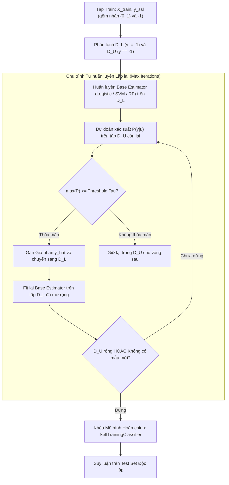

# Tự huấn luyện và Kỹ thuật Giả nhãn (Self-Training & Pseudo-Labeling)

## Purpose

Trong các phương pháp Học bán giám sát, **Tự huấn luyện (Self-Training)** — còn được biết đến với tên gọi **Kỹ thuật Giả nhãn (Pseudo-Labeling)** — là giải pháp có lịch sử lâu đời nhất (Scudder, 1965; Yarowsky, 1995), trực quan nhất và được ứng dụng rộng rãi nhất trong thực tế công nghiệp.

Self-Training thuộc nhóm **Phương pháp Đóng gói (Wrapper Method)**: nó hoàn toàn độc lập với cấu trúc của thuật toán phân loại bên dưới. Bạn có thể sử dụng bất kỳ bộ phân loại có giám sát tiêu chuẩn nào (như Logistic Regression, Support Vector Machine, Random Forest, XGBoost hay Mạng Deep Neural Network) làm bộ phân loại cơ sở (Base Estimator).

Quy trình vận hành trực giác:
1. Huấn luyện mô hình ban đầu trên tập nhãn nhỏ $`D_L`$.
2. Dùng mô hình này để dự đoán phân phối xác suất trên toàn bộ tập dữ liệu chưa có nhãn $`D_U`$.
3. Chọn lọc các mẫu có độ tự tin cao nhất (vượt qua một ngưỡng khắt khe $`\tau`$) để gán **Giả nhãn (Pseudo-labels)**.
4. Bổ sung các mẫu vừa được gắn giả nhãn vào tập huấn luyện và huấn luyện lại mô hình từ đầu.
5. Lặp lại chu kỳ này cho đến khi không còn mẫu nào thỏa mãn điều kiện hoặc toàn bộ $`D_U`$ đã được gán nhãn. [1][2]

---

## Input

Dữ liệu đầu vào và các siêu tham số cấu hình cho thuật toán Self-Training:

1. **Tập dữ liệu Huấn luyện Ban đầu:**
   * Tập có nhãn thật: $`D_L = \lbrace (x_i, y_i) \rbrace_{i=1}^{n_l}`$.
   * Tập chưa có nhãn: $`D_U = \lbrace u_j \rbrace_{j=1}^{n_u}`$ (được gán nhãn đại diện là $`-1`$).
2. **Bộ phân loại Cơ sở (`base_estimator`):**
   * Bắt buộc phải là một estimator có khả năng xuất ra xác suất dự đoán (có phương thức `predict_proba()` hoặc `decision_function()`).
3. **Tiêu chuẩn Chọn lọc Giả nhãn (`criterion` và `threshold`):**
   * `criterion='threshold'`: Chỉ kết nạp các mẫu chưa nhãn có xác suất dự đoán cực đại vượt ngưỡng $`\tau \in (0, 1)`$ (thường chọn $`\tau = 0.80 \sim 0.95`$):

$$
\max_{c \in \lbrace 1, \dots, C \rbrace} P(y=c \mid u_j) \ge \tau
$$

   * `criterion='k_best'`: Trong mỗi vòng lặp, chỉ chọn đúng $`k`$ mẫu có xác suất dự đoán cao nhất để kết nạp, bất kể giá trị xác suất tuyệt đối là bao nhiêu.
4. **Số vòng lặp tối đa (`max_iter`):**
   * Giới hạn số chu kỳ tự huấn luyện lặp lại (thường chọn từ 10 đến 50 vòng lặp).

---

## Output

Kết quả đầu ra của thuật toán Self-Training:

1. **Bộ Phân loại Cuối cùng Đã Huấn luyện Hoàn chỉnh:**
   * Đối tượng mô hình đã được fit trên tập dữ liệu mở rộng bao gồm cả nhãn thật $`D_L`$ và các giả nhãn tin cậy nhất từ $`D_U`$.
2. **Tập Dữ liệu Giả nhãn Đã Kết nạp (Pseudo-labeled Pool):**
   * Tập hợp các cặp $`\lbrace (u_j, \hat{y}_j) \rbrace`$ kèm theo mức độ tự tin xác suất tại thời điểm được mô hình kết nạp.
3. **Số vòng lặp thực tế đã thực hiện:**
   * Thuật toán tự động dừng sớm nếu trong một vòng lặp không có thêm bất kỳ mẫu nào từ $`D_U`$ vượt qua ngưỡng tin cậy $`\tau`$.

---

## Evaluation metrics

Đánh giá chất lượng của thuật toán Self-Training:

1. **Độ Chính xác của Giả nhãn (Pseudo-Label Precision):**
   * Tỷ lệ phần trăm các giả nhãn do mô hình tự gán trên $`D_U`$ trùng khớp với nhãn thực tế bị ẩn đi:

$$
\text{Precision}_{\text{pseudo}} = \frac{\sum_{j \in D_{\text{pseudo}}} \mathbb{I}(\hat{y}_j = y_j^*)}{|D_{\text{pseudo}}|}
$$

   * **Chỉ số Sống còn:** Nếu $`\text{Precision}_{\text{pseudo}} < 85\%`$, các nhãn rác sẽ xâm nhập vào tập train và phá hỏng ranh giới quyết định.
2. **Mức Tăng trưởng F1-Score / Accuracy ($`\Delta`$):**
   * So sánh hiệu năng của mô hình Self-Training so với mô hình cơ sở khi chỉ huấn luyện trên $`D_L`$.
3. **Tỷ lệ Kết nạp Giả nhãn (Acceptance Rate):**
   * Tỷ lệ số lượng mẫu từ $`D_U`$ được chuyển đổi thành công thành dữ liệu có nhãn: $`\frac{|D_{\text{pseudo}}|}{|D_U|}`$.

---

## How it works

### 1. Thuật toán Self-Training Từng bước Chi tiết

```text
┌─────────────────────────────────────────────────────────────┐
│ 1. Khởi tạo: D_L^(0) = D_L, D_U^(0) = D_U, Vòng lặp t = 0   │
└──────────────────────────────┬──────────────────────────────┘
                               │
                               ▼
┌─────────────────────────────────────────────────────────────┐
│ 2. Huấn luyện Mô hình Cơ sở f_t trên tập D_L^(t)            │
└──────────────────────────────┬──────────────────────────────┘
                               │
                               ▼
┌─────────────────────────────────────────────────────────────┐
│ 3. Dự đoán Xác suất P(y | u) cho mọi u thuộc D_U^(t)        │
└──────────────────────────────┬──────────────────────────────┘
                               │
                               ▼
┌─────────────────────────────────────────────────────────────┐
│ 4. Lọc Tập Ứng viên Tin cậy:                                │
│    U_cand = { u in D_U^(t) | max_c P(y=c|u) >= Tau }        │
│    Gán Giả nhãn: y_hat = argmax_c P(y=c|u)                  │
└──────────────────────────────┬──────────────────────────────┘
                               │
                               ▼
                     /───────────────────\
                    <   |U_cand| == 0 ?   >
                     \───────────────────/
                       │ No          │ Yes (Không còn mẫu tin cậy)
                       │             ▼
                       │      [ Dừng Thuật toán ]
                       ▼
┌─────────────────────────────────────────────────────────────┐
│ 5. Cập nhật Tập Dữ liệu:                                    │
│    D_L^(t+1) = D_L^(t) U { (u, y_hat) | u in U_cand }       │
│    D_U^(t+1) = D_U^(t) \ U_cand                             │
│    Tăng t = t + 1 và quay lại Bước 2                        │
└─────────────────────────────────────────────────────────────┘
```

---

### 2. Vấn đề Cốt tử: Thiên lệch Xác nhận (Confirmation Bias) và Lan truyền Sai số

Thách thức lớn nhất đe dọa sự thành bại của Self-Training là hiện tượng **Thiên lệch Xác nhận (Confirmation Bias)**:
* Khi mô hình cơ sở $`f_t`$ đưa ra một dự đoán sai với độ tự tin giả tạo cao (Overconfident Wrong Prediction) trên một mẫu chưa nhãn $`u_j`$, mẫu này lập tức bị gắn giả nhãn sai và nạp ngược lại vào tập huấn luyện $`D_L^{(t+1)}`$.
* Ở vòng lặp tiếp theo, mô hình $`f_{t+1}`$ bị buộc phải ghi nhớ mẫu sai này, khiến ranh giới quyết định bị bẻ cong sai lệch. Quá trình này tạo nên một vòng xoáy tiêu cực tích lũy sai số (**Error Propagation Loop**), làm cho mô hình ngày càng tự tin vào các quyết định sai lầm của chính nó.

#### Ba Cơ chế Phòng thủ Chống Confirmation Bias:
1. **Thiết lập Ngưỡng Tin cậy Rất Cao ($`\tau \ge 0.90`$):** Chỉ kết nạp các mẫu mà mô hình gần như chắc chắn tuyệt đối. Thà bỏ sót mẫu chưa nhãn còn hơn kết nạp mẫu sai.
2. **Điều chỉnh Ngưỡng Động theo Từng Lớp (Class-Adaptive Thresholding):** Nếu một lớp khó học có mức xác suất trung bình thấp hơn các lớp khác, ngưỡng $`\tau_c`$ của lớp đó được điều chỉnh hạ thấp tương ứng để tránh hiện tượng mô hình chỉ toàn kết nạp giả nhãn của lớp dễ học.
3. **Làm Mềm Giả Nhãn (Soft Pseudo-Labels / Label Smoothing):** Thay vì gán nhãn One-hot cứng $`[1, 0]`$, ta gán phân phối xác suất mềm $`[0.9, 0.1]`$ để giảm hình phạt nếu nhãn bị gán sai.

---

## Data used

Self-Training được triển khai rộng rãi trong các kịch bản thực tiễn sau:

1. **Phân loại Văn bản và Báo chí (Document Classification):**
   * Phân loại hàng triệu bài báo vào các chuyên mục (Kinh tế, Thể thao, Công nghệ). Bắt đầu với chỉ 20 bài báo mẫu cho mỗi chuyên mục, Self-Training mở rộng thành công lên hàng chục nghìn bài báo được gắn nhãn tự động với độ chính xác trên 90%.
2. **Khai phá Dữ liệu Y sinh (Biomedical Data Mining):**
   * Dự đoán chức năng của protein hoặc phân loại tương tác thuốc-mục tiêu nơi các thí nghiệm trong phòng lab rất tốn kém.
3. **Nhận dạng Thực thể Tên riêng (Named Entity Recognition - NER):**
   * Mở rộng từ điển thực thể (tên thuốc, tên bệnh, tên công ty) từ các văn bản chưa có cấu trúc.

---

## Design

### 1. Kiến trúc Pipeline Self-Training với Scikit-learn



---

### 2. Mã nguồn Triển khai Thực hành Chuẩn mực với Scikit-learn

```python
import numpy as np
from sklearn.datasets import load_breast_cancer
from sklearn.model_selection import train_test_split
from sklearn.preprocessing import StandardScaler
from sklearn.semi_supervised import SelfTrainingClassifier
from sklearn.ensemble import RandomForestClassifier
from sklearn.metrics import classification_report, accuracy_score

# 1. Tải tập dữ liệu y sinh Breast Cancer Wisconsin
X_raw, y_true = load_breast_cancer(return_X_y=True)
scaler = StandardScaler()
X = scaler.fit_transform(X_raw)

# 2. Phân chia tập Train (80%) và Test độc lập (20%)
X_train, X_test, y_train_full, y_test = train_test_split(
    X, y_true, test_size=0.20, stratify=y_true, random_state=42
)

# 3. Giả lập kịch bản nhãn cực hiếm: Chỉ giữ lại 8% nhãn thật (khoảng 36 mẫu)
np.random.seed(42)
label_ratio = 0.08
n_train = len(y_train_full)

y_train_ssl = np.full(n_train, fill_value=-1)
for c in np.unique(y_train_full):
    c_indices = np.where(y_train_full == c)[0]
    n_keep = max(2, int(len(c_indices) * label_ratio))
    chosen = np.random.choice(c_indices, size=n_keep, replace=False)
    y_train_ssl[chosen] = y_train_full[chosen]

n_labeled_initial = np.sum(y_train_ssl != -1)
print(f"Tổng số mẫu train: {n_train}")
print(f"Số mẫu có nhãn ban đầu (D_L): {n_labeled_initial} ({n_labeled_initial/n_train*100:.1f}%)")
print(f"Số mẫu chưa nhãn (D_U, nhãn = -1): {np.sum(y_train_ssl == -1)}")

# 4. Huấn luyện Baseline Có Giám sát Thuần túy (Chỉ fit trên D_L)
base_clf = RandomForestClassifier(n_estimators=100, max_depth=5, random_state=42)
mask_labeled = y_train_ssl != -1
base_clf.fit(X_train[mask_labeled], y_train_ssl[mask_labeled])

acc_base = accuracy_score(y_test, base_clf.predict(X_test))
print(f"\n[Baseline] Độ chính xác khi CHỈ học trên {n_labeled_initial} mẫu nhãn: {acc_base*100:.2f}%")

# 5. Huấn luyện Mô hình Bán Giám sát Self-Training
# threshold: xác suất tối thiểu để kết nạp giả nhãn (0.85)
# max_iter: tối đa 20 vòng lặp
self_training_model = SelfTrainingClassifier(
    base_estimator=RandomForestClassifier(n_estimators=100, max_depth=5, random_state=42),
    threshold=0.85,
    criterion='threshold',
    max_iter=20,
    verbose=True
)

self_training_model.fit(X_train, y_train_ssl)

# 6. Đánh giá Kết quả trên Test Set Độc lập
y_pred_ssl = self_training_model.predict(X_test)
acc_ssl = accuracy_score(y_test, y_pred_ssl)

print(f"\n[Self-Training] Độ chính xác sau khi kết hợp dữ liệu chưa nhãn: {acc_ssl*100:.2f}%")
print(f"=> Mức tăng trưởng hiệu năng Delta: {(acc_ssl - acc_base)*100:+.2f}%")
print(f"Số vòng lặp thực hiện: {self_training_model.n_iter_}")
print(f"Số lượng mẫu chưa nhãn được kết nạp thành công: {np.sum(self_training_model.transduction_ != -1) - n_labeled_initial}")
```

---

## Nguồn

- [1] Scudder, H. (1965). *Probability of error of adaptive uncommitted mature learning machines*. IEEE Transactions on Information Theory, 11(3), 363-371.
- [2] Yarowsky, D. (1995). *Unsupervised word sense disambiguation rivaling supervised methods*. 33rd Annual Meeting of the Association for Computational Linguistics (ACL), 189-196.
- [3] Lee, D. H. (2013). *Pseudo-label: The simple and efficient semi-supervised learning method for deep neural networks*. ICML Workshop on Challenges in Representation Learning.
- [4] [scikit-learn Documentation: Self-training classifier](https://scikit-learn.org/stable/modules/generated/sklearn.semi_supervised.SelfTrainingClassifier.html).

