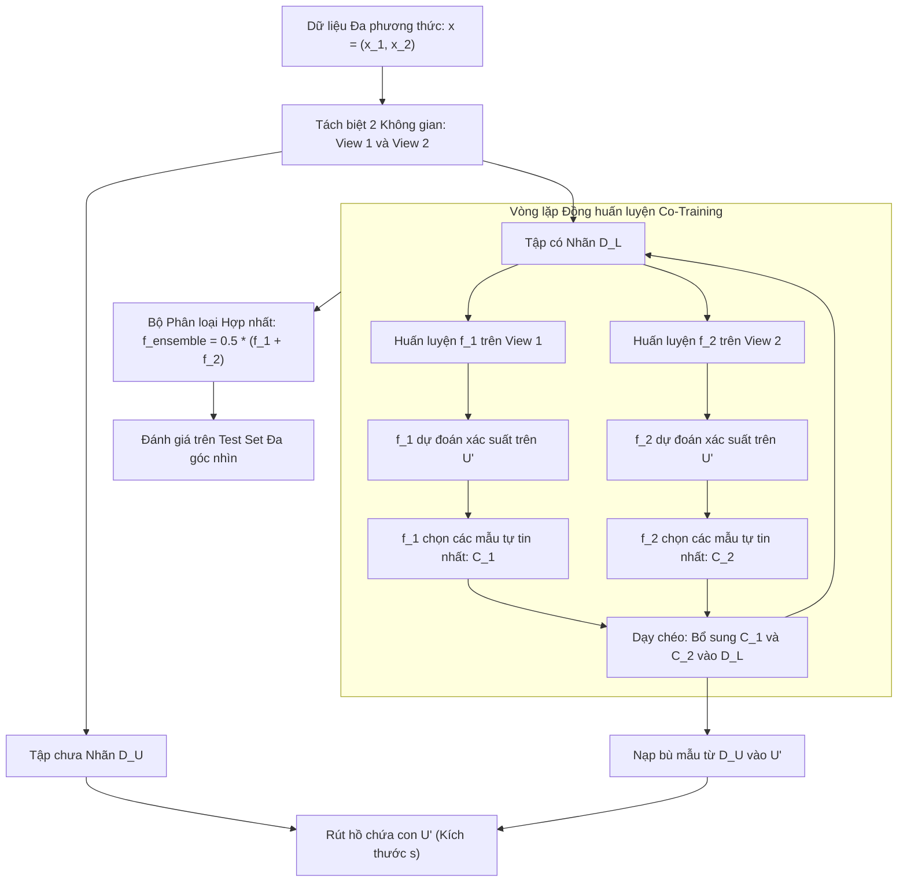

# Đồng huấn luyện Đa góc nhìn (Co-Training & Multi-View Learning)

## Purpose

Trong phương pháp Tự huấn luyện (Self-Training), mô hình tự tạo giả nhãn và tự học lại từ chính những dự đoán của mình. Điều này dẫn đến nguy cơ rất lớn: nếu mô hình mắc sai lầm, sai lầm đó sẽ được củng cố và khuếch đại ở các vòng lặp tiếp theo mà không có bất kỳ cơ chế kiểm chứng độc lập nào.

**Đồng huấn luyện (Co-Training - Blum & Mitchell, 1998)** giải quyết triệt để điểm yếu này bằng cách khai thác tính chất **Đa góc nhìn (Multi-View)** của dữ liệu:
1. **Phân tách Đặc trưng thành Hai Góc nhìn Độc lập:** Tập đặc trưng của mỗi mẫu được chia thành hai tập con $`X = (X^{(1)}, X^{(2)})`$. Mỗi góc nhìn tự thân nó đã đủ mạnh để huấn luyện một bộ phân loại tốt, nhưng hai góc nhìn lại độc lập có điều kiện với nhau khi biết trước nhãn.
2. **Cơ chế Dạy chéo Lẫn nhau (Cross-Teaching):** Huấn luyện đồng thời hai bộ phân loại $`f_1`$ (trên góc nhìn 1) và $`f_2`$ (trên góc nhìn 2). Tại mỗi vòng lặp, mỗi mô hình sẽ dự đoán trên tập chưa nhãn $`D_U`$, chọn ra các mẫu mà nó tự tin nhất để gắn giả nhãn, và bổ sung các mẫu này làm dữ liệu huấn luyện cho mô hình còn lại.
3. **Phá vỡ Vòng xoáy Thiên lệch:** Một mẫu có thể rất khó phân loại đối với góc nhìn 1 nhưng lại cực kỳ rõ ràng đối với góc nhìn 2. Nhờ đó, hai mô hình liên tục cung cấp cho nhau những thông tin mới mẻ, bổ ích mà bản thân mỗi mô hình không thể tự nhận biết. [1][2]

---

## Input

Dữ liệu đầu vào và các điều kiện bắt buộc của thuật toán Co-Training:

1. **Cấu trúc Dữ liệu Đa góc nhìn (Two Sufficient and Redundant Views):**
   * Mỗi quan sát $`x_i`$ được phân rã thành hai vector đặc trưng:

$$
x_i = (x_i^{(1)}, x_i^{(2)}) \quad \text{với } x_i^{(1)} \in \mathbb{R}^{p_1}, \; x_i^{(2)} \in \mathbb{R}^{p_2}
$$

   * **Giả định Đủ năng lực (Sufficiency Assumption):** Cả $`x^{(1)}`$ và $`x^{(2)}`$ đều chứa đủ lượng thông tin để dự đoán chính xác nhãn $`y`$.
   * **Giả định Độc lập có Điều kiện (Conditional Independence):**

$$
P(x^{(1)}, x^{(2)} \mid y) = P(x^{(1)} \mid y) \cdot P(x^{(2)} \mid y)
$$

2. **Tập Dữ liệu Huấn luyện Ban đầu:**
   * Tập nhãn hạt giống $`D_L = \lbrace (x_i^{(1)}, x_i^{(2)}, y_i) \rbrace_{i=1}^{n_l}`$.
   * Tập chưa nhãn dồi dào $`D_U = \lbrace (u_j^{(1)}, u_j^{(2)}) \rbrace_{j=1}^{n_u}`$.
3. **Hồ chứa Mẫu Ứng viên (Unlabeled Sample Pool - $`U'`$):**
   * Kích thước hồ con $`s`$ (ví dụ: $`s = 75`$ mẫu). Thay vì duyệt toàn bộ $`D_U`$, thuật toán rút ngẫu nhiên $`s`$ mẫu vào hồ chứa $`U'`$ để giảm thiểu chi phí tính toán và tránh làm mất cân bằng phân bổ nhãn quá nhanh.
4. **Hạn mức Kết nạp mỗi Vòng ($`p_{\text{add}}`$ mẫu dương, $`n_{\text{add}}`$ mẫu âm):**
   * Số lượng mẫu có độ tin cậy cao nhất của từng lớp mà mỗi bộ phân loại được phép đóng góp cho đối phương trong mỗi chu kỳ (ví dụ: 1 mẫu dương và 3 mẫu âm để giữ nguyên tỷ lệ lớp gốc).

---

## Output

Kết quả đầu ra của thuật toán Co-Training:

1. **Cặp Bộ Phân loại Đã Đồng Huấn luyện ($`f_1^*, f_2^*`$):**
   * $`f_1^*`$ hoạt động trên không gian đặc trưng của góc nhìn 1 ($`\mathbb{R}^{p_1}`$).
   * $`f_2^*`$ hoạt động trên không gian đặc trưng của góc nhìn 2 ($`\mathbb{R}^{p_2}`$).
2. **Bộ Dự đoán Hợp nhất Cuối cùng (Ensemble Predictor):**
   * Dự đoán trên một mẫu mới $`x_{\text{new}} = (x_{\text{new}}^{(1)}, x_{\text{new}}^{(2)})`$ bằng cách kết hợp xác suất của cả hai mô hình:

$$
P(y=c \mid x_{\text{new}}) = P_1(y=c \mid x_{\text{new}}^{(1)}) \cdot P_2(y=c \mid x_{\text{new}}^{(2)})
$$

   * Hoặc nhãn cuối cùng được gán bằng trung bình cộng xác suất (Soft Voting):

$$
\hat{y}_{\text{new}} = \arg\max_{c} \left[ P_1(y=c \mid x_{\text{new}}^{(1)}) + P_2(y=c \mid x_{\text{new}}^{(2)}) \right]
$$

3. **Toàn bộ Dữ liệu Đã Được Gán Giả Nhãn Đầy Đủ:** Tập $`D_U`$ đã được chuyển đổi thành dữ liệu có nhãn với độ tin cậy cao.

---

## Evaluation metrics

Đánh giá tính hiệu quả của Co-Training:

1. **Mức Cải thiện Hiệu năng So sánh với Single-View Baseline:**
   * So sánh độ chính xác của bộ dự đoán hợp nhất $`f_1 + f_2`$ so với từng mô hình đơn lẻ khi chỉ học trên $`D_L`$.
2. **Mức độ Đồng thuận Giữa Hai Mô hình (Inter-Model Agreement):**
   * Tỷ lệ phần trăm các mẫu trong tập kiểm tra mà $`f_1`$ và $`f_2`$ đưa ra cùng một kết quả dự đoán:

$$
\text{Agreement} = \frac{1}{|D_{\text{test}}|} \sum_{x \in D_{\text{test}}} \mathbb{I}(f_1(x^{(1)}) = f_2(x^{(2)}))
$$

   * Giá trị Agreement càng cao chứng tỏ hai mô hình đã hội tụ về cùng một nhận thức quy luật thống nhất.
3. **Độ Tương quan Phần dư (Residual Correlation):**
   * Kiểm tra xem các lỗi sai của $`f_1`$ có bị trùng lặp với lỗi sai của $`f_2`$ hay không. Nếu hai mô hình cùng sai trên các mẫu giống nhau, giả định độc lập đã bị vi phạm.

---

## How it works

### 1. Thuật toán Co-Training Chuẩn Mực của Blum & Mitchell (1998)

```text
┌─────────────────────────────────────────────────────────────┐
│ 1. Khởi tạo: D_L^(0) = D_L, tạo hồ chứa nhỏ U' từ D_U        │
└──────────────────────────────┬──────────────────────────────┘
                               │
                               ▼
┌─────────────────────────────────────────────────────────────┐
│ 2. Huấn luyện f_1 trên View 1 và f_2 trên View 2 từ D_L^(t) │
└──────────────────────────────┬──────────────────────────────┘
                               │
                               ▼
┌─────────────────────────────────────────────────────────────┐
│ 3. Dự đoán trên hồ U':                                      │
│    - f_1 chọn p mẫu dương, n mẫu âm tự tin nhất -> P_1, N_1 │
│    - f_2 chọn p mẫu dương, n mẫu âm tự tin nhất -> P_2, N_2 │
└──────────────────────────────┬──────────────────────────────┘
                               │
                               ▼
┌─────────────────────────────────────────────────────────────┐
│ 4. Trao đổi Giả nhãn (Cross-Updating):                      │
│    D_L^(t+1) = D_L^(t) U P_1 U N_1 U P_2 U N_2              │
│    Loại bỏ các mẫu này khỏi U'                              │
└──────────────────────────────┬──────────────────────────────┘
                               │
                               ▼
┌─────────────────────────────────────────────────────────────┐
│ 5. Nạp bù ngẫu nhiên từ D_U vào U' để duy trì kích thước s   │
│    Lặp lại từ Bước 2 cho đến khi hết vòng lặp               │
└─────────────────────────────────────────────────────────────┘
```

---

### 2. Ví dụ Kinh điển: Phân loại Trang Web Học thuật (Web Page Classification)

Bài toán dẫn nhập lịch sử của Blum & Mitchell là phân loại xem một trang web có phải là "Trang chủ của Giảng viên (Faculty Home Page)" hay không:
* **Góc nhìn 1 ($`X^{(1)}`$ - Nội dung trang web):** Tần suất từ ngữ xuất hiện trực tiếp trên trang (ví dụ: các từ "publications", "research", "teaching", "curriculum vitae").
* **Góc nhìn 2 ($`X^{(2)}`$ - Văn bản neo của siêu liên kết / Anchor Text):** Các đoạn text trong đường link từ các trang web khác trỏ tới trang đó (ví dụ: sinh viên trỏ link với dòng chữ "Trang của GS. Smith", "My advisor's page").

#### Cơ chế Tương tác Học tập:
1. Mô hình $`f_1`$ (học nội dung) phân loại rất tốt các trang có từ ngữ học thuật rõ ràng, nhưng lúng túng khi gặp một trang chủ giảng viên viết rất ngắn gọn.
2. Mô hình $`f_2`$ (học anchor text) lại phát hiện ra trang ngắn gọn đó được hàng chục sinh viên gắn link là "my advisor". Mô hình $`f_2`$ tự tin gán nhãn trang này là "Faculty", tạo giả nhãn và chuyển cho $`f_1`$.
3. Mô hình $`f_1`$ học được mẫu mới này, từ đó khám phá thêm các từ vựng mới có trong trang ngắn gọn đó. Hai mô hình hỗ trợ nhau mở rộng tri thức.

---

## Data used

Co-Training phát huy sức mạnh vượt trội khi dữ liệu tự nhiên sở hữu nhiều nguồn thông tin đa phương thức (Multimodal Data):

1. **Phân loại Video Đa phương thức:**
   * Góc nhìn 1: Khung hình hình ảnh (Visual features).
   * Góc nhìn 2: Dải tín hiệu âm thanh và lời thoại (Audio & Transcript features).
2. **Y sinh và Chẩn đoán Đa chiều:**
   * Góc nhìn 1: Kết quả xét nghiệm sinh hóa máu.
   * Góc nhìn 2: Ảnh chụp cộng hưởng từ (MRI).
3. **Thương mại Điện tử và Khách hàng:**
   * Góc nhìn 1: Lịch sử hành vi clickstream duyệt web.
   * Góc nhìn 2: Lịch sử giao dịch thanh toán tài chính.
4. **Trường hợp Dữ liệu Chỉ có Một Góc nhìn Đơn nhất (Single-View Data):**
   * Nếu dữ liệu không có hai góc nhìn tự nhiên, kỹ sư có thể **chia ngẫu nhiên** tập đặc trưng $`p`$ chiều thành hai tập con $`p_1 + p_2 = p`$ (Random Subspacing Co-Training), hoặc sử dụng hai họ thuật toán phân loại hoàn toàn khác nhau (ví dụ: Random Forest kết hợp với SVM).

---

## Design

### 1. Kiến trúc Hệ thống Pipeline Đồng Huấn Luyện Đa Góc Nhìn



---

### 2. Mã nguồn Kỹ thuật Tự Triển Khai Co-Training với Scikit-learn

```python
import numpy as np
from sklearn.datasets import load_breast_cancer
from sklearn.model_selection import train_test_split
from sklearn.preprocessing import StandardScaler
from sklearn.linear_model import LogisticRegression
from sklearn.naive_bayes import GaussianNB
from sklearn.metrics import accuracy_score, f1_score

class CoTrainingClassifier:
    """
    Thuật toán Co-Training kinh điển theo Blum & Mitchell (1998).
    Hỗ trợ phân rã đặc trưng thành 2 góc nhìn độc lập (View 1 & View 2).
    """
    def __init__(self, clf1, clf2, p_add=1, n_add=3, pool_size=75, max_iter=20):
        self.clf1 = clf1
        self.clf2 = clf2
        self.p_add = p_add # Số mẫu dương bổ sung mỗi vòng
        self.n_add = n_add # Số mẫu âm bổ sung mỗi vòng
        self.pool_size = pool_size
        self.max_iter = max_iter

    def fit(self, X1_train, X2_train, y_train):
        # Xác định chỉ số các mẫu có nhãn và chưa nhãn ban đầu
        labeled_idx = np.where(y_train != -1)[0].tolist()
        unlabeled_idx = np.where(y_train == -1)[0].tolist()
        
        # Rút ngẫu nhiên một hồ chứa con U' từ tập chưa nhãn
        np.random.shuffle(unlabeled_idx)
        pool = unlabeled_idx[:min(len(unlabeled_idx), self.pool_size)]
        unlabeled_pool = unlabeled_idx[len(pool):]
        
        current_y = np.copy(y_train)

        for iteration in range(self.max_iter):
            if len(pool) == 0:
                break
                
            # 1. Huấn luyện 2 bộ phân loại độc lập trên tập có nhãn hiện tại
            X1_L = X1_train[labeled_idx]
            X2_L = X2_train[labeled_idx]
            y_L = current_y[labeled_idx]
            
            self.clf1.fit(X1_L, y_L)
            self.clf2.fit(X2_L, y_L)
            
            # 2. Dự đoán xác suất trên hồ chứa con U'
            probs1 = self.clf1.predict_proba(X1_train[pool])
            probs2 = self.clf2.predict_proba(X2_train[pool])
            
            # 3. Mỗi mô hình chọn ra các mẫu tự tin nhất
            # Lớp 1 (Dương tính) và Lớp 0 (Âm tính)
            p1_candidates = np.argsort(probs1[:, 1])[-self.p_add:]
            n1_candidates = np.argsort(probs1[:, 0])[-self.n_add:]
            
            p2_candidates = np.argsort(probs2[:, 1])[-self.p_add:]
            n2_candidates = np.argsort(probs2[:, 0])[-self.n_add:]
            
            # Gán giả nhãn cho các mẫu được chọn
            selected_by_1 = np.unique(np.concatenate([p1_candidates, n1_candidates]))
            selected_by_2 = np.unique(np.concatenate([p2_candidates, n2_candidates]))
            
            all_selected_in_pool = np.unique(np.concatenate([selected_by_1, selected_by_2]))
            
            for idx in p1_candidates:
                current_y[pool[idx]] = 1
            for idx in n1_candidates:
                current_y[pool[idx]] = 0
            for idx in p2_candidates:
                current_y[pool[idx]] = 1
            for idx in n2_candidates:
                current_y[pool[idx]] = 0
                
            # Chuyển các mẫu đã chọn từ pool sang tập có nhãn
            real_indices_selected = [pool[i] for i in all_selected_in_pool]
            labeled_idx.extend(real_indices_selected)
            
            # Loại bỏ khỏi pool
            pool = [pool[i] for i in range(len(pool)) if i not in all_selected_in_pool]
            
            # Nạp bù từ unlabeled_pool vào pool
            n_refill = min(len(unlabeled_pool), self.pool_size - len(pool))
            pool.extend(unlabeled_pool[:n_refill])
            unlabeled_pool = unlabeled_pool[n_refill:]

        # Huấn luyện lần cuối trên toàn bộ dữ liệu mở rộng
        self.clf1.fit(X1_train[labeled_idx], current_y[labeled_idx])
        self.clf2.fit(X2_train[labeled_idx], current_y[labeled_idx])
        return self

    def predict(self, X1, X2):
        # Kết hợp xác suất bằng Soft Voting
        p1 = self.clf1.predict_proba(X1)
        p2 = self.clf2.predict_proba(X2)
        return np.argmax(p1 + p2, axis=1)

# ==========================================
# THỬ NGHIỆM ĐỒNG HUẤN LUYỆN
# ==========================================
X_raw, y_true = load_breast_cancer(return_X_y=True)
scaler = StandardScaler()
X = scaler.fit_transform(X_raw)

# Phân rã nhân tạo thành 2 góc nhìn: 15 đặc trưng đầu (View 1) và 15 đặc trưng sau (View 2)
X1 = X[:, :15]
X2 = X[:, 15:]

# Tách tập Train (80%) và Test (20%)
X1_tr, X1_te, X2_tr, X2_te, y_tr, y_te = train_test_split(
    X1, X2, y_true, test_size=0.20, stratify=y_true, random_state=42
)

# Giả lập chỉ giữ 10% nhãn
n_train = len(y_tr)
y_ssl = np.full(n_train, -1)
labeled_indices = np.random.choice(n_train, size=int(0.10 * n_train), replace=False)
y_ssl[labeled_indices] = y_tr[labeled_indices]

# Huấn luyện Co-Training kết hợp LogisticRegression và GaussianNB
cotrain = CoTrainingClassifier(
    clf1=LogisticRegression(random_state=42),
    clf2=GaussianNB(),
    p_add=2, n_add=2, pool_size=50, max_iter=15
)
cotrain.fit(X1_tr, X2_tr, y_ssl)

# Đánh giá trên tập test
y_pred = cotrain.predict(X1_te, X2_te)
print(f"Độ chính xác Co-Training trên Test Set: {accuracy_score(y_te, y_pred)*100:.2f}%")
print(f"F1-Score Co-Training: {f1_score(y_te, y_pred):.4f}")
```

---

## Nguồn

- [1] Blum, A., & Mitchell, T. (1998). *Combining labeled and unlabeled data with co-training*. Proceedings of the Eleventh Annual Conference on Computational Learning Theory (COLT), 92-100.
- [2] Nigam, K., & Ghani, R. (2000). *Analyzing the effectiveness and applicability of co-training*. Proceedings of the Ninth International Conference on Information and Knowledge Management (CIKM), 86-93.
- [3] Balcan, M. F., Blum, A., & Yang, K. (2005). *Co-training and expansion properties of labeled and unlabeled data*. Journal of Computer and System Sciences, 71(4), 541-559.
