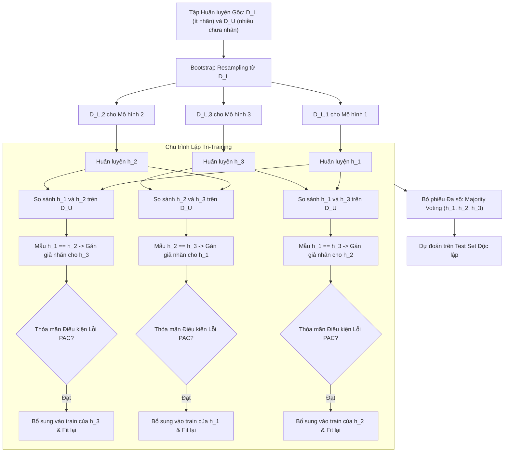

# Tri-Training và Đồng học Tập Dân chủ (Tri-Training & Democratic Co-Learning)

## Purpose

Mặc dù Co-Training là một giải pháp đồng huấn luyện xuất sắc, nó có một điểm nghẽn nghiêm trọng trong thực tiễn: **Đòi hỏi dữ liệu bắt buộc phải có hai góc nhìn độc lập tự nhiên (Multi-View Requirement)**. Trong đa số các bài toán kinh doanh thực tế (như dữ liệu bảng tài chính, bảng chỉ số y tế), toàn bộ các đặc trưng đều có sự đan xen chặt chẽ và không thể chia tách nhân tạo thành hai tập con thỏa mãn tính độc lập có điều kiện.

**Tri-Training (Zhou & Li, 2005)** là một bước đột phá học thuật giải quyết triệt để rào cản này:
1. **Không Yêu cầu Đa góc nhìn (Single-View Compatible):** Tri-Training hoạt động hoàn hảo trên một không gian đặc trưng duy nhất. Thuật toán tạo ra tính đa dạng (Diversity) giữa các mô hình thông qua kỹ thuật lấy mẫu tái lặp ngẫu nhiên (**Bootstrap Resampling / Bagging**).
2. **Quy tắc Đồng thuận Hai-trên-Một (Two-to-One Agreement Rule):** Tri-Training huấn luyện đồng thời 3 bộ phân loại độc lập $`h_1, h_2, h_3`$. Trong mỗi chu kỳ, nếu hai mô hình (ví dụ $`h_1`$ và $`h_2`$) cùng đồng thuận đưa ra một nhãn cho mẫu chưa nhãn $`u \in D_U`$, thì mẫu đó được coi là có độ tin cậy cao và được dùng làm giả nhãn để **bổ sung vào tập huấn luyện của mô hình thứ ba ($`h_3`$)**.
3. **Cơ chế Kiểm soát Sai số PAC (Probably Approximately Correct Bound):** Tri-Training không kết nạp giả nhãn một cách mù quáng. Thuật toán thiết lập một điều kiện toán học nghiêm ngặt: chỉ bổ sung dữ liệu mới cho mô hình $`h_i`$ nếu kích thước tập nhãn mới đủ lớn để bù đắp sai số ước tính theo lý thuyết học PAC. [1][2]

---

## Input

Dữ liệu đầu vào và các tham số cấu hình của thuật toán Tri-Training:

1. **Tập Dữ liệu Huấn luyện Đơn góc nhìn (Single-View Dataset):**
   * Tập nhãn hạt giống: $`D_L = \lbrace (x_i, y_i) \rbrace_{i=1}^{n_l}`$ với $`x_i \in \mathbb{R}^p`$.
   * Tập chưa nhãn dồi dào: $`D_U = \lbrace u_j \rbrace_{j=1}^{n_u}`$ với $`u_j \in \mathbb{R}^p`$.
2. **Ba Bộ Phân loại Cơ sở ($`h_1, h_2, h_3`$):**
   * Có thể sử dụng cùng một họ thuật toán (như Decision Tree, kNN, SVM) hoặc 3 họ thuật toán khác nhau để tối đa hóa tính đa dạng nhận thức.
3. **Kích thước Mẫu Lấy lặp Bootstrap ($`N_{\text{boot}}`$):**
   * Kích thước mẫu con rút ra từ $`D_L`$ để khởi tạo tập train riêng biệt cho từng mô hình: $`D_{L, 1}, D_{L, 2}, D_{L, 3}`$.
4. **Số vòng lặp tối đa (`max_iter`):** Thường từ 10 đến 30 vòng lặp.

---

## Output

Kết quả đầu ra của hệ thống Tri-Training:

1. **Bộ Ba Phân loại Đã Hội tụ ($`h_1^*, h_2^*, h_3^*`$):**
   * Ba mô hình đã được tôi luyện và mở rộng tri thức từ tập chưa nhãn $`D_U`$.
2. **Bộ Dự đoán Bỏ phiếu Đa số (Majority Voting Ensemble):**
   * Khi suy luận trên một mẫu kiểm tra mới $`x_{\text{test}}`$, kết quả cuối cùng được quyết định bằng cơ chế bỏ phiếu đa số dân chủ (Democratic Voting):

$$
\hat{y}_{\text{test}} = \arg\max_{c \in \lbrace 1, \dots, C \rbrace} \sum_{k=1}^3 \mathbb{I}(h_k(x_{\text{test}}) = c)
$$

   * Nếu cả 3 mô hình đưa ra 3 nhãn khác nhau (trong bài toán đa lớp $`C \ge 3`$), nhãn được quyết định bởi mô hình có độ tự tin xác suất cao nhất.
3. **Tập Giả nhãn Tinh chế:** Dữ liệu $`D_U`$ được gán nhãn với tỷ lệ nhiễu thấp hơn nhiều so với Self-Training truyền thống.

---

## Evaluation metrics

Đánh giá chất lượng của mô hình Tri-Training:

1. **Tỷ lệ Sai số Ước tính Trên Vùng Đồng thuận ($`e_i`$):**
   * Đo lường tỷ lệ các mẫu trong tập có nhãn $`D_L`$ mà hai mô hình $`h_j`$ và $`h_k`$ đồng thuận nhưng dự đoán sai so với nhãn thật $`y`$:

$$
e_i = \frac{\sum_{(x, y) \in D_L} \mathbb{I}(h_j(x) = h_k(x) \neq y)}{\sum_{(x, y) \in D_L} \mathbb{I}(h_j(x) = h_k(x))}
$$

2. **Chỉ số Đa dạng Giữa Các Mô hình (Inter-Ensemble Diversity):**
   * Đo lường mức độ bất đồng giữa 3 bộ phân loại bằng chỉ số $`Q`$-statistic hoặc tỷ lệ bất đồng (Disagreement Rate). Nếu 3 mô hình dự đoán giống hệt nhau 100%, cơ chế Tri-Training mất tác dụng.
3. **Mức Tăng trưởng F1-Score trên Tập Kiểm tra So với Bagging Baseline:**
   * So sánh độ chính xác của Tri-Training với mô hình Bagging thông thường khi chỉ huấn luyện trên $`D_L`$.

---

## How it works

### 1. Cơ chế Kiểm soát Sai số PAC Cốt lõi của Tri-Training

Trong mỗi chu kỳ lặp, xét việc tạo tập dữ liệu huấn luyện bổ sung $`L_i`$ cho mô hình $`h_i`$ dựa trên sự đồng thuận của hai mô hình đối tác $`h_j`$ và $`h_k`$ ($`j, k \neq i`$).

Tập các mẫu ứng viên mà $`h_j`$ và $`h_k`$ cùng đồng thuận gán nhãn:

$$
L_i = \lbrace (u, h_j(u)) \mid u \in D_U \text{ và } h_j(u) = h_k(u) \rbrace
$$

Theo lý thuyết học thống kê PAC (Angluin & Laird, 1988), để đảm bảo rằng việc bổ sung tập dữ liệu có lẫn nhiễu $`L_i`$ vào tập nhãn thật $`D_L`$ không làm suy giảm hiệu năng của mô hình $`h_i`$, điều kiện cận trên của số lượng mẫu sai phải thỏa mãn:

$$
e_i^{(t)} \cdot |L_i^{(t)}| < e_i^{(t-1)} \cdot |L_i^{(t-1)}|
$$

Nếu điều kiện trên được thỏa mãn:
* Nếu $`|L_i^{(t)}| > \frac{e_i^{(t-1)}}{e_i^{(t)}} |L_i^{(t-1)}|`$: Mô hình chấp nhận kết nạp toàn bộ $`L_i^{(t)}`$ vào tập huấn luyện của $`h_i`$.
* Ngược lại, nếu tập $`L_i^{(t)}`$ quá nhỏ hoặc tỷ lệ sai số $`e_i^{(t)}`$ tăng lên, mô hình thực hiện lấy mẫu ngẫu nhiên một tập con từ $`L_i^{(t)}`$ để đảm bảo điều kiện PAC không bị vi phạm.

---

### 2. Sơ đồ Tương tác Dạy chéo Tay ba giữa $`h_1, h_2, h_3`$

```text
       ┌──────────────┐                  ┌──────────────┐
       │ Mô hình h_1  │                  │ Mô hình h_2  │
       └──────┬───────┘                  └──────┬───────┘
              │                                 │
              └───────────────┬─────────────────┘
                              ▼
           Hai mô hình h_1 và h_2 cùng đồng thuận:
                       h_1(u) == h_2(u)
                              │
                              ▼
                Tạo Giả nhãn (u, h_1(u))
                              │
                              ▼
                Bổ sung vào Tập Huấn Luyện của:
                       ┌──────────────┐
                       │ Mô hình h_3  │
                       └──────────────┘
```

Tương tự:
* Sự đồng thuận của $`h_2`$ và $`h_3`$ sẽ đóng vai trò người dạy cho $`h_1`$.
* Sự đồng thuận của $`h_1`$ và $`h_3`$ sẽ đóng vai trò người dạy cho $`h_2`$.

Nhờ cấu trúc vòng tròn khép kín này, không có bất kỳ mô hình nào bị cô lập và không cần đến hai góc nhìn đặc trưng riêng biệt.

---

## Data used

Tri-Training là lựa chọn số một cho các bài toán chỉ có một góc nhìn dữ liệu duy nhất:

1. **Phân tích Rủi ro Tín dụng và Gian lận Tài chính (Fintech Tabular Data):**
   * Toàn bộ bảng lịch sử giao dịch và thông tin nhân khẩu học được dùng chung. Ba mô hình (ví dụ: Random Forest, Gradient Boosting, Logistic Regression) bỏ phiếu để gán nhãn cho hàng trăm nghìn khách hàng mới mở thẻ.
2. **Chẩn đoán Bệnh lý Y tế (Medical Diagnosis):**
   * Chỉ có một bảng kết quả xét nghiệm sinh học 30 chỉ số. Tri-Training giúp khai thác các hồ sơ bệnh án cũ chưa kết luận mà không làm tăng nguy cơ gán nhãn sai nhờ quy tắc bỏ phiếu 2/3.
3. **Phân loại Cảm xúc Đánh giá Khách hàng (Sentiment Analysis):**
   * Sử dụng 3 bộ phân loại với độ sâu cây khác nhau để phân loại các bình luận trung tính khó đoán.

---

## Design

### 1. Kiến trúc Quy trình Thực thi của Thuật toán Tri-Training



---

### 2. Mã nguồn Kỹ thuật Tự Triển Khai Tri-Training với Scikit-learn

```python
import numpy as np
from sklearn.datasets import load_breast_cancer
from sklearn.model_selection import train_test_split
from sklearn.preprocessing import StandardScaler
from sklearn.tree import DecisionTreeClassifier
from sklearn.metrics import accuracy_score, f1_score

class TriTrainingClassifier:
    """
    Thuật toán Tri-Training theo Zhou & Li (2005).
    Sử dụng 3 bộ phân loại và quy tắc bỏ phiếu đa số 2-trên-1.
    """
    def __init__(self, base_estimator, max_iter=15):
        self.base_estimator = base_estimator
        self.max_iter = max_iter
        self.classifiers = [None, None, None]

    def _bootstrap_sample(self, X, y):
        n = len(X)
        indices = np.random.choice(n, size=n, replace=True)
        return X[indices], y[indices]

    def _measure_error(self, h_j, h_k, X_L, y_L):
        # Tính tỷ lệ lỗi của hai mô hình trên tập có nhãn D_L
        pred_j = h_j.predict(X_L)
        pred_k = h_k.predict(X_L)
        agree_mask = (pred_j == pred_k)
        if np.sum(agree_mask) == 0:
            return 1.0
        error = np.sum(agree_mask & (pred_j != y_L)) / np.sum(agree_mask)
        return error

    def fit(self, X_train, y_train):
        labeled_mask = (y_train != -1)
        X_L = X_train[labeled_mask]
        y_L = y_train[labeled_mask]
        
        unlabeled_idx = np.where(y_train == -1)[0]
        X_U = X_train[unlabeled_idx]

        # 1. Khởi tạo 3 bộ phân loại bằng Bootstrap Sampling từ D_L
        for i in range(3):
            X_b, y_b = self._bootstrap_sample(X_L, y_L)
            clf = DecisionTreeClassifier(max_depth=5, random_state=42 + i)
            clf.fit(X_b, y_b)
            self.classifiers[i] = clf

        e_prev = [0.5, 0.5, 0.5]
        l_prev = [0, 0, 0]

        # 2. Vòng lặp Tri-Training
        for it in range(self.max_iter):
            update_flags = [False, False, False]
            new_datasets = [None, None, None]

            for i in range(3):
                j, k = [idx for idx in range(3) if idx != i]
                pred_j = self.classifiers[j].predict(X_U)
                pred_k = self.classifiers[k].predict(X_U)

                # Tìm các mẫu trong X_U mà h_j và h_k đồng thuận
                agree_mask = (pred_j == pred_k)
                e_current = self._measure_error(self.classifiers[j], self.classifiers[k], X_L, y_L)

                if e_current < e_prev[i]:
                    candidate_X = X_U[agree_mask]
                    candidate_y = pred_j[agree_mask]
                    n_candidate = len(candidate_X)

                    if n_candidate > 0:
                        # Kiểm tra điều kiện cận PAC
                        if l_prev[i] == 0 or (e_current * n_candidate < e_prev[i] * l_prev[i]):
                            update_flags[i] = True
                            new_datasets[i] = (candidate_X, candidate_y)
                            e_prev[i] = e_current
                            l_prev[i] = n_candidate

            # Cập nhật và huấn luyện lại các mô hình thỏa mãn điều kiện
            any_updated = False
            for i in range(3):
                if update_flags[i]:
                    any_updated = True
                    cand_X, cand_y = new_datasets[i]
                    X_merged = np.vstack([X_L, cand_X])
                    y_merged = np.concatenate([y_L, cand_y])
                    self.classifiers[i].fit(X_merged, y_merged)

            if not any_updated:
                break

        return self

    def predict(self, X):
        # Bỏ phiếu đa số giữa 3 bộ phân loại
        preds = np.array([clf.predict(X) for clf in self.classifiers]) # shape: (3, n_samples)
        final_preds = []
        for col in range(preds.shape[1]):
            votes = preds[:, col]
            counts = np.bincount(votes)
            final_preds.append(np.argmax(counts))
        return np.array(final_preds)

# ==========================================
# THỬ NGHIỆM THỰC THI TRI-TRAINING
# ==========================================
X_raw, y_true = load_breast_cancer(return_X_y=True)
scaler = StandardScaler()
X = scaler.fit_transform(X_raw)

X_train, X_test, y_train, y_test = train_test_split(
    X, y_true, test_size=0.20, stratify=y_true, random_state=42
)

# Giả lập chỉ có 10% nhãn thật trong tập train
n_train = len(y_train)
y_ssl = np.full(n_train, -1)
labeled_idx = np.random.choice(n_train, size=int(0.10 * n_train), replace=False)
y_ssl[labeled_idx] = y_train[labeled_idx]

# Huấn luyện Tri-Training
tri_model = TriTrainingClassifier(base_estimator=DecisionTreeClassifier(), max_iter=15)
tri_model.fit(X_train, y_ssl)

# Đánh giá trên tập test độc lập
y_pred = tri_model.predict(X_test)
print(f"Độ chính xác Tri-Training trên Test Set: {accuracy_score(y_test, y_pred)*100:.2f}%")
print(f"F1-Score Tri-Training: {f1_score(y_test, y_pred):.4f}")
```

---

## Nguồn

- [1] Zhou, Z. H., & Li, M. (2005). *Tri-training: exploiting unlabeled data using three classifiers*. IEEE Transactions on Knowledge and Data Engineering (TKDE), 17(11), 1529-1541.
- [2] Zhou, Z. H., & Goldman, S. (2004). *Democratic co-learning: combining multiple learners on single views*. Proceedings of the IEEE International Conference on Tools with Artificial Intelligence, 520-527.
- [3] Angluin, D., & Laird, P. (1988). *Learning from noisy examples*. Machine Learning, 2(4), 343-370.

