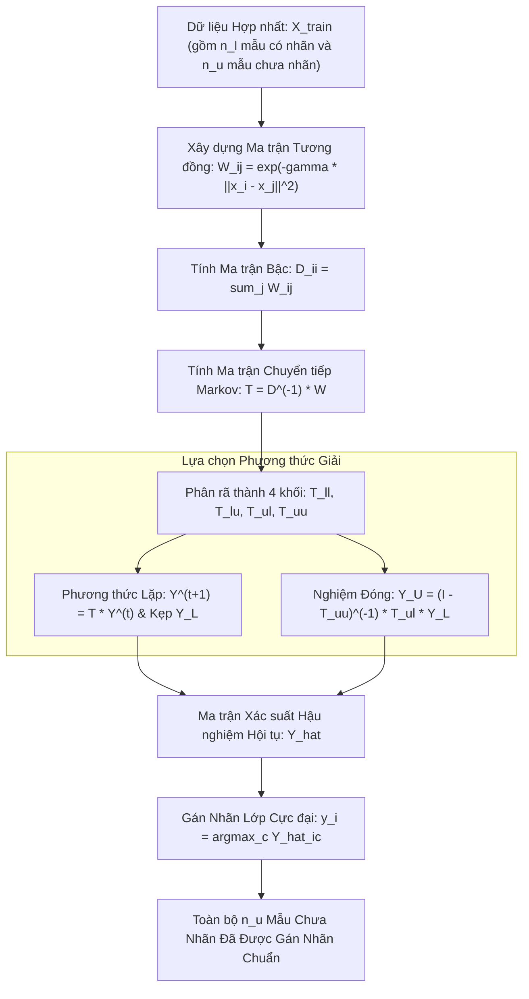

# Lan truyền Nhãn trên Đồ thị (Graph-Based Label Propagation)

## Purpose

Trong khi các phương pháp đóng gói (như Self-Training, Co-Training) tiếp cận bài toán từ góc độ lặp mô hình phân loại, nhóm **Phương pháp Dựa trên Đồ thị (Graph-Based Semi-Supervised Learning)** tiếp cận bài toán từ cấu trúc hình học và liên kết không gian tự nhiên của dữ liệu.

Đại diện nền tảng tiêu biểu nhất của trường phái này là **Thuật toán Lan truyền Nhãn (Label Propagation - Zhu & Ghahramani, 2002)**:
1. **Mô hình hóa Toàn bộ Dữ liệu thành Đồ thị Tương đồng:** Coi toàn bộ các điểm dữ liệu (cả $`D_L`$ và $`D_U`$) là các đỉnh (Nodes) trong một đồ thị vô hướng $`G = (V, E)`$. Độ tương đồng giữa hai điểm được mã hóa thành trọng số cạnh $`W_{ij}`$ (thường sử dụng hàm nhân RBF Gaussian).
2. **Cơ chế Lan truyền Dòng chảy Xác suất (Random Walk on Graph):** Nhãn từ các điểm có nhãn ban đầu đóng vai trò như các "nguồn phát sóng". Chúng lan truyền dọc theo các cạnh có trọng số lớn tới các đỉnh lân cận chưa có nhãn thông qua ma trận chuyển tiếp xác suất $`T`$.
3. **Kẹp Giữ Nhãn Cứng (Hard Clamping):** Sau mỗi bước lan truyền, nhãn của các điểm thuộc tập nhãn thật $`D_L`$ được ép buộc khôi phục lại giá trị gốc ban đầu ($`Y_L^{(t+1)} \leftarrow Y_L^{(0)}`$), đảm bảo rằng tri thức chuẩn xác của chuyên gia không bao giờ bị pha loãng bởi quá trình truyền tin.
4. **Tồn tại Nghiệm Giải tích Đóng (Closed-Form Analytical Solution):** Không bắt buộc phải lặp mô phỏng vô hạn bước; nghiệm hội tụ của nhãn trên tập $`D_U`$ có thể tính toán trực tiếp thông qua phép nghịch đảo ma trận khối dựa trên lý thuyết Hàm Điều hòa Gauss (Gaussian Harmonic Functions). [1][2]

---

## Input

Dữ liệu đầu vào và các tham số cấu hình cho Label Propagation:

1. **Tập Dữ liệu Hợp nhất:**
   * $`X = [x_1, \dots, x_{n_l}, x_{n_l + 1}, \dots, x_{n_l + n_u}]^\top \in \mathbb{R}^{n \times p}`$: Gồm $`n_l`$ mẫu có nhãn và $`n_u`$ mẫu chưa nhãn.
   * Ma trận nhãn khởi tạo One-hot $`Y \in [0, 1]^{n \times C}`$:
     * Với $`i \le n_l`$: $`Y_{ic} = 1`$ nếu $`y_i = c`$, ngược lại $`0`$.
     * Với $`i > n_l`$: $`Y_{ic} = 0, \; \forall c`$ (hoặc gán đều $`1/C`$).
2. **Hạt nhân Đồ thị (`kernel`):**
   * `'rbf'` (Gaussian Kernel): Sử dụng tham số độ rộng $`\gamma > 0`$:

$$
W_{ij} = \exp\left( -\gamma \|x_i - x_j\|^2 \right)
$$

   * `'knn'` (K-Nearest Neighbors Graph): Chỉ tạo liên kết cạnh nếu $`x_j`$ nằm trong $`k`$ láng giềng gần nhất của $`x_i`$.
3. **Số vòng lặp tối đa (`max_iter`) và Dung sai Hội tụ (`tol`):**
   * Giới hạn số chu kỳ lan truyền (mặc định 1000) và ngưỡng dừng $`\text{tol} = 10^{-3}`$.

---

## Output

Kết quả đầu ra của thuật toán Label Propagation:

1. **Ma trận Phân phối Xác suất Nhãn Hội tụ ($`\hat{Y} \in [0, 1]^{n \times C}`$):**
   * Mỗi hàng $`\hat{Y}_i`$ là một phân phối xác suất hợp lệ ($`\sum_{c=1}^C \hat{Y}_{ic} = 1`$) biểu thị xác suất điểm $`x_i`$ thuộc về từng lớp.
2. **Vector Nhãn Suy diễn Hoàn chỉnh (Transduced Labels):**
   * Nhãn gán theo quy tắc xác suất cực đại:

$$
\hat{y}_i = \arg\max_{c \in \lbrace 1, \dots, C \rbrace} \hat{Y}_{ic}
$$

   * Đối với các điểm thuộc $`D_L`$, nhãn được bảo toàn tuyệt đối 100% không đổi.
3. **Ma trận Trọng số Cạnh Đồ thị ($`W \in \mathbb{R}^{n \times n}`$):**
   * Thể hiện cấu trúc liên kết topo của toàn bộ không gian dữ liệu.

---

## Evaluation metrics

Đánh giá hiệu quả của thuật toán lan truyền nhãn:

1. **Độ Mịn của Nhãn trên Đồ thị (Graph Laplacian Smoothness Energy):**
   * Đo lường tính nhất quán của nhãn gán trên các cạnh liên kết mạnh:

$$
\mathcal{E}(Y) = \frac{1}{2} \sum_{i, j=1}^n W_{ij} \|Y_i - Y_j\|^2 = \text{Tr}(Y^\top L Y)
$$

   * Trong đó $`L = D - W`$ là ma trận Unnormalized Graph Laplacian. Năng lượng $`\mathcal{E}(Y)`$ càng nhỏ, nhãn gán càng mượt mà dọc theo cấu trúc cụm.
2. **Độ chính xác Suy luận trên $`D_U`$ (Transduction Accuracy):**
   * Tỷ lệ phần trăm các mẫu trong $`D_U`$ được gán đúng nhãn thực tế bị ẩn đi.
3. **Thời gian Nghịch đảo Ma trận và Tiêu thụ RAM:**
   * Do độ phức tạp là $`O(n^3)`$ khi giải giải tích đóng hoặc $`O(k \cdot n^2)`$ khi lặp ma trận, cần đo lường thời gian thực thi theo kích thước $`n`$.

---

## How it works

### 1. Cơ chế Lan truyền Xác suất Qua Ma trận Chuyển tiếp Markov

#### Bước 1: Xây dựng Ma trận Tương đồng $`W`$
Tính ma trận trọng số đối xứng $`W \in \mathbb{R}^{n \times n}`$ với $`W_{ii} = 0`$ (không có khuyên tự lặp).

#### Bước 2: Chuẩn hóa Hàng thành Ma trận Chuyển tiếp $`T`$
Định nghĩa ma trận bậc đường chéo $`D \in \mathbb{R}^{n \times n}`$ với $`D_{ii} = \sum_{j=1}^n W_{ij}`$.
Ma trận chuyển tiếp xác suất bước ngẫu nhiên (Random Walk Transition Matrix) được chuẩn hóa theo hàng:

$$
T = D^{-1} W \implies T_{ij} = P(j \to i) = \frac{W_{ij}}{\sum_{k=1}^n W_{ik}}
$$

Mỗi phần tử $`T_{ij}`$ là xác suất để nhãn từ đỉnh $`j`$ nhảy sang đỉnh $`i`$.

#### Bước 3: Lan truyền và Kẹp Nhãn Cứng (Iteration & Hard Clamping)
1. **Lan truyền nhãn:** $`Y^{(t+1)} = T \cdot Y^{(t)}`$.
2. **Kẹp giữ nhãn gốc:** Chia ma trận $`Y`$ thành hai khối $`Y_L`$ (chứa $`n_l`$ hàng đầu) và $`Y_U`$ (chứa $`n_u`$ hàng sau):

$$
Y_L^{(t+1)} \leftarrow Y_L^{(0)}
$$

3. **Lặp lại:** Quá trình tiếp tục cho đến khi $`\|Y^{(t+1)} - Y^{(t)}\| < \text{tol}`$.

---

### 2. Nghiệm Giải tích Đóng Dưới Dạng Hàm Điều Hòa Gauss (Closed-Form Solution)

Phân rã ma trận chuyển tiếp $`T`$ thành 4 khối ma trận con tương ứng với tập $`L`$ (có nhãn) và $`U`$ (chưa nhãn):

$$
T = \begin{bmatrix} T_{ll} & T_{lu} \\ T_{ul} & T_{uu} \end{bmatrix}
$$

Khi chu trình lặp tiến tới vô hạn ($`t \to \infty`$), hệ phương trình trạng thái dừng thỏa mãn tính chất điều hòa:

$$
Y_U = T_{ul} Y_L + T_{uu} Y_U
$$

Chuyển vế và giải phương trình đại số tuyến tính:

$$
(I - T_{uu}) Y_U = T_{ul} Y_L \implies Y_U^{\ast} = (I - T_{uu})^{-1} T_{ul} Y_L
$$

* **Ý nghĩa Toán học:** Ma trận $`(I - T_{uu})^{-1}`$ chính là toán tử Green (Green's Function) trên đồ thị. Nghiệm $`Y_U^{\ast}`$ là hàm điều hòa duy nhất thỏa mãn phương trình Laplace $`\Delta Y = 0`$ trên $`D_U`$ với điều kiện biên Dirichlet cố định trên $`D_L`$.

```text
       ĐỒ THỊ TƯƠNG ĐỒNG LIÊN KẾT
          (Node Lớp 1) ● ─────────── ● (Chưa nhãn)
                       │ \         / │
                       │   \     /   │   (Dòng chảy xác suất lan truyền
                       │     \ /     │    men theo các cạnh có trọng số W lớn)
                       │     / \     │
                       │   /     \   │
          (Node Lớp 0) ▲ ─────────── ▲ (Chưa nhãn)
```

---

## Data used

Label Propagation là giải pháp tối ưu cho các bài toán mà dữ liệu tự thân nó đã có cấu trúc mạng lưới liên kết hoặc cấu trúc cụm manifold rõ ràng:

1. **Phân tích Mạng Xã hội và Đồ thị Tri thức (Social Networks):**
   * Dự đoán sở thích hoặc quan điểm chính trị của hàng triệu người dùng dựa trên đồ thị kết bạn (Friendship Graph), khi chỉ có vài nghìn người dùng công khai hồ sơ.
2. **Tin sinh học và Tương tác Protein (Protein-Protein Interaction Networks):**
   * Dự đoán chức năng sinh học của các protein mới dựa trên mạng lưới tương tác vật lý với các protein đã biết.
3. **Phân đoạn Ảnh Y tế (Image Segmentation):**
   * Coi mỗi pixel (hoặc superpixel) là một đỉnh đồ thị, liên kết các pixel gần nhau có màu sắc tương đồng. Bác sĩ chỉ cần chấm vài điểm đánh dấu (scribbles) đại diện cho vùng khối u, thuật toán tự động lan truyền nhãn bao trọn toàn bộ khối u.

---

## Design

### 1. Kiến trúc Quy trình Lan Truyền Nhãn Trên Đồ Thị



---

### 2. Mã nguồn Triển khai Thực hành với Scikit-learn

```python
import numpy as np
from sklearn.datasets import make_circles
from sklearn.model_selection import train_test_split
from sklearn.semi_supervised import LabelPropagation
from sklearn.metrics import accuracy_score

# 1. Tạo tập dữ liệu phi tuyến 2 vòng tròn đồng tâm lồng nhau (Concentric Circles)
# Đây là cấu trúc đa tạp mà các thuật toán tuyến tính (Logistic, Linear SVM) hoàn toàn bất lực
X, y_true = make_circles(n_samples=500, factor=0.4, noise=0.05, random_state=42)

# 2. Phân chia tập Train (80%) và Test độc lập (20%)
X_train, X_test, y_train_full, y_test = train_test_split(
    X, y_true, test_size=0.20, stratify=y_true, random_state=42
)

# 3. Giả lập kịch bản nhãn cực hiếm: Chỉ giữ lại đúng 10 mẫu có nhãn (5 mẫu mỗi vòng tròn)
n_train = len(y_train_full)
y_train_ssl = np.full(n_train, fill_value=-1)

np.random.seed(42)
for c in [0, 1]:
    c_indices = np.where(y_train_full == c)[0]
    chosen = np.random.choice(c_indices, size=5, replace=False)
    y_train_ssl[chosen] = c

n_labeled = np.sum(y_train_ssl != -1)
print(f"Tổng số mẫu train: {n_train}")
print(f"Số mẫu có nhãn thật ban đầu: {n_labeled} ({n_labeled/n_train*100:.2f}%)")
print(f"Số mẫu chưa có nhãn (nhãn = -1): {np.sum(y_train_ssl == -1)}")

# 4. Huấn luyện Mô hình Label Propagation
# kernel='rbf': sử dụng hàm nhân Gaussian để tạo đồ thị liên kết
# gamma: quyết định bán kính lan truyền của đồ thị
label_prop_model = LabelPropagation(
    kernel='rbf',
    gamma=20.0,
    max_iter=1000,
    tol=1e-3
)

label_prop_model.fit(X_train, y_train_ssl)

# 5. Đánh giá Khả năng Lan truyền trên Tập Train Chưa Nhãn (Transduction)
transduced_labels = label_prop_model.transduction_
unlabeled_mask = (y_train_ssl == -1)
transduction_acc = accuracy_score(y_train_full[unlabeled_mask], transduced_labels[unlabeled_mask])

print(f"\n[Transduction] Độ chính xác lan truyền trên {np.sum(unlabeled_mask)} mẫu chưa nhãn: {transduction_acc*100:.2f}%")

# 6. Đánh giá Khả năng Dự đoán Điểm Mới trên Test Set (Induction)
y_test_pred = label_prop_model.predict(X_test)
test_acc = accuracy_score(y_test, y_test_pred)
print(f"[Induction] Độ chính xác trên Test Set độc lập: {test_acc*100:.2f}%")
```

---

## Nguồn

- [1] Zhu, X., & Ghahramani, Z. (2002). *Learning from labeled and unlabeled data with label propagation*. Technical Report CMU-CALD-02-107, Carnegie Mellon University.
- [2] Zhu, X., Ghahramani, Z., & Lafferty, J. D. (2003). *Semi-supervised learning using gaussian fields and harmonic functions*. Proceedings of the 20th International Conference on Machine Learning (ICML), 912-919.
- [3] [scikit-learn Documentation: Label Propagation](https://scikit-learn.org/stable/modules/generated/sklearn.semi_supervised.LabelPropagation.html).

