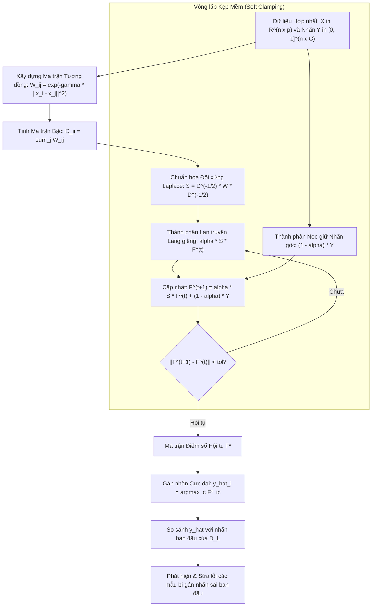

# Lan truyền Nhãn Chuẩn hóa Laplace và Kẹp Mềm (Label Spreading)

## Purpose

Mặc dù thuật toán Lan truyền Nhãn (Label Propagation - Zhu & Ghahramani) là một bước tiến quan trọng, nó bộc lộ hai nhược điểm nghiêm trọng khi ứng dụng vào các bài toán thực tế:
1. **Cơ chế Kẹp Cứng (Hard Clamping Trap):** Label Propagation cố định 100% nhãn của tập $`D_L`$ qua mọi vòng lặp. Nếu trong thực tế, chuyên gia gán nhãn bị nhầm lẫn hoặc tập $`D_L`$ bị lẫn nhiễu (Noisy Labels), sai lầm này sẽ bị đóng băng vĩnh viễn và liên tục "bơm" tín hiệu sai sang hàng nghìn điểm dữ liệu lân cận trong $`D_U`$.
2. **Ma trận Chuyển tiếp Bất đối xứng:** Ma trận ngẫu nhiên bước $`T = D^{-1}W`$ phá vỡ tính đối xứng hình học của đồ thị vô hướng.

**Thuật toán Lan truyền Nhãn Chuẩn hóa (Label Spreading - Zhou et al., 2004)** được phát triển để khắc phục hoàn toàn hai nhược điểm này:
* **Ma trận Đối xứng Chuẩn hóa Laplace (Symmetrically Normalized Graph Laplacian):** Sử dụng ma trận liên kết $`S = D^{-1/2} W D^{-1/2}`$, bảo toàn tính đối xứng và các đặc tính phổ (Spectral Properties) của đồ thị.
* **Cơ chế Kẹp Mềm Đàn hồi (Soft Clamping with $`\alpha`$):** Cho phép các điểm có nhãn ban đầu tự do điều chỉnh nhãn của chính mình nếu toàn bộ các láng giềng xung quanh đều phản đối nhãn đó. Nhờ đó, thuật toán có khả năng **tự động lọc sạch nhiễu nhãn (Noise-Robust Semi-Supervised Learning)**. [1][2]

---

## Input

Dữ liệu đầu vào và các tham số cấu hình của Label Spreading:

1. **Tập Dữ liệu Đồ thị Hợp nhất ($`D_L \cup D_U`$):**
   * Ma trận đặc trưng $`X \in \mathbb{R}^{n \times p}`$ gồm $`n_l`$ mẫu có nhãn và $`n_u`$ mẫu chưa nhãn.
   * Ma trận nhãn ban đầu $`Y \in [0, 1]^{n \times C}`$.
2. **Hệ số Kẹp Mềm (`alpha` - $`\alpha \in (0, 1)`$):**
   * Tham số quyết định mức độ đánh đổi giữa việc **tiếp nhận thông tin lan truyền từ láng giềng** (tỷ lệ $`\alpha`$) và việc **duy trì trạng thái nhãn gốc ban đầu** (tỷ lệ $`1 - \alpha`$).
   * Giá trị mặc định phổ biến là $`\alpha = 0.2`$ hoặc $`0.8`$. Nếu dữ liệu nhãn bị nghi ngờ có nhiều nhiễu, nên chọn $`\alpha`$ lớn ($`0.8`$) để mô hình linh hoạt tự sửa sai.
3. **Cấu hình Đồ thị (`kernel` và `gamma`):**
   * Hạt nhân RBF Gaussian $`W_{ij} = \exp(-\gamma \|x_i - x_j\|^2)`$ hoặc hạt nhân đồ thị $`k`$-láng giềng (kNN graph).
4. **Dung sai hội tụ (`tol`) và Số vòng lặp tối đa (`max_iter`):** Mặc định $`\text{tol} = 10^{-3}`$, $`\text{max\_iter} = 1000`$.

---

## Output

Kết quả đầu ra của thuật toán Label Spreading:

1. **Ma trận Điểm số Nhãn Phân loại Tối ưu ($`F^* \in \mathbb{R}^{n \times C}`$):**
   * Ma trận trạng thái dừng cân bằng, trong đó phần tử $`F_{ic}^*`$ thể hiện mức độ tự tin để điểm $`x_i`$ được gán vào lớp $`c`$.
2. **Vector Nhãn Suy diễn Toàn cục (Transduced Labels):**
   * Nhãn gán theo quy tắc cực đại:

$$
\hat{y}_i = \arg\max_{c \in \lbrace 1, \dots, C \rbrace} F_{ic}^*
$$

   * **Khác biệt quan trọng:** Nhãn của các điểm thuộc $`D_L`$ có thể thay đổi so với nhãn ban đầu nếu mô hình phát hiện ra điểm đó là nhãn bị gán sai.
3. **Danh sách Các Điểm Nghi ngờ Nhiễu Nhãn (Noise Detection List):**
   * Tập hợp các mẫu thuộc $`D_L`$ có $`\hat{y}_i \neq y_i^{(0)}`$, cung cấp báo cáo quý giá cho chuyên gia để rà soát lại chất lượng dữ liệu.

---

## Evaluation metrics

Đánh giá chất lượng của thuật toán Label Spreading:

1. **Hàm Chi phí Năng lượng Nhất quán (Consistency Energy Cost - $`\mathcal{Q}(F)`$):**
   * Đo lường sự cân bằng giữa tính nhất quán cục bộ và độ khớp toàn cục:

$$
\mathcal{Q}(F) = \frac{1}{2} \left( \sum_{i, j=1}^n W_{ij} \left\| \frac{F_i}{\sqrt{D_{ii}}} - \frac{F_j}{\sqrt{D_{jj}}} \right\|^2 + \mu \sum_{i=1}^n \|F_i - Y_i\|^2 \right)
$$

   * Với $`\mu = \frac{1 - \alpha}{\alpha}`$.
2. **Khả năng Phục hồi khi Tập Nhãn Bị Nhiễu (Noise Robustness Score):**
   * Đánh giá độ chính xác của mô hình khi cố tình đảo nhãn ngẫu nhiên 10% đến 30% mẫu trong $`D_L`$.
3. **Độ chính xác Suy luận Điểm Mới trên Test Set (Inductive Accuracy).**

---

## How it works

### 1. Chuẩn hóa Đối xứng và Quy trình Lặp Kẹp Mềm

#### Bước 1: Tính Ma trận Tương đồng Đối xứng Chuẩn hóa $`S`$
Khởi tạo ma trận trọng số $`W`$ với $`W_{ii} = 0`$ và ma trận bậc đường chéo $`D`$.
Tính toán ma trận liên kết đối xứng chuẩn hóa:

$$
S = D^{-1/2} W D^{-1/2} \implies S_{ij} = \frac{W_{ij}}{\sqrt{D_{ii} D_{jj}}}
$$

* **Đặc tính Toán học:** Ma trận $`S`$ là ma trận đối xứng thực, tất cả các trị riêng của $`S`$ đều nằm trọn vẹn trong khoảng $`[-1, 1]`$. Điều này đảm bảo chuỗi lũy thừa $`S^t`$ luôn hội tụ ổn định và không bao giờ bị bùng nổ số học.

#### Bước 2: Vòng lặp Lan truyền với Cơ chế Kẹp Mềm
Khởi tạo ma trận điểm số ban đầu $`F^{(0)} = Y`$.
Tại mỗi vòng lặp $`t`$, ma trận điểm số được cập nhật theo công thức tổ hợp lồi:

$$
F^{(t+1)} = \alpha S F^{(t)} + (1 - \alpha) Y
$$

Trong đó:
* $`\alpha S F^{(t)}`$: Thành phần nhận thông tin lan truyền từ toàn bộ các láng giềng xung quanh.
* $`(1 - \alpha) Y`$: Thành phần neo giữ trở lại trạng thái nhãn ban đầu.

Vì cả hai thành phần đều được cộng dồn sau mỗi bước (thay vì ghi đè thô bạo như Label Propagation), các điểm có nhãn ban đầu vẫn chịu ảnh hưởng của các điểm lân cận, tạo nên tính chất **Kẹp Mềm (Soft Clamping)**.

---

### 2. Nghiệm Giải tích Đóng Hội Tụ (Closed-Form Solution)

Khi số vòng lặp tiến ra vô cùng ($`t \to \infty`$), chuỗi hình học ma trận hội tụ về nghiệm giải tích đóng:

$$
F^* = \lim_{t \to \infty} F^{(t)} = (1 - \alpha) \left( \sum_{k=0}^\infty (\alpha S)^k \right) Y
$$

Vì bán kính phổ của $`\alpha S`$ nhỏ hơn 1 (do $`\alpha < 1`$ và $`\rho(S) \le 1`$), áp dụng khai triển chuỗi Neumann ma trận:

$$
\sum_{k=0}^\infty (\alpha S)^k = (I - \alpha S)^{-1}
$$

Từ đó ta có công thức nghiệm đóng tức thời:

$$
F^* = (1 - \alpha) (I - \alpha S)^{-1} Y
$$

* **Ý nghĩa:** Ma trận $`(I - \alpha S)^{-1}`$ chính là toán tử chính quy hóa Laplace (Laplacian Regularizer). Thuật toán có thể giải trực tiếp bằng các phương pháp phân rã Cholesky hoặc Conjugate Gradient mà không cần chạy vòng lặp lặp lại từng bước.

```text
SO SÁNH CƠ CHẾ KẸP:
Label Propagation (Kẹp Cứng):   Y_L luôn bị khóa chết 100% -> Nhiễu nhãn bị lan truyền
Label Spreading (Kẹp Mềm):      F_L = alpha * S * F_L + (1 - alpha) * Y_L -> Có thể tự sửa lỗi nhãn
```

---

## Data used

Label Spreading là thuật toán hàng đầu khi môi trường dữ liệu có các đặc tính sau:

1. **Dữ liệu Nhãn Bị Nhiễu do Thu thập Cộng đồng (Crowdsourced / Noisy Labels):**
   * Dữ liệu được gán nhãn bởi cộng đồng (như Amazon Mechanical Turk) với tỷ lệ sai sót từ 10% đến 20%. Label Spreading tự động lọc sạch các nhãn dị biệt bị chuyên gia gán nhầm.
2. **Dữ liệu Hình ảnh và Nhận diện Chữ viết tay (MNIST / OCR):**
   * Cấu trúc chữ viết tay nằm trên các mặt đa tạp uốn lượn liên tục. Label Spreading men theo đường cong đa tạp để gán nhãn chính xác cho hàng nghìn chữ số chưa dán nhãn.
3. **Phân loại Tế bào và Gen Sinh học:**
   * Dữ liệu biểu hiện gen có độ nhiễu kỹ thuật cao từ thiết bị giải trình tự.

---

## Design

### 1. Kiến trúc Quy trình Lan Truyền Chuẩn Hóa và Tự Sửa Lỗi Nhãn



---

### 2. Mã nguồn Triển khai Thực hành Chuẩn hóa với Scikit-learn

```python
import numpy as np
from sklearn.datasets import load_digits
from sklearn.model_selection import train_test_split
from sklearn.preprocessing import StandardScaler
from sklearn.semi_supervised import LabelSpreading, LabelPropagation
from sklearn.metrics import accuracy_score

# 1. Tải tập dữ liệu chữ số viết tay Digits (1797 mẫu, 64 đặc trưng pixel)
digits = load_digits()
X = StandardScaler().fit_transform(digits.data)
y_true = digits.target

# 2. Phân tách tập Train (80%) và Test độc lập (20%)
X_train, X_test, y_train_full, y_test = train_test_split(
    X, y_true, test_size=0.20, stratify=y_true, random_state=42
)

# 3. Giả lập kịch bản nhãn thực tế:
# - Chỉ giữ lại 15% nhãn thật trong tập train
# - CỐ TÌNH GÂY NHIỄU: Đảo sai ngẫu nhiên 20% các nhãn đã gán để kiểm tra độ bền vững
n_train = len(y_train_full)
y_train_ssl = np.full(n_train, fill_value=-1)

np.random.seed(42)
for c in range(10):
    c_indices = np.where(y_train_full == c)[0]
    n_keep = max(3, int(len(c_indices) * 0.15))
    chosen = np.random.choice(c_indices, size=n_keep, replace=False)
    y_train_ssl[chosen] = c

# Tạo nhiễu: Đảo nhãn ngẫu nhiên 20% các mẫu có nhãn
labeled_indices = np.where(y_train_ssl != -1)[0]
n_noise = int(len(labeled_indices) * 0.20)
noise_indices = np.random.choice(labeled_indices, size=n_noise, replace=False)
for idx in noise_indices:
    original_c = y_train_ssl[idx]
    y_train_ssl[idx] = (original_c + np.random.randint(1, 10)) % 10 # Gán sang nhãn khác

print(f"Tổng số mẫu train: {n_train}")
print(f"Số mẫu có nhãn: {len(labeled_indices)} (Trong đó cố tình gây nhiễu {n_noise} mẫu)")

# 4. Huấn luyện Label Propagation (Kẹp cứng - Rất dễ bị hỏng do nhiễu)
model_lp = LabelPropagation(kernel='rbf', gamma=0.05, max_iter=1000)
model_lp.fit(X_train, y_train_ssl)
acc_lp = accuracy_score(y_test, model_lp.predict(X_test))

# 5. Huấn luyện Label Spreading (Kẹp mềm alpha=0.8 - Kháng nhiễu xuất sắc)
model_ls = LabelSpreading(kernel='rbf', gamma=0.05, alpha=0.8, max_iter=1000)
model_ls.fit(X_train, y_train_ssl)
acc_ls = accuracy_score(y_test, model_ls.predict(X_test))

# 6. So sánh Đối đầu
print(f"\n[Kết quả So sánh Đối đầu khi Dữ liệu Nhãn Bị Nhiễu]")
print(f"Label Propagation (Kẹp Cứng): Độ chính xác Test = {acc_lp*100:.2f}%")
print(f"Label Spreading   (Kẹp Mềm):  Độ chính xác Test = {acc_ls*100:.2f}%")
print(f"=> Mức vượt trội của Label Spreading: {(acc_ls - acc_lp)*100:+.2f}%")

# Kiểm tra khả năng tự sửa lỗi nhãn nhiễu ban đầu
corrected_noise_count = 0
for idx in noise_indices:
    true_label = y_train_full[idx]
    corrected_label = model_ls.transduction_[idx]
    if corrected_label == true_label:
        corrected_noise_count += 1

print(f"Số mẫu nhãn nhiễu được Label Spreading tự động sửa về đúng nhãn thật: {corrected_noise_count} / {n_noise} ({corrected_noise_count/n_noise*100:.1f}%)")
```

---

## Nguồn

- [1] Zhou, D., Bousquet, O., Lal, T. N., Weston, J., & Schölkopf, B. (2004). *Learning with local and global consistency*. Advances in Neural Information Processing Systems (NeurIPS), 16, 321-328.
- [2] Bengio, Y., Delalleau, O., & Le Roux, N. (2006). *Label propagation and quadratic criterion*. Semi-Supervised Learning, MIT Press, 193-216.
- [3] [scikit-learn Documentation: Label Spreading](https://scikit-learn.org/stable/modules/generated/sklearn.semi_supervised.LabelSpreading.html).
