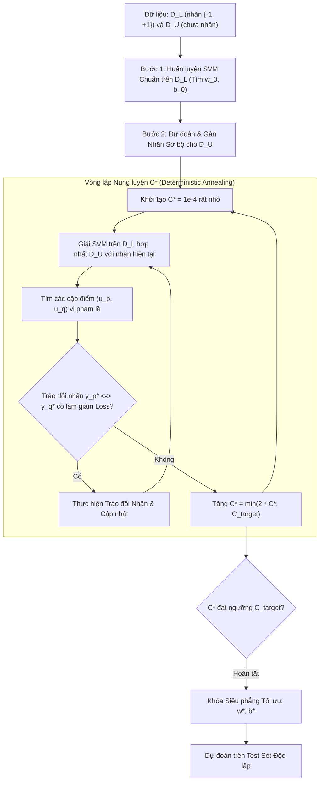

# Support Vector Machines Bán giám sát (Semi-Supervised & Transductive SVM)

## Purpose

Trong Học có giám sát, Máy Vector Hỗ trợ (Support Vector Machine - SVM - Vapnik, 1995) tìm kiếm một siêu phẳng phân cách tuyến tính cực đại hóa lề (Margin Maximization) giữa hai lớp dữ liệu có nhãn. Tuy nhiên, khi số lượng mẫu có nhãn trong $`D_L`$ quá ít, có vô số siêu phẳng khác nhau đều có thể phân tách hoàn hảo các điểm trong $`D_L`$ với lề rộng, nhưng hầu hết các siêu phẳng này lại cắt ngang qua các cụm dữ liệu tự nhiên chưa được gán nhãn trong $`D_U`$.

**Support Vector Machines Bán giám sát (Semi-Supervised SVM - S3VM)**, còn được biết đến với tên gọi kinh điển là **Transductive SVM (TSVM - Vapnik, 1998; Joachims, 1999)**, giải quyết triệt để bài toán này dựa trên **Giả định Ranh giới Mật độ Thấp (Low-Density Separation Assumption)**:
1. **Ép Ranh giới đi qua Vùng Không gian Thưa thớt:** Siêu phẳng phân cách tối ưu không chỉ phân loại đúng tập nhãn thật $`D_L`$ với khoảng cách lề lớn nhất, mà còn **bắt buộc phải tránh né các vùng không gian đông đúc của tập chưa nhãn $`D_U`$**, tìm cách luồn lách qua các "khe hở" thưa thớt nhất của dữ liệu.
2. **Hàm Mất mát Hình Mũ (Hat Loss / Symmetric Hinge Loss):** Phạt nặng bất kỳ điểm dữ liệu chưa nhãn nào rơi vào bên trong dải phân cách an toàn (Margin Band) $`[-1, +1]`$.
3. **Cân bằng Phân bổ Nhãn:** Ngăn chặn hiện tượng mô hình tìm ra nghiệm tầm thường bằng cách gán toàn bộ dữ liệu chưa nhãn vào duy nhất một lớp. [1][2]

---

## Input

Dữ liệu đầu vào và các siêu tham số của mô hình S3VM / TSVM:

1. **Tập Dữ liệu Huấn luyện Hỗn hợp:**
   * Tập có nhãn: $`D_L = \lbrace (x_i, y_i) \rbrace_{i=1}^{n_l}`$ với $`x_i \in \mathbb{R}^p`$ và $`y_i \in \lbrace -1, +1 \rbrace`$.
   * Tập chưa nhãn: $`D_U = \lbrace u_j \rbrace_{j=1}^{n_u}`$ với $`u_j \in \mathbb{R}^p`$.
2. **Hệ số Phạt Sai số Có Giám sát ($`C`$):**
   * Tham số điều chỉnh mức độ phạt các vi phạm lề trên tập có nhãn $`D_L`$.
3. **Hệ số Phạt Vi phạm Lề Không Giám sát ($`C^*`$):**
   * Tham số điều chỉnh mức độ phạt các điểm chưa nhãn rơi vào dải phân cách lề. Ban đầu $`C^*`$ được thiết lập rất nhỏ và tăng dần trong quá trình tối ưu hóa.
4. **Hàm Nhân Kernel ($`K(x_i, x_j)`$):**
   * Tuyến tính (`'linear'`) hoặc hạt nhân RBF phi tuyến (`'rbf'`) để nâng dữ liệu lên không gian đặc trưng Hilbert.

---

## Output

Kết quả đầu ra của thuật toán S3VM / TSVM:

1. **Siêu phẳng Phân cách Tối ưu ($`w^*, b^*`$):**
   * Hàm quyết định suy luận cho một điểm mới $`x`$:

$$
f(x) = \text{sign}\left( (w^*)^\top \Phi(x) + b^* \right) = \text{sign}\left( \sum_{i \in \text{SV}} \alpha_i y_i K(x_i, x) + b^* \right)
$$

2. **Tập Nhãn Gán Tối ưu cho Toàn bộ Dữ liệu Chưa Nhãn:**
   * Vector nhãn $`y_U^* = [y_{n_l + 1}^*, \dots, y_{n_l + n_u}^*]^\top \in \lbrace -1, +1 \rbrace^{n_u}`$ giải bài toán cực tiểu hóa năng lượng toàn cục.
3. **Khoảng cách Lề Phân cách Mới:**
   * Dải phân cách lề $`\frac{2}{\|w\|}`$ được mở rộng tối đa mà không đè lên bất kỳ cụm dữ liệu chưa nhãn nào.

---

## Evaluation metrics

Đánh giá chất lượng của mô hình S3VM / TSVM:

1. **Độ rộng Khoảng cách Lề (Margin Width):**
   * Giá trị $`\frac{1}{\|w\|}`$. S3VM thành công khi tìm được một siêu phẳng vừa có lề rộng vừa không vi phạm mật độ của $`D_U`$.
2. **Số lượng Điểm Rơi vào Dải Lề (Margin Violations on $`D_U`$):**
   * Số lượng điểm chưa nhãn có giá trị $`|w^\top u_j + b| < 1`$. Con số này càng nhỏ càng chứng tỏ ranh giới đã đi qua đúng vùng thưa thớt nhất.
3. **Độ chính xác và Điểm F1 trên Test Set Độc lập.**

---

## How it works

### 1. Hàm Mục tiêu Toán học và Hàm Mất Mát Hình Mũ (Hat Loss)

Bài toán tối ưu hóa của S3VM / TSVM được phát biểu như sau: Tìm vector trọng số $`w`$, hệ số chệch $`b`$, và nhãn giả $`y_j^* \in \lbrace -1, +1 \rbrace`$ cho các điểm chưa nhãn để giải bài toán tối thiểu hóa:

$$
\min_{w, b, y^*} \frac{1}{2} \|w\|^2 + C \sum_{i=1}^{n_l} \max(0, 1 - y_i(w^\top x_i + b)) + C^* \sum_{j=1}^{n_u} \max(0, 1 - y_j^*(w^\top u_j + b))
$$

Kèm theo ràng buộc cân bằng phân bổ nhãn để tránh nghiệm suy biến:

$$
\frac{1}{n_u} \sum_{j=1}^{n_u} y_j^* = \frac{1}{n_l} \sum_{i=1}^{n_l} y_i
$$

Bản chất của việc chọn $`y_j^* = \text{sign}(w^\top u_j + b)`$ dẫn đến việc thay thế thành phần thứ ba bằng **Hàm Mất Mát Hình Mũ Đối Xứng (Hat Loss / Symmetric Hinge Loss)**:

$$
\mathcal{L}_{\text{hat}}(z) = \max(0, 1 - |z|) \quad \text{với } z = w^\top u + b
$$

```text
       HÀM MẤT MÁT HÌNH MŨ CHO DỮ LIỆU CHƯA NHÃN: L_hat(z) = max(0, 1 - |z|)
       Loss
        ▲
      1 ┼          /\
        │         /  \
        │        /    \
        │       /      \
      0 ┴──────/────────\──────> z = w^T * u + b
              -1    0   +1
             (Vùng Dải Lề)
```

* **Phân tích Trực giác:**
  * Nếu điểm chưa nhãn $`u`$ nằm sâu về phía dương ($`z \ge +1`$) hoặc sâu về phía âm ($`z \le -1`$): $`\text{Loss} = 0`$ (Mô hình không phạt).
  * Nếu điểm chưa nhãn $`u`$ rơi vào giữa dải lề ($`-1 < z < +1`$): Mô hình bị phạt một lượng $`1 - |z| > 0`$. Điểm nằm càng gần ranh giới $`z = 0`$, mức phạt càng lớn!
  * **Hệ quả:** Thuật toán bị cưỡng ép phải đẩy siêu phẳng ra xa khỏi mọi điểm dữ liệu chưa nhãn.

---

### 2. Thách thức Tối ưu Phi lồi và Thuật toán Tráo đổi Nhãn của Joachims (1999)

Hàm mất mát hình mũ $`\max(0, 1 - |z|)`$ là một hàm **phi lồi (Non-convex)**. Hơn nữa, việc tìm kiếm đồng thời cấu hình nhãn rời rạc $`y^* \in \lbrace -1, +1 \rbrace^{n_u}`$ là một bài toán tối ưu tổ hợp NP-khó.

Thuật toán TSVM kinh điển của Joachims giải xấp xỉ bài toán này qua 4 bước:

```text
┌─────────────────────────────────────────────────────────────┐
│ Bước 1: Huấn luyện SVM chuẩn trên tập nhãn thật D_L         │
└──────────────────────────────┬──────────────────────────────┘
                               │
                               ▼
┌─────────────────────────────────────────────────────────────┐
│ Bước 2: Dự đoán nhãn ban đầu cho toàn bộ D_U                │
│         Gán nhãn sơ bộ cho D_U để thỏa mãn tỷ lệ cân bằng   │
└──────────────────────────────┬──────────────────────────────┘
                               │
                               ▼
┌─────────────────────────────────────────────────────────────┐
│ Bước 3: Vòng lặp Tăng dần C* (từ 1e-4 đến C_max):           │
│   a) Huấn luyện SVM chuẩn có trọng số trên cả D_L và D_U    │
│   b) Tìm hai điểm chưa nhãn (u_p, u_q) có nhãn đối lập      │
│      nhưng vi phạm lề nặng nhất                             │
│   c) Tráo đổi nhãn (Pairwise Label Swapping):               │
│      y_p* <-> y_q* nếu việc tráo đổi làm giảm hàm mất mát   │
│   d) Lặp lại tráo đổi cho đến khi không còn cải thiện       │
└──────────────────────────────┬──────────────────────────────┘
                               │
                               ▼
┌─────────────────────────────────────────────────────────────┐
│ Bước 4: Tăng C* và lặp lại Bước 3 cho đến khi C* == C_max   │
└─────────────────────────────────────────────────────────────┘
```

---

## Data used

S3VM / TSVM đặc biệt hiệu quả trong các bài toán phân loại văn bản và phân loại nhị phân ít chiều:

1. **Lọc Thư rác và Phân loại Email (Spam Filtering):**
   * Dữ liệu văn bản thường có tính phân tách tuyến tính tự nhiên cao trong không gian vector từ vựng (Bag of Words / TF-IDF). TSVM tìm thấy khe hở ngôn ngữ phân tách rõ ràng giữa email quảng cáo và email công việc.
2. **Chẩn đoán Bệnh lý Nhị phân (Binary Medical Diagnosis):**
   * Phân loại U lành tính vs U ác tính từ dữ liệu sinh thiết khi số ca phẫu thuật đã có kết quả giải phẫu bệnh rất ít.
3. **Phân tích Rủi ro Trực tiếp (Direct Marketing):**
   * Dự đoán khách hàng phản hồi chiến dịch quảng cáo với chi phí gán nhãn cuộc gọi thăm dò cao.

---

## Design

### 1. Kiến trúc Quy trình Tối ưu hóa Siêu phẳng S3VM



---

### 2. Mã nguồn Kỹ thuật Minh họa Triển khai Thuật toán TSVM trên Python

```python
import numpy as np
from sklearn.datasets import make_moons
from sklearn.model_selection import train_test_split
from sklearn.preprocessing import StandardScaler
from sklearn.svm import SVC
from sklearn.metrics import accuracy_score

class SimpleTSVM:
    """
    Thuật toán Transductive Support Vector Machine (TSVM) đơn giản hóa.
    Áp dụng kỹ thuật Self-Training kết hợp nung luyện phạt lề C* (Annealing).
    """
    def __init__(self, kernel='rbf', C=1.0, C_star_max=0.5, max_iter=15):
        self.kernel = kernel
        self.C = C
        self.C_star_max = C_star_max
        self.max_iter = max_iter
        self.model = None

    def fit(self, X_train, y_train):
        labeled_mask = (y_train != -1)
        X_L = X_train[labeled_mask]
        y_L = y_train[labeled_mask]
        
        unlabeled_idx = np.where(y_train == -1)[0]
        X_U = X_train[unlabeled_idx]

        # 1. Huấn luyện SVM ban đầu trên tập có nhãn D_L
        self.model = SVC(kernel=self.kernel, C=self.C, probability=True, random_state=42)
        self.model.fit(X_L, y_L)

        # 2. Gán nhãn sơ bộ cho tập chưa nhãn D_U
        y_U_pseudo = self.model.predict(X_U)

        # 3. Quá trình nung luyện tăng dần C*
        C_star = 1e-4
        step_factor = 1.5

        for iteration in range(self.max_iter):
            # Hợp nhất tập D_L và D_U với nhãn hiện tại
            X_merged = np.vstack([X_L, X_U])
            y_merged = np.concatenate([y_L, y_U_pseudo])

            # Thiết lập trọng số mẫu: mẫu D_L có trọng số C, mẫu D_U có trọng số C_star
            sample_weights = np.concatenate([
                np.full(len(X_L), fill_value=self.C),
                np.full(len(X_U), fill_value=C_star)
            ])

            # Huấn luyện lại SVM có trọng số
            self.model.fit(X_merged, y_merged, sample_weight=sample_weights)

            # Đánh giá khoảng cách ký hiệu tới siêu phẳng (Decision Function)
            decision_values = self.model.decision_function(X_U)

            # Cập nhật lại nhãn giả dựa trên khoảng cách mới
            y_U_pseudo = np.where(decision_values >= 0, 1, 0)

            # Tăng dần C*
            C_star = min(self.C_star_max, C_star * step_factor)
            if C_star >= self.C_star_max:
                break

        return self

    def predict(self, X):
        return self.model.predict(X)

# ==========================================
# THỬ NGHIỆM TRÊN TẬP DỮ LIỆU MAKE_MOONS
# ==========================================
# Cấu trúc phi tuyến hình 2 vành trăng khuyết lồng nhau
X_raw, y_true = make_moons(n_samples=400, noise=0.15, random_state=42)
X = StandardScaler().fit_transform(X_raw)

X_train, X_test, y_train, y_test = train_test_split(
    X, y_true, test_size=0.25, stratify=y_true, random_state=42
)

# Giả lập chỉ giữ lại 6 mẫu có nhãn thật (3 mẫu mỗi vành trăng)
n_train = len(y_train)
y_ssl = np.full(n_train, -1)
np.random.seed(42)
for c in [0, 1]:
    c_idx = np.where(y_train == c)[0]
    chosen = np.random.choice(c_idx, size=3, replace=False)
    y_ssl[chosen] = c

# Huấn luyện SVM cơ sở (Chỉ học trên 6 mẫu nhãn)
baseline_svm = SVC(kernel='rbf', C=1.0, random_state=42)
mask_labeled = (y_ssl != -1)
baseline_svm.fit(X_train[mask_labeled], y_ssl[mask_labeled])
acc_base = accuracy_score(y_test, baseline_svm.predict(X_test))

# Huấn luyện mô hình TSVM bán giám sát
tsvm = SimpleTSVM(kernel='rbf', C=1.0, C_star_max=0.5, max_iter=15)
tsvm.fit(X_train, y_ssl)
acc_tsvm = accuracy_score(y_test, tsvm.predict(X_test))

print(f"Số lượng mẫu có nhãn thật ban đầu: {np.sum(mask_labeled)} mẫu")
print(f"Số lượng mẫu chưa có nhãn: {np.sum(~mask_labeled)} mẫu")
print(f"\n[Baseline SVM] Độ chính xác chỉ học trên 6 nhãn: {acc_base*100:.2f}%")
print(f"[TSVM Bán giám sát] Độ chính xác khi kết hợp dữ liệu chưa nhãn: {acc_tsvm*100:.2f}%")
print(f"=> Mức tăng trưởng hiệu năng Delta: {(acc_tsvm - acc_base)*100:+.2f}%")
```

---

## Nguồn

- [1] Vapnik, V. (1998). *Statistical Learning Theory* (Chapter 10: Transductive Inference). John Wiley & Sons.
- [2] Joachims, T. (1999). *Transductive inference for text classification using support vector machines*. Proceedings of the Sixteenth International Conference on Machine Learning (ICML), 200-209.
- [3] Bennett, K. P., & Demiriz, A. (1999). *Semi-supervised support vector machines*. Advances in Neural Information Processing Systems (NeurIPS), 11, 368-374.
- [4] Collobert, R., Sinz, F., Weston, J., & Bottou, L. (2006). *Large scale transductive SVMs*. Journal of Machine Learning Research (JMLR), 7, 1687-1712.

