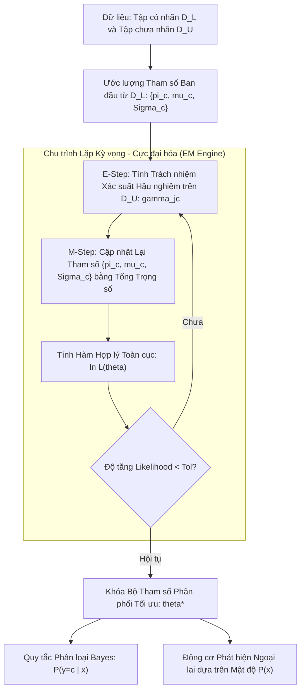

# Mô hình Sinh trong Học bán giám sát (Generative Semi-Supervised Learning)

## Purpose

Các phương pháp phân biệt (Discriminative Methods) như SVM hay Logistic Regression chỉ tập trung mô hình hóa trực tiếp xác suất có điều kiện $`P(Y \mid X)`$ để tìm ranh giới quyết định. Ngược lại, **Mô hình Sinh (Generative Models)** tiếp cận bài toán từ bản chất phân phối xác suất đồng thời:

$$
P(X, Y) = P(Y) P(X \mid Y)
$$

Trong Học bán giám sát, Mô hình Sinh mang lại một lợi thế toán học tự nhiên vô cùng to lớn:
1. **Xem Nhãn của Dữ liệu Chưa Nhãn là Biến Ẩn (Latent Variables):** Với các mẫu có nhãn trong $`D_L`$, ta quan sát được cả $`x`$ và $`y`$. Với các mẫu chưa nhãn trong $`D_U`$, nhãn $`y`$ chỉ đơn giản bị xem là một biến ngẫu nhiên ẩn bị khuyết (Missing / Latent Variable).
2. **Khung Tối ưu Hợp lý Cực đại Thống nhất (Unified Maximum Likelihood Framework):** Ta có thể thiết lập một hàm Hợp lý biên (Marginal Likelihood) duy nhất trên toàn bộ dữ liệu và áp dụng **Thuật toán Kỳ vọng - Cực đại hóa (Expectation-Maximization - EM)** để tối ưu đồng thời cả phân phối của từng lớp $`P(X \mid Y=c)`$ lẫn xác suất tiên nghiệm $`P(Y=c)`$.
3. **Mở rộng sang Deep Generative Models:** Kết hợp sức mạnh của mạng neuron sâu thông qua Variational Autoencoders bán giám sát (Semi-Supervised VAEs - Kingma et al., 2014) và Generative Adversarial Networks (Semi-Supervised GANs), cho phép học biểu diễn đặc trưng phức tạp từ hàng triệu ảnh hoặc văn bản chưa nhãn. [1][2]

---

## Input

Dữ liệu đầu vào và các tham số cấu hình cho mô hình sinh bán giám sát:

1. **Tập Dữ liệu Huấn luyện Hỗn hợp:**
   * Tập có nhãn: $`D_L = \lbrace (x_i, y_i) \rbrace_{i=1}^{n_l}`$ với $`y_i \in \lbrace 1, 2, \dots, C \rbrace`$.
   * Tập chưa nhãn: $`D_U = \lbrace u_j \rbrace_{j=1}^{n_u}`$.
2. **Giả định Phân phối Thành phần (Parametric Family Assumption):**
   * Đối với mô hình Hỗn hợp Gauss bán giám sát (Semi-Supervised GMM): Mỗi lớp $`c`$ được giả định tuân theo một phân phối Gauss đa chiều $`\mathcal{N}(\mu_c, \Sigma_c)`$.
   * Cấu hình ma trận hiệp phương sai: `'full'`, `'tied'`, `'diag'`, hoặc `'spherical'`.
3. **Hệ số Điều hòa Giữa Tập Có Nhãn và Chưa Nhãn ($`\lambda`$):**
   * Hệ số trọng số điều chỉnh mức độ đóng góp của dữ liệu chưa nhãn vào hàm Log-Likelihood tổng để tránh trường hợp $`|D_U| \gg |D_L|`$ làm phân phối lớp bị "nuốt chửng" bởi phân phối không nhãn.
4. **Hệ số Ổn định Số học (`reg_covar`):**
   * Hằng số dương nhỏ ($`10^{-6}`$) cộng vào đường chéo ma trận hiệp phương sai để chống lỗi suy biến ma trận (Singular Covariance Matrix).

---

## Output

Kết quả đầu ra của mô hình sinh bán giám sát:

1. **Bộ Tham số Phân phối Đầy đủ của Từng Lớp ($`\theta^*`$):**
   * Trọng số tiên nghiệm của các lớp: $`\pi_c = P(Y=c)`$ với $`\sum_{c=1}^C \pi_c = 1`$.
   * Vector kỳ vọng trung bình tâm lớp: $`\mu_c \in \mathbb{R}^p`$.
   * Ma trận hiệp phương sai hình dạng lớp: $`\Sigma_c \in \mathbb{R}^{p \times p}`$.
2. **Quy tắc Phân loại Bayes Hậu nghiệm (Bayesian Posterior Classifier):**
   * Với một mẫu mới $`x`$, nhãn được suy luận theo định lý Bayes:

$$
P(Y=c \mid x) = \frac{\pi_c \mathcal{N}(x \mid \mu_c, \Sigma_c)}{\sum_{k=1}^C \pi_k \mathcal{N}(x \mid \mu_k, \Sigma_k)}
$$

$$
\hat{y} = \arg\max_{c \in \lbrace 1, \dots, C \rbrace} P(Y=c \mid x)
$$

3. **Mật độ Xác suất Dữ liệu $`P(X)`$ phục vụ Phát hiện Bất thường:**
   * Khả năng tự động chấm điểm phát hiện mẫu ngoại lai dựa trên hàm mật độ tổng hợp: $`p(x) = \sum_{c=1}^C \pi_c \mathcal{N}(x \mid \mu_c, \Sigma_c)`$.

---

## Evaluation metrics

Đánh giá chất lượng của mô hình sinh bán giám sát:

1. **Hàm Log-Likelihood Hỗn hợp Toàn cục (Joint Log-Likelihood):**
   * Đo lường mức độ khớp của mô hình trên cả dữ liệu có nhãn và chưa nhãn:

$$
\ln \mathcal{L}(\theta) = \sum_{i=1}^{n_l} \ln P(x_i, y_i \mid \theta) + \sum_{j=1}^{n_u} \ln P(u_j \mid \theta)
$$

2. **Chỉ số Thông tin Bayesian (BIC) và Akaike (AIC):**
   * Đánh giá chất lượng mô hình có bị quá khớp tham số hay không.
3. **Độ chính xác Phân loại (Classification Accuracy / F1-Score) trên Test Set Độc lập.**
4. **Khoảng cách Phân kỳ KL giữa Phân phối Sinh và Phân phối Thực tế:**
   * Đánh giá chất lượng tái tạo dữ liệu khi sử dụng các mô hình sinh sâu (VAE/GAN).

---

## How it works

### 1. Thuật toán EM Bán Giám Sát (Semi-Supervised EM for GMM)

Hàm hợp lý hoàn chỉnh (Complete Data Log-Likelihood) được viết dưới dạng:

$$
\ln \mathcal{L}(\theta) = \sum_{i=1}^{n_l} \left[ \ln P(y_i) + \ln P(x_i \mid y_i; \theta) \right] + \sum_{j=1}^{n_u} \ln \left( \sum_{c=1}^C P(y=c) P(u_j \mid y=c; \theta) \right)
$$

Thuật toán EM giải bài toán này qua hai bước lặp:

```text
┌─────────────────────────────────────────────────────────────┐
│ Khởi tạo: Ước lượng tham số ban đầu {π_c, μ_c, Σ_c} từ D_L  │
└──────────────────────────────┬──────────────────────────────┘
                               │
                               ▼
┌─────────────────────────────────────────────────────────────┐
│ E-Step (Expectation):                                       │
│ Tính xác suất hậu nghiệm (Responsibility) γ_jc trên D_U:    │
│            γ_jc = P(y=c | u_j; θ^(t))                       │
└──────────────────────────────┬──────────────────────────────┘
                               │
                               ▼
┌─────────────────────────────────────────────────────────────┐
│ M-Step (Maximization):                                      │
│ Cập nhật {π_c, μ_c, Σ_c} kết hợp cả nhãn thật và xác suất γ│
└──────────────────────────────┬──────────────────────────────┘
                               │
                               ▼
                     /───────────────────\
                    <   Hội tụ Likelihood? >
                     \───────────────────/
                       │ No          │ Yes
                       └─── Quay lại └───> [ Khóa Tham số Tối ưu ]
```

#### Công thức Cập nhật ở Bước M-step:
1. **Tổng trọng lượng mẫu thuộc về lớp $`c`$:**

$$
N_c = \sum_{i=1}^{n_l} \mathbb{I}(y_i = c) + \sum_{j=1}^{n_u} \gamma_{jc}
$$

2. **Cập nhật Vector Kỳ vọng Trung bình $`\mu_c`$:**

$$
\mu_c^{(t+1)} = \frac{1}{N_c} \left( \sum_{i \in D_{L, c}} x_i + \sum_{j=1}^{n_u} \gamma_{jc} u_j \right)
$$

3. **Cập nhật Ma trận Hiệp phương sai $`\Sigma_c`$:**

$$
\Sigma_c^{(t+1)} = \frac{1}{N_c} \left( \sum_{i \in D_{L, c}} (x_i - \mu_c)(x_i - \mu_c)^\top + \sum_{j=1}^{n_u} \gamma_{jc} (u_j - \mu_c)(u_j - \mu_c)^\top \right)
$$

---

### 2. Mô hình Sinh Sâu Bán Giám Sát: Semi-Supervised VAE (Kingma et al., 2014)

Khi dữ liệu có cấu trúc phi tuyến phức tạp (như hình ảnh khuôn mặt hoặc văn bản ngữ nghĩa), các phân phối Gauss đơn giản không đủ năng lực biểu diễn.

Mô hình VAE Bán giám sát (M2 Model) đưa vào biến tiềm ẩn liên tục $`z \sim \mathcal{N}(0, I)`$ và biến nhãn rời rạc $`y`$:
* **Quá trình Sinh (Generative Process):** $`p_\theta(x, y, z) = p(y) p(z) p_\theta(x \mid y, z)`$.
* **Mạng Suy luận (Inference Networks):**
  * Bộ mã hóa biến tiềm ẩn: $`q_\phi(z \mid x, y)`$.
  * Bộ phân loại nhãn: $`q_\phi(y \mid x)`$.
* **Hàm Mục tiêu Biến phân ELBO Bán giám sát:**
  * Với dữ liệu có nhãn: Tối đa hóa cận dưới $`-\mathcal{L}(x, y) + \alpha \ln q_\phi(y \mid x)`$.
  * Với dữ liệu chưa nhãn: Lấy tổng kỳ vọng qua toàn bộ các lớp có thể $`\sum_{y} q_\phi(y \mid u) \mathcal{L}(u, y) + \mathcal{H}(q_\phi(y \mid u))`$.

```text
       CẤU TRÚC BÁN GIÁM SÁT CỦA M2 VAE (KINGMA ET AL.):
             x (Ảnh/Văn bản)
            /               \
           ▼                 ▼
     [ Bộ Phân loại ]    [ Bộ Mã hóa z ]
       q_phi(y | x)       q_phi(z | x, y)
           │                 │
           ▼                 ▼
       Nhãn lớp y       Vector ẩn z
            \               /
             ▼             ▼
          [ Bộ Giải mã p_theta(x | y, z) ]
                         │
                         ▼
                    Tái tạo x_hat
```

---

## Data used

Mô hình sinh bán giám sát phát huy tối đa hiệu quả trong các lĩnh vực:

1. **Phân loại Văn bản và Chủ đề Ngữ nghĩa (Text & Topic Modeling):**
   * Mỗi chủ đề tài liệu tuân theo một phân phối từ vựng đa thức (Multinomial Distribution). Khai thác hàng triệu bài báo chưa dán nhãn giúp ước lượng chính xác tần suất xuất hiện của các từ hiếm.
2. **Nhận dạng Tiếng nói và Tín hiệu Âm thanh (Acoustic Modeling):**
   * Sử dụng GMM-HMM bán giám sát để mô hình hóa các âm vị (Phonemes) từ các đoạn ghi âm hội thoại chưa có phụ đề.
3. **Sinh Dữ liệu Nhân tạo Kèm Nhãn (Synthetic Data Augmentation):**
   * Semi-Supervised GANs và VAEs vừa học cách phân loại các mẫu hiếm, vừa học cách sinh thêm các biến thể nhân tạo đa dạng của lớp hiếm đó để huấn luyện tiếp cho các mô hình xuôi dòng.

---

## Design

### 1. Kiến trúc Quy trình Huấn luyện Mô hình Sinh Bán Giám Sát



---

### 2. Mã nguồn Kỹ thuật Tự Triển Khai Semi-Supervised GMM với Scikit-learn

```python
import numpy as np
from sklearn.datasets import make_blobs
from sklearn.model_selection import train_test_split
from sklearn.preprocessing import StandardScaler
from sklearn.metrics import accuracy_score, f1_score
from scipy.stats import multivariate_normal

class SemiSupervisedGMM:
    """
    Mô hình Hỗn hợp Gauss Bán giám sát (Semi-Supervised GMM) với thuật toán EM.
    Khai thác cả nhãn cứng từ D_L và biến ẩn xác suất từ D_U.
    """
    def __init__(self, n_components=3, max_iter=50, tol=1e-4, reg_covar=1e-5):
        self.K = n_components
        self.max_iter = max_iter
        self.tol = tol
        self.reg_covar = reg_covar
        self.pi = None
        self.mu = None
        self.sigma = None

    def fit(self, X_train, y_train):
        n_samples, n_features = X_train.shape
        labeled_mask = (y_train != -1)
        unlabeled_mask = (y_train == -1)

        X_L, y_L = X_train[labeled_mask], y_train[labeled_mask]
        X_U = X_train[unlabeled_mask]
        n_l, n_u = len(X_L), len(X_U)

        # 1. Khởi tạo tham số từ tập có nhãn D_L
        self.pi = np.zeros(self.K)
        self.mu = np.zeros((self.K, n_features))
        self.sigma = np.zeros((self.K, n_features, n_features))

        for k in range(self.K):
            X_k = X_L[y_L == k]
            self.pi[k] = len(X_k) / n_l
            self.mu[k] = np.mean(X_k, axis=0) if len(X_k) > 0 else np.random.randn(n_features)
            cov_k = np.cov(X_k, rowvar=False) if len(X_k) > 1 else np.eye(n_features)
            self.sigma[k] = cov_k + np.eye(n_features) * self.reg_covar

        log_likelihood_old = -np.inf

        # 2. Vòng lặp EM
        for iteration in range(self.max_iter):
            # --- E-STEP: Tính xác suất hậu nghiệm (gamma) trên tập D_U ---
            gamma_U = np.zeros((n_u, self.K))
            for k in range(self.K):
                pdf_vals = multivariate_normal.pdf(X_U, mean=self.mu[k], cov=self.sigma[k])
                gamma_U[:, k] = self.pi[k] * pdf_vals
            
            sum_gamma = np.sum(gamma_U, axis=1, keepdims=True) + 1e-12
            gamma_U = gamma_U / sum_gamma # Chuẩn hóa thành phân phối xác suất

            # --- M-STEP: Cập nhật lại {pi, mu, sigma} kết hợp cả D_L và D_U ---
            for k in range(self.K):
                mask_k = (y_L == k)
                X_L_k = X_L[mask_k]
                
                # Trọng lượng kết hợp
                weight_L = len(X_L_k)
                weight_U = np.sum(gamma_U[:, k])
                total_weight = weight_L + weight_U + 1e-12

                # Cập nhật pi_k
                self.pi[k] = total_weight / (n_l + n_u)

                # Cập nhật mu_k
                sum_X_L = np.sum(X_L_k, axis=0) if len(X_L_k) > 0 else np.zeros(n_features)
                sum_X_U = np.sum(gamma_U[:, k:k+1] * X_U, axis=0)
                self.mu[k] = (sum_X_L + sum_X_U) / total_weight

                # Cập nhật sigma_k
                diff_L = X_L_k - self.mu[k]
                cov_L = np.dot(diff_L.T, diff_L) if len(X_L_k) > 0 else np.zeros((n_features, n_features))
                
                diff_U = X_U - self.mu[k]
                cov_U = np.dot((gamma_U[:, k:k+1] * diff_U).T, diff_U)

                self.sigma[k] = (cov_L + cov_U) / total_weight + np.eye(n_features) * self.reg_covar

            # Kiểm tra hội tụ qua Likelihood
            current_ll = 0.0
            for k in range(self.K):
                current_ll += np.sum(np.log(self.pi[k] * multivariate_normal.pdf(X_L[y_L == k], self.mu[k], self.sigma[k]) + 1e-12))
            if np.abs(current_ll - log_likelihood_old) < self.tol:
                break
            log_likelihood_old = current_ll

        return self

    def predict_proba(self, X):
        probs = np.zeros((len(X), self.K))
        for k in range(self.K):
            probs[:, k] = self.pi[k] * multivariate_normal.pdf(X, mean=self.mu[k], cov=self.sigma[k])
        sum_p = np.sum(probs, axis=1, keepdims=True) + 1e-12
        return probs / sum_p

    def predict(self, X):
        return np.argmax(self.predict_proba(X), axis=1)

# ==========================================
# THỬ NGHIỆM TRÊN DỮ LIỆU ĐA CỤM
# ==========================================
X_raw, y_true = make_blobs(n_samples=600, centers=3, n_features=4, cluster_std=1.5, random_state=42)
X = StandardScaler().fit_transform(X_raw)

X_train, X_test, y_train, y_test = train_test_split(
    X, y_true, test_size=0.25, stratify=y_true, random_state=42
)

# Chỉ giữ lại 5 mẫu nhãn thật cho mỗi cụm (15 mẫu tổng cộng)
n_train = len(y_train)
y_ssl = np.full(n_train, -1)
np.random.seed(42)
for c in range(3):
    c_idx = np.where(y_train == c)[0]
    chosen = np.random.choice(c_idx, size=5, replace=False)
    y_ssl[chosen] = c

# Huấn luyện Semi-Supervised GMM
gmm_ssl = SemiSupervisedGMM(n_components=3, max_iter=40)
gmm_ssl.fit(X_train, y_ssl)

# Đánh giá trên tập test độc lập
y_pred = gmm_ssl.predict(X_test)
print(f"Số lượng mẫu có nhãn ban đầu: 15 / {n_train} mẫu")
print(f"Độ chính xác Semi-Supervised GMM trên Test Set: {accuracy_score(y_test, y_pred)*100:.2f}%")
print(f"Macro F1-Score: {f1_score(y_test, y_pred, average='macro'):.4f}")
```

---

## Nguồn

- [1] Kingma, D. P., Mohamed, S., Rezende, D. J., & Welling, M. (2014). *Semi-supervised learning with deep generative models*. Advances in Neural Information Processing Systems (NeurIPS), 27, 3581-3589.
- [2] Nigam, K., McCallum, A. K., Thrun, S., & Mitchell, T. (2000). *Text classification from labeled and unlabeled documents using EM*. Machine Learning, 39(2), 103-134.
- [3] Springenberg, J. T. (2015). *Unsupervised and semi-supervised learning with categorical generative adversarial networks*. International Conference on Learning Representations (ICLR).
