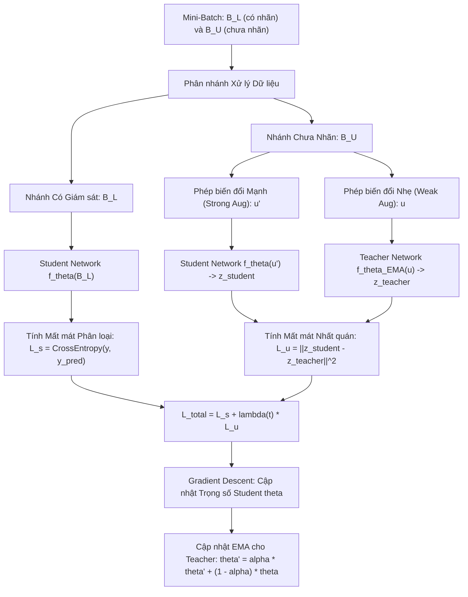

# Ràng buộc Nhất quán trong Học bán giám sát (Consistency Regularization)

## Purpose

Trong các phương pháp Học bán giám sát truyền thống, việc gán nhãn giả (Pseudo-labeling) hay xây dựng đồ thị tương đồng thường gặp khó khăn lớn khi mở rộng lên không gian dữ liệu nhiều chiều và các mạng Deep Neural Networks khổng lồ.

**Ràng buộc Nhất quán (Consistency Regularization)** là một trong những trụ cột thành công và có ảnh hưởng sâu rộng nhất trong Học bán giám sát hiện đại (Sajjadi et al., 2016; Laine & Aila, 2017; Tarvainen & Valpola, 2017).

Nguyên lý cốt lõi dựa trên **Giả định Độ Mượt Cục bộ (Local Smoothness Assumption)**:
1. **Tính Bất biến với Nhiễu (Invariance to Perturbations):** Một mô hình dự đoán mạnh mẽ phải có tính chất ổn định: nếu ta thêm một lượng nhiễu nhỏ ngẫu nhiên hoặc áp dụng các phép biến dạng thực tế (Data Augmentation như xoay, lật, thay đổi độ sáng, Gaussian noise, Dropout) vào cùng một mẫu dữ liệu chưa nhãn $`u`$, mô hình **bắt buộc phải đưa ra các dự đoán đầu ra nhất quán và tương đồng nhau**:

$$
f(u; \theta) \approx f(\text{Augment}(u); \theta)
$$

2. **Khai thác Toàn bộ $`D_U`$ mà Không Cần Nhãn Thật:** Ràng buộc nhất quán không cần biết nhãn thật của $`u`$ là gì; nó chỉ cưỡng ép bề mặt hàm số $`f(x)`$ phải phẳng và mượt dọc theo vùng không gian bao quanh dữ liệu thực tế, đẩy ranh giới quyết định ra xa khỏi các điểm dữ liệu chưa nhãn.
3. **Tiến hóa Kiến trúc từ $`\Pi`$-Model đến Mean Teacher:** Quá trình cải tiến từ việc so sánh hai lần chạy cùng một mạng (Pi-Model), đến việc lưu vết dự đoán theo thời gian (Temporal Ensembling), và đỉnh cao là kiến trúc **Mạng Giáo viên - Học sinh (Mean Teacher)** giúp ổn định mục tiêu huấn luyện và đạt độ chính xác tương đương con người. [1][2]

---

## Input

Dữ liệu và cấu hình phục vụ cơ chế Ràng buộc Nhất quán:

1. **Batch Dữ liệu Hỗn hợp:**
   * Mẫu có nhãn: $`x \in D_L`$ kèm nhãn chuẩn $`y`$.
   * Mẫu chưa nhãn: $`u \in D_U`$.
2. **Hàm Nhiễu và Tăng cường Dữ liệu Ngẫu nhiên (Stochastic Augmentation Operator - $`\text{Aug}(x)`$):**
   * Đối với hình ảnh: Phép cắt cúp ngẫu nhiên (Random Crop), lật ngang (Horizontal Flip), làm mờ Gaussian (Gaussian Blur), biến đổi màu sắc (Color Jittering).
   * Đối với cấu trúc mạng: Bật chế độ Dropout ngẫu nhiên giữa các lớp ẩn.
3. **Hệ số Trọng số Nhất quán ($`\lambda(t)`$):**
   * Trọng số cân bằng động tăng dần từ 0 theo lịch trình Ramp-up (Sigmoid Ramp-up) để bảo vệ mạng trong giai đoạn khởi động.
4. **Hệ số Suy giảm Trung bình Trượt Lũy thừa (EMA Decay Rate - $`\alpha`$):**
   * Tham số cập nhật trọng số của Mạng Giáo viên trong Mean Teacher (thường chọn $`\alpha = 0.99`$ hoặc $`0.999`$).

---

## Output

Kết quả đầu ra của hệ thống huấn luyện nhất quán:

1. **Mạng Học sinh Tối ưu (Optimal Student Network $`\theta^{\ast}`$):**
   * Mạng neuron chính được dùng để suy luận thời gian thực trong sản xuất.
2. **Mạng Giáo viên Tích lũy (Ensemble Teacher Network $`\theta_{\text{EMA}}^{\ast}`$):**
   * Mạng có trọng số là trung bình trượt theo thời gian. Mạng này thường có độ chính xác và khả năng tổng quát hóa cao hơn cả mạng học sinh từ 1% đến 3%.
3. **Mất mát Nhất quán (Consistency Loss Score):**
   * Thước đo định lượng sự sai lệch giữa các biến thể dự đoán của cùng một mẫu chưa nhãn.

---

## Evaluation metrics

Đánh giá chất lượng của mô hình nhất quán:

1. **Mất mát Sai lệch Nhất quán Trung bình (Mean Consistency Distance):**

$$
\mathcal{L}_{\text{cons}} = \frac{1}{|D_U|} \sum_{u \in D_U} d\left( f(u; \theta), f(\text{Aug}(u); \theta') \right)
$$

   * Đo lường bằng khoảng cách bình phương Euclid (MSE) trên vector xác suất Softmax hoặc phân kỳ Jensen-Shannon.
2. **Độ ổn định của Dự đoán Giáo viên (Teacher Prediction Stability):**
   * Đo mức độ biến động của phân phối xác suất đầu ra do Mạng Giáo viên cung cấp qua các epoch.
3. **Độ chính xác Top-1 và Top-5 Error trên Test Set Độc lập.**

---

## How it works

### 1. Sự Tiến Hóa của Ba Kiến Trúc Ràng Buộc Nhất Quán

```text
 1. Mô hình Pi-Model (2017)           2. Temporal Ensembling (2017)        3. Mean Teacher (2017 - Đỉnh cao)
   u -> Aug1 -> f_theta -> z1           u -> Aug -> f_theta -> z             u -> Aug_strong -> Student(theta) -> z
        │                │                          │                                             │
        │ MSE Loss <─────┘                          │ MSE Loss                                    │ MSE Loss
        ▼                                           ▼                                             ▼
   u -> Aug2 -> f_theta -> z2                 Lưu vết EMA z_target         u -> Aug_weak -> Teacher(theta_EMA) -> z_target
  (Tốn 2 lần Forward Pass)                   (Tốn RAM lưu trữ toàn bộ N)  (Cập nhật Teacher bằng EMA trọng số)
```

---

### 2. Kiến trúc Mean Teacher (Tarvainen & Valpola, 2017) - Giải pháp Chuẩn Mực

Trong kiến trúc **Mean Teacher**, thay vì duy trì một mục tiêu nhãn tĩnh hoặc trung bình trượt của từng mẫu riêng lẻ (gây tốn bộ nhớ RAM để lưu trữ toàn bộ tập dữ liệu), thuật toán duy trì hai mô hình có cấu trúc giống hệt nhau:

1. **Mạng Học sinh (Student Model $`f_\theta`$):**
   * Tiếp nhận mẫu chưa nhãn đã qua biến đổi mạnh (Strong Augmentation $`u'`$).
   * Tham số $`\theta`$ được cập nhật liên tục qua từng batch bằng thuật toán lan truyền ngược (Backpropagation) và Gradient Descent.
2. **Mạng Giáo viên (Teacher Model $`f_{\theta'}`$):**
   * Tiếp nhận mẫu chưa nhãn nguyên bản hoặc qua biến đổi nhẹ (Weak Augmentation $`u`$).
   * Tham số $`\theta'`$ **KHÔNG BAO GIỜ được cập nhật bằng Gradient**. Thay vào đó, trọng số của Giáo viên là đường trung bình trượt lũy thừa (Exponential Moving Average - EMA) của trọng số Học sinh sau mỗi bước lặp $`t`$:

$$
\theta_t' = \alpha \theta_{t-1}' + (1 - \alpha) \theta_t
$$

* **Tại sao Mạng Giáo viên lại vượt trội?**
  * Việc lấy trung bình trượt trọng số $`\theta'`$ tương đương với việc thực hiện phép tổ hợp vô hạn các mô hình học sinh trong quá khứ (Polyak-Ruppert Averaging). Nhờ đó, Mạng Giáo viên có biểu diễn không gian mượt mà hơn, triệt tiêu các dao động ngẫu nhiên của từng batch và cung cấp các mục tiêu nhãn chất lượng cao hơn hẳn so với việc để mô hình tự so sánh với chính mình.

#### Hàm Mất Mát Toàn Cục của Mean Teacher:
Tổng mất mát trên một mini-batch gồm cả dữ liệu có nhãn và chưa nhãn:

$$
\mathcal{L}_{\text{total}} = \frac{1}{B_l} \sum_{i \in B_l} \text{CrossEntropy}(y_i, f(x_i; \theta)) + \lambda(t) \cdot \frac{1}{B_u} \sum_{j \in B_u} \left\| f(u_j'; \theta) - f(u_j; \theta') \right\|^2
$$

---

## Data used

Consistency Regularization là nền tảng của toàn bộ các hệ thống AI thị giác và xử lý ngôn ngữ hiện đại:

1. **Phân loại Hình ảnh với Tập Nhãn Cực Nhỏ (Semi-Supervised Image Classification):**
   * Đạt độ chính xác trên 95% trên tập dữ liệu chuẩn CIFAR-10 chỉ với 250 ảnh có nhãn (25 ảnh mỗi lớp).
2. **Chẩn đoán Bệnh học Kỹ thuật số (Digital Pathology):**
   * Ảnh mô bệnh học độ phân giải siêu cao (Gigapixel Whole Slide Images). Consistency Regularization giúp mạng bất biến với các góc xoay tự nhiên của lát cắt kính hiển vi.
3. **Xe Tự hành và Thị giác Robot (Autonomous Driving):**
   * Phân đoạn ngữ nghĩa thời gian thực (Semantic Segmentation) từ luồng video camera hành trình chưa có nhãn.

---

## Design

### 1. Sơ đồ Luồng Hoạt Động của Kiến Trúc Mean Teacher



---

### 2. Mã nguồn Kỹ thuật Minh họa Cơ chế Mean Teacher bằng PyTorch / NumPy

```python
import numpy as np

class SimpleMeanTeacherEngine:
    """
    Mô phỏng cơ chế toán học cốt lõi của Kiến trúc Mean Teacher.
    Bao gồm:
    1. Cập nhật trọng số Teacher bằng Exponential Moving Average (EMA).
    2. Tính toán Consistency Loss (MSE) giữa Student và Teacher.
    """
    def __init__(self, n_features=10, n_classes=2, alpha=0.99, lambda_cons=1.0):
        self.n_features = n_features
        self.n_classes = n_classes
        self.alpha = alpha # Hệ số suy giảm EMA
        self.lambda_cons = lambda_cons

        # Khởi tạo trọng số tuyến tính cho Student và Teacher
        np.random.seed(42)
        self.theta_student = np.random.randn(n_features, n_classes) * 0.1
        self.theta_teacher = np.copy(self.theta_student) # Ban đầu Teacher sao chép Student

    def _softmax(self, z):
        exp_z = np.exp(z - np.max(z, axis=1, keepdims=True))
        return exp_z / np.sum(exp_z, axis=1, keepdims=True)

    def student_forward(self, X_perturbed):
        # Forward pass qua mạng Student với dữ liệu có nhiễu
        logits = np.dot(X_perturbed, self.theta_student)
        return self._softmax(logits)

    def teacher_forward(self, X_clean):
        # Forward pass qua mạng Teacher với dữ liệu ít nhiễu
        logits = np.dot(X_clean, self.theta_teacher)
        return self._softmax(logits)

    def update_teacher_weights(self):
        # Cập nhật trọng số Teacher bằng đường trung bình trượt lũy thừa (EMA)
        self.theta_teacher = self.alpha * self.theta_teacher + (1.0 - self.alpha) * self.theta_student

    def compute_consistency_loss(self, prob_student, prob_teacher):
        # Tính khoảng cách bình phương trung bình (MSE) giữa 2 phân phối
        return np.mean(np.sum((prob_student - prob_teacher) ** 2, axis=1))

# ==========================================
# MÔ PHỎNG MỘT BƯỚC HUẤN LUYỆN
# ==========================================
engine = SimpleMeanTeacherEngine(n_features=5, n_classes=2, alpha=0.95, lambda_cons=2.0)

# 1. Giả lập 10 mẫu chưa nhãn (u_clean) và biến thể nhiễu của chúng (u_perturbed)
np.random.seed(42)
u_clean = np.random.randn(10, 5)
noise = np.random.normal(0, 0.1, size=u_clean.shape)
u_perturbed = u_clean + noise

# 2. Forward pass qua cả hai mô hình
prob_student = engine.student_forward(u_perturbed)
prob_teacher = engine.teacher_forward(u_clean)

# 3. Tính toán mất mát nhất quán
cons_loss = engine.compute_consistency_loss(prob_student, prob_teacher)
print(f"Mất mát Nhất quán (Consistency Loss) giữa Student và Teacher: {cons_loss:.6f}")

# 4. Giả lập Student được cập nhật bởi Gradient và cập nhật EMA cho Teacher
print("\nTiến hành cập nhật trọng số:")
print(f"Trọng số Student trước khi cập nhật (mẫu 2 tham số đầu):\n{engine.theta_student[:2]}")
# Giả lập gradient step của student
engine.theta_student += np.random.randn(5, 2) * 0.05
# Cập nhật Teacher
engine.update_teacher_weights()
print(f"Trọng số Teacher sau khi cập nhật EMA:\n{engine.theta_teacher[:2]}")
```

---

## Nguồn

- [1] Laine, S., & Aila, T. (2017). *Temporal Ensembling for Semi-Supervised Learning*. International Conference on Learning Representations (ICLR).
- [2] Tarvainen, A., & Valpola, H. (2017). *Mean teachers are better role models: Weight-averaged consistency targets improve semi-supervised deep learning results*. Advances in Neural Information Processing Systems (NeurIPS), 30, 1195-1204.
- [3] Sajjadi, M., Javanmardi, M., & Tasdizen, T. (2016). *Regularization with stochastic transformations and perturbations for deep semi-supervised learning*. Advances in Neural Information Processing Systems (NeurIPS), 29, 1163-1171.
- [4] Miyato, T., Maeda, S. I., Koyama, M., & Ishii, S. (2018). *Virtual adversarial training: a regularization method for supervised and semi-supervised learning*. IEEE Transactions on Pattern Analysis and Machine Intelligence (TPAMI), 41(8), 1979-1993.

