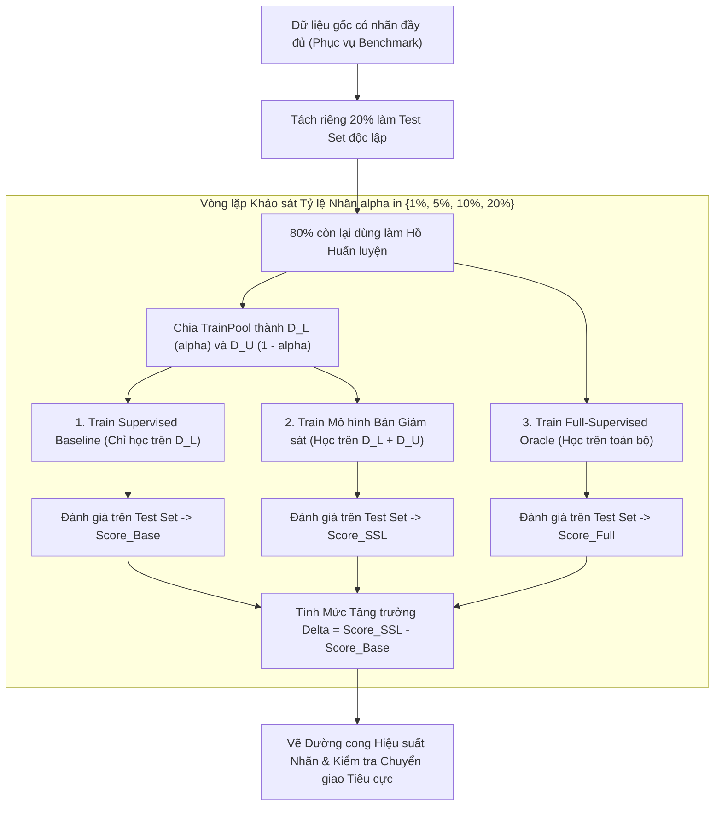

# Phương pháp luận Đánh giá Mô hình Bán giám sát (Evaluation Metrics & Benchmarking)

## Purpose

Trong Học có giám sát, việc đánh giá mô hình chỉ đơn giản là đo lường các chỉ số sai số chuẩn (như Accuracy, F1-Score, RMSE) trên một tập kiểm tra độc lập. Tuy nhiên, trong **Học bán giám sát (Semi-Supervised Learning)**, phương pháp luận đánh giá đòi hỏi tính nghiêm ngặt và toàn diện hơn rất nhiều để trả lời câu hỏi cốt tử: *Liệu việc bổ sung tập dữ liệu chưa nhãn $`D_U`$ có thực sự mang lại giá trị gia tăng so với việc chỉ huấn luyện mô hình có giám sát thuần túy trên tập nhãn $`D_L`$ hay không?*

Tài liệu này chuẩn hóa quy trình đánh giá khoa học cho Học bán giám sát:
1. **Thiết lập Đối chứng Hai Mô hình Chuẩn mực (Strict Baseline Comparison):** Mọi kết quả bán giám sát bắt buộc phải được đặt cạnh **Supervised Baseline** (mô hình cùng kiến trúc nhưng chỉ được học duy nhất trên $`D_L`$) và **Full-Supervised Upper Bound** (mô hình lý tưởng giả định toàn bộ $`D_L \cup D_U`$ đều có nhãn thật).
2. **Đo lường Mức Tăng trưởng Hiệu năng ($`\Delta`$) và Phát hiện Chuyển giao Tiêu cực (Negative Transfer):** Nhận diện kịp thời các trường hợp dữ liệu chưa nhãn bị lệch phân phối hoặc có quá nhiều nhiễu làm suy giảm hiệu năng của hệ thống.
3. **Đánh giá Chất lượng Giả nhãn (Pseudo-Label Quality Audit):** Đo lường độ chính xác (Precision) và độ phủ (Coverage) của các giả nhãn tự gán trong suốt quá trình huấn luyện.
4. **Phân biệt Rạch ròi Giữa Đánh giá Quy nạp (Inductive) và Chuyển vị (Transductive).** [1][2]

---

## Input

Dữ liệu đầu vào và các hiện vật cần thiết cho quy trình đánh giá:

1. **Tập Kiểm tra Độc lập Giữ Riêng (Hold-out Test Set - $`D_{\text{test}}`$):**
   * Tập gồm $`n_{\text{test}}`$ mẫu có nhãn chuẩn $`100\%`$ được tách ra ngay từ đầu, tuyệt đối không tham gia vào bất kỳ khâu nào của quá trình tiền xử lý hay huấn luyện bán giám sát.
2. **Nhãn Ẩn của Tập Chưa Nhãn ($`y_U^*`$ - Dùng trong Môi trường Nghiên cứu Benchmark):**
   * Nhãn thực tế của các mẫu trong $`D_U`$ (bị cố tình ẩn đi lúc train) dùng để kiểm toán chất lượng giả nhãn nội bộ.
3. **Dãy Tỷ lệ Nhãn Cần Khảo sát (Label Fraction Spectrum - $`\alpha`$):**
   * Dãy tỷ lệ $`\alpha \in \lbrace 1\%, 2\%, 5\%, 10\%, 20\%, 50\% \rbrace`$ để vẽ đường cong hiệu quả khai thác nhãn.
4. **Số lượng Lần Chạy Lặp Lại Độc lập (Random Splits / Seeds):**
   * Tối thiểu 5 lần chạy với các hạt giống ngẫu nhiên khác nhau để tính khoảng tin cậy thống kê (Confidence Intervals $`95\%`$).

---

## Output

Báo cáo đánh giá khoa học toàn diện bao gồm:

1. **Bảng So sánh Bộ Ba Hiệu năng (The Three-Tier Performance Table):**
   * Điểm số đối đầu giữa: Supervised Baseline ($`D_L`$), Semi-Supervised Model ($`D_L + D_U`$), và Full-Supervised Oracle ($`D_L + D_U`$ có nhãn đầy đủ).
2. **Đường cong Hiệu suất Nhãn (Label Efficiency Curve):**
   * Biểu đồ trực quan thể hiện mối tương quan giữa tỷ lệ nhãn $`\alpha`$ và độ chính xác đạt được, xác định điểm bão hòa nơi dữ liệu chưa nhãn bắt đầu giảm dần tác dụng.
3. **Báo cáo Kiểm toán Giả nhãn (Pseudo-Label Audit Report):**
   * Độ chính xác, ma trận nhầm lẫn (Confusion Matrix) của các giả nhãn, và tỷ lệ bao phủ của giả nhãn trên $`D_U`$.

---

## Evaluation metrics

Các thước đo định lượng chuyên dụng trong Học bán giám sát:

1. **Mức Tăng trưởng Hiệu năng Tuyệt đối ($`\Delta_{\text{abs}}`$) và Tương đối ($`\Delta_{\text{rel}}`$):**

$$
\Delta_{\text{abs}} = \text{Score}_{\text{SSL}} - \text{Score}_{\text{Baseline}}
$$

$$
\Delta_{\text{rel}} = \frac{\text{Score}_{\text{SSL}} - \text{Score}_{\text{Baseline}}}{\text{Score}_{\text{Full}} - \text{Score}_{\text{Baseline}}} \times 100\%
$$

   * $`\Delta_{\text{rel}}`$ phản ánh tỷ lệ phần trăm khoảng cách giữa Baseline và mô hình lý tưởng Full-Supervised mà giải pháp SSL đã thu hẹp được.
2. **Độ Chính xác của Giả nhãn (Pseudo-Label Precision - $`P_{\text{pseudo}}`$):**

$$
P_{\text{pseudo}} = \frac{1}{|D_{\text{pseudo}}|} \sum_{u_j \in D_{\text{pseudo}}} \mathbb{I}(\hat{y}_j = y_j^*)
$$

   * Đánh giá xem mô hình có đang nạp nhãn sạch hay nhãn rác vào tập train.
3. **Độ Phủ của Giả nhãn (Pseudo-Label Coverage - $`C_{\text{pseudo}}`$):**

$$
C_{\text{pseudo}} = \frac{|D_{\text{pseudo}}|}{|D_U|}
$$

   * Thể hiện tỷ lệ phần trăm dữ liệu chưa nhãn được mô hình khai thác hiệu quả.
4. **Chỉ số Cảnh báo Chuyển giao Tiêu cực (Negative Transfer Index):**
   * Nếu kiểm định giả thuyết $`t`$-test một phía cho thấy $`P(\Delta_{\text{abs}} < 0) > 0.05`$, hệ thống cảnh báo chuyển giao tiêu cực: việc thêm $`D_U`$ làm mô hình hoạt động kém hơn việc chỉ dùng $`D_L`$.

---

## How it works

### 1. Khung Phương Pháp Luận Benchmark Chuẩn Mực

Một thí nghiệm đánh giá Học bán giám sát đúng chuẩn học thuật bắt buộc phải tuân theo sơ đồ đối chứng 3 tầng:

```text
       ĐÁNH GIÁ ĐỐI CHỨNG 3 TẦNG TRONG BÁN GIÁM SÁT:
       
       Tầng 3: Cận trên Lý tưởng (Full-Supervised Oracle)
       Huấn luyện trên 100% dữ liệu có nhãn thật -> Điểm số tối đa kỳ vọng
                          ▲
                          │  Khoảng cách cần thu hẹp
                          ▼
       Tầng 2: Mô hình Bán giám sát (Semi-Supervised Model)
       Huấn luyện trên D_L (ít nhãn) + D_U (nhiều chưa nhãn) -> Đạt Delta > 0
                          ▲
                          │  Mức tăng trưởng Delta
                          ▼
       Tầng 1: Cận dưới Tối thiểu (Supervised Baseline)
       Huấn luyện CHỈ trên D_L (ít nhãn) -> Chuẩn đối chứng bắt buộc
```

---

### 2. Hai Thiết Lập Đánh Giá: Quy Nạp (Inductive) vs Chuyển Vị (Transductive)

Cần phân biệt rõ ràng hai bài toán đánh giá để tránh so sánh khập khiễng:

| Tiêu chí | Đánh giá Quy nạp (Inductive Evaluation) | Đánh giá Chuyển vị (Transductive Evaluation) |
|---|---|---|
| **Tập dữ liệu kiểm tra** | Tập $`D_{\text{test}}`$ hoàn toàn độc lập, chưa từng thấy lúc train | Chính là tập dữ liệu chưa nhãn $`D_U`$ đã có mặt lúc train |
| **Mục tiêu đánh giá** | Khả năng tổng quát hóa trên người dùng mới ngoài đời | Khả năng "điền vào chỗ trống" cho dữ liệu hiện tại |
| **Thuật toán áp dụng** | Self-Training, Mean Teacher, S3VM | Label Propagation, Label Spreading |
| **Ứng dụng thực tế** | Triển khai API thời gian thực phục vụ tương lai | Khám phá tri thức, làm sạch cơ sở dữ liệu lịch sử |

---

## Data used

Phương pháp đánh giá bán giám sát được áp dụng bắt buộc trên:

1. **Kiểm tra Sức chịu đựng theo Độ hiếm của Nhãn (Label Scarcity Stress Test):**
   * Đánh giá mô hình trên các kịch bản số lượng nhãn giảm dần: từ 100 nhãn mỗi lớp xuống còn 10 nhãn, 5 nhãn, và 1 nhãn duy nhất mỗi lớp (One-shot Semi-Supervised).
2. **Kiểm tra Độ lệch Phân phối giữa $`D_L`$ và $`D_U`$ (Out-of-Distribution Unlabeled Data):**
   * Đưa vào $`D_U`$ các mẫu dữ liệu không thuộc bất kỳ lớp mục tiêu nào (Open-Set SSL). Đánh giá xem mô hình có bị các mẫu rác này làm hỏng độ chính xác hay không.

---

## Design

### 1. Kiến trúc Quy trình Tự động Đánh giá Đối chứng Benchmark



---

### 2. Mã nguồn Kỹ thuật Xây dựng Hệ thống Benchmark Bán giám sát

```python
import numpy as np
from sklearn.datasets import load_breast_cancer
from sklearn.model_selection import train_test_split
from sklearn.preprocessing import StandardScaler
from sklearn.linear_model import LogisticRegression
from sklearn.semi_supervised import SelfTrainingClassifier
from sklearn.metrics import accuracy_score, f1_score

def run_ssl_benchmark(X, y, label_ratios=[0.02, 0.05, 0.10, 0.20], n_repeats=5, random_state=42):
    """
    Hệ thống đánh giá đối chứng chuẩn 3 tầng cho Học bán giám sát.
    So sánh: Supervised Baseline vs Semi-Supervised vs Full-Supervised Oracle.
    """
    scaler = StandardScaler()
    X_scaled = scaler.fit_transform(X)

    # Tách tập Test độc lập 20%
    X_train_full, X_test, y_train_full, y_test = train_test_split(
        X_scaled, y, test_size=0.20, stratify=y, random_state=random_state
    )

    # 1. Huấn luyện Full-Supervised Oracle (Cận trên lý tưởng khi có 100% nhãn)
    oracle_model = LogisticRegression(random_state=random_state)
    oracle_model.fit(X_train_full, y_train_full)
    oracle_score = f1_score(y_test, oracle_model.predict(X_test))

    print(f"{'Tỷ lệ nhãn':<12} | {'Baseline (D_L)':<16} | {'SSL (D_L + D_U)':<18} | {'Mức tăng Delta':<16} | {'Oracle (100%)':<12}")
    print("-" * 80)

    for ratio in label_ratios:
        baseline_scores = []
        ssl_scores = []

        for seed in range(n_repeats):
            rng = np.random.RandomState(random_state + seed)
            n_train = len(y_train_full)
            y_ssl = np.full(n_train, fill_value=-1)

            # Phân tầng để lấy đúng tỷ lệ ratio cho mỗi lớp
            labeled_idx = []
            for c in np.unique(y_train_full):
                c_idx = np.where(y_train_full == c)[0]
                n_keep = max(2, int(np.round(len(c_idx) * ratio)))
                chosen = rng.choice(c_idx, size=n_keep, replace=False)
                labeled_idx.extend(chosen)
                y_ssl[chosen] = y_train_full[chosen]

            # 2. Huấn luyện Baseline có giám sát (Chỉ nhìn thấy D_L)
            mask_labeled = (y_ssl != -1)
            base_clf = LogisticRegression(random_state=random_state)
            base_clf.fit(X_train_full[mask_labeled], y_ssl[mask_labeled])
            base_f1 = f1_score(y_test, base_clf.predict(X_test))
            baseline_scores.append(base_f1)

            # 3. Huấn luyện Mô hình Bán Giám Sát (Khai thác cả D_L và D_U)
            ssl_clf = SelfTrainingClassifier(
                base_estimator=LogisticRegression(random_state=random_state),
                threshold=0.80,
                max_iter=15
            )
            ssl_clf.fit(X_train_full, y_ssl)
            ssl_f1 = f1_score(y_test, ssl_clf.predict(X_test))
            ssl_scores.append(ssl_f1)

        mean_base = np.mean(baseline_scores)
        mean_ssl = np.mean(ssl_scores)
        delta_abs = mean_ssl - mean_base

        status = f"{delta_abs:+.4f}" if delta_abs >= 0 else f"{delta_abs:+.4f} (TIÊU CỰC!)"
        print(f"{ratio*100:<5.1f}% ({len(labeled_idx)} mẫu) | {mean_base:<16.4f} | {mean_ssl:<18.4f} | {status:<16} | {oracle_score:<12.4f}")

# Thực thi benchmark trên tập Breast Cancer
X_raw, y_true = load_breast_cancer(return_X_y=True)
run_ssl_benchmark(X_raw, y_true, label_ratios=[0.02, 0.05, 0.10, 0.20], n_repeats=3)
```

---

## Nguồn

- [1] Oliver, A., Odena, A., Raffel, C. A., Cubuk, E. D., & Goodfellow, I. (2018). *Realistic evaluation of deep semi-supervised learning algorithms*. Advances in Neural Information Processing Systems (NeurIPS), 31, 3235-3246.
- [2] Chapelle, O., Schölkopf, B., & Zien, A. (2006). *Semi-Supervised Learning* (Chapter 21: An Overview of Empirical Results). MIT Press.
- [3] Van Engelen, J. E., & Hoos, H. H. (2020). *A survey on semi-supervised learning*. Machine Learning, 109(2), 373-440.

