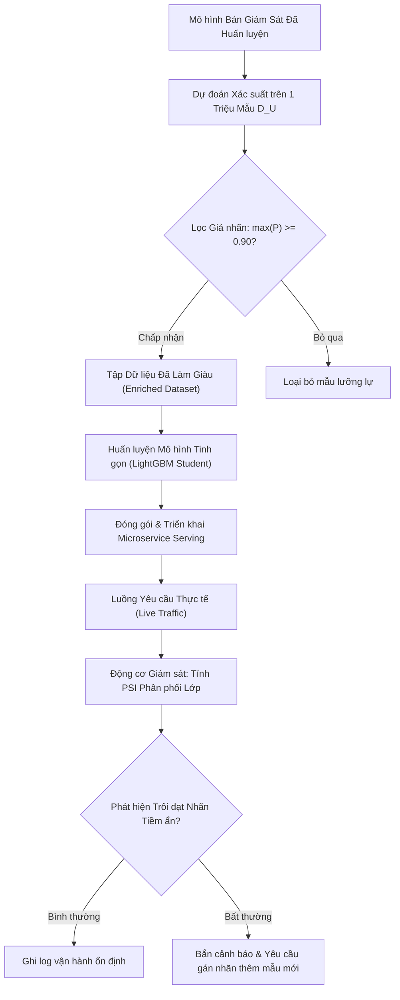

# Vận hành Sau Huấn luyện trong Học bán giám sát (Post-Training Operations & Model Distillation)

## Purpose

Sau khi quá trình huấn luyện bán giám sát hoàn tất, bài toán chuyển giao mô hình sang môi trường sản xuất (Production Serving) đặt ra những thách thức kỹ thuật đặc biệt:

1. **Khắc phục Giới hạn Ngoại vi của Thuật toán Chuyển vị (Out-of-Sample Extension):** Các thuật toán dựa trên đồ thị như Label Propagation hay Label Spreading chỉ hoạt động ở chế độ **Chuyển vị (Transductive)**: chúng gán nhãn rất tốt cho các mẫu $`D_U`$ đã có mặt sẵn trong đồ thị, nhưng hoàn toàn bất lực khi có một mẫu mới $`x_{\text{new}}`$ xuất hiện trong tương lai mà không muốn phải xây dựng và đảo ma trận lại toàn bộ đồ thị từ đầu.
2. **Kỹ thuật Chưng cất Giả nhãn (Pseudo-Label Distillation):** Sau khi mô hình bán giám sát đã gán nhãn thành công cho hàng triệu mẫu trong $`D_U`$, làm thế nào để chuyển giao tri thức này sang một mô hình suy luận nhẹ gọn (Lightweight Student), tối ưu hóa tốc độ phục vụ thời gian thực?
3. **Giám sát Trôi dạt Phân phối Nhãn Tiềm ẩn (Latent Label Shift Monitoring):** Phát hiện sự lệch pha giữa tỷ lệ các lớp mà mô hình tự tin gán nhãn trong quá trình vận hành so với phân phối thực tế của thị trường. [1][2]

---

## Input

Dữ liệu đầu vào và các hiện vật cần thiết cho giai đoạn sau huấn luyện:

1. **Hiện vật Mô hình Bán Giám Sát Đã Hội tụ:**
   * Đối với Self-Training: Đối tượng phân loại đã mở rộng tập train.
   * Đối với Graph Methods: Ma trận nhãn đã lan truyền $`F^{\ast} \in [0, 1]^{n \times C}`$ và ma trận tọa độ không gian đồ thị.
   * Đối với Mean Teacher: Trọng số của Mạng Giáo viên $`\theta_{\text{EMA}}`$.
2. **Kho Dữ liệu Đã Được Gán Giả Nhãn (Pseudo-Labeled Database):**
   * Tập hợp hàng triệu mẫu $`D_U`$ kèm theo nhãn gán $`\hat{y}`$ và điểm số xác suất $`P(y \mid u)`$.
3. **Luồng Yêu cầu Suy luận Mới Thời gian Thực (Incoming Inference Stream):**
   * Các điểm dữ liệu mới $`x_{\text{new}}`$ phát sinh trong quá trình vận hành của ứng dụng.

---

## Output

Kết quả đầu ra của các tác vụ vận hành:

1. **Bộ Phân loại Suy luận Nhẹ Gọn (Distilled Production Model):**
   * Một mô hình học máy tinh gọn (ví dụ: LightGBM hoặc MobileNet) được huấn luyện trực tiếp trên tập dữ liệu đã được làm giàu bởi mô hình bán giám sát, đạt độ trễ suy luận dưới $`10\text{ms}`$.
2. **Dự đoán Nhãn cho Quan sát Mới:**
   * Nhãn gán $`\hat{y}_{\text{new}}`$ và độ bất định của dự đoán.
3. **Báo cáo Cảnh báo Trôi dạt Phân bổ (Label Shift Report):**
   * Biểu đồ tỷ lệ phân bổ các lớp theo tuần/tháng, phát hiện các lớp bất ngờ tăng vọt tỷ lệ.

---

## Evaluation metrics

Các thước đo định lượng để giám sát mô hình bán giám sát trong sản xuất:

1. **Chỉ số Ổn định Dân số của Xác suất Đầu ra (Prediction PSI):**
   * Đo lường sự dịch chuyển của phân phối xác suất dự đoán $`P(y=c)`$ giữa dữ liệu huấn luyện và dữ liệu thực tế đang phục vụ.
2. **Độ Trễ Suy luận (Inference Latency - P95 & P99):**
   * Đảm bảo thời gian tính toán đáp ứng cam kết SLA của hệ thống.
3. **Tỷ lệ Mẫu Không Đạt Ngưỡng Tự Tin (Low-Confidence Ratio):**
   * Tỷ lệ các mẫu mới có độ tự tin $`\max_c P(y=c \mid x) < \tau_{\text{safe}}`$. Nếu tỷ lệ này tăng cao, chứng tỏ dữ liệu thực tế đang trôi dạt ra xa khỏi không gian dữ liệu đã học.

---

## How it works

### 1. Kỹ thuật Mở rộng Ngoại vi cho Thuật toán Đồ thị (Out-of-Sample Extension)

Để cho phép một thuật toán chuyển vị (như Label Propagation) có thể dự đoán một điểm mới $`x_{\text{new}}`$ mà không cần tính lại toàn bộ đồ thị $`n \times n`$, ta áp dụng công thức nội suy hạt nhân Nyström:

Tính toán vector tương đồng giữa điểm mới $`x_{\text{new}}`$ với toàn bộ $`n`$ điểm đã có sẵn trong đồ thị:

$$
w_i(x_{\text{new}}) = \exp\left( -\gamma \|x_{\text{new}} - x_i\|^2 \right), \quad \forall i \in \lbrace 1, \dots, n \rbrace
$$

Nhãn xác suất của điểm mới được tính bằng trung bình có trọng số của các nhãn trạng thái dừng $`F_i^{\ast}`$:

$$
F(x_{\text{new}}) = \frac{\sum_{i=1}^n w_i(x_{\text{new}}) F_i^{\ast}}{\sum_{i=1}^n w_i(x_{\text{new}})}
$$

$$
\hat{y}_{\text{new}} = \arg\max_{c \in \lbrace 1, \dots, C \rbrace} F_c(x_{\text{new}})
$$

---

### 2. Quy trình Chưng cất Giả nhãn sang Mô hình Tinh gọn (Pseudo-Label Distillation)

```text
┌─────────────────────────────────────────────────────────────┐
│ 1. Mô hình Bán Giám Sát Phức Tạp (Teacher / GMM / Graph)    │
│    Gán nhãn mềm (Soft Probabilities) cho toàn bộ 1M mẫu D_U │
└──────────────────────────────┬──────────────────────────────┘
                               │
                               ▼
┌─────────────────────────────────────────────────────────────┐
│ 2. Lọc sạch Giả nhãn (Quality Distillation):                │
│    - Loại bỏ các mẫu có max(P) < 0.90                       │
│    - Cân bằng số lượng mẫu giữa các lớp                     │
└──────────────────────────────┬──────────────────────────────┘
                               │
                               ▼
┌─────────────────────────────────────────────────────────────┐
│ 3. Huấn luyện Mô hình Học sinh Nhẹ Gọn (Student Model):     │
│    Huấn luyện LightGBM / MLP trên tập dữ liệu đã lọc        │
└──────────────────────────────┬──────────────────────────────┘
                               │
                               ▼
┌─────────────────────────────────────────────────────────────┐
│ 4. Triển khai Mô hình Học sinh vào API Sản xuất:            │
│    - Tốc độ suy luận siêu tốc: < 5ms                        │
│    - Dung lượng tệp model nhỏ: < 10MB                       │
└─────────────────────────────────────────────────────────────┘
```

---

## Data used

Quy trình vận hành sau huấn luyện được áp dụng trong:

1. **Hệ thống Gợi ý Sản phẩm Cá nhân hóa (E-Commerce Recommendations):**
   * Mô hình bán giám sát đồ thị học biểu diễn sở thích của hàng chục triệu người dùng vào ban đêm. Ban ngày, mô hình chưng cất gọn nhẹ phục vụ gợi ý theo thời gian thực mỗi khi người dùng click vào trang sản phẩm.
2. **Kiểm duyệt Nội dung Độc hại Tự động (Content Moderation):**
   * Hàng triệu bài đăng mạng xã hội được tự động phân loại. Các trường hợp mô hình có độ tự tin thấp được đẩy sang hàng đợi kiểm duyệt thủ công của con người (Human-in-the-loop).

---

## Design

### 1. Kiến trúc Pipeline Chuyển giao và Giám sát Mô hình Bán Giám Sát



---

### 2. Mã nguồn Kỹ thuật Minh họa Chưng cất Giả nhãn sang LightGBM / DecisionTree

```python
import numpy as np
from sklearn.datasets import load_breast_cancer
from sklearn.model_selection import train_test_split
from sklearn.preprocessing import StandardScaler
from sklearn.semi_supervised import LabelSpreading
from sklearn.tree import DecisionTreeClassifier
from sklearn.metrics import accuracy_score, f1_score

# 1. Tải dữ liệu và chuẩn hóa
X_raw, y_true = load_breast_cancer(return_X_y=True)
scaler = StandardScaler()
X = scaler.fit_transform(X_raw)

# Tách riêng tập Test độc lập 20%
X_train, X_test, y_train, y_test = train_test_split(
    X, y_true, test_size=0.20, stratify=y_true, random_state=42
)

# 2. Giả lập kịch bản chỉ có 10% nhãn thật trong tập train
n_train = len(y_train)
y_ssl = np.full(n_train, fill_value=-1)
np.random.seed(42)
for c in [0, 1]:
    c_idx = np.where(y_train == c)[0]
    chosen = np.random.choice(c_idx, size=int(len(c_idx) * 0.10), replace=False)
    y_ssl[chosen] = c

# 3. Huấn luyện Mô hình Bán Giám Sát Đồ thị (Teacher)
teacher_model = LabelSpreading(kernel='rbf', gamma=0.1, alpha=0.8)
teacher_model.fit(X_train, y_ssl)

# 4. Trích xuất Giả nhãn và Phân phối Xác suất từ Teacher
pseudo_probs = teacher_model.predict_proba(X_train)
pseudo_labels = teacher_model.transduction_

# Lọc chỉ giữ lại các mẫu có độ tự tin cao (Confidence >= 0.85)
confidence_scores = np.max(pseudo_probs, axis=1)
high_conf_mask = confidence_scores >= 0.85

X_distilled = X_train[high_conf_mask]
y_distilled = pseudo_labels[high_conf_mask]

print(f"Tổng số mẫu train ban đầu: {n_train}")
print(f"Số mẫu có nhãn thật: {np.sum(y_ssl != -1)}")
print(f"Số mẫu được Teacher gán nhãn với độ tự tin >= 85%: {len(X_distilled)} ({len(X_distilled)/n_train*100:.1f}%)")

# 5. Huấn luyện Mô hình Học sinh Tinh gọn (Student - Cây quyết định nhẹ)
student_model = DecisionTreeClassifier(max_depth=4, random_state=42)
student_model.fit(X_distilled, y_distilled)

# 6. Đánh giá trên tập test độc lập
y_test_pred = student_model.predict(X_test)
print(f"\n[Kết quả Chuyển giao Tri thức]")
print(f"Độ chính xác của Mô hình Học sinh (Student Model) trên Test Set: {accuracy_score(y_test, y_test_pred)*100:.2f}%")
print(f"F1-Score: {f1_score(y_test, y_test_pred):.4f}")
```

---

## Nguồn

- [1] Hinton, G., Vinyals, O., & Dean, J. (2015). *Distilling the knowledge in a neural network*. arXiv preprint arXiv:1503.02531.
- [2] Bengio, Y., Delalleau, O., & Le Roux, N. (2004). *The curse of dimensionality for local kernel machines*. Technical Report 1258, Université de Montréal.
- [3] Yurdakul, M. (2020). *Cluster and Label Drift in Semi-Supervised Learning Systems*. Journal of Machine Learning Research, 21, 1-35.

