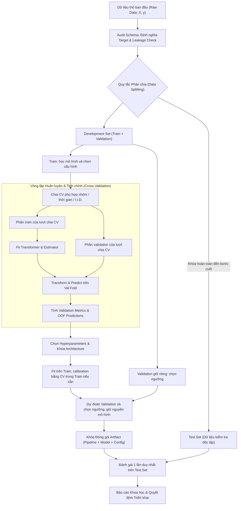

# Học giám sát: bản đồ học tập

## Purpose

Học giám sát (supervised learning) học ánh xạ từ đặc trưng `X` sang nhãn/giá trị đích `y` từ các ví dụ đã gán nhãn, để dự đoán trên ví dụ mới. Hai bài toán nền tảng là **regression** (`y` liên tục, như giá nhà) và **classification** (`y` là lớp, như thư rác/không phải thư rác). Đây là bản đồ để học từ bài toán đến vận hành, không phải một thuật toán riêng lẻ. [1][2]

**Ví dụ dẫn nhập:** muốn dự đoán giá nhà, ta dùng diện tích và số phòng làm `X`, giá giao dịch làm `y`. Mô hình học từ các căn nhà đã biết giá, rồi dự đoán giá cho căn nhà mới. Cần so dự đoán với giá thật trên dữ liệu giữ riêng; khớp tốt dữ liệu đã học chưa đủ để kết luận mô hình hữu ích.

Ký hiệu: với `n` mẫu và `p` feature số, $`X \in \mathbb{R}^{n\times p}`$, $`y = (y_{1},\ldots ,y_{n})`$. Mô hình có tham số $`\theta`$ và dự đoán $`f_\theta(x)`$. Mục tiêu là lỗi kỳ vọng trên **dữ liệu mới** thấp. Mẫu được lấy từ phân phối nào, và phân phối đó có giống lúc triển khai hay không, là giả định cần kiểm tra. [2][4]

**Cách đọc lần đầu:** nắm ví dụ trên rồi đi tiếp qua các mục Input → Output → Evaluation metrics → How it works. Phần công thức đọc sâu bên dưới giải thích cơ sở toán học; có thể quay lại sau khi hiểu quy trình train/validation/test.

### Động lực nghiên cứu & Bản chất học thuật (Textbook Intuition)

Trong khoa học máy tính truyền thống (Traditional Programming), con người cung cấp **Dữ liệu (Data)** và **Quy tắc/Thuật toán (Rules)** để máy tính tính toán ra **Đáp án (Answers)**. Ngược lại, Học giám sát đảo ngược quy trình này: con người cung cấp **Dữ liệu ($`X`$)** và **Đáp án chuẩn ($`y`$)**, nhiệm vụ của thuật toán học máy là tự động khám phá và xấp xỉ hàm quy luật $`f: \mathcal{X} \to \mathcal{Y}`$.

**Đọc sâu — giả định và công thức:** trong thiết lập I.I.D., các cặp dữ liệu được lấy độc lập từ cùng phân phối chưa biết $`P(X, Y)`$. Đây là giả định cần kiểm tra, nhất là với dữ liệu theo nhóm hoặc thời gian. Hàm mất mát $`L(y, f(x))`$ đo sai lệch giữa dự đoán $`f(x)`$ và nhãn $`y`$.

* **Rủi ro kỳ vọng (Expected Risk / Generalization Loss):** Là kỳ vọng toán học của sai số trên toàn bộ phân phối dữ liệu thực tế:

  ```math
  \mathcal{R}(f) = \mathbb{E}_{(X, Y) \sim P}[L(Y, f(X))] = \int_{\mathcal{X} \times \mathcal{Y}} L(y, f(x)) \, dP(x, y)
  ```

  Vì phân phối $`P(X, Y)`$ là ẩn số trong thực tế, ta không thể tính toán trực tiếp $`\mathcal{R}(f)`$.
* **Rủi ro thực nghiệm (Empirical Risk):** Là sai số trung bình tính trên tập dữ liệu huấn luyện mẫu gồm $`n`$ quan sát:

  ```math
  \hat{\mathcal{R}}_n(f) = \frac{1}{n} \sum_{i=1}^n L(y_i, f(x_i))
  ```

* **Nguyên lý Tối thiểu hóa Rủi ro Thực nghiệm (Empirical Risk Minimization - ERM):**
  ERM chọn hàm làm nhỏ nhất $`\hat{\mathcal{R}}_n(f)`$ trong lớp mô hình đang xét. Mô hình quá linh hoạt có thể đạt lỗi train gần 0 nhưng lỗi trên dữ liệu mới vẫn lớn: **overfitting**. Regularization là một cách kiểm soát độ phức tạp, không tự bảo đảm tổng quát hóa tốt. Khoảng cách giữa hai loại rủi ro có thể viết:

  ```math
  \mathrm{Gap}(f) = \lvert \mathcal{R}(f) - \hat{\mathcal{R}}_n(f) \rvert
  ```

  Muốn kết luận khoảng cách này tiến về 0 khi tăng dữ liệu, cần các điều kiện phù hợp về cách lấy mẫu, loss và lớp mô hình. Trong thực hành, dùng validation/test hợp lệ để ước lượng chất lượng trên dữ liệu chưa thấy. [4][14]

---

## Input

- Bài toán thực tế, đơn vị dự đoán (một người, giao dịch, ảnh...), thời điểm cần dự đoán và chi phí của từng loại sai.
- Tập ví dụ có `X` và `y`; mô tả nguồn, cách tạo nhãn, thời gian thu thập, nhóm liên quan và quyền sử dụng dữ liệu.
- Ràng buộc về độ trễ, khả năng giải thích, bộ nhớ và tần suất cập nhật.

### Không gian đầu vào & Điều kiện biên của dữ liệu

1. **Ma trận đặc trưng (Design Matrix $`X`$):**
   * Chiều dữ liệu: $`X \in \mathbb{R}^{n \times p}`$, trong đó mỗi hàng $`x_i^\top \in \mathbb{R}^p`$ đại diện cho một vector đặc trưng của quan sát thứ $`i`$, và mỗi cột đại diện cho một biến ngẫu nhiên đo lường được.
   * Bản chất kiểu dữ liệu:
     * *Dữ liệu số (Numerical):* Liên tục (chiều cao, giá tiền) hoặc rời rạc (số lượng phòng).
     * *Dữ liệu phân loại (Categorical):* Định danh (Nominal: màu sắc, quốc gia) hoặc thứ bậc (Ordinal: học lực, mức độ hài lòng).
     * *Dữ liệu phi cấu trúc (Unstructured):* Ảnh ($`H \times W \times C`$), văn bản (chuỗi token), chuỗi thời gian ($`T \times p`$). Toàn bộ phải được đưa về dạng vector số học trước khi đưa vào estimator truyền thống.
2. **Giả định I.I.D. và các vi phạm thường gặp:**
   * Giả định: Các cặp $`(x_i, y_i)`$ được sinh ra độc lập và từ cùng một phân phối $`P`$.
   * Vi phạm trong thực tế:
     * *Tương quan chuỗi (Autocorrelation):* Giá cổ phiếu hôm nay phụ thuộc vào giá hôm qua $`\to`$ vi phạm tính độc lập.
     * *Phân cụm thực thể (Grouped Data):* Nhiều hàng thuộc về cùng một bệnh nhân $`\to`$ vi phạm tính độc lập.
     * *Trôi dạt phân phối (Distribution Drift):* Dữ liệu mùa đông khác mùa hè $`\to`$ vi phạm tính cùng phân phối.

---

## Output

- Mô hình $`f(X)\to\hat{y}`$ hoặc $`f(X) \to p(y\mid X)`$; với regression là giá trị số, với classification là nhãn/điểm/xác suất.
- Báo cáo đánh giá trên dữ liệu chưa dùng để chọn mô hình, cùng giới hạn áp dụng.
- Pipeline tiền xử lý, phiên bản dữ liệu và mô hình để suy luận nhất quán.

### Phân tích không gian mục tiêu $`\mathcal{Y}`$

Tùy vào kiểu giá trị cần dự đoán, học giám sát có các dạng sau. Ký hiệu $`\mathcal{Y}`$ chỉ tập các giá trị đầu ra có thể nhận:

1. **Hồi quy (Regression):** $`\mathcal{Y} \subseteq \mathbb{R}`$ hoặc $`\mathbb{R}^m`$ (multi-output regression). Với squared-error loss và moment bậc hai hữu hạn, dự đoán tối ưu là kỳ vọng có điều kiện; loss khác có thể dẫn đến mục tiêu khác:

   ```math
   f(x) = \mathbb{E}[Y \mid X = x]
   ```

2. **Phân loại nhị phân (Binary Classification):** $`\mathcal{Y} = \{0, 1\}`$ hoặc $`\{-1, +1\}`$. Mô hình thường ước lượng xác suất hậu nghiệm:

   ```math
   \eta(x) = P(Y = 1 \mid X = x)
   ```

   Sau đó áp dụng ngưỡng quyết định $`\tau \in (0, 1)`$ để gán nhãn: $`\hat{y} = \mathbb{I}(\eta(x) \ge \tau)`$.
3. **Phân loại đa lớp (Multi-class Classification):** $`\mathcal{Y} = \{1, 2, \dots, K\}`$ với $`K > 2`$. Mỗi quan sát thuộc về duy nhất một lớp. Mô hình thường xuất ra một vector xác suất thuộc Simplex:

   ```math
   \Delta^{K-1} = \left\lbrace (p_1, \dots, p_K) \in [0, 1]^K \mid \sum_{k=1}^K p_k = 1 \right\rbrace
   ```

4. **Phân loại đa nhãn (Multi-label Classification):** $`\mathcal{Y} = \{0, 1\}^K`$. Một quan sát có thể đồng thời mang nhiều nhãn (ví dụ: một bài báo vừa về "Công nghệ", vừa về "Kinh tế"). Các nhãn có thể liên quan với nhau; định nghĩa multilabel không yêu cầu chúng độc lập.

---

## Evaluation metrics

Chọn **trước khi train** theo mục tiêu: regression dùng MAE/RMSE/R²; classification dùng precision, recall, F1, ROC-AUC hoặc PR-AUC; nếu quyết định theo xác suất thì thêm log loss/Brier score và calibration. So với baseline đơn giản, rồi kiểm tra theo nhóm dữ liệu quan trọng. Không có metric nào tốt cho mọi bài toán. [3]

Ví dụ: hệ thống lọc thư rác có thể ưu tiên precision của lớp “rác” để tránh chặn nhầm thư quan trọng; sàng lọc ca bệnh có thể ưu tiên recall, nhưng vẫn phải kiểm số báo động giả và khả năng can thiệp. Đây là lựa chọn dựa trên chi phí sai cụ thể, không phải quy tắc chung cho mọi ứng dụng.

### Chọn metric theo mục tiêu & Ma trận tổn thất (Cost Matrix)

Metric phải phản ánh mục tiêu và chi phí sai lầm của bài toán. Bảng dưới minh họa trường hợp chỉ tính chi phí dự đoán sai; nếu quyết định đúng cũng có chi phí hoặc lợi ích, cần bổ sung vào ma trận. [11]

| Nhãn thực tế \ Dự đoán | Dự đoán Âm ($`\hat{y}=0`$) | Dự đoán Dương ($`\hat{y}=1`$) |
|---|---|---|
| **Thực tế Âm ($`y=0`$)** | Đúng: $`C_{TN} = 0`$ | Báo động nhầm (False Positive): $`C_{FP}`$ |
| **Thực tế Dương ($`y=1`$)** | Bỏ sót (False Negative): $`C_{FN}`$ | Đúng: $`C_{TP} = 0`$ |

* Nếu $`C_{FN} \gg C_{FP}`$, có thể ưu tiên recall nhưng cần kiểm soát số báo động giả, chẳng hạn tối đa recall với ràng buộc precision tối thiểu.
* Nếu $`C_{FP} \gg C_{FN}`$, có thể ưu tiên precision nhưng vẫn phải kiểm số ca bỏ sót. Với ma trận trên, một lựa chọn là tối thiểu hóa $`C_{FP}\,FP + C_{FN}\,FN`$ trên validation, kèm ràng buộc vận hành. Không suy ra rằng cứ tối đa một metric riêng lẻ là có quyết định tốt nhất. [11]
* Phân biệt rạch ròi giữa **Surrogate Loss** (dùng để tối ưu hóa đạo hàm trong lúc train, ví dụ: Cross-Entropy, Hinge Loss) và **Evaluation Metric** (thước đo nghiệp vụ thực tế, ví dụ: F1-score, Cost, Accuracy). Ta dùng surrogate loss vì metric thực tế thường là hàm bậc thang không liên tục và không khả vi.

---

## How it works

1. Định nghĩa `X`, `y`, thời điểm dự đoán và metric.
2. Thu thập, kiểm nhãn/chất lượng dữ liệu; chia train/validation/test đúng theo đơn vị độc lập, nhóm hoặc thời gian. [4]
3. Fit preprocessing và baseline chỉ trên train; chọn thuật toán, hyperparameter bằng validation/CV. Nếu cần, hiệu chuẩn xác suất và chọn ngưỡng bằng dữ liệu giữ riêng hoặc quy trình CV phù hợp, trước khi mở test. [5][6][11]
4. Khóa toàn bộ pipeline và ngưỡng; đánh giá test cuối cùng, rồi phân tích lỗi. Nếu dùng kết quả này để sửa mô hình, cần tập test mới cho đánh giá độc lập tiếp theo. [4][5]
5. Triển khai, giám sát dữ liệu và chất lượng, lên lịch đánh giá lại khi phân phối thay đổi. [7]

Đọc tiếp theo thứ tự: [01 Dữ liệu trước train](01_du_lieu_truoc_train.md) → [02 Trong train](02_trong_train.md) → các họ thuật toán [03](03_hoi_quy_tuyen_tinh.md), [04](04_logistic_regression.md), [05](05_knn.md), [06](06_naive_bayes.md), [07](07_decision_tree.md), [08](08_random_forest_gradient_boosting.md), [09](09_svm.md), [10](10_mang_neuron.md) → [11 Đánh giá](11_danh_gia.md) → [12 Sau train](12_sau_train.md).

Tài liệu bổ sung: [13 Bài thực hành xuyên suốt](13_thuc_hanh_xuyen_suot.md), [14 LDA/QDA và Gaussian Process](14_lda_qda_gaussian_process.md), [15 Chọn thuật toán](15_chon_thuat_toan.md).

Thuật toán trong PDF chương 2 có thêm [18 Polynomial Regression](18_hoi_quy_da_thuc.md) và [19 AdaBoost](19_adaboost.md). Các file [16 Training phase](16_training_phase.md) và [17 Inference phase](17_inference_phase.md) mô tả ranh giới giữa học mô hình và dùng mô hình.

| Giai đoạn | Câu hỏi cần trả lời | Sản phẩm kiểm tra được |
|---|---|---|
| Trước train | Dự đoán cái gì, tại thời điểm nào, dữ liệu nào hợp lệ? | Định nghĩa target, schema, split, baseline, metric |
| Trong train | Mô hình nào học được tín hiệu mà không overfit? | Pipeline, log thí nghiệm, cấu hình tốt nhất trên validation |
| Sau train | Kết quả có lặp lại trên dữ liệu mới và còn đúng khi triển khai? | Báo cáo test, phân tích lỗi, giám sát, quy tắc retrain |

### Sơ đồ luồng dữ liệu học máy với validation giữ riêng

Sơ đồ dùng một phương án cụ thể: chọn cấu hình bằng CV trong train, giữ validation để chọn ngưỡng. Nếu cần calibration, thực hiện bằng CV trong train trước khi dự đoán validation. Mô hình và ngưỡng sau đó được giữ nguyên đến test, như nguyên tắc trong [bài thực hành](13_thuc_hanh_xuyen_suot.md). [6][11]



---

## Data used

Một hàng thường là một ví dụ; cột là feature; `y` là nhãn. Dữ liệu có thể là bảng, văn bản, ảnh hoặc chuỗi thời gian sau khi được mã hóa phù hợp. Ví dụ học tập: Iris (classification), California Housing (regression); đây là bộ mẫu minh họa, không đại diện cho dữ liệu production. [8]

Phân biệt ba dạng target: **binary** (`0/1`), **multiclass** (mỗi mẫu thuộc đúng một trong nhiều lớp), **multilabel** (một mẫu có thể mang nhiều nhãn). Với regression, một mẫu cũng có thể có nhiều target số. Quy tắc gán nhãn và đơn vị quan sát phải được ghi rõ trước khi chọn thuật toán. [8]

### So sánh Dữ liệu Học tập và Dữ liệu Thực tế (Production Data)

Bảng là gợi ý các điểm cần kiểm tra, không phải định nghĩa chung cho mọi dataset. Iris thuộc nhóm toy datasets của scikit-learn, còn California Housing thuộc nhóm real-world datasets nhưng thường được dùng để học. Bộ dữ liệu mẫu vẫn cần kiểm tra nguồn, phiên bản và chất lượng; không có căn cứ để mặc định nhãn chính xác 100%. [8][12]

| Đặc tính | Dữ liệu học tập mẫu (Iris, California Housing) | Dữ liệu thực tế ngoài sản xuất (Production Data) |
|---|---|---|
| **Kích thước & Chiều** | Hai bộ mẫu này đủ nhỏ cho nhiều bài tập trên máy cá nhân. | Có thể nhỏ hoặc lớn; đo số mẫu, số feature và bộ nhớ thực tế. |
| **Giá trị khuyết (Missing Values)** | Có mô tả để kiểm tra; bài tập đôi khi tạo missing nhân tạo. | Kiểm tra tỷ lệ và cơ chế thiếu; không mặc định mọi missing đều là MNAR. |
| **Nhiễu nhãn (Label Noise)** | Có target sẵn nhưng vẫn cần kiểm nguồn và khả năng sai lệch. | Kiểm tra nhãn sai, nhãn trễ và quy trình xác thực. |
| **Mất cân bằng lớp** | Iris có ba lớp bằng nhau; không suy rộng cho mọi bộ mẫu. | Đo tỷ lệ lớp thực tế; có thể cân bằng hoặc lệch mạnh. Không áp dụng khái niệm tỷ lệ lớp trực tiếp cho regression. |
| **Thời gian & Drift** | Một snapshot không cho biết chất lượng sẽ ổn định khi triển khai. | Theo dõi thay đổi phân phối và chất lượng qua thời gian. |

---

## Design

- Luôn thử **dummy baseline** và mô hình dễ giải thích trước, sau đó mới tăng độ phức tạp nếu kết quả chưa đủ. [3]
- Lưu `preprocessing + model + threshold` như một đơn vị suy luận. Chọn split phản ánh cách dữ liệu mới xuất hiện; tránh data leakage.
- Cân nhắc trade-off giữa chất lượng, tính giải thích, chi phí train/inference và khả năng bảo trì. Failure mode chung: nhãn sai, lệch phân phối, mất cân bằng lớp, dữ liệu trùng qua các tập.

**Lộ trình đề xuất:** nắm split/leakage → chạy dummy baseline → linear/logistic → cây/kNN/Naive Bayes → ensemble/SVM/MLP → đánh giá xác suất và triển khai. Độ phức tạp tăng khi baseline chưa đạt mục tiêu, không tăng chỉ vì thuật toán mới hơn.

### Phân tích Lý thuyết Đánh đổi Thiên lệch - Phương sai (Bias-Variance Decomposition)

**Đọc sâu:** trong regression với squared-error loss, giả sử $`y_0=f_*(x_0)+\epsilon`$, nhiễu có trung bình 0, phương sai $`\sigma^2`$ và độc lập với tập train. Tại $`x_0`$ cố định, kỳ vọng qua các tập train và nhiễu của mẫu mới phân rã như sau; đây không phải công thức cho mọi loại loss. [13]

```math
\mathbb{E}[(y_0 - \hat{f}(x_0))^2] = \mathrm{Bias}[\hat{f}(x_0)]^2 + \mathrm{Var}[\hat{f}(x_0)] + \sigma^2
```

1. **Bias (Thiên lệch):** Chênh lệch giữa dự đoán trung bình qua các tập train và $`f_*(x_0)`$. Bias cao có thể phản ánh giả định mô hình quá đơn giản.
2. **Variance (Phương sai):** Độ biến thiên của dự đoán khi thay tập train; variance cao thể hiện mô hình nhạy với dữ liệu huấn luyện.
3. **Chiến lược kiểm soát:**
   * Tăng độ linh hoạt thường giúp giảm bias nhưng có thể tăng variance; cần kiểm bằng validation.
   * Regularization hoặc tỉa cây có thể giảm variance và tăng bias. Bagging giảm variance bằng cách tổng hợp nhiều mô hình; không đồng nghĩa với giảm độ phức tạp từng mô hình. [13]

### Key words nền tảng

Các thuật ngữ sau được dùng xuyên suốt các bài. Trong mỗi bài thuật toán, bảng **Key words** giải thích thêm ý nghĩa cụ thể của thuật ngữ trong mô hình đó. [1][2][5]

| Thuật ngữ | Là gì? | Tác dụng trực tiếp | Vai trò trong quy trình |
|---|---|---|---|
| **Sample / mẫu** | Một đơn vị quan sát, thường là một hàng dữ liệu. | Cung cấp một ví dụ để học hoặc dự đoán. | Cần xác định đúng đơn vị mẫu trước khi chia train/test; các hàng cùng người hoặc cùng phiên có thể cần chia theo nhóm. |
| **Feature / đặc trưng** | Thông tin đầu vào đo được cho một mẫu, ký hiệu thường là `x`. | Cho mô hình căn cứ để dự đoán. | Được thu thập, làm sạch và biến đổi giống nhau lúc train và inference. |
| **Target / label / nhãn** | Giá trị đúng cần dự đoán, ký hiệu thường là `y`; có thể là số hoặc lớp. | Cung cấp tín hiệu để tính lỗi trong học giám sát. | Phải có quy tắc gán nhãn rõ ràng và không được vô tình đưa vào feature. |
| **Train set** | Phần dữ liệu được phép dùng để học tham số và thống kê tiền xử lý. | Tạo mô hình đã fit. | Chỉ phần train của mỗi split/fold được dùng trong bước `fit`. |
| **Validation set / CV** | Dữ liệu giữ riêng trong quá trình chọn cấu hình; CV lặp nhiều lượt chia. | Ước lượng cấu hình nào tổng quát tốt hơn. | Dùng chọn thuật toán, hyperparameter, ngưỡng và điểm dừng; dùng nhiều lần có thể gây overfit vào validation. |
| **Test set** | Tập giữ riêng đến khi quy trình chọn mô hình hoàn tất. | Cho ước lượng cuối về chất lượng trên dữ liệu chưa thấy. | Dùng đánh giá cuối, không dùng để chọn cấu hình hoặc sửa mô hình rồi vẫn báo cùng điểm test như đánh giá độc lập. |
| **Baseline** | Cách dự đoán đơn giản làm mốc, ví dụ luôn đoán lớp phổ biến. | Cho biết mô hình mới cải thiện được bao nhiêu. | Được chạy trước mô hình phức tạp để kiểm giá trị thực của việc học. |
| **Parameter / tham số** | Giá trị mô hình học từ train, như hệ số hồi quy hoặc trọng số mạng. | Quyết định hàm dự đoán đã học. | Được cập nhật trong `fit` và lưu trong artifact để inference. |
| **Hyperparameter / siêu tham số** | Thiết lập chọn trước khi fit, như `k` của KNN hoặc độ sâu cây. | Điều khiển hình dạng và cách học của mô hình. | Chọn bằng validation/CV rồi fit lại theo quy trình đã chốt. |
| **Transformer / pipeline** | Transformer biến đổi dữ liệu; pipeline ghép tuần tự biến đổi và mô hình. | Giữ các bước xử lý đầu vào nhất quán. | Fit transformer trên train trong từng fold, sau đó lưu chung với mô hình để inference. |
| **Loss / hàm mất mát** | Biểu thức lượng hóa mức sai của dự đoán khi tối ưu. | Tạo tín hiệu cập nhật tham số hoặc chọn split. | Thuộc training; không nhất thiết trùng metric dùng báo cáo cho người dùng. |
| **Metric / thước đo** | Công thức đánh giá chất lượng, như MAE, F1 hoặc ROC-AUC. | Tóm tắt một khía cạnh hiệu quả của mô hình. | Phải chọn theo mục tiêu và chi phí lỗi của bài toán; tính trên tập đánh giá phù hợp. |
| **Data leakage / rò rỉ dữ liệu** | Thông tin không hợp lệ từ tương lai, test hoặc nhãn lọt vào quá trình học/chọn mô hình. | Làm điểm đánh giá cao giả tạo. | Cần chặn bằng cách chia dữ liệu trước và fit tiền xử lý đúng trong từng fold. |
| **Overfitting / học quá khớp** | Mô hình khớp dữ liệu đã thấy nhưng kém trên dữ liệu mới. | Làm chất lượng ngoài train giảm. | Được phát hiện qua validation và kiểm soát bằng độ phức tạp, regularization hoặc thêm dữ liệu phù hợp. |
| **Underfitting / học chưa khớp** | Mô hình quá đơn giản, không học được quy luật ngay trên train. | Điểm train và validation đều kém. | Khắc phục bằng cách tăng năng lực mô hình, tạo thêm feature hoặc giảm regularization. |
| **Inductive Bias / Thiên hướng quy nạp** | Tập hợp các giả định thuật toán dùng để dự đoán cho mẫu chưa thấy. | Cho phép mô hình tổng quát hóa vượt ra ngoài dữ liệu quan sát. | Mỗi thuật toán có inductive bias riêng (ví dụ: Linear regression giả định tính tuyến tính; KNN giả định sự mượt mà cục bộ). |
| **Inference / suy luận** | Áp mô hình đã fit vào đầu vào mới để lấy dự đoán. | Tạo score, xác suất hoặc giá trị dự đoán. | Dùng đúng schema, transformer và phiên bản artifact đã lưu. |
| **Threshold / ngưỡng** | Mức cắt biến score hoặc xác suất thành quyết định lớp. | Thay đổi tỷ lệ bỏ sót và báo động nhầm. | Chọn theo chi phí lỗi trên validation, rồi áp cố định trong inference cho đến khi cập nhật có kiểm soát. |

---

## Nguồn

- [1] [Google Machine Learning Crash Course](https://developers.google.com/machine-learning/crash-course/)
- [2] [Stanford CS229: Machine Learning Course Notes - Andrew Ng](https://cs229.stanford.edu/main_notes.pdf)
- [3] [scikit-learn: Metrics and scoring - Model evaluation](https://scikit-learn.org/stable/modules/model_evaluation.html)
- [4] [Google: Dividing datasets in Machine Learning](https://developers.google.com/machine-learning/crash-course/overfitting/dividing-datasets)
- [5] [scikit-learn: Common pitfalls and recommended practices](https://scikit-learn.org/stable/common_pitfalls.html)
- [6] [scikit-learn: Probability calibration](https://scikit-learn.org/stable/modules/calibration.html)
- [7] [Google: Monitoring production ML systems](https://developers.google.com/machine-learning/crash-course/production-ml-systems/monitoring)
- [8] [scikit-learn: Toy and real-world datasets](https://scikit-learn.org/stable/datasets.html)
- [9] Hastie, T., Tibshirani, R., & Friedman, J. (2009). *The Elements of Statistical Learning: Data Mining, Inference, and Prediction*. Springer.
- [10] Bishop, C. M. (2006). *Pattern Recognition and Machine Learning*. Springer.
- [11] [scikit-learn: Tuning the decision threshold](https://scikit-learn.org/stable/modules/classification_threshold.html)
- [12] [scikit-learn: Toy datasets — mô tả và lịch sử hiệu chỉnh Iris](https://scikit-learn.org/stable/datasets/toy_dataset.html)
- [13] [scikit-learn: Bias-variance decomposition](https://scikit-learn.org/stable/auto_examples/ensemble/plot_bias_variance.html)
- [14] [Stanford CS229: Learning Theory — ERM và điều kiện tổng quát hóa](https://cs229.stanford.edu/notes_archive/cs229-notes4.pdf)

Ghi chú đối chiếu nguồn và phạm vi sửa: [Ghi chú hiệu đính](ghi_chu_hieu_dinh.md).
