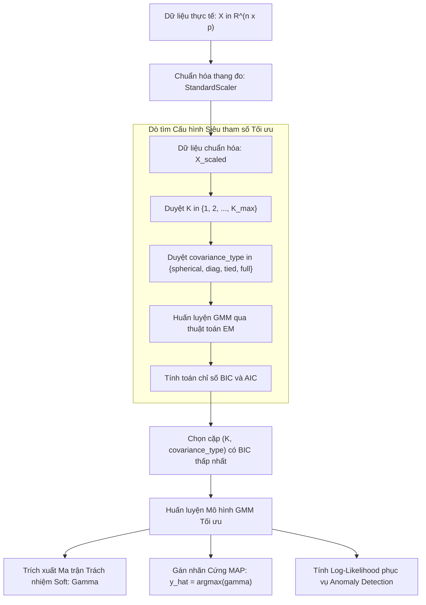

# Mô hình Hỗn hợp Gauss và Thuật toán EM (Gaussian Mixture Models & Expectation-Maximization)

## Purpose

Trong các thuật toán gom cụm phân hoạch như K-Means hoặc K-Medoids, mỗi điểm dữ liệu $`x_i`$ bị bắt buộc gán cứng vào đúng một cụm duy nhất với xác suất 100% (**Hard Clustering**). Hơn nữa, K-Means giả định ngầm rằng các cụm có dạng hình cầu đối xứng, kích thước tương đương và phương sai đẳng hướng. Trong nhiều bài toán thực tế (như phân tích phân khúc khách hàng đa sở thích, tách tín hiệu âm thanh, chẩn đoán y khoa), các ranh giới giữa các cụm thường có sự chồng lấn, mờ nhạt và các cụm tự nhiên có xu hướng kéo dài thành dạng hình bầu dục (ellipsoid) theo nhiều góc xoay và độ phân tán khác nhau.

**Mô hình Hỗn hợp Gauss (Gaussian Mixture Models - GMM)** giải quyết triệt để hai giới hạn này:
1. **Gom cụm mềm theo xác suất (Soft / Probabilistic Clustering):** Thay vì gán nhãn cứng, GMM gán cho mỗi điểm dữ liệu một phân phối xác suất hậu nghiệm (Posterior Probability / Responsibility) $`\gamma_{ik} \in [0, 1]`$ thể hiện mức độ thuộc về từng cụm $`k`$.
2. **Hình dạng cụm elip linh hoạt:** Thông qua việc tối ưu ma trận hiệp phương sai riêng biệt $`\Sigma_k`$ cho từng thành phần, GMM có thể mô hình hóa chính xác các cụm có kích thước khác nhau, bị bẹp, kéo dài hoặc nghiêng theo bất kỳ hướng nào trong không gian đa chiều.

Thuật toán tối ưu hóa nền tảng cho GMM là **Thuật toán Kỳ vọng - Cực đại hóa (Expectation-Maximization - EM)**, giúp tìm ước lượng hợp lý cực đại (Maximum Likelihood Estimation - MLE) cho các mô hình chứa biến ẩn (Latent Variables).

---

## Input

Dữ liệu đầu vào và các tham số cấu hình cho GMM:

1. **Ma trận dữ liệu đặc trưng:**
   * $`X = [x_1, x_2, \dots, x_n]^\top \in \mathbb{R}^{n \times p}`$: Tập gồm $`n`$ mẫu quan sát độc lập, mỗi mẫu có $`p`$ chiều đặc trưng số liên tục.
   * **Yêu cầu tiền xử lý:** Bắt buộc chuẩn hóa tỷ lệ (StandardScaler: đưa về trung bình 0 và độ lệch chuẩn 1). Nếu các chiều có đơn vị đo chênh lệch lớn, ma trận hiệp phương sai có thể bị chi phối bởi các biến có thang đo lớn, dẫn đến lỗi suy biến ma trận (Singular Matrix).
2. **Số lượng thành phần Gauss ($`K`$):**
   * Số lượng cụm cần tìm trong dữ liệu ($`K \in \mathbb{N}^+`$). Nếu chưa biết trước $`K`$, giá trị này được lựa chọn thông qua các tiêu chuẩn thông tin thống kê như BIC hoặc AIC.
3. **Cấu hình dạng Ma trận Hiệp phương sai (`covariance_type`):**
   * `'full'`: Mỗi cụm có một ma trận hiệp phương sai tổng quát đối xứng xác định dương $`\Sigma_k`$ riêng ($`p(p+1)/2`$ tham số tự do cho mỗi cụm). Cho phép các cụm có hình dạng ellipsoid định hướng tùy ý.
   * `'tied'`: Tất cả các cụm dùng chung một ma trận hiệp phương sai $`\Sigma`$. Các cụm có cùng kích thước và hướng xoay elip nhưng khác tâm.
   * `'diag'`: $`\Sigma_k`$ là ma trận đường chéo (chỉ có $`p`$ tham số phương sai trên đường chéo chính, các phần tử ngoài đường chéo bằng 0). Các trục của elip bắt buộc phải song song với các trục tọa độ.
   * `'spherical'`: $`\Sigma_k = \sigma_k^2 I`$ (chỉ có 1 tham số phương sai vô hướng cho mỗi cụm). Tương đương với các hình cầu có kích thước khác nhau.
4. **Hệ số chính quy hóa hiệp phương sai (`reg_covar`):**
   * Hằng số dương rất nhỏ (mặc định $`10^{-6}`$) được cộng vào đường chéo chính của các ma trận $`\Sigma_k`$ nhằm tránh hiện tượng kỳ dị toán học (Singularity) khi phương sai tiến về 0.

---

## Output

Kết quả đầu ra của mô hình sau khi thuật toán EM hội tụ:

1. **Trọng số hòa trộn (Mixing Coefficients / Component Priors):**
   * Vector $`\pi = [\pi_1, \pi_2, \dots, \pi_K]^\top`$ thỏa mãn:

$$
\sum_{k=1}^K \pi_k = 1 \quad \text{và} \quad 0 \le \pi_k \le 1, \; \forall k \in \lbrace 1, \dots, K \rbrace
$$

   * $`\pi_k`$ đại diện cho xác suất tiên nghiệm để một quan sát ngẫu nhiên thuộc về cụm thứ $`k`$.
2. **Tọa độ tâm cụm (Means):**
   * Tập $`K`$ vector kỳ vọng $`\mu_1, \mu_2, \dots, \mu_K \in \mathbb{R}^p`$, biểu thị vị trí trung tâm của từng phân phối Gauss.
3. **Ma trận Hiệp phương sai (Covariances):**
   * Tập $`K`$ ma trận $`\Sigma_1, \Sigma_2, \dots, \Sigma_K \in \mathbb{R}^{p \times p}`$, biểu thị hình dạng, kích thước và hướng xoay của các phân phối thành phần.
4. **Ma trận Trách nhiệm xác suất hậu nghiệm (Soft Assignments / Responsibilities):**
   * Ma trận $`\Gamma \in [0, 1]^{n \times K}`$, trong đó phần tử $`\gamma_{ik}`$ là xác suất để điểm $`x_i`$ được sinh ra từ cụm Gauss thứ $`k`$:

$$
\sum_{k=1}^K \gamma_{ik} = 1, \; \forall i \in \lbrace 1, \dots, n \rbrace
$$

5. **Nhãn cụm cứng suy diễn (Hard Cluster Labels):**
   * Nhãn gán theo quy tắc Bayes cực đại hậu nghiệm (MAP):

$$
\hat{y}_i = \arg\max_{k \in \lbrace 1, \dots, K \rbrace} \gamma_{ik}
$$

6. **Log-Likelihood:**
   * Tổng log xác suất hợp lý cực đại của tập dữ liệu dưới mô hình GMM đã huấn luyện: $`\ln p(X \mid \theta)`$.

---

## Evaluation metrics

Đánh giá chất lượng của mô hình GMM đòi hỏi sự kết hợp giữa các thước đo hợp lý thống kê và thước đo hình học phân cụm:

1. **Log-Likelihood (Hàm Hợp lý Logarit):**
   * Đo lường mức độ khớp của mô hình với phân phối thực tế của dữ liệu:

$$
\ln p(X \mid \theta) = \sum_{i=1}^n \ln \left( \sum_{k=1}^K \pi_k \mathcal{N}(x_i \mid \mu_k, \Sigma_k) \right)
$$

   * Giá trị Log-Likelihood càng lớn, mô hình khớp với tập dữ liệu càng cao. Tuy nhiên, nếu chỉ tối đa hóa Log-Likelihood thuần túy, mô hình sẽ gặp hiện tượng **quá khớp (Overfitting)** khi tăng số cụm $`K`$.
2. **Tiêu chuẩn Thông tin Bayesian (Bayesian Information Criterion - BIC):**
   * Thước đo đánh đổi tối ưu giữa độ khớp của mô hình và số lượng tham số tự do, phạt rất nặng các mô hình quá phức tạp:

$$
\text{BIC} = -2 \ln \mathcal{L} + d \ln n
$$

   * Trong đó:
     * $`\mathcal{L} = p(X \mid \hat{\theta})`$ là giá trị Likelihood cực đại đạt được.
     * $`n`$ là số lượng điểm dữ liệu.
     * $`d`$ là tổng số tham số tự do cần ước lượng (phụ thuộc vào $`K`$, số chiều $`p`$ và `covariance_type`). Với covariance `'full'`, $`d = K - 1 + Kp + K \cdot \frac{p(p+1)}{2}`$.
   * **Quy tắc chọn mô hình:** Giá trị **BIC càng nhỏ thì mô hình càng tối ưu**.
3. **Tiêu chuẩn Thông tin Akaike (Akaike Information Criterion - AIC):**
   * Thước đo tương tự BIC nhưng mức độ phạt độ phức tạp nhẹ hơn:

$$
\text{AIC} = -2 \ln \mathcal{L} + 2d
$$

   * AIC thường được sử dụng khi kích thước mẫu $`n`$ nhỏ hoặc mục tiêu chính là dự đoán mật độ thay vì tìm đúng cấu trúc cụm thực.
4. **Hệ số Silhouette (Silhouette Coefficient):**
   * Đo mức độ gắn kết nội cụm và phân tách ngoại cụm dựa trên nhãn cứng $`\hat{y}_i = \arg\max_k \gamma_{ik}`$. Thích hợp để so sánh trực tiếp hiệu quả phân vùng của GMM với K-Means.

---

## How it works

### 1. Cơ sở Xác suất của Mô hình Hỗn hợp Gauss

Giả sử mỗi điểm dữ liệu $`x_i`$ được sinh ra từ một trong $`K`$ thành phần phân phối Gauss đa chiều. Ta đưa vào biến ngẫu nhiên ẩn (Latent Variable) $`z_i \in \lbrace 1, \dots, K \rbrace`$ chỉ định nguồn gốc cụm của $`x_i`$, được mã hóa bằng biểu diễn One-hot vector $`z_i = [z_{i1}, z_{i2}, \dots, z_{iK}]^\top`$ với $`z_{ik} \in \lbrace 0, 1 \rbrace`$ và $`\sum_{k=1}^K z_{ik} = 1`$.

* **Phân phối tiên nghiệm của biến ẩn:**

$$
p(z_{ik} = 1) = \pi_k
$$

* **Phân phối có điều kiện của dữ liệu khi biết cụm (Gauss đa chiều):**

$$
p(x_i \mid z_{ik} = 1) = \mathcal{N}(x_i \mid \mu_k, \Sigma_k) = \frac{1}{(2\pi)^{p/2} \lvert \Sigma_k \rvert^{1/2}} \exp\left( -\frac{1}{2} (x_i - \mu_k)^\top \Sigma_k^{-1} (x_i - \mu_k) \right)
$$

* **Hàm mật độ xác suất biên duyên (Marginal Density Function):**
  Áp dụng quy tắc xác suất toàn phần, mật độ của một điểm $`x`$ bất kỳ được tính bằng tổng hòa trộn của $`K`$ phân phối thành phần:

$$
p(x \mid \theta) = \sum_{k=1}^K p(z_k = 1) p(x \mid z_k = 1) = \sum_{k=1}^K \pi_k \mathcal{N}(x \mid \mu_k, \Sigma_k)
$$

Tập tham số đầy đủ của mô hình là $`\theta = \lbrace \pi_k, \mu_k, \Sigma_k \rbrace_{k=1}^K`$.

---

### 2. Thuật toán Kỳ vọng - Cực đại hóa (Expectation-Maximization - EM)

Vì biến ẩn $`z_i`$ không quan sát được trực tiếp, đạo hàm của hàm log-likelihood đầy đủ không cho ra nghiệm giải tích đóng. Thuật toán EM giải quyết bài toán này thông qua quy trình lặp hai bước đảm bảo đơn điệu làm tăng log-likelihood ở mỗi chu kỳ:

```text
┌─────────────────────────────────────────────────────────────┐
│ Khởi tạo tham số ban đầu: θ^(0) = {π_k, μ_k, Σ_k} (bằng K-Means)│
└──────────────────────────────┬──────────────────────────────┘
                               │
                               ▼
            ┌────────────────────────────────────┐
            │  E-Step (Expectation):             │
            │  Tính trách nhiệm γ_ik theo Bayes  │
            └──────────────────┬─────────────────┘
                               │
                               ▼
            ┌────────────────────────────────────┐
            │  M-Step (Maximization):            │
            │  Cập nhật lại {π_k, μ_k, Σ_k}      │
            └──────────────────┬─────────────────┘
                               │
                               ▼
                     /───────────────────\
                    <  Hội tụ Likelihood? >
                     \───────────────────/
                       │ No          │ Yes
                       │             ▼
                       └───> [ Khóa Mô hình Hoàn chỉnh ]
```

#### Bước 1: Khởi tạo (Initialization)
* Chạy K-Means trên dữ liệu $`X`$ để lấy các tâm cụm ban đầu làm $`\mu_k^{(0)}`$.
* Khởi tạo ma trận hiệp phương sai mẫu của từng cụm K-Means làm $`\Sigma_k^{(0)}`$.
* Gán trọng số đều nhau $`\pi_k^{(0)} = \frac{1}{K}`$.

#### Bước 2: Bước Kỳ vọng E-step (Expectation Step)
Sử dụng bộ tham số hiện tại $`\theta^{(t)}`$, tính giá trị kỳ vọng của biến ẩn $`z_{ik}`$, chính là xác suất hậu nghiệm (Responsibility) rằng điểm $`x_i`$ thuộc về cụm $`k`$, theo định lý Bayes:

$$
\gamma_{ik} = p(z_{ik} = 1 \mid x_i, \theta^{(t)}) = \frac{\pi_k^{(t)} \mathcal{N}(x_i \mid \mu_k^{(t)}, \Sigma_k^{(t)})}{\sum_{j=1}^K \pi_j^{(t)} \mathcal{N}(x_i \mid \mu_j^{(t)}, \Sigma_j^{(t)})}
$$

Giá trị $`\gamma_{ik}`$ thể hiện "trách nhiệm" mà cụm $`k`$ gánh vác trong việc giải thích sự xuất hiện của điểm $`x_i`$.

#### Bước 3: Bước Cực đại hóa M-step (Maximization Step)
Sử dụng ma trận trách nhiệm $`\gamma_{ik}`$ vừa tính ở E-step, cập nhật lại toàn bộ các tham số của mô hình bằng cách cực đại hóa cận dưới của hàm log-likelihood:

1. **Tổng trọng lượng điểm thuộc về cụm $`k`$:**

$$
N_k = \sum_{i=1}^n \gamma_{ik}
$$

2. **Cập nhật trọng số thành phần mới:**

$$
\pi_k^{(t+1)} = \frac{N_k}{n}
$$

3. **Cập nhật vector kỳ vọng trung bình mới (Trung bình có trọng số):**

$$
\mu_k^{(t+1)} = \frac{1}{N_k} \sum_{i=1}^n \gamma_{ik} x_i
$$

4. **Cập nhật ma trận hiệp phương sai mới (Hiệp phương sai có trọng số):**

$$
\Sigma_k^{(t+1)} = \frac{1}{N_k} \sum_{i=1}^n \gamma_{ik} (x_i - \mu_k^{(t+1)})(x_i - \mu_k^{(t+1)})^\top
$$

#### Bước 4: Kiểm tra Điều kiện Hội tụ
Tính giá trị Log-Likelihood sau bước M-step:

$$
\ln p(X \mid \theta^{(t+1)}) = \sum_{i=1}^n \ln \left( \sum_{k=1}^K \pi_k^{(t+1)} \mathcal{N}(x_i \mid \mu_k^{(t+1)}, \Sigma_k^{(t+1)}) \right)
$$

Nếu mức cải thiện $`\lvert \ln p(X \mid \theta^{(t+1)}) - \ln p(X \mid \theta^{(t)}) \rvert < \text{tol}`$ (thường chọn $`\text{tol} = 10^{-3}`$), thuật toán dừng. Ngược lại, lặp lại từ Bước 2.

---

### 3. Các Dạng Cấu hình Ma trận Hiệp phương sai

```text
  1. 'spherical'            2. 'diag'                  3. 'full'
   ┌───────────┐          ┌──────────────┐          ┌──────────────┐
   │    ●●●    │          │     ●●●●     │          │        ●●    │
   │   ●●●●●   │          │   ●●●●●●●●   │          │      ●●●●    │
   │    ●●●    │          │     ●●●●     │          │    ●●●●      │
   └───────────┘          └──────────────┘          └──────────────┘
  Bán kính đều nhau       Elip song song trục        Elip xoay mọi hướng
  (Ít tham số nhất)       (Độc lập đặc trưng)       (Đầy đủ quan hệ tương quan)
```

1. **`covariance_type='spherical'`:** $`\Sigma_k = \sigma_k^2 I`$. Số tham số tự do mỗi cụm: 1. Thích hợp khi các chiều dữ liệu độc lập và có phương sai đồng nhất.
2. **`covariance_type='diag'`:** $`\Sigma_k = \mathrm{diag}(\sigma_{k1}^2, \dots, \sigma_{kp}^2)`$. Số tham số tự do mỗi cụm: $`p`$. Giả định các đặc trưng không tương quan với nhau trong phạm vi từng cụm.
3. **`covariance_type='tied'`:** Tất cả $`K`$ cụm có chung một ma trận $`\Sigma`$. Số tham số: $`p(p+1)/2`$. Phù hợp khi các cụm có hình dạng và xu hướng xoay tương đương nhau.
4. **`covariance_type='full'`:** Mỗi cụm có ma trận $`\Sigma_k`$ độc lập. Số tham số: $`K \cdot p(p+1)/2`$. Cung cấp độ linh hoạt cao nhất nhưng cần nhiều dữ liệu để tránh quá khớp.

---

### 4. Bẫy Kỳ dị Toán học (Singularities / Zero Variance) và Cơ chế Khắc phục

* **Bản chất của lỗi Kỳ dị:** Trong quá trình chạy EM, nếu một thành phần Gauss thu hẹp lại tới mức chỉ chứa duy nhất đúng một điểm dữ liệu $`x_n`$, tâm của nó sẽ trở thành $`\mu_k = x_n`$. Khi đó phương sai $`\sigma_k^2 \to 0`$, dẫn đến định thức $`\lvert \Sigma_k \rvert \to 0`$ và mật độ tại điểm đó tiến tới vô cực:

$$
\mathcal{N}(x_n \mid x_n, \sigma_k^2 I) \propto \frac{1}{\sigma_k^p} \to \infty
$$

Điều này làm cho hàm Likelihood phân kỳ về dương vô cùng ($`+\infty`$), khiến thuật toán bị sụp đổ số học (Numerical Crash / Floating-point overflow).
* **Giải pháp kỹ thuật (`reg_covar`):** Bắt buộc cộng thêm một lượng hằng số dương nhỏ $`\epsilon I`$ vào ma trận hiệp phương sai sau mỗi bước M-step:

$$
\Sigma_k^{\text{reg}} = \Sigma_k + \epsilon I \quad \text{với } \epsilon = 10^{-6}
$$

Thao tác này đảm bảo ma trận luôn khả nghịch và tất cả các trị riêng đều strictly dương ($`\lambda_i > 0`$).

---

## Data used

Mô hình Hỗn hợp Gauss phù hợp nhất với các tập dữ liệu có tính chất sau:

1. **Dữ liệu có sự phân tách mờ và chồng lấn (Overlapping Clusters):**
   * Trong bài toán chấm điểm tín dụng hoặc phân loại khách hàng tiềm năng, ranh giới giữa nhóm "rủi ro trung bình" và "rủi ro cao" không bao giờ tuyệt đối. Điểm xác suất $`\gamma_{ik}`$ cho phép đưa ra các chính sách can thiệp mềm dẻo.
2. **Dữ liệu phân cụm có hình dạng elip định hướng:**
   * Dữ liệu y sinh, dữ liệu cảm biến nơi hai chỉ số có sự tương quan tuyến tính tự nhiên (ví dụ: chiều cao và cân nặng; huyết áp tâm thu và huyết áp tâm trương). K-Means sẽ chia cắt vô lý cụm elip này, trong khi GMM bắt trọn cấu trúc phân phối.
3. **Bài toán Phát hiện Điểm Bất thường (Anomaly Detection):**
   * Sau khi huấn luyện GMM trên tập dữ liệu bình thường, mật độ xác suất $`p(x)`$ đóng vai trò là điểm số chuẩn hóa. Bất kỳ mẫu mới $`x_{\text{test}}`$ nào có $`p(x_{\text{test}}) < \tau`$ (dưới ngưỡng phân vị $`1\%`$ hoặc $`5\%`$) đều được cảnh báo là ngoại lai bất thường.

---

## Design

### 1. Kiến trúc Quy trình Lựa chọn Siêu tham số cho GMM



---

### 2. Mã nguồn Triển khai Thực hành Chuẩn hóa với Scikit-learn

```python
import numpy as np
import matplotlib.pyplot as plt
from sklearn.mixture import GaussianMixture
from sklearn.preprocessing import StandardScaler
from sklearn.metrics import silhouette_score

# 1. Giả lập dữ liệu hỗn hợp đa cụm ellipsoid
np.random.seed(42)
n_samples = 600

# Cụm 1: Hình elip nghiêng góc
X1 = np.dot(np.random.randn(n_samples // 2, 2), [[0.8, 0.6], [-0.4, 0.9]]) + [2, 2]
# Cụm 2: Hình cầu phân tán rộng
X2 = np.random.randn(n_samples // 2, 2) * 1.5 + [-3, -2]
X = np.vstack([X1, X2])

# 2. Tiền xử lý chuẩn hóa Z-score bắt buộc
scaler = StandardScaler()
X_scaled = scaler.fit_transform(X)

# 3. Dò tìm số lượng cụm K tối ưu dựa trên đường cong BIC và AIC
k_range = range(1, 8)
bic_scores = []
aic_scores = []

for k in k_range:
    gmm = GaussianMixture(n_components=k, covariance_type='full', random_state=42, reg_covar=1e-6)
    gmm.fit(X_scaled)
    bic_scores.append(gmm.bic(X_scaled))
    aic_scores.append(gmm.aic(X_scaled))

best_k = k_range[np.argmin(bic_scores)]
print(f"=> Cấu hình tối ưu được lựa chọn theo BIC: K = {best_k}")

# 4. Huấn luyện mô hình tối ưu
optimal_gmm = GaussianMixture(
    n_components=best_k,
    covariance_type='full',
    max_iter=200,
    tol=1e-3,
    reg_covar=1e-6,
    random_state=42
)
optimal_gmm.fit(X_scaled)

# 5. Trích xuất đầu ra
# Xác suất hậu nghiệm Soft Assignments (Responsibilities)
gamma = optimal_gmm.predict_proba(X_scaled)
# Nhãn cứng Hard Labels
labels = optimal_gmm.predict(X_scaled)
# Mật độ log-likelihood phục vụ phát hiện bất thường
log_densities = optimal_gmm.score_samples(X_scaled)

print(f"\nTrọng số hòa trộn (pi_k): {optimal_gmm.weights_}")
print(f"Tâm cụm (mu_k):\n{optimal_gmm.means_}")
print(f"Ví dụ xác suất thuộc từng cụm của điểm đầu tiên: {gamma[0]}")
print(f"Hệ số Silhouette theo nhãn gán: {silhouette_score(X_scaled, labels):.4f}")
```

---

## Nguồn

- [1] Bishop, C. M. (2006). *Pattern Recognition and Machine Learning* (Chapter 9: Mixture Models and EM, pp. 423-459). Springer.
- [2] Dempster, A. P., Laird, N. M., & Rubin, D. B. (1977). *Maximum likelihood from incomplete data via the EM algorithm*. Journal of the Royal Statistical Society: Series B (Methodological), 39(1), 1-22.
- [3] Hastie, T., Tibshirani, R., & Friedman, J. (2009). *The Elements of Statistical Learning* (Chapter 8.5: The EM Algorithm, pp. 272-279). Springer.
- [4] [scikit-learn User Guide: Gaussian mixture models](https://scikit-learn.org/stable/modules/mixture.html).
