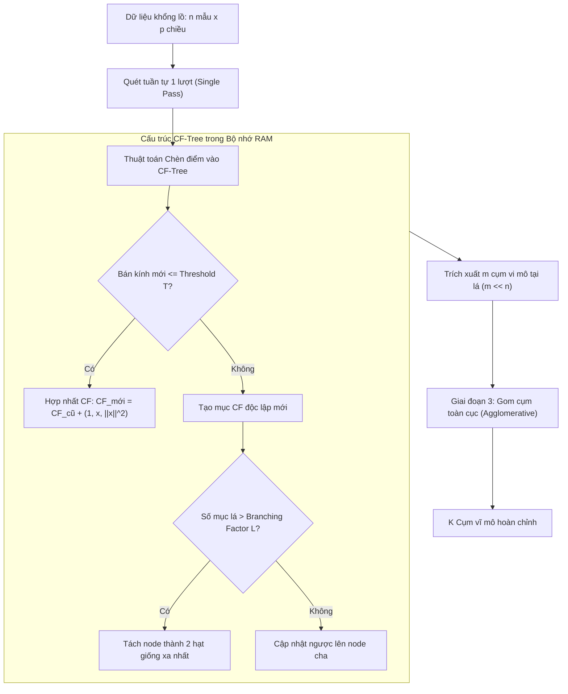

# Gom cụm Phân cấp Dữ liệu Lớn với BIRCH (Balanced Iterative Reducing and Clustering using Hierarchies)

## Purpose

Hầu hết các thuật toán gom cụm truyền thống (như K-Means, DBSCAN, Hierarchical Clustering) đều đòi hỏi phải lưu trữ toàn bộ tập dữ liệu trong bộ nhớ chính (RAM) và yêu cầu quét qua dữ liệu nhiều lần ($`O(n^2)`$ hoặc $`O(n \cdot K \cdot \text{iter})`$). Khi đối mặt với các bài toán dữ liệu lớn (Big Data) lên đến hàng triệu hay hàng tỷ quan sát, các thuật toán này trở nên bất khả thi do tràn bộ nhớ và chi phí I/O đọc ổ đĩa quá lớn.

**BIRCH (Balanced Iterative Reducing and Clustering using Hierarchies - Zhang et al., 1996)** được thiết kế chuyên biệt để giải quyết thách thức này:
1. **Quét dữ liệu duy nhất một lượt ($`O(n)`$ Time Complexity):** BIRCH chỉ cần đọc tuần tự dữ liệu qua đĩa một lần duy nhất để nén toàn bộ tập dữ liệu khổng lồ vào một cấu trúc cây thu gọn trong bộ nhớ gọi là **Cây Đặc trưng Gom cụm (Clustering Feature Tree - CF-Tree)**.
2. **Nén không gian không làm mất mát thông tin thống kê:** Thay vì lưu giữ từng điểm dữ liệu cụ thể, mỗi node của CF-Tree chỉ lưu trữ một vector gồm 3 số đặc trưng tóm tắt thống kê cốt lõi ($`N, \vec{LS}, SS`$), cho phép tính toán tức thời tâm cụm, bán kính và khoảng cách giữa các cụm con trong thời gian $`O(1)`$.
3. **Làm tiền đề cho các thuật toán khác:** Cây CF-Tree nén dữ liệu thành vài nghìn cụm vi mô (micro-clusters), sau đó một thuật toán gom cụm toàn cục (như Agglomerative Clustering) có thể chạy mượt mà trên các cụm vi mô này.

---

## Input

Dữ liệu đầu vào và các siêu tham số cấu hình cho thuật toán BIRCH:

1. **Ma trận dữ liệu đặc trưng:**
   * $`X = [x_1, x_2, \dots, x_n]^\top \in \mathbb{R}^{n \times p}`$: Tập dữ liệu gồm $`n`$ quan sát (có thể rất lớn, $`n > 10^7`$), mỗi quan sát là một vector đặc trưng số $`p`$ chiều.
   * **Yêu cầu tiền xử lý:** Toàn bộ đặc trưng phải là số liên tục trong không gian Euclid (Euclidean Space). Các đặc trưng phải được chuẩn hóa thang đo tỷ lệ (StandardScaler) trước khi đưa vào xây dựng CF-Tree.
2. **Bán kính ngưỡng dung sai (`threshold`):**
   * Ngưỡng bán kính tối đa $`T > 0`$ cho phép của một cụm vi mô (Subcluster) tại node lá. Khi một điểm mới được chèn vào, nếu bán kính của cụm sau khi hợp nhất vượt quá $`T`$, node đó sẽ bị tách (split).
3. **Hệ số rẽ nhánh tối đa (`branching_factor`):**
   * Số lượng con tối đa $`B`$ mà mỗi node trung gian hoặc node lá có thể chứa. Giới hạn kích thước cây để luôn nằm gọn trong dung lượng RAM định trước.
4. **Số lượng cụm mục tiêu toàn cục (`n_clusters`):**
   * Nếu gán một số nguyên $`K`$, sau khi cây CF-Tree được xây dựng xong, BIRCH sẽ áp dụng gom cụm phân cấp toàn cục (AgglomerativeClustering) trên các node lá để gom về đúng $`K`$ cụm cuối cùng. Nếu đặt `None`, mô hình giữ nguyên toàn bộ các cụm vi mô tại node lá.

---

## Output

Kết quả đầu ra của thuật toán BIRCH:

1. **Cấu trúc Cây Đặc trưng Gom cụm (CF-Tree):**
   * Cây cân bằng lưu trữ hệ thống các vector tóm tắt $`\text{CF}`$ đại diện cho cấu trúc phân bố của toàn bộ tập dữ liệu thô.
2. **Tọa độ tâm các cụm vi mô (Subcluster Centroids):**
   * Tập hợp các vector trọng tâm $`\lbrace c_1, c_2, \dots, c_m \rbrace`$ tương ứng với $`m`$ cụm vi mô tại các node lá ($`m \ll n`$).
3. **Nhãn cụm gán cho từng mẫu dữ liệu:**
   * Vector nhãn $`\hat{y} = [\hat{y}_1, \hat{y}_2, \dots, \hat{y}_n]^\top`$, trong đó mỗi điểm dữ liệu $`x_i`$ được gán vào cụm có khoảng cách Euclid tới tâm cụm là ngắn nhất.
4. **Trọng số kích thước cụm:**
   * Số lượng điểm dữ liệu thô $`N_k`$ được nén bên trong từng cụm vi mô.

---

## Evaluation metrics

Đánh giá chất lượng của BIRCH dựa trên hiệu năng gom cụm và tỷ lệ nén bộ nhớ:

1. **Bán kính Cụm (Radius - $`R`$) và Đường kính Cụm (Diameter - $`D`$):**
   * Đo độ phân tán và mức độ đậm đặc của từng cụm vi mô tại node lá. Giá trị $`R`$ càng nhỏ thể hiện cụm càng co cụm chặt chẽ:

$$
R = \sqrt{\frac{1}{N} \sum_{i=1}^N \|x_i - c\|^2} = \sqrt{\frac{SS}{N} - \left\|\frac{\vec{LS}}{N}\right\|^2}
$$

2. **Hệ số Nén Dữ liệu (Compression Ratio):**
   * Tỷ lệ nén bộ nhớ $`\text{CR} = \frac{m}{n}`$, trong đó $`m`$ là số lượng cụm vi mô ở lá và $`n`$ là tổng số quan sát ban đầu. Tỷ lệ nén thông thường đạt từ $`10^{-2}`$ đến $`10^{-4}`$.
3. **Hệ số Silhouette (Silhouette Coefficient):**
   * Đánh giá độ gắn kết nội cụm và phân tách ngoại cụm trên nhãn dự đoán cuối cùng.
4. **Thời gian Thực thi và Bộ nhớ Chiếm dụng (Execution Time & RAM Footprint):**
   * So sánh thời gian chạy thực tế và lượng RAM tiêu thụ so với K-Means chuẩn để minh chứng ưu thế xử lý dữ liệu quy mô lớn.

---

## How it works

### 1. Vector Đặc trưng Gom cụm (Clustering Feature - CF)

Khái niệm cốt lõi của BIRCH là bộ ba tóm tắt thống kê **Clustering Feature (CF)**. Cho một cụm gồm $`N`$ điểm dữ liệu $`\lbrace x_1, x_2, \dots, x_N \rbrace \subset \mathbb{R}^p`$, vector $`\text{CF}`$ được định nghĩa là bộ 3 đại lượng:

$$
\text{CF} = (N, \vec{LS}, SS)
$$

Trong đó:
* $`N`$: Số lượng điểm dữ liệu có trong cụm (vô hướng nguyên).
* $`\vec{LS} \in \mathbb{R}^p`$ (Linear Sum): Tổng vector tuyến tính của $`N`$ điểm:

$$
\vec{LS} = \sum_{i=1}^N x_i
$$

* $`SS \in \mathbb{R}`$ (Square Sum): Tổng bình phương chuẩn Euclid của $`N`$ điểm dữ liệu:

$$
SS = \sum_{i=1}^N \|x_i\|^2 = \sum_{i=1}^N \sum_{j=1}^p x_{ij}^2
$$

#### Định lý Cộng tính của CF (Additivity Theorem)
Nếu có hai cụm rời nhau $`C_1`$ và $`C_2`$ với các vector đặc trưng tương ứng là $`\text{CF}_1 = (N_1, \vec{LS}_1, SS_1)`$ và $`\text{CF}_2 = (N_2, \vec{LS}_2, SS_2)`$, thì cụm hợp nhất $`C = C_1 \cup C_2`$ có vector đặc trưng được tính đơn giản bằng tổng từng thành phần:

$$
\text{CF}_{\text{merged}} = \text{CF}_1 + \text{CF}_2 = (N_1 + N_2, \vec{LS}_1 + \vec{LS}_2, SS_1 + SS_2)
$$

Nhờ tính chất cộng tính này, việc hợp nhất hai cụm không đòi hỏi phải truy cập lại bất kỳ điểm dữ liệu thô nào bên dưới.

#### Tính toán Các Đặc tính Hình học trong Thời gian $`O(1)`$
Từ bộ ba $`(N, \vec{LS}, SS)`$, ta tính được trực tiếp các thuộc tính hình học quan trọng:
* **Tọa độ tâm cụm (Centroid $`c`$):**

$$
c = \frac{\vec{LS}}{N}
$$

* **Bán kính cụm (Radius $`R`$):**

$$
R = \sqrt{\frac{SS}{N} - \|c\|^2}
$$

* **Khoảng cách Euclid giữa hai tâm cụm $`C_1`$ và $`C_2`$:**

$$
D(C_1, C_2) = \|c_1 - c_2\| = \left\| \frac{\vec{LS}_1}{N_1} - \frac{\vec{LS}_2}{N_2} \right\|
$$

---

### 2. Cấu trúc Cây CF-Tree và Cơ chế Chèn Điểm (Insertion Algorithm)

Một cây CF-Tree là một cây cân bằng về chiều cao (tương tự như B-tree), bao gồm hai loại tham số cấu trúc:
1. $`B`$ (Branching factor): Số lượng mục con tối đa trong mỗi node nội bộ.
2. $`L`$: Số lượng mục con tối đa trong mỗi node lá.
3. $`T`$ (Threshold): Bán kính tối đa cho phép của mỗi cụm vi mô ở node lá.

```text
               [ Root Node (Gốc) ]
              /                   \
        [ Node con 1 ]         [ Node con 2 ]
        /            \         /            \
   [ Leaf 1 ]    [ Leaf 2 ] [ Leaf 3 ]    [ Leaf 4 ]
   (CF_1, CF_2)  (CF_3, CF_4) ...
```

#### Quy trình Chèn một Điểm Dữ liệu Mới $`x`$ vào Cây
1. **Tìm kiếm từ Gốc xuống Lá:** Bắt đầu từ node gốc, lần theo nhánh có tâm cụm gần điểm $`x`$ nhất cho đến khi chạm tới node lá.
2. **Thử Hợp nhất vào Cụm vi mô Gần nhất:** Tại node lá, tìm cụm $`\text{CF}_i`$ gần $`x`$ nhất. Tính thử nghiệm bán kính mới $`R_{\text{new}}`$ nếu kết nạp $`x`$:
   * Nếu $`R_{\text{new}} \le T`$: Chấp nhận kết nạp $`x`$. Cập nhật $`\text{CF}_i = (N_i + 1, \vec{LS}_i + x, SS_i + \|x\|^2)`$.
   * Nếu $`R_{\text{new}} > T`$: Tạo một mục $`\text{CF}`$ mới riêng cho $`x`$ dạng $`(1, x, \|x\|^2)`$ và thêm vào node lá.
3. **Tách Node nếu Quá tải (Splitting):** Nếu số lượng mục tại node lá vượt quá $`L`$, node lá bị tách thành hai node mới:
   * Chọn hai cụm có khoảng cách xa nhau nhất làm hai hạt giống (Seeds).
   * Phân bổ các mục còn lại vào hạt giống gần hơn.
   * Lan truyền cập nhật ngược lên các node cha. Nếu node cha cũng vượt quá $`B`$, tiếp tục tách node cha cho đến gốc.

---

### 3. Quy trình 4 Giai đoạn Toàn diện của BIRCH

```text
┌─────────────────────────────────────────────────────────────┐
│ Giai đoạn 1: Quét dữ liệu 1 lượt & Xây dựng CF-Tree trong RAM│
└──────────────────────────────┬──────────────────────────────┘
                               │
                               ▼
┌─────────────────────────────────────────────────────────────┐
│ Giai đoạn 2 (Tùy chọn): Tái cấu trúc cây & Loại bỏ Nhiễu     │
└──────────────────────────────┬──────────────────────────────┘
                               │
                               ▼
┌─────────────────────────────────────────────────────────────┐
│ Giai đoạn 3: Gom cụm toàn cục (Agglomerative) trên các lá    │
└──────────────────────────────┬──────────────────────────────┘
                               │
                               ▼
┌─────────────────────────────────────────────────────────────┐
│ Giai đoạn 4 (Tùy chọn): Tinh chỉnh nhãn & Gán nhãn cho X    │
└─────────────────────────────────────────────────────────────┘
```

1. **Giai đoạn 1 (Bắt buộc):** Quét toàn bộ dữ liệu từ ổ đĩa 1 lần duy nhất, xây dựng cây CF-Tree ban đầu vừa vặn trong dung lượng RAM cho phép.
2. **Giai đoạn 2 (Tùy chọn):** Quét lại cây CF-Tree để tái tạo cây nhỏ gọn hơn với ngưỡng $`T`$ lớn hơn, đồng thời loại bỏ các cụm vi mô chứa quá ít điểm (gán nhãn là Outlier/Nhiễu).
3. **Giai đoạn 3 (Bắt buộc nếu cần $`K`$ cụm):** Áp dụng một thuật toán gom cụm toàn cục (như Agglomerative Hierarchical Clustering) lên tập hợp các cụm vi mô tại node lá để thu được đúng số lượng cụm $`K`$ mong muốn. Vì số lượng cụm vi mô rất nhỏ so với $`n`$, giai đoạn này chạy cực nhanh.
4. **Giai đoạn 4 (Tùy chọn):** Quét lại dữ liệu một lần cuối cùng để gán nhãn cho từng điểm dữ liệu dựa trên khoảng cách tới tâm của $`K`$ cụm vĩ mô cuối cùng.

---

## Data used

BIRCH đạt hiệu quả cao nhất trên các tập dữ liệu có các đặc thù sau:

1. **Tập dữ liệu quy mô siêu lớn (Massive Scale Datasets):**
   * Dữ liệu log máy chủ hàng trăm triệu dòng, dữ liệu giao dịch thẻ tín dụng ngân hàng nơi bộ nhớ RAM không thể nạp trọn vẹn toàn bộ ma trận dữ liệu thô.
2. **Dữ liệu có đặc trưng số liên tục (Continuous Numeric Space):**
   * Các chiều dữ liệu bắt buộc phải đo được bằng khoảng cách Euclid chuẩn để tính được $`\vec{LS}`$ và $`SS`$.
3. **Các cụm tự nhiên có dạng hình cầu hoặc convex:**
   * Do tiêu chuẩn bán kính $`R`$ đo lường khoảng cách từ tâm cụm, BIRCH ưu tiên tìm kiếm các cụm có dạng hình cầu. Nếu dữ liệu có dạng uốn lượn phi tuyến phức tạp, BIRCH nên được dùng ở giai đoạn 1 để nén điểm trước khi chuyển sang các thuật toán đồ thị.

---

## Design

### 1. Sơ đồ Cấu trúc Cây CF-Tree và Quy trình Gom Cụm



---

### 2. Mã nguồn Triển khai Chuẩn hóa với Scikit-learn

```python
import numpy as np
from sklearn.cluster import Birch
from sklearn.datasets import make_blobs
from sklearn.preprocessing import StandardScaler
from sklearn.metrics import silhouette_score
import time

# 1. Tạo tập dữ liệu quy mô lớn (100,000 mẫu, 5 chiều đặc trưng)
n_samples = 100000
n_features = 5
centers = 6

X, y_true = make_blobs(
    n_samples=n_samples,
    n_features=n_features,
    centers=centers,
    cluster_std=1.2,
    random_state=42
)

# 2. Tiền xử lý chuẩn hóa thang đo
scaler = StandardScaler()
X_scaled = scaler.fit_transform(X)

# 3. Khởi tạo và huấn luyện mô hình BIRCH
# threshold: bán kính tối đa của cụm vi mô tại lá
# branching_factor: số mục tối đa trong mỗi node
# n_clusters: số cụm mục tiêu ở giai đoạn 3 (nếu None thì chỉ nén thành cây)
threshold_val = 1.0
branching_val = 50
target_k = 6

start_time = time.time()
birch_model = Birch(
    threshold=threshold_val,
    branching_factor=branching_val,
    n_clusters=target_k,
    copy=False
)

# Huấn luyện chỉ qua một lượt quét
birch_model.fit(X_scaled)
execution_time = time.time() - start_time

# 4. Phân tích kết quả
subclusters = birch_model.subcluster_centers_
labels = birch_model.labels_

print(f"Thời gian hoàn thành huấn luyện: {execution_time:.3f} giây")
print(f"Tổng số mẫu ban đầu (n): {n_samples}")
print(f"Số lượng cụm vi mô tại node lá của CF-Tree: {len(subclusters)}")
print(f"Tỷ lệ nén dữ liệu: {len(subclusters) / n_samples * 100:.2f}%")
print(f"Số lượng cụm vĩ mô cuối cùng: {len(set(labels))}")

# Đánh giá trên một tập mẫu con 5000 điểm để tiết kiệm thời gian tính ma trận khoảng cách
sample_idx = np.random.choice(n_samples, 5000, replace=False)
sample_silhouette = silhouette_score(X_scaled[sample_idx], labels[sample_idx])
print(f"Hệ số Silhouette trên tập mẫu kiểm tra: {sample_silhouette:.4f}")
```

---

## Nguồn

- [1] Zhang, T., Ramakrishnan, R., & Livny, M. (1996). *BIRCH: an efficient data clustering method for very large databases*. ACM SIGMOD Record, 25(2), 103-114.
- [2] Han, J., Kamber, M., & Pei, J. (2011). *Data Mining: Concepts and Techniques* (Chapter 10.4: Grid-Based and Hierarchy-Based Clustering). Morgan Kaufmann.
- [3] [scikit-learn User Guide: Birch](https://scikit-learn.org/stable/modules/clustering.html#birch).
- [4] Aggarwal, C. C. (2015). *Data Mining: The Textbook* (Chapter 6: Cluster Analysis). Springer.
