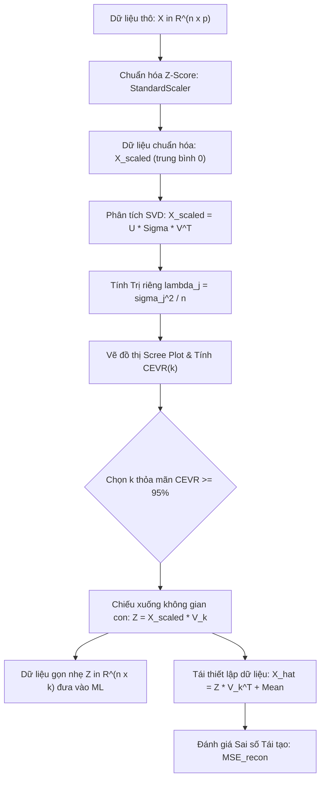

# Phân tích Thành phần Chính và Giảm chiều Dữ liệu (Principal Component Analysis - PCA)

## Purpose

Trong các bài toán học máy hiện đại, dữ liệu thường có số lượng chiều đặc trưng (Features) rất lớn (hàng chục, hàng trăm hoặc hàng nghìn biến). Hiện tượng này dẫn tới **Lời nguyền Chiều không gian (Curse of Dimensionality)**: không gian trở nên quá thưa thớt, khoảng cách giữa các điểm tiến dần tới giá trị tương đồng nhau, độ phức tạp tính toán bùng nổ và mô hình rất dễ bị quá khớp (overfitting). Bên cạnh đó, nhiều đặc trưng thực tế thường có sự tương quan tuyến tính mạnh với nhau (Multicollinearity / Dư thừa thông tin).

**Phân tích Thành phần Chính (Principal Component Analysis - PCA - Pearson 1901, Hotelling 1933)** là thuật toán giảm chiều dữ liệu tuyến tính kinh điển và mạnh mẽ nhất trong Học không giám sát:
1. **Tìm kiếm các trục phương sai cực đại (Maximizing Variance):** PCA chiếu tập dữ liệu từ không gian ban đầu $`p`$ chiều xuống một không gian con $`k`$ chiều ($`k \ll p`$) sao cho lượng thông tin (đo bằng phương sai của dữ liệu) được bảo toàn là lớn nhất có thể.
2. **Triệt tiêu hoàn toàn sự tương quan tuyến tính (Orthogonal Decorrelation):** Các trục tọa độ mới (gọi là các **Thành phần chính - Principal Components**) hoàn toàn trực giao (vuông góc) từng đôi một với nhau, loại bỏ 100% sự dư thừa thông tin giữa các biến.
3. **Mở rộng phi tuyến với Kernel PCA:** Khi dữ liệu nằm trên các đa tạp cong phức tạp không thể tách biệt tuyến tính, Kernel PCA sử dụng thủ thuật hạt nhân (Kernel Trick) để ánh xạ phi tuyến vào không gian Hilbert trước khi chiếu trực giao.

---

## Input

Dữ liệu đầu vào và các tham số cấu hình cho thuật toán PCA:

1. **Ma trận dữ liệu đặc trưng:**
   * $`X = [x_1, x_2, \dots, x_n]^\top \in \mathbb{R}^{n \times p}`$: Tập gồm $`n`$ mẫu quan sát, mỗi mẫu có $`p`$ đặc trưng số liên tục.
   * **Yêu cầu tiền xử lý bắt buộc:** Bắt buộc phải **Trừ vector trung bình (Zero-centering)**: $`\tilde{x}_i = x_i - \bar{x}`$. Hơn nữa, nếu các biến có đơn vị đo khác nhau (ví dụ: tuổi tính bằng năm, thu nhập tính bằng triệu đồng), bắt buộc phải **Chuẩn hóa phương sai về 1 (StandardScaler)**. Nếu không chuẩn hóa, trục có thang đo lớn nhất sẽ chiếm trọn thành phần chính đầu tiên một cách vô nghĩa.
2. **Số lượng thành phần cần giữ lại (`n_components`):**
   * Có thể truyền vào một số nguyên cụ thể $`k \in \lbrace 1, 2, \dots, \min(n, p) \rbrace`$ (thường là $`k=2`$ hoặc $`k=3`$ phục vụ trực quan hóa dữ liệu).
   * Hoặc truyền vào một số thực $`\alpha \in (0, 1)`$ thể hiện **tỷ lệ phương sai tối thiểu cần giữ lại** (ví dụ: `n_components=0.95` nghĩa là tự động chọn $`k`$ nhỏ nhất sao cho giữ được ít nhất 95% phương sai của dữ liệu).
3. **Phương pháp giải thuật (`svd_solver`):**
   * `'full'`: Tính toán phân tích SVD đầy đủ (chính xác tuyệt đối, phù hợp với ma trận kích thước vừa).
   * `'randomized'`: Sử dụng thuật toán SVD ngẫu nhiên hóa (Halko et al., 2011) cho ma trận lớn, tính xấp xỉ $`k`$ thành phần đầu tiên trong thời gian cực nhanh.
4. **Hạt nhân cho Kernel PCA (`kernel`):**
   * Nếu dùng Kernel PCA: lựa chọn hạt nhân `'linear'`, `'rbf'` (Gaussian), `'poly'` (Đa thức) hoặc `'sigmoid'`.

---

## Output

Kết quả đầu ra của thuật toán PCA:

1. **Các vector thành phần chính (Principal Components / Eigenvectors):**
   * Ma trận chuyển đổi $`W_k = [w_1, w_2, \dots, w_k] \in \mathbb{R}^{p \times k}`$, trong đó mỗi cột $`w_j`$ là một vector đơn vị trực chuẩn ($`\|w_j\| = 1`$, $`w_i^\top w_j = 0`$ khi $`i \neq j`$), thể hiện hướng chiếu của thành phần chính thứ $`j`$.
2. **Dữ liệu sau khi chiếu (Transformed Data / Scores):**
   * Ma trận biểu diễn không gian thu gọn $`Z = \tilde{X} W_k \in \mathbb{R}^{n \times k}`$, trong đó mỗi dòng $`z_i = W_k^\top \tilde{x}_i \in \mathbb{R}^k`$ là tọa độ mới của điểm dữ liệu $`x_i`$ trên $`k`$ trục thành phần chính.
3. **Phương sai của từng thành phần (Explained Variance / Eigenvalues):**
   * Tập các trị riêng $`\lambda_1 \ge \lambda_2 \ge \dots \ge \lambda_k \ge 0`$, thể hiện lượng phương sai của dữ liệu được hấp thụ dọc theo từng trục thành phần chính.
4. **Tỷ lệ phương sai giải thích (Explained Variance Ratio):**
   * Vector $`r = [r_1, r_2, \dots, r_k]^\top`$ trong đó $`r_j = \frac{\lambda_j}{\sum_{l=1}^p \lambda_l}`$, phản ánh tỷ lệ phần trăm thông tin của dữ liệu gốc được bảo toàn bởi thành phần thứ $`j`$.

---

## Evaluation metrics

Đánh giá chất lượng của mô hình PCA dựa trên tỷ lệ thông tin giữ lại và sai số tái tạo:

1. **Tỷ lệ Phương sai Giải thích Tích lũy (Cumulative Explained Variance Ratio):**
   * Tổng tỷ lệ phần trăm phương sai được giữ lại khi sử dụng $`k`$ thành phần đầu tiên:

$$
\text{CEVR}(k) = \frac{\sum_{j=1}^k \lambda_j}{\sum_{l=1}^p \lambda_l} \in [0, 1]
$$

   * **Tiêu chuẩn thực hành:** Thông thường, người kỹ sư dữ liệu chọn $`k`$ sao cho $`\text{CEVR}(k) \ge 0.85 \sim 0.95`$ (giữ lại từ 85% đến 95% thông tin của toàn bộ tập dữ liệu).
2. **Sai số Tái tạo Bình phương Trung bình (Mean Squared Reconstruction Error):**
   * Khi tái thiết lập lại dữ liệu gốc từ không gian thu gọn qua phép chiếu ngược $`\hat{X} = Z W_k^\top + \bar{X}`$, sai số tái tạo đo lường phần thông tin bị thất thoát:

$$
\text{MSE}_{\text{recon}} = \frac{1}{n} \sum_{i=1}^n \|x_i - \hat{x}_i\|^2 = \sum_{j=k+1}^p \lambda_j
$$

   * Sai số tái tạo bằng đúng tổng của các trị riêng bị loại bỏ ($`\lambda_{k+1} + \dots + \lambda_p`$).
3. **Đồ thị Điểm uốn Scree Plot:**
   * Đồ thị biểu diễn giá trị của các trị riêng $`\lambda_j`$ theo thứ tự giảm dần. Điểm "khuỷu tay" (Elbow) nơi đồ thị bắt đầu thoải đều báo hiệu rằng các thành phần tiếp theo chỉ mang phần lớn là nhiễu ngẫu nhiên.

---

## How it works

### 1. Cơ sở Đại số Tuyến tính: Tối đa hóa Phương sai Chiếu

Giả sử dữ liệu đã được trừ trung bình, tức $`\frac{1}{n}\sum_{i=1}^n x_i = 0`$. Ma trận hiệp phương sai mẫu của dữ liệu được tính bởi:

$$
S = \frac{1}{n} X^\top X \in \mathbb{R}^{p \times p}
$$

Ta tìm một vector đơn vị $`w_1 \in \mathbb{R}^p`$ ($`\|w_1\|^2 = w_1^\top w_1 = 1`$) sao cho khi chiếu các điểm dữ liệu lên hướng của $`w_1`$, phương sai của hình chiếu đạt giá trị lớn nhất:

$$
\text{Var}(z_1) = \frac{1}{n} \sum_{i=1}^n (w_1^\top x_i)^2 = \frac{1}{n} w_1^\top X^\top X w_1 = w_1^\top S w_1
$$

Sử dụng phương pháp nhân tử Lagrange để giải bài toán tối ưu có ràng buộc:

$$
\mathcal{L}(w_1, \lambda_1) = w_1^\top S w_1 - \lambda_1 (w_1^\top w_1 - 1)
$$

Lấy đạo hàm riêng theo $`w_1`$ và cho bằng 0:

$$
\frac{\partial \mathcal{L}}{\partial w_1} = 2 S w_1 - 2 \lambda_1 w_1 = 0 \iff S w_1 = \lambda_1 w_1
$$

Phương trình trên chính là phương trình tìm **Vector riêng (Eigenvector) và Trị riêng (Eigenvalue)** của ma trận hiệp phương sai $`S`$.
Nhân hai vế với $`w_1^\top`$:

$$
w_1^\top S w_1 = \lambda_1 w_1^\top w_1 = \lambda_1
$$

Như vậy, phương sai của hình chiếu bằng chính trị riêng $`\lambda_1`$. Để phương sai lớn nhất, $`w_1`$ phải là **vector riêng ứng với trị riêng lớn nhất $`\lambda_1`$** của ma trận hiệp phương sai $`S`$.

Lặp lại quy trình trên để tìm thành phần chính thứ hai $`w_2`$ với ràng buộc trực giao $`w_2^\top w_1 = 0`$, ta thu được $`w_2`$ chính là vector riêng ứng với trị riêng lớn thứ hai $`\lambda_2`$.

---

### 2. Thuật toán SVD (Singular Value Decomposition) - Chuẩn công nghiệp

Trong các thư viện hiện đại như Scikit-learn, PCA không tính toán trực tiếp ma trận hiệp phương sai $`S = \frac{1}{n} X^\top X`$ (vì việc nhân ma trận tốn $`O(n \cdot p^2)`$ và dễ mất độ chính xác số học). Thay vào đó, thuật toán áp dụng trực tiếp **Phân tích Giá trị Kỳ dị (SVD)** trên ma trận dữ liệu đã trừ trung bình $`\tilde{X}`$:

$$
\tilde{X} = U \Sigma V^\top
$$

Trong đó:
* $`U \in \mathbb{R}^{n \times n}`$ là ma trận trực giao chứa các vector kỳ dị trái.
* $`\Sigma \in \mathbb{R}^{n \times p}`$ là ma trận đường chéo chứa các giá trị kỳ dị (Singular Values) $`\sigma_1 \ge \sigma_2 \ge \dots \ge \sigma_{\min(n,p)} \ge 0`$.
* $`V \in \mathbb{R}^{p \times p}`$ là ma trận trực giao chứa các vector kỳ dị phải.

Mối liên hệ toán học trực tiếp với ma trận hiệp phương sai:

$$
S = \frac{1}{n} \tilde{X}^\top \tilde{X} = \frac{1}{n} (U \Sigma V^\top)^\top (U \Sigma V^\top) = \frac{1}{n} V \Sigma^\top U^\top U \Sigma V^\top = V \left( \frac{\Sigma^2}{n} \right) V^\top
$$

Từ đó suy ra:
* Các cột của ma trận $`V`$ chính là các **vector thành phần chính $`w_j`$**.
* Các trị riêng $`\lambda_j`$ liên hệ với giá trị kỳ dị qua công thức:

$$
\lambda_j = \frac{\sigma_j^2}{n}
$$

* Tọa độ của dữ liệu trong không gian thu gọn $`k`$ chiều được tính tức thời:

$$
Z = \tilde{X} V_k = U_k \Sigma_k
$$

---

### 3. Mở rộng Phi tuyến: Kernel PCA

Khi cấu hình hình học của tập dữ liệu nằm trên một mặt cong phi tuyến (như cuộn Swiss Roll hay hai vòng tròn đồng tâm lồng nhau), không có bất kỳ siêu phẳng tuyến tính nào có thể chiếu dữ liệu mà không làm chồng lấn cấu trúc.

**Kernel PCA (Schölkopf et al., 1998)** áp dụng hàm ánh xạ phi tuyến $`\Phi(x)`$ để đưa dữ liệu vào không gian đặc trưng Hilbert vô hạn chiều $`\mathcal{H}`$, sau đó thực hiện PCA tuyến tính trong không gian mới này:
* Nhờ **Thủ thuật Hạt nhân (Kernel Trick)**, ta không cần tính trực tiếp $`\Phi(x)`$ mà chỉ cần tính ma trận Gram $`K \in \mathbb{R}^{n \times n}`$ với:

$$
K_{ij} = k(x_i, x_j) = \langle \Phi(x_i), \Phi(x_j) \rangle
$$

* Các hàm nhân phổ biến:
  * Radial Basis Function (RBF / Gaussian): $`k(x, y) = \exp(-\gamma \|x - y\|^2)`$.
  * Hạt nhân đa thức (Polynomial): $`k(x, y) = (\gamma \langle x, y \rangle + c)^d`$.

```text
       Không gian gốc 2D (Phi tuyến)                   Không gian Hilbert (Tuyến tính)
       ┌──────────────────────────────┐                ┌──────────────────────────────┐
       │         ●●●●●●●●●            │   Phi(x)       │    ●●●●●●●●●                 │
       │       ●●         ●●          │ ──────────>    │  ────────────── Siêu phẳng   │
       │      ●●   ▲▲▲▲▲   ●●         │   (Kernel)     │                              │
       │      ●●   ▲▲▲▲▲   ●●         │                │        ▲▲▲▲▲                 │
       └──────────────────────────────┘                └──────────────────────────────┘
```

---

## Data used

PCA được ứng dụng rộng rãi và hiệu quả nhất trong các kịch bản thực tế sau:

1. **Giảm chiều dữ liệu trước khi Huấn luyện Mô hình Học máy:**
   * Trong thị giác máy tính (ảnh khuôn mặt Eigenfaces), xử lý ngôn ngữ tự nhiên (TF-IDF thưa thớt) và sinh học phân tử (biểu hiện gen Microarray gồm hàng chục nghìn gen). Giảm từ 10,000 chiều xuống 100 chiều giúp tăng tốc độ huấn luyện của Random Forest hay SVM lên hàng trăm lần mà vẫn giữ 95% độ chính xác.
2. **Khử Đa cộng tuyến (Multicollinearity Removal):**
   * Trong mô hình hồi quy tuyến tính (OLS), khi các biến giải thích tương quan mạnh khiến ma trận $`X^\top X`$ suy biến. Biến đổi dữ liệu sang các thành phần chính trực giao giúp loại bỏ hoàn toàn hiện tượng đa cộng tuyến.
3. **Trực quan hóa Dữ liệu Đa chiều (Data Visualization):**
   * Chiếu dữ liệu từ hàng trăm chiều xuống không gian 2D hoặc 3D ($`k=2, 3`$) để vẽ biểu đồ phân tán (Scatter Plot), giúp chuyên gia phân tích quan sát trực quan các cụm khách hàng hoặc hành vi gian lận.
4. **Nén Dữ liệu và Khử Nhiễu Tín hiệu (Noise Filtering):**
   * Tái cấu trúc tín hiệu bằng $`k`$ thành phần đầu tiên giúp loại bỏ các dao động tần số cao và nhiễu ngẫu nhiên nằm ở các thành phần có trị riêng nhỏ ($`\lambda_{k+1} \dots \lambda_p`$).

---

## Design

### 1. Kiến trúc Quy trình Giảm chiều và Khôi phục Dữ liệu của PCA



---

### 2. Mã nguồn Triển khai Chuẩn hóa với Scikit-learn

```python
import numpy as np
import matplotlib.pyplot as plt
from sklearn.decomposition import PCA
from sklearn.preprocessing import StandardScaler
from sklearn.datasets import load_digits

# 1. Tải tập dữ liệu chữ số viết tay (Digits: 1797 mẫu, 64 chiều đặc trưng pixel 8x8)
digits = load_digits()
X = digits.data
y = digits.target
n_samples, n_features = X.shape

print(f"Dữ liệu gốc: {n_samples} mẫu, {n_features} chiều đặc trưng.")

# 2. Tiền xử lý chuẩn hóa thang đo Z-score bắt buộc
scaler = StandardScaler()
X_scaled = scaler.fit_transform(X)

# 3. Phân tích PCA đầy đủ để khảo sát phương sai tích lũy
pca_full = PCA(svd_solver='full')
pca_full.fit(X_scaled)

# Tính tỷ lệ phương sai giải thích tích lũy (CEVR)
cumulative_variance = np.cumsum(pca_full.explained_variance_ratio_)

# Tìm số lượng thành phần k tối thiểu để giữ lại ít nhất 90% thông tin
target_variance = 0.90
k_optimal = np.argmax(cumulative_variance >= target_variance) + 1
print(f"=> Số thành phần tối ưu để bảo toàn >= {target_variance*100:.0f}% phương sai: k = {k_optimal} / {n_features}")

# 4. Huấn luyện mô hình PCA tối ưu với k_optimal
pca_optimal = PCA(n_components=k_optimal, svd_solver='full')
X_transformed = pca_optimal.fit_transform(X_scaled)

print(f"Kích thước ma trận sau khi giảm chiều: {X_transformed.shape}")

# 5. Đánh giá sai số tái tạo (Reconstruction Error)
X_reconstructed = pca_optimal.inverse_transform(X_transformed)
reconstruction_mse = np.mean(np.square(X_scaled - X_reconstructed))
print(f"Sai số tái tạo trung bình (MSE): {reconstruction_mse:.4f}")

# 6. Trích xuất thành phần chính phục vụ trực quan hóa 2D
pca_2d = PCA(n_components=2)
X_2d = pca_2d.fit_transform(X_scaled)
print(f"Tỷ lệ phương sai giải thích của 2 thành phần đầu tiên: {pca_2d.explained_variance_ratio_.sum()*100:.2f}%")
```

---

## Nguồn

- [1] Pearson, K. (1901). *On lines and planes of closest fit to systems of points in space*. The London, Edinburgh, and Dublin Philosophical Magazine and Journal of Science, 2(11), 559-572.
- [2] Hotelling, H. (1933). *Analysis of a complex of statistical variables into principal components*. Journal of Educational Psychology, 24(6), 417-441.
- [3] Schölkopf, B., Smola, A., & Müller, K. R. (1998). *Nonlinear component analysis as a kernel eigenvalue problem*. Neural Computation, 10(5), 1299-1319.
- [4] Hastie, T., Tibshirani, R., & Friedman, J. (2009). *The Elements of Statistical Learning* (Chapter 14.5: Principal Components, pp. 534-544). Springer.
- [5] [scikit-learn User Guide: Decomposing signals in components (Matrix decomposition problems)](https://scikit-learn.org/stable/modules/decomposition.html#pca).
