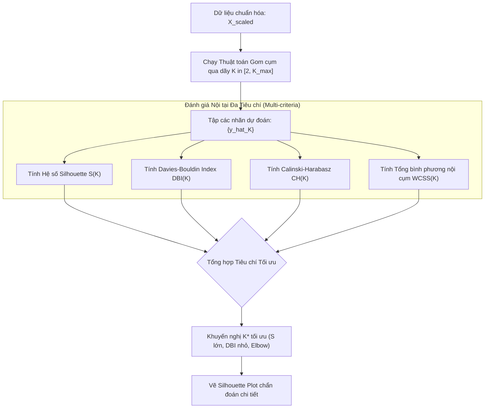

# Các Thước đo Đánh giá Mô hình Học không giám sát (Evaluation Metrics for Unsupervised Learning)

## Purpose

Trong Học có giám sát (Supervised Learning), việc đánh giá chất lượng mô hình tương đối rõ ràng thông qua việc so sánh trực tiếp dự đoán của mô hình với nhãn chuẩn (Ground Truth) có sẵn trên tập kiểm tra (như Accuracy, F1-Score, RMSE, AUC-ROC). Ngược lại, thách thức căn bản của **Học không giám sát (Unsupervised Learning)** là dữ liệu hoàn toàn không có nhãn thực tế. Một câu hỏi cốt lõi luôn được đặt ra: *Làm thế nào để biết một thuật toán gom cụm hoặc giảm chiều hoạt động tốt, và làm thế nào để chọn số lượng cụm $`K`$ tối ưu một cách khách quan?*

Hệ thống đánh giá Học không giám sát được chia thành hai nhóm phương pháp luận chính:
1. **Đánh giá Nội tại (Internal Evaluation / Unsupervised Validation):** Đánh giá chất lượng phân vùng chỉ dựa trên các đặc tính hình học của không gian dữ liệu (độ cô đọng nội cụm và độ phân tách ngoại cụm) mà không cần bất kỳ thông tin nhãn ngoài nào. Tiêu biểu gồm: **Silhouette Coefficient**, **Davies-Bouldin Index**, **Calinski-Harabasz Index**, và **Elbow WCSS**.
2. **Đánh giá Ngoại vi (External Evaluation / Benchmark Validation):** Được áp dụng trong môi trường nghiên cứu hoặc khi có sẵn một tập dữ liệu chuẩn đã được chuyên gia dán nhãn để đo lường mức độ trùng khớp giữa cấu trúc cụm do thuật toán tìm ra và nhãn thực tế. Tiêu biểu gồm: **Adjusted Rand Index (ARI)**, **Normalized Mutual Information (NMI)**, và **V-Measure**.

---

## Input

Đầu vào cho các thước đo đánh giá:

1. **Ma trận dữ liệu đặc trưng:**
   * $`X = [x_1, x_2, \dots, x_n]^\top \in \mathbb{R}^{n \times p}`$: Tập hợp $`n`$ mẫu quan sát $`p`$ chiều cần đánh giá (hoặc ma trận khoảng cách đôi một $`D \in \mathbb{R}^{n \times n}`$).
2. **Vector nhãn cụm do thuật toán dự đoán (Predicted Cluster Labels):**
   * $`\hat{y} = [\hat{y}_1, \hat{y}_2, \dots, \hat{y}_n]^\top`$ với $`\hat{y}_i \in \lbrace 1, 2, \dots, K \rbrace`$ (hoặc $`-1`$ đối với điểm nhiễu trong DBSCAN/OPTICS).
3. **Vector nhãn thực tế đối chứng (Ground Truth Labels - chỉ dùng cho External Metrics):**
   * $`y = [y_1, y_2, \dots, y_n]^\top`$ với $`y_i \in \lbrace 1, 2, \dots, C \rbrace`$.

---

## Output

Kết quả đầu ra của quá trình đánh giá:

1. **Các chỉ số vô hướng định lượng (Scalar Evaluation Scores):**
   * Điểm số đơn lẻ phản ánh chất lượng gom cụm (ví dụ: điểm Silhouette trung bình toàn cục $`s \in [-1, +1]`$; chỉ số DBI $`\ge 0`$; điểm ARI $`\in [-1, 1]`$).
2. **Biểu đồ trực quan hóa đánh giá (Diagnostic Plots):**
   * **Silhouette Plot:** Biểu đồ dải thể hiện độ dày và hệ số Silhouette của từng điểm bên trong mỗi cụm, giúp phát hiện cụm nào bị chồng lấn hoặc cụm nào có chất lượng kém.
   * **Đường cong Elbow Curve (K-Inertia):** Đồ thị biểu diễn tổng bình phương sai số nội cụm (WCSS) theo số lượng cụm $`K`$ để tìm điểm gập khuỷu tay.
3. **Ma trận Liên tục (Contingency Matrix / Confusion Matrix):**
   * Ma trận kích thước $`K \times C`$ biểu diễn sự phân bổ số lượng mẫu giữa các cụm dự đoán và các lớp thực tế.

---

## Evaluation metrics

Bảng tổng hợp các tiêu chí đánh giá mô hình gom cụm:

| Nhóm Thước đo | Tên Thước đo | Khoảng Giá trị | Chiều hướng Tối ưu | Yêu cầu Nhãn Thực tế? |
|---|---|---|---|---|
| **Nội tại (Internal)** | Hệ số Silhouette (SC) | $`[-1, +1]`$ | Càng cao càng tốt ($`\to +1`$) | Không |
| **Nội tại (Internal)** | Davies-Bouldin Index (DBI) | $`[0, +\infty)`$ | Càng nhỏ càng tốt ($`\to 0`$) | Không |
| **Nội tại (Internal)** | Calinski-Harabasz Index (CH) | $`[0, +\infty)`$ | Càng lớn càng tốt ($`\to +\infty`$) | Không |
| **Nội tại (Internal)** | Tổng bình phương nội cụm (WCSS) | $`[0, +\infty)`$ | Tìm điểm uốn (Elbow) | Không |
| **Nội tại (Internal)** | Bayesian Information Criterion (BIC) | $`(-\infty, +\infty)`$ | Càng nhỏ càng tốt (cho GMM) | Không |
| **Ngoại vi (External)** | Adjusted Rand Index (ARI) | $`[-1, +1]`$ | Càng cao càng tốt ($`\to +1`$) | Có |
| **Ngoại vi (External)** | Normalized Mutual Info (NMI) | $`[0, 1]`$ | Càng cao càng tốt ($`\to 1`$) | Có |
| **Ngoại vi (External)** | V-Measure (Harmonic mean of H & C) | $`[0, 1]`$ | Càng cao càng tốt ($`\to 1`$) | Có |

---

## How it works

### 1. Chi tiết Các Thước đo Đánh giá Nội tại (Internal Metrics)

#### A. Hệ số Silhouette (Silhouette Coefficient - Rousseeuw, 1987)
Hệ số Silhouette đo lường mức độ một điểm dữ liệu giống với các điểm trong chính cụm của nó (sự gắn kết) so với các điểm ở cụm gần nhất khác (sự phân tách).

Với mỗi điểm dữ liệu $`x_i`$ thuộc cụm $`C_I`$:
1. **Khoảng cách nội cụm trung bình ($`a(i)`$ - Cohesion):**

$$
a(i) = \frac{1}{|C_I| - 1} \sum_{x_j \in C_I, j \neq i} \|x_i - x_j\|
$$

2. **Khoảng cách ngoại cụm nhỏ nhất ($`b(i)`$ - Separation):** Khoảng cách trung bình từ $`x_i`$ đến tất cả các điểm của cụm láng giềng gần nhất $`C_J \neq C_I`$:

$$
b(i) = \min_{J \neq I} \left( \frac{1}{|C_J|} \sum_{x_j \in C_J} \|x_i - x_j\| \right)
$$

3. **Hệ số Silhouette của điểm $`x_i`$:**

$$
s(i) = \frac{b(i) - a(i)}{\max(a(i), b(i))} \in [-1, +1]
$$

* **Ý nghĩa:**
  * $`s(i) \approx +1`$: Điểm $`x_i`$ nằm sâu trong cụm của nó và rất xa các cụm khác (Gom cụm xuất sắc).
  * $`s(i) \approx 0`$: Điểm $`x_i`$ nằm ngay trên đường biên giữa hai cụm.
  * $`s(i) < 0`$: Điểm $`x_i`$ gần các điểm của cụm khác hơn cụm hiện tại (Bị gán nhầm cụm).
* **Hệ số Silhouette toàn cục:** Trung bình cộng $`S = \frac{1}{n} \sum_{i=1}^n s(i)`$.

---

#### B. Chỉ số Davies-Bouldin (Davies-Bouldin Index - DBI)
Chỉ số DBI dựa trên tỷ số giữa độ phân tán bên trong cụm (Scatter) và khoảng cách giữa các tâm cụm (Separation).

1. **Độ phân tán trung bình nội cụm $`s_i`$ của cụm $`C_i`$ có tâm $`c_i`$:**

$$
s_i = \frac{1}{|C_i|} \sum_{x \in C_i} \|x - c_i\|
$$

2. **Độ tương đồng giữa hai cụm $`C_i`$ và $`C_j`$ ($`R_{ij}`$):**

$$
R_{ij} = \frac{s_i + s_j}{\|c_i - c_j\|}
$$

3. **Chỉ số Davies-Bouldin toàn cục:**

$$
\text{DBI} = \frac{1}{K} \sum_{i=1}^K \max_{j \neq i} R_{ij}
$$

* **Ý nghĩa:** DBI tìm kiếm đối thủ tồi tệ nhất của mỗi cụm (giá trị $`R_{ij}`$ lớn nhất). Giá trị **DBI càng nhỏ thì mô hình càng tốt** (các cụm cô đặc và các tâm cách xa nhau).

---

#### C. Chỉ số Calinski-Harabasz (Variance Ratio Criterion - CH Index)
Chỉ số CH là tỷ số giữa độ biến thiên giữa các cụm (Between-group Dispersion) và độ biến thiên bên trong các cụm (Within-group Dispersion), có hiệu chỉnh theo bậc tự do:

$$
\text{CH} = \frac{\text{Tr}(B_K)}{\text{Tr}(W_K)} \times \frac{n - K}{K - 1}
$$

Trong đó:
* $`B_K = \sum_{k=1}^K n_k (c_k - \bar{x})(c_k - \bar{x})^\top`$ là ma trận phân tán giữa các cụm ($`\bar{x}`$ là trung bình toàn bộ tập dữ liệu).
* $`W_K = \sum_{k=1}^K \sum_{x \in C_k} (x - c_k)(x - c_k)^\top`$ là ma trận phân tán nội bộ các cụm.
* **Ý nghĩa:** Giá trị **CH càng cao thì mô hình gom cụm càng tối ưu**. Thuật toán tính toán cực nhanh ($`O(np)`$), rất phù hợp để khảo sát dãy $`K`$ lớn.

---

### 2. Chi tiết Các Thước đo Đánh giá Ngoại vi (External Metrics)

#### A. Chỉ số Điều chỉnh Rand (Adjusted Rand Index - ARI - Hubert & Arabie, 1985)
Rand Index (RI) đếm số lượng cặp điểm được quyết định nhất quán giữa nhãn thực tế $`Y`$ và nhãn cụm dự đoán $`\hat{Y}`$:
* $`a`$: Số cặp điểm cùng cụm trong cả $`Y`$ và $`\hat{Y}`$.
* $`b`$: Số cặp điểm khác cụm trong cả $`Y`$ và $`\hat{Y}`$.
* $`c`$: Số cặp cùng cụm trong $`Y`$ nhưng khác cụm trong $`\hat{Y}`$.
* $`d`$: Số cặp khác cụm trong $`Y`$ nhưng cùng cụm trong $`\hat{Y}`$.

Chỉ số Rand gốc $`\text{RI} = \frac{a + b}{a + b + c + d}`$ có nhược điểm là không tiến về 0 đối với phép gán nhãn ngẫu nhiên. **Adjusted Rand Index (ARI)** hiệu chỉnh kỳ vọng ngẫu nhiên:

$$
\text{ARI} = \frac{\text{RI} - \mathbb{E}[\text{RI}]}{\max(\text{RI}) - \mathbb{E}[\text{RI}]} \in [-1, +1]
$$

* **Ý nghĩa:** 
  * $`\text{ARI} = 1.0`$: Cụm dự đoán trùng khớp hoàn toàn với nhãn thực tế (chấp nhận hoán vị tên cụm).
  * $`\text{ARI} \le 0.0`$: Gán nhãn ngẫu nhiên độc lập không có giá trị học máy.

---

#### B. Thông tin Tương hỗ Chuẩn hóa (Normalized Mutual Information - NMI)
Đo lượng thông tin chia sẻ giữa nhãn thực $`Y`$ và nhãn cụm $`\hat{Y}`$ dựa trên lý thuyết thông tin Shannon:

$$
\text{NMI}(Y, \hat{Y}) = \frac{2 \cdot I(Y; \hat{Y})}{H(Y) + H(\hat{Y})} \in [0, 1]
$$

Trong đó:
* $`H(Y) = -\sum_{c} P(c) \log P(c)`$ là Entropy của biến nhãn thực.
* $`I(Y; \hat{Y}) = \sum_{c, k} P(c, k) \log \left(\frac{P(c, k)}{P(c)P(k)}\right)`$ là Thông tin Tương hỗ (Mutual Information).
* **Ý nghĩa:** $`\text{NMI} = 1`$ thể hiện hai cách phân hoạch tương đương hoàn hảo; $`\text{NMI} = 0`$ thể hiện hai cách phân hoạch hoàn toàn độc lập thống kê.

---

## Data used

Quy tắc áp dụng các thước đo đánh giá theo từng bối cảnh thực tế:

1. **Khi KHÔNG có nhãn thực tế (Bài toán sản phẩm thực tế):**
   * Sử dụng kết hợp **Silhouette Score** và **Davies-Bouldin Index** để tìm $`K`$ tối ưu.
   * Vẽ biểu đồ **Silhouette Plot** để kiểm tra tính đồng đều: loại bỏ các cấu hình mà một cụm có kích thước quá nhỏ hoặc có nhiều điểm bị âm ($`s(i) < 0`$).
2. **Khi CÓ nhãn thực tế (Nghiên cứu học thuật / Benchmark thuật toán):**
   * Sử dụng **ARI** và **NMI** để đối chiếu thuật toán mới với các baseline đã công bố. Vì ARI và NMI bất biến với phép hoán vị nhãn (Label Permutation Invariance), không cần phải map nhãn 0, 1, 2 thành nhãn lớp tương ứng.
3. **Đối với cụm hình dạng phi tuyến phức tạp (DBSCAN / Mật độ):**
   * Cần thận trọng khi dùng Silhouette, DBI và Calinski-Harabasz vì các chỉ số này ngầm giả định cụm dạng hình cầu hoặc convex. Với cụm trăng khuyết hoặc xoắn ốc, điểm Silhouette có thể thấp dù thuật toán gom cụm hoàn hảo theo mật độ.

---

## Design

### 1. Kiến trúc Quy trình Tự động Đánh giá và Chọn Cấu hình Cụm Tối ưu



---

### 2. Mã nguồn Triển khai Đánh giá Đa Tiêu chí với Scikit-learn

```python
import numpy as np
import matplotlib.pyplot as plt
from sklearn.datasets import make_blobs
from sklearn.cluster import KMeans
from sklearn.metrics import (
    silhouette_score,
    davies_bouldin_score,
    calinski_harabasz_score,
    adjusted_rand_score,
    normalized_mutual_info_score
)
from sklearn.preprocessing import StandardScaler

# 1. Tạo dữ liệu thực nghiệm có nhãn thật làm đối chứng (Ground Truth)
X_raw, y_true = make_blobs(n_samples=800, centers=4, cluster_std=0.9, random_state=42)
X = StandardScaler().fit_transform(X_raw)

# 2. Khảo sát dãy K từ 2 đến 7 bằng các chỉ số Đánh giá Nội tại
k_candidates = range(2, 8)
silhouette_records = []
dbi_records = []
ch_records = []
wcss_records = []

print(f"{'K':<4} | {'Silhouette':<12} | {'Davies-Bouldin':<15} | {'Calinski-Harabasz':<18} | {'WCSS (Inertia)':<15}")
print("-" * 75)

for k in k_candidates:
    kmeans = KMeans(n_clusters=k, init='k-means++', n_init=10, random_state=42)
    labels = kmeans.fit_predict(X)
    
    s_score = silhouette_score(X, labels)
    dbi_score = davies_bouldin_score(X, labels)
    ch_score = calinski_harabasz_score(X, labels)
    wcss = kmeans.inertia_
    
    silhouette_records.append(s_score)
    dbi_records.append(dbi_score)
    ch_records.append(ch_score)
    wcss_records.append(wcss)
    
    print(f"{k:<4} | {s_score:<12.4f} | {dbi_score:<15.4f} | {ch_score:<18.2f} | {wcss:<15.2f}")

# Tìm K tối ưu theo Silhouette và DBI
best_k_sil = k_candidates[np.argmax(silhouette_records)]
best_k_dbi = k_candidates[np.argmin(dbi_records)]
print(f"\n=> K tối ưu theo Silhouette (cực đại): K = {best_k_sil}")
print(f"=> K tối ưu theo Davies-Bouldin (cực tiểu): K = {best_k_dbi}")

# 3. Đánh giá Ngoại vi (External Evaluation) đối với K tối ưu
final_kmeans = KMeans(n_clusters=best_k_sil, init='k-means++', n_init=10, random_state=42)
final_labels = final_kmeans.fit_predict(X)

ari = adjusted_rand_score(y_true, final_labels)
nmi = normalized_mutual_info_score(y_true, final_labels)

print(f"\n[Kết quả Đánh giá Ngoại vi đối chứng]")
print(f"Adjusted Rand Index (ARI): {ari:.4f} (Trùng khớp gần tuyệt đối nếu tiến tới 1.0)")
print(f"Normalized Mutual Information (NMI): {nmi:.4f}")
```

---

## Nguồn

- [1] Rousseeuw, P. J. (1987). *Silhouettes: a graphical aid to the interpretation and validation of cluster analysis*. Journal of Computational and Applied Mathematics, 20, 53-65.
- [2] Davies, D. L., & Bouldin, D. W. (1979). *A cluster separation measure*. IEEE Transactions on Pattern Analysis and Machine Intelligence, (2), 224-227.
- [3] Caliński, T., & Harabasz, J. (1974). *A dendrite method for cluster analysis*. Communications in Statistics-theory and Methods, 3(1), 1-27.
- [4] Hubert, L., & Arabie, P. (1985). *Comparing partitions*. Journal of Classification, 2(1), 193-218.
- [5] [scikit-learn User Guide: Clustering performance evaluation](https://scikit-learn.org/stable/modules/clustering.html#clustering-performance-evaluation).
