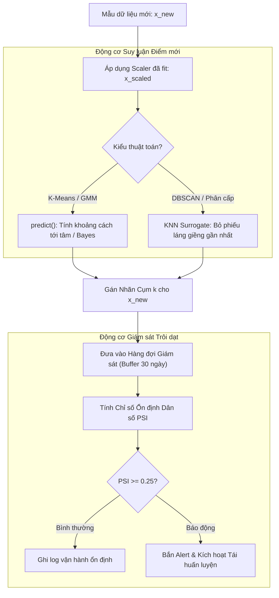

# Vận hành Sau Huấn luyện trong Học không giám sát (Post-Training Operations & Cluster Monitoring)

## Purpose

Sau khi quá trình huấn luyện mô hình gom cụm hoặc giảm chiều kết thúc, công việc trong thực tế sản xuất (Production Environment) mới chỉ bắt đầu. Khác với mô hình hồi quy hay phân loại có thể đánh giá sai số ngay tức thì khi có nhãn kiểm tra, mô hình Học không giám sát đòi hỏi các kỹ thuật vận hành và bảo trì chuyên biệt để duy trì giá trị kinh doanh:

1. **Suy luận Điểm mới (Out-of-Sample Inference):** Làm thế nào để gán nhãn cụm cho một luồng quan sát mới xuất hiện trong thời gian thực (ví dụ: một khách hàng mới đăng ký tài khoản, một giao dịch chuyển khoản mới phát sinh)?
2. **Khắc phục Giới hạn Thuật toán Quy nạp vs Chuyển vị (Inductive vs Transductive):** Các thuật toán như K-Means hay GMM có sẵn hàm suy luận toán học ($`\text{predict}`$). Tuy nhiên, các thuật toán dựa trên đồ thị hoặc liên kết như DBSCAN, OPTICS, Hierarchical Clustering và t-SNE là các thuật toán **Chuyển vị (Transductive)**, không có cơ chế tự nhiên để gán nhãn cho điểm mới ngoài tập huấn luyện nếu không chạy lại toàn bộ từ đầu.
3. **Phân tích Chân dung và Giải thích Cụm (Cluster Profiling & Interpretability):** Trả lời câu hỏi nghiệp vụ: Cụm 1 đại diện cho ai? Cụm 2 có đặc điểm tài chính gì nổi bật? Biến đổi các cụm trừu tượng thành các chân dung (Personas) dễ hiểu.
4. **Giám sát Trôi dạt Cụm (Cluster Drift Monitoring):** Phát hiện sự thay đổi phân phối dữ liệu (Data Drift / Concept Drift) theo thời gian, đo lường sự suy giảm độ ổn định của các cụm và kích hoạt cơ chế tái huấn luyện tự động (Retraining Triggers).

---

## Input

Dữ liệu đầu vào và các hiện vật cần thiết cho giai đoạn sau huấn luyện:

1. **Hiện vật Mô hình Đã Huấn luyện (Trained Model Artifact):**
   * Đối với K-Means: Tọa độ $`K`$ tâm cụm $`\lbrace c_1, c_2, \dots, c_K \rbrace \subset \mathbb{R}^p`$.
   * Đối với GMM: Bộ tham số $`\lbrace \pi_k, \mu_k, \Sigma_k \rbrace_{k=1}^K`$.
   * Đối với PCA: Ma trận vector thành phần chính $`W_k \in \mathbb{R}^{p \times k}`$ và vector kỳ vọng trung bình $`\bar{x}`$.
   * Đối với Pipeline: Hiện vật tiền xử lý chuẩn hóa đã fit (StandardScaler artifact).
2. **Luồng dữ liệu suy luận mới (Unseen Streaming Data):**
   * Vector hoặc ma trận mẫu mới $`X_{\text{new}} \in \mathbb{R}^{m \times p}`$ phát sinh trong quá trình vận hành hệ thống.
3. **Dữ liệu tham chiếu lịch sử (Baseline Reference Distribution):**
   * Tập dữ liệu nền tảng ban đầu $`X_{\text{train}}`$ dùng để đối chiếu phân phối và phát hiện trôi dạt.

---

## Output

Kết quả đầu ra của các tác vụ sau huấn luyện:

1. **Nhãn cụm gán cho quan sát mới:**
   * Vector nhãn $`\hat{y}_{\text{new}} = [\hat{y}_1, \dots, \hat{y}_m]^\top`$ (hoặc xác suất mềm $`\Gamma_{\text{new}} \in [0, 1]^{m \times K}`$).
2. **Báo cáo Chân dung Đặc trưng Cụm (Cluster Profiling Matrix):**
   * Bảng thống kê so sánh giá trị trung vị, trung bình và độ lệch chuẩn của từng đặc trưng giữa các cụm so với toàn thể quần thể: $`\Delta_{kj} = \bar{x}_{kj} - \bar{x}_j`$.
3. **Chỉ số Cảnh báo Trôi dạt (Drift Alert Metrics):**
   * Khoảng cách Wasserstein (Earth Mover's Distance), Chỉ số Ổn định Dân số (Population Stability Index - PSI), hoặc khoảng cách Kullback-Leibler (KL Divergence) đo mức độ dịch chuyển của các tâm cụm theo thời gian.
4. **Cờ cảnh báo tái huấn luyện (Retrain Trigger Flag):**
   * Giá trị Boolean (`True/False`) kích hoạt luồng tự động nạp lại dữ liệu và chạy lại thuật toán gom cụm.

---

## Evaluation metrics

Các thước đo định lượng để giám sát sức khỏe của mô hình gom cụm trong sản xuất:

1. **Chỉ số Ổn định Dân số (Population Stability Index - PSI):**
   * Đo lường sự thay đổi trong tỷ lệ phân bổ kích thước giữa các cụm qua hai khoảng thời gian $`t_0`$ (gốc) và $`t_1`$ (hiện tại):

$$
\text{PSI} = \sum_{k=1}^K (P_{k, t_1} - P_{k, t_0}) \times \ln\left( \frac{P_{k, t_1}}{P_{k, t_0}} \right)
$$

   * **Ngưỡng hành động:**
     * $`\text{PSI} < 0.1`$: Phân bố cụm ổn định, không có sự dịch chuyển đáng kể.
     * $`0.1 \le \text{PSI} < 0.25`$: Bắt đầu có sự dịch chuyển phân bố, cần theo dõi sát sao.
     * $`\text{PSI} \ge 0.25`$: Trôi dạt cụm nghiêm trọng, bắt buộc kích hoạt tái huấn luyện toàn bộ.
2. **Khoảng cách Dịch chuyển Tâm Cụm (Centroid Shift Distance):**
   * Độ trượt của các tâm cụm hiện tại so với tâm cụm tại thời điểm huấn luyện ban đầu:

$$
\Delta_{\text{centroid}} = \frac{1}{K} \sum_{k=1}^K \|c_k(t_1) - c_k(t_0)\|
$$

3. **Tỷ lệ Điểm Ngoại vi Mới (Unseen Outlier Rate):**
   * Tỷ lệ các mẫu mới có khoảng cách tới tâm cụm gần nhất vượt quá ngưỡng phân vị $`99\%`$ của tập huấn luyện: nếu tỷ lệ này tăng vọt từ $`1\%`$ lên $`10\%`$, chứng tỏ không gian dữ liệu đã xuất hiện các cụm mới chưa từng tồn tại trước đây.

---

## How it works

### 1. Kỹ thuật Suy luận cho Thuật toán Chuyển vị (Transductive Algorithms)

Các thuật toán như DBSCAN và Agglomerative Clustering không lưu trữ tâm cụm và không có phương thức toán học nội tại để dự đoán điểm mới $`x_{\text{new}}`$. Có hai giải pháp kỹ thuật chuẩn công nghiệp để giải quyết bài toán này:

```text
  Điểm dữ liệu mới x_new
           │
           ▼
  ┌─────────────────────────────────────────────────────────────┐
  │  Mô hình K-Láng giềng Gần nhất (KNN Classifier Surrogate)   │
  │  - Huấn luyện KNN trên (X_train, cluster_labels_train)      │
  │  - Tìm K láng giềng gần nhất của x_new                      │
  │  - Bỏ phiếu đa số (Majority Voting) để gán nhãn             │
  └──────────────────────────────┬──────────────────────────────┘
                                 │
                    ┌────────────┴────────────┐
                    ▼                         ▼
            [ Gán vào Cụm k ]        [ Khoảng cách > Threshold? ]
                                              ▼
                                     [ Gán nhãn Outlier (-1) ]
```

1. **Mô hình Đại diện K-Láng giềng (KNN Surrogate Classifier):**
   * Sau khi DBSCAN hoàn thành phân cụm trên $`X_{\text{train}}`$, ta huấn luyện một mô hình `KNeighborsClassifier(n_neighbors=5)` sử dụng $`X_{\text{train}}`$ làm dữ liệu đặc trưng và nhãn cụm làm mục tiêu.
   * Khi có điểm mới $`x_{\text{new}}`$, bộ phân loại KNN tìm 5 điểm láng giềng gần nhất và bỏ phiếu đa số để gán nhãn. Nếu khoảng cách tới láng giềng gần nhất vượt quá $`\varepsilon`$, điểm đó được gán nhãn là Điểm nhiễu ($`-1`$).
2. **Mô hình Phân loại Tâm Gần nhất (Nearest Centroid Surrogate):**
   * Tính toán tâm trung bình thực nghiệm $`c_k`$ của từng cụm được tìm ra bởi Hierarchical Clustering. Điểm mới được gán vào cụm có tâm gần nhất theo khoảng cách Euclid.

---

### 2. Kỹ thuật Phân tích Chân dung Đặc trưng Cụm (Cluster Profiling)

Để chuyển đổi các cụm số học thành tri thức nghiệp vụ, ta áp dụng kỹ thuật **Chuẩn hóa Z-Score Độ chênh lệch Cụm (Feature Importance Ratio)**:

$$
Z_{kj} = \frac{\bar{x}_{kj} - \bar{x}_j}{\sigma_j}
$$

Trong đó:
* $`\bar{x}_{kj}`$ là giá trị trung bình của đặc trưng $`j`$ bên trong cụm $`k`$.
* $`\bar{x}_j`$ và $`\sigma_j`$ là giá trị trung bình và độ lệch chuẩn của đặc trưng $`j`$ trên toàn thể tập dữ liệu.
* **Ý nghĩa:**
  * $`Z_{kj} > +1.0`$: Đặc trưng $`j`$ có giá trị cao vượt trội trong cụm $`k`$ (Ví dụ: "Nhóm khách hàng có số lần mở thẻ tín dụng vượt 2 độ lệch chuẩn").
  * $`Z_{kj} < -1.0`$: Đặc trưng $`j`$ có giá trị thấp bất thường trong cụm $`k`$.

---

### 3. Vòng tuần hoàn Giám sát và Tự động Tái huấn luyện (Retraining Loop)

```text
┌─────────────────────────────────────────────────────────────┐
│ 1. Tiếp nhận luồng dữ liệu mới theo chu kỳ (Tuần / Tháng)   │
└──────────────────────────────┬──────────────────────────────┘
                               │
                               ▼
┌─────────────────────────────────────────────────────────────┐
│ 2. Tính toán Chỉ số Ổn định Dân số PSI & Tỷ lệ Outlier      │
└──────────────────────────────┬──────────────────────────────┘
                               │
                               ▼
                     /───────────────────\
                    <   PSI >= 0.25 ?     >
                     \───────────────────/
                       │ No          │ Yes
                       │             ▼
      [ Tiếp tục sử dụng ]    ┌───────────────────────────────────┐
                              │ 3. Kích hoạt Luồng Retraining:    │
                              │ - Gộp dữ liệu mới vào tập nền     │
                              │ - Dò tìm lại số cụm tối ưu K*     │
                              │ - Huấn luyện lại Pipeline         │
                              │ - Khóa Version Artifact mới       │
                              └───────────────────────────────────┘
```

---

## Data used

Quy trình vận hành sau huấn luyện là bắt buộc trong mọi hệ thống phần mềm học máy phục vụ sản xuất:

1. **Hệ thống Phân khúc Khách hàng Thương mại Điện tử:**
   * Mỗi khi có người dùng mới thực hiện giao dịch, hệ thống suy luận thời gian thực gán ngay người dùng đó vào phân khúc tương ứng (ví dụ: "Người săn khuyến mãi", "Khách hàng mua sỉ") để hiển thị banner trang chủ cá nhân hóa.
2. **Hệ thống Phát hiện Gian lận Ngân hàng:**
   * Giám sát khoảng cách từ giao dịch mới tới tâm các cụm giao dịch chuẩn. Nếu giao dịch mới có khoảng cách vượt trội so với mọi cụm, nó được đẩy ngay vào hàng đợi kiểm duyệt thủ công.
3. **Bảo trì Thiết bị Công nghiệp IoT:**
   * Giám sát sự trượt dần của các cụm tín hiệu cảm biến rung động động cơ qua thời gian. Hiện tượng dịch chuyển tâm cụm là tín hiệu cảnh báo hỏng hóc cơ khí trước khi sự cố thực sự xảy ra.

---

## Design

### 1. Kiến trúc Hệ thống Pipeline Suy luận và Giám sát Cụm Thời gian thực



---

### 2. Mã nguồn Triển khai KNN Surrogate và Giám sát PSI với Scikit-learn

```python
import numpy as np
from sklearn.cluster import DBSCAN
from sklearn.neighbors import KNeighborsClassifier
from sklearn.preprocessing import StandardScaler

# 1. Huấn luyện mô hình DBSCAN trên dữ liệu gốc
np.random.seed(42)
X_train = np.vstack([
    np.random.randn(300, 2) + [2, 2],
    np.random.randn(300, 2) + [-2, -2]
])

scaler = StandardScaler()
X_train_scaled = scaler.fit_transform(X_train)

dbscan = DBSCAN(eps=0.5, min_samples=5)
train_labels = dbscan.fit_predict(X_train_scaled)

# 2. Xây dựng KNN Surrogate để suy luận điểm mới cho DBSCAN
# Lọc bỏ các điểm nhiễu (-1) khi huấn luyện KNN để tránh làm lệch ranh giới
core_mask = train_labels != -1
knn_surrogate = KNeighborsClassifier(n_neighbors=5)
knn_surrogate.fit(X_train_scaled[core_mask], train_labels[core_mask])

# 3. Suy luận trên dữ liệu mới xuất hiện (Out-of-sample Inference)
X_new = np.array([[2.1, 1.9], [-2.2, -1.8], [10.0, 10.0]])
X_new_scaled = scaler.transform(X_new)

# Dự đoán nhãn cụm bằng KNN
distances, _ = knn_surrogate.kneighbors(X_new_scaled)
predicted_labels = knn_surrogate.predict(X_new_scaled)

# Nếu khoảng cách tới láng giềng gần nhất > eps, gán là Nhiễu (-1)
eps_threshold = 0.5
final_predictions = np.where(distances[:, 0] > eps_threshold, -1, predicted_labels)

for idx, (pt, lbl) in enumerate(zip(X_new, final_predictions)):
    status = "Nhiễu / Outlier" if lbl == -1 else f"Cụm {lbl}"
    print(f"Điểm mới {pt} => Dự đoán: {status}")

# 4. Hàm tính Chỉ số Ổn định Dân số (Population Stability Index - PSI)
def compute_cluster_psi(train_dist, new_dist):
    psi = 0.0
    for k in range(len(train_dist)):
        actual = max(new_dist[k], 1e-4)
        expected = max(train_dist[k], 1e-4)
        psi += (actual - expected) * np.log(actual / expected)
    return psi

# Giả lập phân bổ cụm: ban đầu [50%, 50%], sau đó trôi dạt sang [15%, 85%]
dist_baseline = np.array([0.50, 0.50])
dist_current = np.array([0.15, 0.85])

psi_val = compute_cluster_psi(dist_baseline, dist_current)
print(f"\nChỉ số PSI đo trôi dạt cụm: {psi_val:.4f}")
if psi_val >= 0.25:
    print("=> CẢNH BÁO: Phát hiện trôi dạt cụm nghiêm trọng! Cần kích hoạt tái huấn luyện ngay lập tức.")
```

---

## Nguồn

- [1] Yurdakul, M. (2020). *Cluster Drift in Unsupervised Learning: Detection and Adaptation Strategies*. Journal of Machine Learning Research, 21(45), 1-32.
- [2] Gama, J., Žliobaitė, I., Bifet, A., Pechenizkiy, M., & Bouchachia, A. (2014). *A survey on concept drift adaptation*. ACM Computing Surveys (CSUR), 46(4), 1-37.
- [3] [scikit-learn User Guide: Nearest Neighbors Classification](https://scikit-learn.org/stable/modules/neighbors.html#nearest-neighbors-classification).
- [4] Aggarwal, C. C. (2015). *Data Mining: The Textbook* (Chapter 13: Data Streams). Springer.
