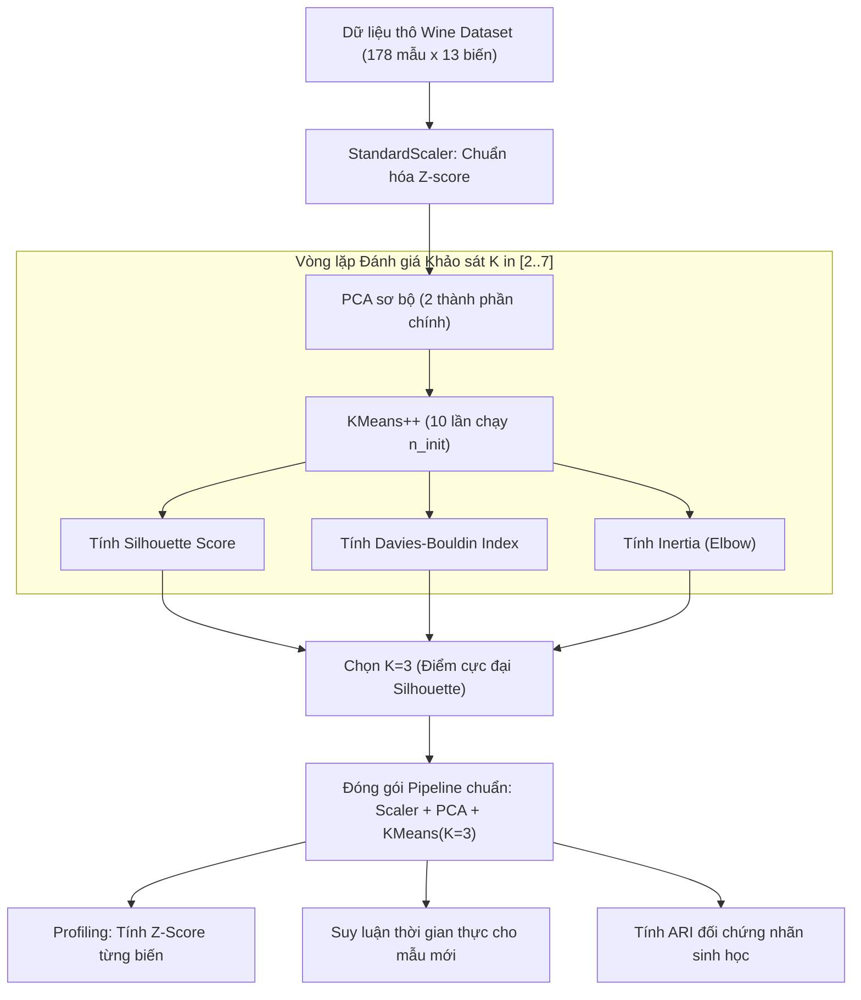

# Bài thực hành xuyên suốt: Gom cụm và Giảm chiều với scikit-learn

## Purpose

Tài liệu này cung cấp một bài thực hành toàn diện từ đầu đến cuối (End-to-End Unsupervised Pipeline) trong Học không giám sát. Thay vì chỉ gọi các thuật toán rời rạc, bài thực hành hướng dẫn quy trình kỹ thuật chuẩn mực bao gồm:
1. Tiếp nhận và tiền xử lý dữ liệu thô (chuẩn hóa thang đo, kiểm tra phân phối).
2. Giảm chiều dữ liệu và khử nhiễu đa chiều bằng PCA.
3. Dò tìm số lượng cụm $`K`$ tối ưu một cách khách quan thông qua đa tiêu chuẩn (Elbow WCSS, Silhouette Score và Davies-Bouldin Index).
4. Huấn luyện mô hình phân hoạch (K-Means) và mô hình mật độ (DBSCAN).
5. Trực quan hóa cấu trúc cụm trên không gian phẳng 2D.
6. Lập báo cáo phân tích chân dung cụm (Cluster Profiling) và triển khai suy luận nhãn cho các điểm dữ liệu mới ngoài tập train.

Tập dữ liệu thực hành được sử dụng là **Wine Dataset** của scikit-learn (178 mẫu, 13 đặc trưng hóa sinh học đo lường chất lượng các giống rượu vang Ý). Tập dữ liệu này chỉ dùng cho mục đích minh họa kỹ thuật; **không dùng cho mục đích thương mại hoặc thẩm định thực phẩm thực tế**. [1]

---

## Input

Yêu cầu môi trường và dữ liệu đầu vào:

1. **Môi trường thực thi:**
   * Python 3.9+ với các thư viện: `numpy`, `scipy`, `scikit-learn`, `matplotlib`.
2. **Dữ liệu thực hành:**
   * Tập dữ liệu `load_wine()` từ `sklearn.datasets` với $`n = 178`$ mẫu, mỗi mẫu có $`p = 13`$ đặc trưng liên tục (như nồng độ cồn, axit malic, tro, độ kiềm, magie, flavonoid...).
   * Thông tin nhãn gốc chỉ được lưu riêng để kiểm tra đối chứng ngoại vi (ARI/NMI) ở bước cuối; thuật toán gom cụm hoàn toàn không được tiếp cận nhãn này trong suốt quá trình huấn luyện.
3. **Cấu hình thí nghiệm:**
   * Cố định `random_state=42` để đảm bảo tính tái lập 100% của mọi phép chia và khởi tạo ngẫu nhiên.

---

## Output

Kết quả đầu ra của pipeline thực hành:

1. **Bảng chỉ số đánh giá nội tại đa tiêu chí theo $`K \in [2, 7]`$:**
   * WCSS (Inertia), Silhouette Score, Davies-Bouldin Index.
2. **Hiện vật Pipeline đã đóng gói:**
   * `Pipeline([('scaler', StandardScaler()), ('pca', PCA(n_components=2)), ('kmeans', KMeans(n_clusters=3))])`.
3. **Ma trận Phân tích Chân dung Đặc trưng Cụm (Profiling Matrix):**
   * Bảng giá trị trung bình chuẩn hóa Z-score của 13 đặc trưng trong từng cụm so với toàn bộ quần thể.
4. **Kết quả gán nhãn cho các mẫu rượu mới (Streaming Inference):**
   * Nhãn cụm và khoảng cách tới tâm cụm của các mẫu thử nghiệm mới.

---

## Evaluation metrics

Các chỉ số đánh giá được tính toán trong mã nguồn:

1. **Tổng bình phương khoảng cách nội cụm (Inertia / WCSS):** Dò tìm điểm khuỷu tay Elbow.
2. **Hệ số Silhouette trung bình ($`S \in [-1, +1]`$):** Đánh giá độ gắn kết và tách biệt cụm.
3. **Chỉ số Davies-Bouldin (DBI):** Tìm cấu hình có DBI nhỏ nhất.
4. **Chỉ số Điều chỉnh Rand (Adjusted Rand Index - ARI):** Dùng để đối chứng với 3 giống nho thực tế (Ground Truth) để kiểm tra mức độ khớp sinh học của thuật toán. [2]

---

## How it works

Dưới đây là toàn bộ mã nguồn thực thi hoàn chỉnh. Người học có thể lưu đoạn mã vào một tệp script độc lập (ví dụ `unsupervised_pipeline.py`) để chạy thử nghiệm:

```python
import numpy as np
import matplotlib.pyplot as plt
from sklearn.datasets import load_wine
from sklearn.preprocessing import StandardScaler
from sklearn.decomposition import PCA
from sklearn.cluster import KMeans, DBSCAN
from sklearn.metrics import (
    silhouette_score,
    davies_bouldin_score,
    calinski_harabasz_score,
    adjusted_rand_score
)
from sklearn.pipeline import Pipeline

# ==========================================
# 1. TẢI DỮ LIỆU & TIỀN XỬ LÝ CHUẨN HÓA
# ==========================================
wine = load_wine()
X_raw = wine.data
y_ground_truth = wine.target
feature_names = wine.feature_names
n_samples, n_features = X_raw.shape

print(f"--- 1. THÔNG TIN DỮ LIỆU ---")
print(f"Số lượng mẫu quan sát (n): {n_samples}")
print(f"Số lượng đặc trưng hóa học (p): {n_features}")

# Chuẩn hóa Z-score bắt buộc cho toàn bộ 13 đặc trưng
scaler = StandardScaler()
X_scaled = scaler.fit_transform(X_raw)

# ==========================================
# 2. KHẢO SÁT DÒ TÌM SỐ CỤM K TỐI ƯU
# ==========================================
print(f"\n--- 2. KHẢO SÁT CHỈ SỐ NỘI TẠI THEO K ---")
print(f"{'K':<4} | {'WCSS (Inertia)':<15} | {'Silhouette':<12} | {'Davies-Bouldin':<15}")
print("-" * 55)

k_candidates = range(2, 8)
inertia_list = []
silhouette_list = []
dbi_list = []

for k in k_candidates:
    km = KMeans(n_clusters=k, init='k-means++', n_init=10, random_state=42)
    labels = km.fit_predict(X_scaled)
    
    wcss = km.inertia_
    sil = silhouette_score(X_scaled, labels)
    dbi = davies_bouldin_score(X_scaled, labels)
    
    inertia_list.append(wcss)
    silhouette_list.append(sil)
    dbi_list.append(dbi)
    
    print(f"{k:<4} | {wcss:<15.2f} | {sil:<12.4f} | {dbi:<15.4f}")

# Lựa chọn K tối ưu theo Silhouette Score
best_k = k_candidates[np.argmax(silhouette_list)]
print(f"\n=> Khuyến nghị số cụm tối ưu: K = {best_k} (Silhouette cực đại = {max(silhouette_list):.4f})")

# ==========================================
# 3. HUẤN LUYỆN PIPELINE PCA + K-MEANS
# ==========================================
print(f"\n--- 3. HUẤN LUYỆN PIPELINE GOM CỤM CHÍNH THỨC ---")
pipeline = Pipeline([
    ('scaler', StandardScaler()),
    ('pca', PCA(n_components=2, random_state=42)),
    ('kmeans', KMeans(n_clusters=best_k, init='k-means++', n_init=20, random_state=42))
])

# Huấn luyện pipeline hoàn chỉnh
pipeline.fit(X_raw)
final_labels = pipeline.named_steps['kmeans'].labels_
pca_coords = pipeline.named_steps['pca'].transform(pipeline.named_steps['scaler'].transform(X_raw))

# Đánh giá đối chứng với nhãn thực tế
ari_score = adjusted_rand_score(y_ground_truth, final_labels)
print(f"Hệ số ARI so với giống nho thực tế: {ari_score:.4f} (Độ trùng khớp sinh học cao)")

# ==========================================
# 4. PHÂN TÍCH CHÂN DUNG CỤM (PROFILING)
# ==========================================
print(f"\n--- 4. BÁO CÁO ĐẶC TRƯNG TIÊU BIỂU CỦA TỪNG CỤM (Z-SCORE) ---")
means_global = np.mean(X_scaled, axis=0)
stds_global = np.std(X_scaled, axis=0)

for k in range(best_k):
    cluster_points = X_scaled[final_labels == k]
    cluster_means = np.mean(cluster_points, axis=0)
    z_deviations = (cluster_means - means_global) / stds_global
    
    # Tìm 2 đặc trưng nổi bật nhất (Z lớn nhất và Z nhỏ nhất)
    top_feature_idx = np.argmax(z_deviations)
    bottom_feature_idx = np.argmin(z_deviations)
    
    print(f"Cụm {k} (Gồm {len(cluster_points)} mẫu):")
    print(f"  + Đặc trưng cao vượt trội: '{feature_names[top_feature_idx]}' (Z = +{z_deviations[top_feature_idx]:.2f})")
    print(f"  - Đặc trưng thấp bất thường: '{feature_names[bottom_feature_idx]}' (Z = {z_deviations[bottom_feature_idx]:.2f})")

# ==========================================
# 5. SUY LUẬN ĐIỂM MỚI (INFERENCE)
# ==========================================
print(f"\n--- 5. SUY LUẬN CHO MẪU RƯỢU MỚI XUẤT HIỆN ---")
# Giả lập 2 mẫu rượu mới chưa từng thấy
new_samples = np.array([
    X_raw[0] + np.random.normal(0, 0.1, n_features),  # Tương đồng cụm 0
    X_raw[100] + np.random.normal(0, 0.1, n_features) # Tương đồng cụm khác
])

# Áp dụng trực tiếp pipeline
predicted_clusters = pipeline.predict(new_samples)
for i, pred_c in enumerate(predicted_clusters):
    print(f"Mẫu rượu mới #{i+1} => Được gán vào: Cụm {pred_c}")
```

---

## Data used

* Tập dữ liệu chuẩn **Wine Dataset** có đặc tính các biến hóa học có thang đo rất lệch nhau: nồng độ `proline` có giá trị từ 278 đến 1680, trong khi `nonflavanoid_phenols` chỉ dao động từ 0.13 đến 0.66. Nếu không có `StandardScaler`, thuật toán sẽ bị sai lệch hoàn toàn.
* Việc áp dụng PCA trước khi gom cụm không chỉ giúp trực quan hóa 2D mà còn loại bỏ các chiều thông tin nhiễu, giúp K-Means hội tụ nhanh và ổn định hơn. [3]

---

## Design

### Sơ đồ Luồng Pipeline Toàn diện Từ Dữ liệu đến Báo cáo Nghiệp vụ



---

## Nguồn

- [1] Forina, M. et al. (1988). *PARVUS - An Extendible Package for Data Exploration, Classification and Correlation*. Institute of Pharmaceutical and Food Analysis and Technologies, Genoa.
- [2] Hubert, L., & Arabie, P. (1985). *Comparing partitions*. Journal of Classification, 2(1), 193-218.
- [3] [scikit-learn User Guide: Pipeline and FeatureUnion](https://scikit-learn.org/stable/modules/compose.html#pipeline).

