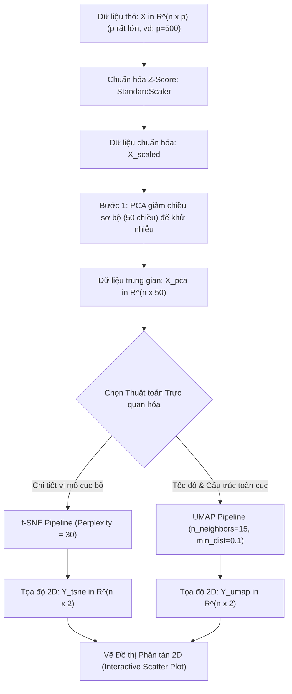

# Giảm chiều Phi tuyến Phục vụ Trực quan hóa: t-SNE và UMAP

## Purpose

Mặc dù Phân tích Thành phần Chính (PCA) là phương pháp giảm chiều dữ liệu tuyến tính chuẩn mực, nó có một giới hạn căn bản: PCA tối đa hóa phương sai toàn cục dựa trên phép chiếu trực giao tuyến tính. Khi dữ liệu nằm trên các đa tạp phi tuyến phức tạp (Nonlinear Manifolds) như cuộn Thụy Sĩ (Swiss Roll), quả cầu lồng nhau, hoặc biểu hiện tế bào đơn (Single-cell RNA-seq), phép chiếu phẳng của PCA sẽ đè bẹp các cụm khác nhau lên cùng một mặt chiếu, làm mất hoàn toàn cấu trúc phân tách tự nhiên của dữ liệu.

Hai thuật toán Học đa tạp (Manifold Learning) hiện đại đại diện cho đỉnh cao của kỹ thuật trực quan hóa dữ liệu đa chiều là **t-SNE** và **UMAP**:
1. **t-SNE (t-Distributed Stochastic Neighbor Embedding - van der Maaten & Hinton, 2008):** Chuyển đổi khoảng cách Euclid giữa các điểm thành xác suất có điều kiện thể hiện sự tương đồng. t-SNE tập trung cao độ vào việc bảo toàn **cấu trúc lân cận cục bộ (Local Structure)**: những điểm gần nhau trong không gian nhiều chiều chắc chắn sẽ nằm sát nhau trong không gian 2D/3D. Thuật toán sử dụng phân phối Student-t với 1 bậc tự do ở không gian đích để giải quyết triệt để **Vấn đề Chật chội (Crowding Problem)**.
2. **UMAP (Uniform Manifold Approximation and Projection - McInnes et al., 2018):** Xây dựng trên nền tảng lý thuyết topo đại số (Algebraic Topology) và hình học Riemann (Riemannian Geometry). UMAP vượt trội hơn t-SNE ở ba khía cạnh:
   * Tốc độ tính toán nhanh hơn từ hàng chục đến hàng trăm lần trên tập dữ liệu lớn.
   * Bảo toàn đồng thời cả **cấu trúc cục bộ lẫn cấu trúc toàn cục (Global Structure)** (khoảng cách tương đối giữa các cụm xa nhau được bảo lưu tốt hơn).
   * Cung cấp ánh xạ chiếu quy nạp có thể biến đổi các điểm dữ liệu mới ngoài tập train (`transform`).

---

## Input

Dữ liệu đầu vào và các siêu tham số cốt lõi:

1. **Ma trận dữ liệu đặc trưng:**
   * $`X = [x_1, x_2, \dots, x_n]^\top \in \mathbb{R}^{n \times p}`$: Tập gồm $`n`$ mẫu quan sát, mỗi mẫu có $`p`$ chiều đặc trưng số liên tục.
   * **Khuyến nghị tiền xử lý:** 
     * Đối với dữ liệu có số chiều quá lớn ($`p > 50`$), khuyến nghị chạy PCA trước để giảm về $`30 \sim 50`$ chiều nhằm khử nhiễu và tăng tốc độ tính toán ma trận khoảng cách.
     * Chuẩn hóa thang đo (StandardScaler hoặc MinMaxScaler).
2. **Siêu tham số của t-SNE:**
   * **`perplexity` (Độ phức tạp lân cận):** Quyết định số lượng láng giềng hiệu dụng mà mỗi điểm xem xét (thường chọn trong khoảng $`[5, 50]`$, mặc định là 30). Perplexity nhỏ tập trung vào các chi tiết vi mô cục bộ; perplexity lớn bao quát cấu trúc rộng hơn.
   * **`early_exaggeration`:** Hệ số phóng đại liên kết ở giai đoạn đầu để đẩy các cụm tách xa nhau trong không gian phẳng.
   * **`learning_rate`:** Tốc độ học trong thuật toán tối ưu hóa Gradient Descent (thường chọn $`[10, 1000]`$).
3. **Siêu tham số của UMAP:**
   * **`n_neighbors`:** Số lượng điểm láng giềng gần nhất dùng để xấp xỉ cấu trúc đa tạp cục bộ (tương tự như perplexity của t-SNE, thường từ 5 đến 50).
   * **`min_dist`:** Khoảng cách tối thiểu cho phép giữa hai điểm trong không gian đích 2D (từ 0.001 đến 0.5). Giá trị nhỏ làm các điểm trong cùng cụm co cụm rất chặt; giá trị lớn giữ cho cụm tản đều tự nhiên.
   * **`metric`:** Hàm đo khoảng cách trong không gian gốc (hỗ trợ `'euclidean'`, `'cosine'`, `'manhattan'`).

---

## Output

Kết quả đầu ra của t-SNE và UMAP:

1. **Tọa độ Biểu diễn Không gian Thấp chiều (Low-dimensional Embedding):**
   * Ma trận tọa độ thu gọn $`Y = [y_1, y_2, \dots, y_n]^\top \in \mathbb{R}^{n \times d}`$ (trong đó thông thường $`d = 2`$ để vẽ đồ thị 2D Scatter Plot hoặc $`d = 3`$ cho đồ thị không gian 3 chiều).
2. **Mức độ Mất mát Thông tin Cấu trúc (Kullback-Leibler Divergence):**
   * Đối với t-SNE: Giá trị hàm mất mát KL Divergence cuối cùng sau khi tối ưu hóa hội tụ.
3. **Đồ thị Trực quan hóa Đa tạp (Manifold Visualization Plot):**
   * Biểu đồ phân tán (Scatter Plot) hiển thị các đảo cụm tách biệt rõ ràng, được tô màu theo nhãn phân loại hoặc phân khúc nghiệp vụ.

---

## Evaluation metrics

Đánh giá chất lượng của thuật toán giảm chiều phi tuyến:

1. **Độ Tin cậy và Tính Tiếp biến (Trustworthiness & Continuity - Venna & Kaski, 2006):**
   * **Trustworthiness:** Đo lường tỷ lệ các điểm là láng giềng gần trong không gian thấp chiều có thực sự là láng giềng gần trong không gian gốc nhiều chiều hay không (phạt các trường hợp "ảo giác láng giềng" - False Neighbors):

$$
T(k) = 1 - \frac{2}{n k (2n - 3k - 1)} \sum_{i=1}^n \sum_{j \in U_i^{(k)}} (r(i, j) - k)
$$

   * **Continuity:** Đo lường tỷ lệ các láng giềng thực sự trong không gian gốc bị thất lạc trong không gian thấp chiều (phạt trường hợp "xé rách cụm" - Missing Neighbors).
   * Giá trị $`T(k) \in [0, 1]`$, càng tiến gần tới 1.0 thể hiện phép chiếu càng đáng tin cậy.
2. **Khoảng cách Kullback-Leibler (KL Divergence - Hàm mục tiêu của t-SNE):**
   * Đo sự sai lệch giữa phân phối xác suất tương đồng trong không gian gốc $`P`$ và không gian đích $`Q`$:

$$
\text{KL}(P \parallel Q) = \sum_{i \neq j} p_{ij} \ln\left( \frac{p_{ij}}{q_{ij}} \right)
$$

3. **Thời gian Thực thi và Khả năng Mở rộng (Scalability Benchmark):**
   * So sánh thời gian chạy thực tế theo số lượng mẫu $`n`$: UMAP có độ phức tạp $`O(n \log n)`$ với xấp xỉ Nearest Neighbors, trong khi t-SNE chuẩn là $`O(n^2)`$ (hoặc $`O(n \log n)`$ với Barnes-Hut t-SNE).

---

## How it works

### 1. Cơ chế Toán học của t-SNE

#### Bước 1: Tính Xác suất Tương đồng trong Không gian Gốc Nhiều Chiều ($`\mathbb{R}^p`$)
Khoảng cách giữa hai điểm $`x_i`$ và $`x_j`$ được chuyển thành xác suất có điều kiện theo phân phối chuẩn Gauss:

$$
p_{j|i} = \frac{\exp\left( -\frac{\|x_i - x_j\|^2}{2\sigma_i^2} \right)}{\sum_{k \neq i} \exp\left( -\frac{\|x_i - x_k\|^2}{2\sigma_i^2} \right)}, \quad p_{i|i} = 0
$$

Độ lệch chuẩn $`\sigma_i`$ được thuật toán tự động dò tìm bằng phương pháp tìm kiếm nhị phân (Binary Search) sao cho Entropy của phân phối bằng đúng giá trị `perplexity` do người dùng thiết lập:

$$
\text{Perp}(P_i) = 2^{H(P_i)} = 2^{-\sum_{j} p_{j|i} \log_2 p_{j|i}}
$$

Để đối phó với các điểm ngoại lai, t-SNE định nghĩa xác suất đối xứng chung giữa hai điểm:

$$
p_{ij} = \frac{p_{j|i} + p_{i|j}}{2n}
$$

#### Bước 2: Tính Xác suất trong Không gian Đích Thấp Chiều ($`\mathbb{R}^2`$) và Vấn đề Chật chội (Crowding Problem)
Trong không gian 2D, diện tích mặt phẳng nhỏ hơn rất nhiều so với thể tích của không gian $`p`$ chiều. Nếu tiếp tục dùng phân phối Gauss ở không gian 2D, các điểm ở cự ly trung bình sẽ bị ép chặt vào nhau và đè nát các khoảng trống giữa các cụm (**Crowding Problem**).

t-SNE giải quyết triệt để vấn đề này bằng cách thay thế phân phối Gauss bằng **Phân phối Student-t với 1 bậc tự do (Phân phối Cauchy)** vốn có phần đuôi rất dày (Heavy-tailed distribution):

$$
q_{ij} = \frac{(1 + \|y_i - y_j\|^2)^{-1}}{\sum_{k \neq l} (1 + \|y_k - y_l\|^2)^{-1}}, \quad q_{ii} = 0
$$

Vì phân phối Student-t có đuôi dày, để đạt cùng một mức xác suất tương đồng nhỏ $`q_{ij} \approx p_{ij}`$, khoảng cách $`\|y_i - y_j\|`$ trong không gian 2D phải bị đẩy ra xa hơn rất nhiều so với không gian gốc. Điều này tạo nên các khoảng trống ranh giới phân tách các cụm cực kỳ rõ ràng trên đồ thị 2D.

#### Bước 3: Tối ưu hóa Gradient Descent
Hàm mất mát cần tối thiểu hóa là khoảng cách KL giữa $`P`$ và $`Q`$:

$$
\mathcal{L} = \sum_{i \neq j} p_{ij} \ln\left( \frac{p_{ij}}{q_{ij}} \right)
$$

Đạo hàm theo tọa độ $`y_i`$ có dạng lực kéo lò xo rất trực quan:

$$
\frac{\partial \mathcal{L}}{\partial y_i} = 4 \sum_{j} (p_{ij} - q_{ij})(y_i - y_j)(1 + \|y_i - y_j\|^2)^{-1}
$$

* Nếu $`p_{ij} > q_{ij}`$: Lực hút kéo hai điểm lại gần nhau (bảo toàn láng giềng).
* Nếu $`p_{ij} < q_{ij}`$: Lực đẩy đẩy hai điểm tách rời nhau.

---

### 2. Cơ chế Toán học của UMAP

UMAP tiếp cận bài toán từ lý thuyết Topo vi phân. Thuật toán giả định rằng dữ liệu thực tế nằm trên một đa tạp Riemann liên tục (Riemannian Manifold) và không gian metric cục bộ biến thiên theo mật độ:

1. **Xây dựng Đồ thị Mờ Đa tạp (Fuzzy Simplicial Set):**
   * Trong không gian gốc, UMAP xác định khoảng cách cục bộ tới láng giềng gần nhất $`\rho_i`$ và hệ số co giãn địa phương $`\sigma_i`$. Trọng số cạnh liên kết giữa hai điểm $`x_i`$ và $`x_j`$ là:

$$
p_{i|j} = \exp\left( -\frac{\max(0, \|x_i - x_j\| - \rho_i)}{\sigma_i} \right)
$$

   * Hợp nhất đồ thị mờ bằng phép toán đại số mờ: $`p_{ij} = p_{i|j} + p_{j|i} - p_{i|j} p_{j|i}`$.
2. **Không gian Thấp chiều và Hàm Tương tự:**
   * Trong không gian 2D, xác suất kết nối được mô hình hóa bởi đường cong mượt:

$$
q_{ij} = \left( 1 + a \|y_i - y_j\|^{2b} \right)^{-1}
$$

   * (Với các hằng số $`a, b`$ được ước lượng tự động từ tham số `min_dist`).
3. **Tối ưu hóa bằng Cross-Entropy Mờ (Fuzzy Set Cross-Entropy):**
   * Thay vì chỉ tối ưu khoảng cách KL đơn phương như t-SNE, UMAP tối thiểu hóa hàm Cross-Entropy đối xứng:

$$
\mathcal{L}_{\text{UMAP}} = \sum_{i \neq j} \left[ p_{ij} \ln\left( \frac{p_{ij}}{q_{ij}} \right) + (1 - p_{ij}) \ln\left( \frac{1 - p_{ij}}{1 - q_{ij}} \right) \right]
$$

   * Thành phần thứ hai $`(1 - p_{ij}) \ln\left( \frac{1 - p_{ij}}{1 - q_{ij}} \right)`$ chính là chìa khóa giúp UMAP bảo toàn cấu trúc toàn cục: nó cưỡng ép các điểm không phải láng giềng ($`p_{ij} \approx 0`$) phải có $`q_{ij} \approx 0`$, giữ cho các cụm khác nhau duy trì khoảng cách xa nhau tương ứng trên đồ thị.

---

### Bảng So sánh Đối đầu: t-SNE vs UMAP

```text
+-----------------------+---------------------------------------+--------------------------------------+
| Đặc tính              | t-SNE                                 | UMAP                                 |
+-----------------------+---------------------------------------+--------------------------------------+
| 1. Cơ sở toán học     | Thống kê & Phân phối xác suất (KL)    | Topo đại số & Hình học Riemann       |
| 2. Cấu trúc bảo toàn  | Chủ yếu cấu trúc cục bộ               | Cả cấu trúc cục bộ và toàn cục       |
| 3. Tốc độ thực thi    | Chậm (O(n^2) hoặc O(n log n))         | Cực nhanh (xấp xỉ đồ thị k-NN mờ)    |
| 4. Chiếu điểm mới     | Không hỗ trợ (phải chạy lại từ đầu)   | Hỗ trợ đầy đủ (phương thức transform)|
| 5. Khoảng cách cụm    | Khoảng cách giữa các cụm vô nghĩa     | Khoảng cách giữa các cụm có ý nghĩa  |
| 6. Mục đích sử dụng   | Thăm dò, trực quan hóa 2D/3D          | Trực quan hóa & Feature Engineering  |
+-----------------------+---------------------------------------+--------------------------------------+
```

---

## Data used

t-SNE và UMAP là công cụ bắt buộc trong các lĩnh vực xử lý dữ liệu hiện đại:

1. **Sinh học Điện toán (Bioinformatics & Single-Cell Genomics):**
   * Phân tích dữ liệu biểu hiện gen tế bào đơn (scRNA-seq) với hơn 20,000 gen mỗi tế bào. UMAP và t-SNE giúp phân tách rõ ràng các quần thể tế bào miễn dịch, tế bào gốc và tế bào ung thư.
2. **Xử lý Ngôn ngữ Tự nhiên & Thị giác Máy tính (Embeddings Visualization):**
   * Trực quan hóa các không gian vector nhúng từ các mô hình Deep Learning (như Word2Vec, BERT, CLIP embeddings, ResNet latent representations) trên mặt phẳng 2D để kiểm tra tính phân tách ngữ nghĩa.
3. **Phát hiện Bất thường và Giám sát Gian lận:**
   * Chiếu toàn bộ dữ liệu người dùng lên không gian UMAP 2D. Các điểm dữ liệu nằm cô lập, tách biệt khỏi tất cả các cụm chính lập tức được phát hiện là các tài khoản gian lận tiềm ẩn.

---

## Design

### 1. Kiến trúc Quy trình Trực quan hóa Dữ liệu Đa chiều với PCA + t-SNE / UMAP



---

### 2. Mã nguồn Triển khai Thực hành Chuẩn hóa với Scikit-learn

```python
import numpy as np
import matplotlib.pyplot as plt
from sklearn.manifold import TSNE
from sklearn.decomposition import PCA
from sklearn.preprocessing import StandardScaler
from sklearn.datasets import load_digits
import time

# 1. Tải tập dữ liệu chữ số viết tay (Digits: 1797 mẫu, 64 chiều)
digits = load_digits()
X = digits.data
y = digits.target
n_samples, n_features = X.shape

print(f"Dữ liệu gốc: {n_samples} mẫu, {n_features} đặc trưng.")

# 2. Tiền xử lý chuẩn hóa thang đo
X_scaled = StandardScaler().fit_transform(X)

# 3. Giảm chiều sơ bộ bằng PCA xuống 30 chiều để khử nhiễu và tăng tốc t-SNE
pca_pre = PCA(n_components=30, random_state=42)
X_pca = pca_pre.fit_transform(X_scaled)
print(f"Tỷ lệ phương sai giữ lại sau bước PCA sơ bộ: {pca_pre.explained_variance_ratio_.sum()*100:.2f}%")

# 4. Huấn luyện t-SNE (thuật toán Barnes-Hut O(n log n))
start_time = time.time()
tsne = TSNE(
    n_components=2,
    perplexity=30.0,
    early_exaggeration=12.0,
    learning_rate='auto',
    init='pca',
    max_iter=1000,
    random_state=42
)
X_tsne_2d = tsne.fit_transform(X_pca)
tsne_time = time.time() - start_time

print(f"Thời gian hoàn thành t-SNE: {tsne_time:.2f} giây")
print(f"Giá trị KL Divergence cuối cùng: {tsne.kl_divergence_:.4f}")

# 5. Đánh giá chất lượng chiếu bằng Trustworthiness
from sklearn.manifold import trustworthiness
trust_score = trustworthiness(X_pca, X_tsne_2d, n_neighbors=15)
print(f"Hệ số Trustworthiness (Độ tin cậy phép chiếu): {trust_score:.4f} / 1.0000")

# 6. Ghi nhận tọa độ chiếu 2D sẵn sàng xuất file
print(f"Kích thước ma trận tọa độ 2D cuối cùng: {X_tsne_2d.shape}")
print(f"Mẫu tọa độ 3 điểm đầu tiên:\n{X_tsne_2d[:3]}")
```

---

## Nguồn

- [1] van der Maaten, L., & Hinton, G. (2008). *Visualizing data using t-SNE*. Journal of Machine Learning Research, 9(11), 2579-2605.
- [2] McInnes, L., Healy, J., & Melville, J. (2018). *UMAP: Uniform manifold approximation and projection for dimension reduction*. arXiv preprint arXiv:1802.03426.
- [3] Venna, J., & Kaski, S. (2006). *Local multidimensional scaling with applications*. Neural Networks, 19(6-7), 889-899.
- [4] [scikit-learn User Guide: Manifold learning (t-SNE)](https://scikit-learn.org/stable/modules/manifold.html#t-sne).

