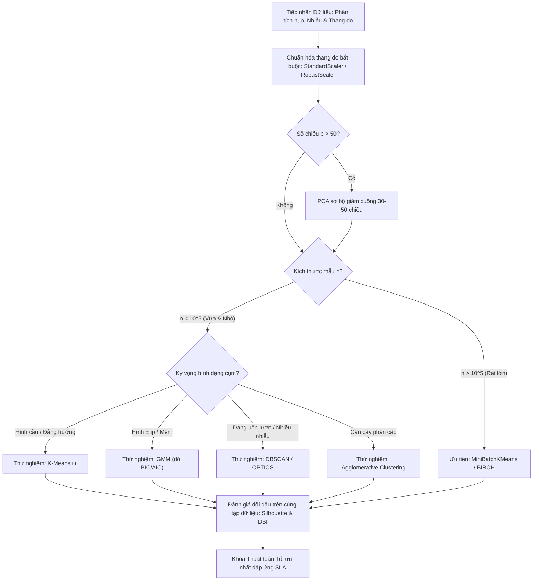

# Chọn Thuật toán Học không giám sát theo Bài toán và Dữ liệu

## Purpose

Trong Học không giám sát, **không tồn tại một thuật toán nào là "tốt nhất cho mọi bài toán"** (Định lý Không có Bữa trưa Miễn phí - No Free Lunch Theorem). K-Means chạy cực nhanh trên dữ liệu lớn nhưng thất bại hoàn toàn nếu các cụm có hình dạng phi tuyến hoặc chứa nhiều ngoại lai; DBSCAN tìm được cụm uốn lượn bất kỳ nhưng bất lực khi mật độ các cụm lệch nhau quá xa; GMM rất linh hoạt với các cụm elip nhưng dễ sụp đổ vì bẫy kỳ dị số học nếu không có đủ dữ liệu.

Tài liệu này cung cấp **Cây quyết định Kỹ thuật và Ma trận Tiêu chí Chọn lựa** giúp người kỹ sư dữ liệu:
1. Xác định thứ tự thử nghiệm hợp lý ngay từ đầu dựa trên đặc thù hình học của dữ liệu ($`n`$, $`p`$, hình dạng cụm, mức độ nhiễu).
2. Phân tích sự đánh đổi (Trade-offs) giữa độ phức tạp tính toán, mức độ chiếm dụng bộ nhớ RAM và khả năng giải thích nghiệp vụ.
3. Giảm thiểu chi phí thử-sai (Trial-and-Error) trong quá trình nghiên cứu và phát triển sản phẩm. [1]

---

## Input

Các đặc tính kỹ thuật cần thu thập từ dữ liệu trước khi chọn thuật toán:

1. **Quy mô dữ liệu ($`n`$ mẫu, $`p`$ chiều):**
   * Dữ liệu nhỏ ($`n < 10^4`$), vừa ($`10^4 \le n \le 10^6`$), hay siêu lớn ($`n > 10^6`$ không vừa RAM)?
   * Số chiều thấp ($`p < 20`$) hay siêu cao ($`p > 10^3`$)?
2. **Kỳ vọng về Hình dạng Cụm (Cluster Geometry):**
   * Cụm hình cầu đối xứng, cụm hình elip nghiêng, hay cụm dải uốn lượn / phi tuyến / lồng nhau?
3. **Mức độ Nhiễu và Ngoại lai (Noise & Outliers):**
   * Dữ liệu sạch trong phòng thí nghiệm hay dữ liệu thực tế nhiều tín hiệu nhiễu rác?
4. **Kiểu phân bổ thành viên (Hard vs Soft Assignment):**
   * Bắt buộc mỗi điểm thuộc về 1 cụm duy nhất hay cần biết xác suất thuộc về từng cụm?
5. **Yêu cầu Vận hành (SLA & Latency):**
   * Cần suy luận online thời gian thực cho điểm mới (`predict`) hay chỉ cần phân tích tĩnh một lần?

---

## Output

Kết quả đầu ra của quá trình lựa chọn:

1. **Shortlist từ 2 đến 3 thuật toán tiềm năng nhất:** Kèm theo giả thuyết kỹ thuật giải thích lý do lựa chọn.
2. **Kế hoạch Thử nghiệm Đối đầu (A/B Benchmarking Plan):** Cấu hình thử nghiệm trên cùng một tập dữ liệu chuẩn hóa, so sánh trực tiếp bằng các chỉ số nội tại (Silhouette, DBI, CH) và thời gian chạy.
3. **Chiến lược Kết hợp Đa thuật toán (Hybrid Strategy):** Ví dụ: dùng BIRCH để nén $`10^6`$ điểm thành $`10^3`$ cụm vi mô, sau đó chạy Agglomerative Clustering để thu được cấu trúc phân cấp toàn cục.

---

## Evaluation metrics

Bộ tiêu chí so sánh đối đầu giữa các ứng viên thuật toán:

1. **Độ phức tạp Thời gian (Time Complexity):** Tuyến tính $`O(n)`$, cận tuyến tính $`O(n \log n)`$, hay đa thức bậc hai $`O(n^2)`$.
2. **Độ phức tạp Bộ nhớ (Space Complexity):** Tiêu thụ bộ nhớ tỷ lệ thuận với $`O(np)`$ hay bị nghẽn bởi ma trận khoảng cách $`O(n^2)`$.
3. **Hệ số Silhouette và DBI đạt được:** Đo lường độ cô đọng và phân tách hình học.
4. **Độ Ổn định qua các lần Khởi tạo (Random Seed Stability):** Độ biến thiên của nhãn cụm khi thay đổi seed ngẫu nhiên.

---

## How it works

### 1. Ma trận Hướng dẫn Chọn Thuật toán Nhanh (Decision Matrix)

| Tình huống Dữ liệu Thực tế | Lựa chọn Thử nghiệm Ưu tiên (Baseline) | Lựa chọn Nâng cao Tiếp theo | Điểm Cốt lõi Cần Kiểm soát |
|---|---|---|---|
| **Dữ liệu lớn ($`n > 10^5`$), dạng hình cầu, cần nhanh** | **K-Means++** | **MiniBatchKMeans** hoặc **BIRCH** | Chuẩn hóa Z-score; kiểm tra ngoại lai làm lệch tâm |
| **Dữ liệu nhiều nhiễu, cụm hình dáng bất kỳ, không biết trước $`K`$** | **DBSCAN** | **HDBSCAN** hoặc **OPTICS** | Dò tìm $`\varepsilon`$ qua K-distance graph; chuẩn hóa thang đo |
| **Các cụm có mật độ dày/thưa rất lệch nhau** | **OPTICS** | **HDBSCAN** | Đọc biểu đồ Reachability Plot để cắt ngưỡng linh hoạt |
| **Cụm có hình elip nghiêng, cần xác suất mềm (Soft Clustering)** | **GMM** (`covariance_type='full'`) | **GMM** (`'diag'` nếu $`p`$ lớn) | Dò tìm $`K`$ bằng BIC/AIC; đặt `reg_covar=1e-6` tránh bẫy kỳ dị |
| **Dữ liệu chứa nhiều ngoại lai cực đoan (Outliers), khoảng cách phi Euclid** | **K-Medoids (PAM / CLARANS)** | **DBSCAN** | Chi phí tính toán ma trận medoid $`O(n^2)`$ |
| **Cần trực quan hóa cấu trúc gia phả, taxonomy phân cấp** | **Agglomerative Hierarchical** | **Dendrogram cắt ngưỡng** | Giới hạn $`n < 10^4`$ để tránh tràn bộ nhớ RAM |
| **Dữ liệu siêu lớn ($`n > 10^6`$), bộ nhớ RAM hạn chế** | **BIRCH** | **MiniBatchKMeans** | Thiết lập tham số `threshold` và `branching_factor` |
| **Giảm chiều tuyến tính, khử đa cộng tuyến** | **PCA** | **Kernel PCA** (nếu phi tuyến) | Kiểm tra tỷ lệ phương sai tích lũy $`\text{CEVR} \ge 0.90`$ |
| **Trực quan hóa đa tạp 2D/3D (Manifold Visualization)** | **t-SNE** (chi tiết vi mô) | **UMAP** (cả vi mô lẫn toàn cục) | Giảm về 50 chiều bằng PCA trước; chỉnh `perplexity`/`n_neighbors` |

---

### 2. Cây Quyết định Chọn Thuật toán Gom cụm (Clustering Decision Tree)

```text
                                  BẮT ĐẦU CHỌN THUẬT TOÁN
                                             │
                       ┌─────────────────────┴─────────────────────┐
                       ▼                                           ▼
            Cần Gom cụm (Clustering)                    Cần Giảm chiều / Trực quan hóa
                       │                                           │
          ┌────────────┴────────────┐                     ┌────────┴────────┐
          ▼                         ▼                     ▼                 ▼
   Biết trước số cụm K?       Chưa biết số cụm K?      Tuyến tính       Phi tuyến (Manifold)
          │                         │                     │                 │
    ┌─────┴─────┐             ┌─────┴─────┐              PCA          ┌─────┴─────┐
    ▼           ▼             ▼           ▼                           ▼           ▼
 Dạng cầu    Dạng elip     Dựa mật độ  Dạng cây                   t-SNE        UMAP
    │           │             │           │                     (Cục bộ)   (Cục bộ+Toàn cục)
 K-Means       GMM         DBSCAN    Phân cấp
(K-Medoids) (Soft assign) (OPTICS) (Dendrogram)
```

---

## Data used

1. **Khảo sát Tỷ lệ Mẫu trên Chiều ($`n/p`$):**
   * Nếu $`p > n`$ (Số chiều lớn hơn số mẫu, ví dụ dữ liệu gen di truyền): Bắt buộc áp dụng **PCA** để giảm chiều trước khi gom cụm. Nếu không, mọi điểm dữ liệu đều có khoảng cách bằng nhau trong không gian siêu thưa thớt.
2. **Kiểm tra Phân bố và Ngoại lai (Outlier Audit):**
   * Vẽ biểu đồ Boxplot hoặc tính khoảng cách Mahalanobis. Nếu dữ liệu có các điểm ngoại lai gấp 10 lần giá trị trung bình, **tuyệt đối không dùng K-Means chuẩn** (vì hàm mất mát bình phương khoảng cách $`\|x - c\|^2`$ sẽ bị các điểm ngoại lai kéo lệch tâm hoàn toàn). Ưu tiên dùng **K-Medoids**, **DBSCAN** hoặc tiền xử lý bằng `RobustScaler`.
3. **Đặc tính Thước đo Khoảng cách:**
   * Dữ liệu tọa độ GPS: dùng DBSCAN với hàm khoảng cách Haversine.
   * Dữ liệu văn bản (TF-IDF vector): dùng Cosine Distance kết hợp Spherical K-Means hoặc UMAP metric='cosine'.

---

## Design

### Sơ đồ Luồng Đưa ra Quyết định Thực nghiệm trong Dự án Thực tế



---

## Nguồn

- [1] [scikit-learn Documentation: Overview of clustering methods](https://scikit-learn.org/stable/modules/clustering.html#overview-of-clustering-methods).
- [2] Hastie, T., Tibshirani, R., & Friedman, J. (2009). *The Elements of Statistical Learning* (Chapter 14: Unsupervised Learning, pp. 485-585). Springer.
- [3] Aggarwal, C. C. (2015). *Data Mining: The Textbook* (Chapter 6 & 7: Advanced Clustering). Springer.
- [4] McInnes, L., Healy, J., & Astels, S. (2017). *hdbscan: Hierarchical density based clustering*. Journal of Open Source Software, 2(11), 205.

