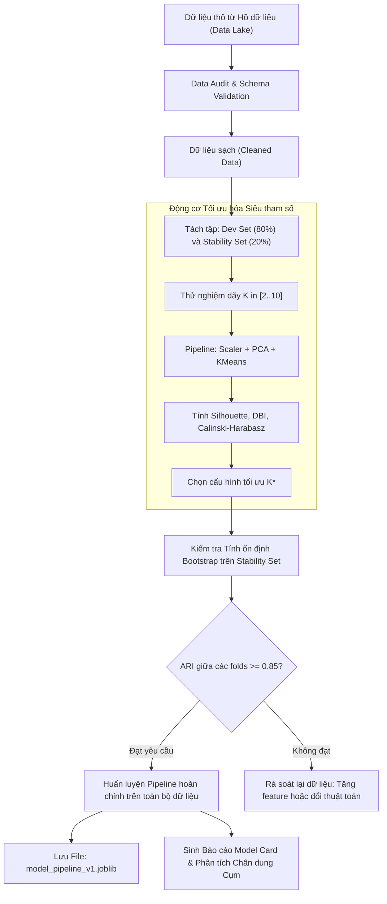

# Training phase — Giai đoạn Huấn luyện Mô hình Học không giám sát

> Giai đoạn này đi từ dữ liệu thô ban đầu đến một **Pipeline học không giám sát đã được đóng gói và sẵn sàng suy luận**. Trong tài liệu này, quy trình huấn luyện được thiết kế chuyên biệt cho các bài toán không có nhãn giám sát: tiền xử lý, kiểm soát rò rỉ thông tin trong biến đổi không gian, lựa chọn siêu tham số tự động và khóa hiện vật mô hình. Xem [inference phase](17_inference_phase.md) cho bước triển khai mô hình đã học vào môi trường phục vụ thực tế.

---

## Purpose

Mục tiêu cốt lõi của **Training Phase (Giai đoạn Huấn luyện)** trong Học không giám sát là khám phá cấu trúc tiềm ẩn, ước lượng các tham số thống kê của phân phối dữ liệu (như tọa độ tâm cụm $`c_k`$, ma trận hiệp phương sai $`\Sigma_k`$, hoặc các vector cơ sở thành phần chính $`W_k`$), đồng thời **khóa chặt toàn bộ dây chuyền xử lý dữ liệu** thành một đối tượng bất biến (Immutable Pipeline Artifact).

Trong kỹ nghệ học máy chuyên nghiệp, giai đoạn này giải quyết 3 bài toán kỹ thuật nền tảng:
1. **Tránh Rò rỉ Thông tin Thống kê (Information Leakage in Preprocessing):** Các bước tính toán thống kê (như tính trung bình $`\bar{x}`$ và độ lệch chuẩn $`\sigma`$ trong StandardScaler, hoặc tính ma trận SVD trong PCA) phải được học nghiêm ngặt trên tập huấn luyện đại diện, tuyệt đối không tính gộp chung trên toàn bộ dữ liệu tương lai.
2. **Lựa chọn Siêu tham số Khách quan Không nhãn (Unsupervised Hyperparameter Tuning):** Tự động hóa quá trình dò tìm số cụm $`K`$, bán kính $`\varepsilon`$, hoặc số thành phần chính $`k`$ thông qua các hàm mục tiêu nội tại (Silhouette Score, DBI, BIC/AIC).
3. **Đóng gói Độc lập và Kiểm toán được (Reproducible Packaging):** Đóng gói toàn bộ chuỗi biến đổi thành một tệp artifact hoàn chỉnh có gắn thẻ định danh phiên bản mã nguồn và dữ liệu (Lineage Manifest). [1][2]

---

## Input

Các tài nguyên và thông số đầu vào bắt buộc phải có trước khi khởi động Training Phase:

1. **Tập dữ liệu Huấn luyện Nền tảng ($`X_{\text{train}}`$):**
   * Ma trận đặc trưng số $`X \in \mathbb{R}^{n \times p}`$ đã được loại bỏ các cột định danh vô nghĩa (User ID, Timestamp, chuỗi text ngẫu nhiên).
2. **Kế hoạch Phân chia Dữ liệu Thẩm định (Validation Splitting Strategy):**
   * Mặc dù không có nhãn, việc chia dữ liệu thành tập phát triển (Development Set) và tập kiểm định độc lập (Hold-out Evaluation Set) là bắt buộc để đánh giá **tính ổn định phân cụm (Cluster Stability)**: liệu thuật toán có tìm ra cùng các tâm cụm tương tự nhau khi huấn luyện trên hai mẫu con độc lập lấy từ cùng một nguồn dữ liệu hay không?
3. **Không gian Tìm kiếm Siêu tham số (Hyperparameter Search Space):**
   * Dãy $`K \in [2, K_{\max}]`$ cho K-Means/GMM; lưới giá trị $`\varepsilon \in [\varepsilon_{\min}, \varepsilon_{\max}]`$ và $`\text{MinPts}`$ cho DBSCAN.
4. **Ngân sách Tính toán và Tiêu chuẩn Dừng (Stopping Criteria):**
   * Số vòng lặp tối đa `max_iter`, ngưỡng dung sai hội tụ `tol`, số luồng xử lý song song `n_jobs`.
5. **Khóa Ngẫu nhiên Cố định (Random Seed):**
   * Khóa seed `random_state` để đảm bảo tính tái lập 100% của thuật toán khởi tạo hạt giống (k-means++).

---

## Output

Các sản phẩm hoàn chỉnh thu được sau khi kết thúc Training Phase:

1. **Hiện vật Pipeline đã Fit (Fitted Pipeline Artifact):**
   * Một đối tượng nhị phân hoàn chỉnh (ví dụ lưu bằng `joblib` hoặc `pickle`) chứa toàn bộ các transformer và estimator đã hội tụ:
     * Bộ chuẩn hóa đã lưu $`\bar{x}_{\text{train}}`$ và $`\sigma_{\text{train}}`$.
     * Bộ giảm chiều đã lưu ma trận chiếu $`W_k`$.
     * Mô hình gom cụm đã lưu tọa độ các tâm cụm $`c_k`$ hoặc ma trận trách nhiệm.
2. **Thẻ Báo cáo Mô hình Học không giám sát (Unsupervised Model Card):**
   * Tài liệu ghi lại: Số chiều ban đầu, số chiều sau PCA, tỷ lệ phương sai tích lũy được bảo toàn, số cụm $`K`$ được chọn, điểm Silhouette đạt được, và danh sách các biến quan trọng nhất phân định từng cụm.
3. **Tập Dữ liệu Tham chiếu Nền (Reference Baseline Dataset):**
   * Tập dữ liệu mẫu thu gọn được dùng làm chuẩn đối chiếu phục vụ hệ thống phát hiện trôi dạt cụm (Data Drift) ở giai đoạn Inference sau này.

---

## Evaluation metrics

Các tiêu chí nghiệm thu chất lượng trước khi phê duyệt đưa mô hình sang giai đoạn Inference:

1. **Độ Ổn định Phân cụm (Clustering Stability Score):**
   * Áp dụng kỹ thuật lấy mẫu lặp lại (Bootstrap Resampling) trên $`X_{\text{train}}`$ qua 20 lần chạy độc lập. Tính chỉ số Adjusted Rand Index (ARI) giữa các lần chạy: nếu $`\text{ARI} > 0.85`$, chứng tỏ cấu trúc cụm là thực chất và bền vững, không phải ảo giác ngẫu nhiên do thuật toán tự vẽ ra.
2. **Hệ số Silhouette Toàn cục và Kiểm tra Độ rộng Cụm:**
   * Hệ số Silhouette toàn cục phải vượt ngưỡng tối thiểu (thường yêu cầu $`S \ge 0.40`$).
   * Không có cụm nào bị chiếm tỷ lệ dưới $`2\%`$ tổng số mẫu (trừ khi bài toán đặc thù là phát hiện bất thường).
3. **Thời gian Huấn luyện và Kích thước Tệp Artifact:**
   * Thời gian chạy huấn luyện nằm trong ngân sách cho phép của hệ thống CI/CD; dung lượng tệp artifact không vượt quá giới hạn bộ nhớ của máy chủ suy luận.

---

## How it works

### 1. Dây chuyền 5 Bước Tiêu chuẩn của Training Phase

```text
┌─────────────────────────────────────────────────────────────┐
│ Bước 1: Tiếp nhận dữ liệu, Audit Schema & Lọc Outlier thô   │
└──────────────────────────────┬──────────────────────────────┘
                               │
                               ▼
┌─────────────────────────────────────────────────────────────┐
│ Bước 2: Chia tập Phát triển (Dev Set) và Tập Ổn định (Eval) │
└──────────────────────────────┬──────────────────────────────┘
                               │
                               ▼
┌─────────────────────────────────────────────────────────────┐
│ Bước 3: Dò tìm Siêu tham số Tự động (GridSearchCV không nhãn)│
└──────────────────────────────┬──────────────────────────────┘
                               │
                               ▼
┌─────────────────────────────────────────────────────────────┐
│ Bước 4: Kiểm tra Độ Ổn định Cụm qua Bootstrap Resampling     │
└──────────────────────────────┬──────────────────────────────┘
                               │
                               ▼
┌─────────────────────────────────────────────────────────────┐
│ Bước 5: Fit toàn bộ Pipeline & Khóa Artifact (.joblib)      │
└─────────────────────────────────────────────────────────────┘
```

#### Chi tiết các Bước:
* **Bước 1: Audit Schema:** Kiểm tra kiểu dữ liệu, loại bỏ các cột có tỷ lệ missing > 40%, áp dụng `SimpleImputer(strategy='median')` cho các giá trị khuyết còn lại.
* **Bước 2: Phân chia Tập Ổn định:** Tách riêng 20% dữ liệu làm tập Hold-out để kiểm tra tính tổng quát hóa của các tâm cụm.
* **Bước 3: Dò tìm Siêu tham số:** Viết hàm tính điểm nội tại tùy chỉnh (`silhouette_scorer`) kết hợp với `GridSearchCV` hoặc duyệt vòng lặp để tìm cặp $`(K, \text{scaler})`$ tối ưu.
* **Bước 4: Kiểm tra Tính Bền vững:** Đánh giá tính nhất quán của phân cụm khi xáo trộn dữ liệu bằng chỉ số ARI.
* **Bước 5: Xuất Hiện vật Bất biến:** Lưu pipeline hoàn chỉnh kèm theo Model Card vào kho lưu trữ phiên bản.

---

## Data used

1. **Kiểm tra Giả định Phân phối của Dữ liệu:**
   * Đánh giá ma trận tương quan giữa các đặc trưng (Correlation Matrix). Nếu xuất hiện nhiều cặp đặc trưng có hệ số tương quan $`r > 0.85`$, bắt buộc phải cấu hình bước PCA trong pipeline để khử đa cộng tuyến.
2. **Quy tắc Xử lý Biến Phân loại (Categorical Features):**
   * Nếu dữ liệu chứa biến phân loại (như Giới tính, Tỉnh thành), không dùng khoảng cách Euclid chuẩn của K-Means. Bắt buộc mã hóa One-Hot hoặc chuyển sang thuật toán **K-Prototypes** (hỗ trợ dữ liệu hỗn hợp cả số lẫn hạng mục).

---

## Design

### 1. Sơ đồ Kiến trúc Pipeline Huấn luyện Tự động và Kiểm định Đóng gói



---

### 2. Mã nguồn Kỹ thuật Huấn luyện và Đóng gói Chuẩn Mực

```python
import numpy as np
import joblib
from sklearn.datasets import make_blobs
from sklearn.preprocessing import StandardScaler
from sklearn.decomposition import PCA
from sklearn.cluster import KMeans
from sklearn.pipeline import Pipeline
from sklearn.metrics import silhouette_score, adjusted_rand_score
from sklearn.model_selection import train_test_split

# 1. Tiếp nhận dữ liệu huấn luyện
X_raw, _ = make_blobs(n_samples=2000, centers=4, n_features=10, cluster_std=1.2, random_state=42)

# 2. Phân tách tập phát triển (Dev) và tập kiểm định tính ổn định (Hold-out)
X_dev, X_eval = train_test_split(X_raw, test_size=0.20, random_state=42)

# 3. Dò tìm số cụm K tối ưu trên tập Dev
k_range = range(2, 8)
best_k = 2
best_silhouette = -1.0

for k in k_range:
    # Xây dựng pipeline thử nghiệm
    temp_pipe = Pipeline([
        ('scaler', StandardScaler()),
        ('pca', PCA(n_components=0.90, random_state=42)), # giữ 90% phương sai
        ('kmeans', KMeans(n_clusters=k, init='k-means++', n_init=10, random_state=42))
    ])
    temp_pipe.fit(X_dev)

    # Đánh giá bằng Silhouette Score trên không gian sau khi biến đổi
    X_dev_trans = temp_pipe.named_steps['pca'].transform(temp_pipe.named_steps['scaler'].transform(X_dev))
    labels = temp_pipe.named_steps['kmeans'].labels_
    score = silhouette_score(X_dev_trans, labels)

    if score > best_silhouette:
        best_silhouette = score
        best_k = k

print(f"Cấu hình tối ưu được chọn: K = {best_k} (Silhouette = {best_silhouette:.4f})")

# 4. Kiểm tra Độ ổn định Phân cụm (Clustering Stability Test) trên tập Hold-out
pipe_final = Pipeline([
    ('scaler', StandardScaler()),
    ('pca', PCA(n_components=0.90, random_state=42)),
    ('kmeans', KMeans(n_clusters=best_k, init='k-means++', n_init=20, random_state=42))
])
pipe_final.fit(X_dev)

# Dự đoán nhãn trên tập Hold-out bằng pipeline đã học
labels_eval_predicted = pipe_final.predict(X_eval)

# Huấn luyện độc lập một pipeline khác trực tiếp trên tập Hold-out
pipe_eval_direct = Pipeline([
    ('scaler', StandardScaler()),
    ('pca', PCA(n_components=0.90, random_state=42)),
    ('kmeans', KMeans(n_clusters=best_k, init='k-means++', n_init=20, random_state=42))
])
pipe_eval_direct.fit(X_eval)
labels_eval_direct = pipe_eval_direct.named_steps['kmeans'].labels_

# Tính độ tương đồng ARI giữa hai lần phân cụm
stability_ari = adjusted_rand_score(labels_eval_predicted, labels_eval_direct)
print(f"Chỉ số Ổn định Phân cụm (Stability ARI): {stability_ari:.4f}")

# 5. Khóa và Đóng gói Hiện vật Bất biến (Artifact Packaging)
if stability_ari >= 0.80:
    # Huấn luyện trên toàn bộ dữ liệu trước khi bàn giao
    pipe_production = Pipeline([
        ('scaler', StandardScaler()),
        ('pca', PCA(n_components=0.90, random_state=42)),
        ('kmeans', KMeans(n_clusters=best_k, init='k-means++', n_init=20, random_state=42))
    ])
    pipe_production.fit(X_raw)

    artifact_path = "unsupervised_cluster_pipeline_v1.joblib"
    joblib.dump(pipe_production, artifact_path)
    print(f"=> XUẤT THÀNH CÔNG: Đã đóng gói pipeline sản xuất vào '{artifact_path}'")
else:
    print("=> CẢNH BÁO: Cấu trúc phân cụm không ổn định! Không được phép bàn giao sang Inference Phase.")
```

---

## Nguồn

- [1] [scikit-learn User Guide: Pipeline and Composite Estimators](https://scikit-learn.org/stable/modules/compose.html).
- [2] Von Luxburg, U. (2010). *Clustering stability: an overview*. Foundations and Trends in Machine Learning, 2(3), 235-274.
- [3] Mitchell, M. et al. (2019). *Model Cards for Model Reporting*. Proceedings of the Conference on Fairness, Accountability, and Transparency (FAT*), 220-229.

