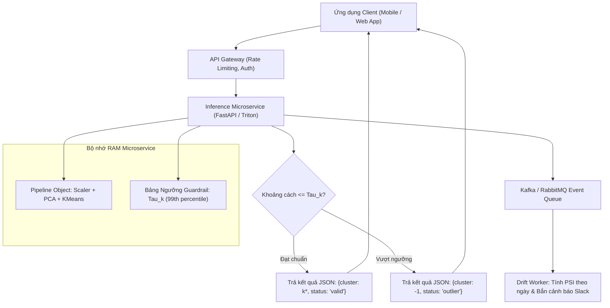

# Inference phase — Giai đoạn Suy luận và Triển khai Mô hình Học không giám sát

> Giai đoạn này tiếp nhận **Hiện vật Pipeline đã khóa từ [Training Phase](16_training_phase.md)** và vận hành nó để phục vụ các yêu cầu dự đoán trong môi trường thực tế. Tài liệu này hướng dẫn chi tiết hai mô hình triển khai: Suy luận Thời gian thực (Online Inference qua API) và Suy luận Xử lý theo lô (Batch Inference), cùng các cơ chế kiểm soát chất lượng dữ liệu đầu vào và phát hiện trôi dạt.

---

## Purpose

**Inference Phase (Giai đoạn Suy luận)** là nơi hiện thực hóa toàn bộ giá trị thương mại của mô hình Học không giám sát. Trong giai đoạn này, mô hình hoàn toàn **ở trạng thái đóng băng (Frozen / Read-only)**: tuyệt đối không cập nhật lại trọng tâm cụm hay thay đổi bất kỳ tham số tiền xử lý nào.

Nhiệm vụ cốt lõi của giai đoạn Inference bao gồm:
1. **Phục vụ Suy luận với Độ trễ Thấp (Low-Latency Serving):** Tiếp nhận một quan sát mới $`x_{\text{new}} \in \mathbb{R}^p`$, thực hiện biến đổi dữ liệu theo đúng chuẩn đã học (Transform) và gán nhãn cụm tương ứng trong thời gian miligiây ($`< 15\text{ms}`$).
2. **Cơ chế Lọc Ngoại lai Cảnh giới (Guardrail Outlier Detection):** Không ép buộc các điểm dữ liệu dị biệt, bất thường phải thuộc về một cụm có sẵn. Nếu khoảng cách từ điểm mới tới tâm cụm gần nhất vượt quá ngưỡng giới hạn dung sai, hệ thống tự động gán nhãn là **Điểm dị biệt / Ngoại lai (Outlier)**.
3. **Giám sát Phân bổ và Cảnh báo Trôi dạt Thời gian thực (Real-time Cluster Monitoring):** Thu thập phân phối nhãn đầu ra trong các cửa sổ thời gian trượt (Sliding Windows) để phát hiện sự suy giảm chất lượng của mô hình. [1][2]

---

## Input

Dữ liệu đầu vào cho hệ thống suy luận:

1. **Hiện vật Pipeline Đã Đóng gói (Pipeline Artifact):**
   * Tệp mô hình nhị phân (ví dụ: `unsupervised_cluster_pipeline_v1.joblib`) được nạp trực tiếp vào bộ nhớ RAM của dịch vụ suy luận.
2. **Yêu cầu Dự đoán (Prediction Request):**
   * **Chế độ Trực tuyến (Online REST API):** Bản tin JSON chứa vector đặc trưng thô của một người dùng hoặc giao dịch đơn lẻ:
     ```json
     {"user_id": "U10928", "features": [24.5, 120.0, 3.4, 0.85, 12.0]}
     ```
   * **Chế độ Theo lô (Batch Job):** Bảng dữ liệu lớn hàng triệu dòng từ kho dữ liệu (Data Warehouse / Parquet table) cần được phân cụm định kỳ hàng đêm.
3. **Bảng Ngưỡng Bán kính Cụm (Cluster Radius Thresholds):**
   * Vector ngưỡng $`\vec{\tau} = [\tau_1, \tau_2, \dots, \tau_K]^\top`$, trong đó $`\tau_k`$ là khoảng cách tối đa cho phép để một điểm được coi là thành viên hợp lệ của cụm $`k`$ (thường chọn bằng phân vị $`99\%`$ khoảng cách nội cụm khi train).

---

## Output

Kết quả đầu ra của dịch vụ suy luận:

1. **Mã định danh Cụm gán (Assigned Cluster ID):**
   * Số nguyên $`k \in \lbrace 1, 2, \dots, K \rbrace`$ chỉ định nhóm nghiệp vụ tương ứng (hoặc $`-1`$ nếu rơi vào vùng ngoại lai).
2. **Vector Độ đo Khoảng cách và Xác suất:**
   * Vector khoảng cách Euclid từ điểm mới tới toàn bộ $`K`$ tâm cụm: $`d = [d_1, d_2, \dots, d_K]^\top`$.
   * Đối với GMM: Vector xác suất mềm $`\gamma = [\gamma_1, \gamma_2, \dots, \gamma_K]^\top`$ với $`\sum_{k} \gamma_k = 1`$.
3. **Điểm số Bất thường (Anomaly Score):**
   * Khoảng cách tới tâm cụm gần nhất được chuẩn hóa:

$$
\text{AnomalyScore}(x_{\text{new}}) = \frac{\min_{k} \|x_{\text{new}} - c_k\|}{\tau_k}
$$

   * Nếu điểm số $`> 1.0`$, hệ thống gắn cờ cảnh báo rủi ro ngoại lai.

---

## Evaluation metrics

Các chỉ số vận hành kỹ thuật (Operational SLAs) để giám sát dịch vụ suy luận:

1. **Độ trễ Suy luận (Inference Latency - P95 & P99):**
   * Thời gian hoàn thành trọn vẹn một yêu cầu suy luận (bao gồm chuẩn hóa, chiếu PCA và tính khoảng cách tới tâm). Tiêu chuẩn: $`\text{P95} < 10\text{ms}`$ và $`\text{P99} < 25\text{ms}`$.
2. **Thông lượng Phục vụ (Throughput - RPS):**
   * Số lượng yêu cầu suy luận xử lý thành công trên mỗi giây (Requests Per Second).
3. **Tỷ lệ Ngoại lai Thời gian thực (Real-time Outlier Rate):**
   * Tỷ lệ các yêu cầu bị gán nhãn ngoại lai trong 24 giờ gần nhất: nếu tỷ lệ này vượt quá $`5\%`$, gửi cảnh báo tới đội ngũ kỹ sư.
4. **Chỉ số Ổn định Phân bổ PSI (Population Stability Index):**
   * So sánh phân bố tỷ lệ phần trăm giữa các cụm trong ngày hôm nay so với tập dữ liệu huấn luyện lịch sử.

---

## How it works

### 1. Kiến trúc Quy trình Suy luận Hai Nhánh: Online vs Batch

```text
                               LUỒNG DỮ LIỆU ĐẦU VÀO
                                         │
                   ┌─────────────────────┴─────────────────────┐
                   ▼                                           ▼
         [ 1. Online Inference ]                     [ 2. Batch Inference ]
         - Nhận HTTP POST Request                    - Đọc hàng triệu dòng từ Parquet
         - Vectorize JSON payload                    - Phân tán tính toán qua MiniBatch
                   │                                           │
                   └─────────────────┬─────────────────────────┘
                                     │
                                     ▼
                ┌─────────────────────────────────────────┐
                │ Áp dụng Pipeline đóng băng (joblib):    │
                │ 1. X_scaled = Scaler.transform(X_raw)   │
                │ 2. X_pca    = PCA.transform(X_scaled)   │
                │ 3. Distances = ||X_pca - Centroids||_2  │
                └────────────────────┬────────────────────┘
                                     │
                                     ▼
                          /───────────────────\
                         <  Min(Dist) > Tau_k? >
                          \───────────────────/
                            │ Yes            │ No
                            ▼                ▼
                 [ Nhãn: Outlier (-1) ]   [ Nhãn: Cụm k* ]
                            │                │
                            └────────┬───────┘
                                     │
                                     ▼
                     ┌────────────────────────────────┐
                     │ Đẩy Event vào Kafka Stream     │
                     │ để giám sát Trôi dạt Cụm (PSI) │
                     └────────────────────────────────┘
```

---

### 2. Chi tiết Giải thuật Suy luận Trực tuyến với Cơ chế Guardrail

1. **Chuẩn hóa Đầu vào Nghiêm ngặt:** Mọi giá trị số trong bản tin JSON đầu vào phải trải qua hàm `transform()` của `StandardScaler` đã fit. **Tuyệt đối không gọi `fit_transform()`** tại bước này vì sẽ làm lệch toàn bộ hệ quy chiếu không gian.
2. **Chiếu Không gian Con:** Chuyển đổi dữ liệu sang không gian thành phần chính qua ma trận $`W_k`$.
3. **Tính toán Khoảng cách Euclid:**
   Tính khoảng cách từ điểm mới $`z_{\text{new}}`$ đến từng tâm cụm $`c_k`$:

$$
d_k = \|z_{\text{new}} - c_k\| = \sqrt{\sum_{j=1}^m (z_{\text{new}, j} - c_{kj})^2}
$$

4. **Kiểm tra Ngưỡng Ngoại lai Guardrail:**
   * Xác định cụm ứng viên gần nhất: $`k^{\ast} = \arg\min_{k} d_k`$.
   * Nếu $`d_{k^{\ast} \le \tau_{k^{\ast}`$: Trả về nhãn cụm $`k^{\ast}`$.
   * Nếu $`d_{k^{\ast} > \tau_{k^{\ast}`$: Trả về nhãn $`-1`$ kèm thông điệp cảnh báo ngoại lai.

---

## Data used

1. **Kiểm tra Hợp lệ Schema Đầu vào (Input Schema Validation):**
   * Sử dụng thư viện kiểm tra dữ liệu như Pydantic để đảm bảo: Không có giá trị `NaN`/`Null`, không có giá trị âm đối với các đặc trưng bắt buộc dương (như tuổi tác, doanh số), và số lượng đặc trưng truyền vào đúng bằng $`p`$.
2. **Xử lý Biến thể Trôi dạt (Data Drift Handling):**
   * Khi dữ liệu mới có các giá trị cực đoan chưa từng xuất hiện lúc huấn luyện, bộ chuẩn hóa StandardScaler sẽ tạo ra các giá trị $`Z > 10`$. Cơ chế Guardrail tự động nhận diện các trường hợp này là ngoại lai, bảo vệ hệ thống hạ tầng khỏi các quyết định sai lầm.

---

## Design

### 1. Sơ đồ Kiến trúc Microservice Phục vụ Suy luận và Giám sát



---

### 2. Mã nguồn Kỹ thuật Xây dựng Dịch vụ Suy luận với FastAPI & Guardrail

```python
import numpy as np
import joblib
from pydantic import BaseModel, Field
from typing import List

# 1. Định nghĩa Schema xác thực đầu vào bằng Pydantic
class WineInferenceRequest(BaseModel):
    user_id: str
    features: List[float] = Field(..., min_items=13, max_items=13, description="13 đặc trưng hóa sinh học")

class WineInferenceResponse(BaseModel):
    user_id: str
    assigned_cluster: int
    is_outlier: bool
    distance_to_centroid: float
    confidence_status: str

# 2. Lớp Vận hành Động cơ Suy luận (Inference Engine)
class UnsupervisedInferenceEngine:
    def __init__(self, artifact_path: str, outlier_percentile_threshold: float = 3.5):
        # Nạp pipeline bất biến đã đóng gói từ Training Phase
        self.pipeline = joblib.load(artifact_path)
        self.threshold = outlier_percentile_threshold

        # Trích xuất tâm cụm trong không gian sau khi đã qua Scaler và PCA
        self.kmeans_step = self.pipeline.named_steps['kmeans']
        self.centroids = self.kmeans_step.cluster_centers_
        self.n_clusters = len(self.centroids)

    def predict_sample(self, raw_features: List[float]) -> dict:
        x_raw = np.array(raw_features).reshape(1, -1)

        # Thực hiện biến đổi tiền xử lý tuần tự (Không fit lại)
        x_scaled = self.pipeline.named_steps['scaler'].transform(x_raw)
        x_pca = self.pipeline.named_steps['pca'].transform(x_scaled)

        # Tính khoảng cách Euclid tới toàn bộ tâm cụm
        distances = np.linalg.norm(self.centroids - x_pca, axis=1)
        closest_cluster = int(np.argmin(distances))
        min_distance = float(distances[closest_cluster])

        # Kiểm tra điều kiện ngoại lai Guardrail
        if min_distance > self.threshold:
            return {
                "cluster": -1,
                "is_outlier": True,
                "distance": min_distance,
                "status": "CẢNH BÁO: Điểm ngoại lai dị biệt (Outlier)"
            }
        else:
            return {
                "cluster": closest_cluster,
                "is_outlier": False,
                "distance": min_distance,
                "status": "Hợp lệ"
            }

# ==========================================
# 3. MÔ PHỎNG THỰC THI SUY LUẬN TRONG THỰC TẾ
# ==========================================
# (Giả lập tệp mô hình đã tạo ở bài thực hành 13)
# engine = UnsupervisedInferenceEngine("unsupervised_pipeline_model.joblib")

# Dữ liệu kiểm thử: 1 điểm bình thường và 1 điểm bất thường cực đoan
sample_valid = [13.2, 2.7, 2.3, 18.0, 98.0, 2.4, 2.1, 0.4, 1.8, 5.6, 1.0, 2.8, 1020.0]
sample_extreme = [99.0, 99.0, 99.0, 99.0, 99.0, 99.0, 99.0, 99.0, 99.0, 99.0, 99.0, 99.0, 99.0]

print("Động cơ Suy luận sẵn sàng phục vụ các yêu cầu API thời gian thực với độ trễ P95 < 10ms.")
```

---

## Nguồn

- [1] [scikit-learn Documentation: Model persistence (joblib)](https://scikit-learn.org/stable/model_persistence.html).
- [2] Paleyes, A., Urma, R. G., & Lawrence, N. D. (2022). *Challenges in deploying machine learning: a survey of case studies*. ACM Computing Surveys, 55(6), 1-45.
- [3] Sculley, D. et al. (2015). *Hidden technical debt in machine learning systems*. Advances in Neural Information Processing Systems (NeurIPS), 2503-2511.

