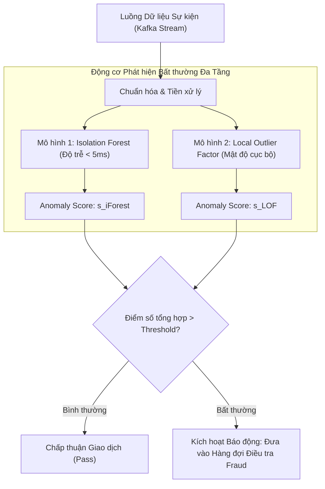

# Phát hiện Điểm Bất thường và Ngoại lai (Anomaly & Outlier Detection)

## Purpose

Trong các hệ thống học máy thực tế, dữ liệu thu thập được thường xuyên bị xâm nhập bởi các quan sát dị biệt, sai lệch nghiêm trọng so với phần lớn quần thể dữ liệu thông thường. Những quan sát này được gọi là **Điểm bất thường (Anomalies)** hoặc **Điểm ngoại lai (Outliers)**. Chúng có thể là kết quả của lỗi đo lường cảm biến, lỗi nhập liệu, hoặc phản ánh các sự kiện có giá trị kinh doanh đặc biệt cao (như giao dịch gian lận tài chính, tấn công xâm nhập mạng máy tính, hoặc dấu hiệu suy thoái sức khỏe bất ngờ của bệnh nhân).

Vì các sự kiện bất thường diễn ra rất hiếm (thường chiếm dưới $`1\%`$) và liên tục biến đổi hình thái mới, việc thu thập nhãn để huấn luyện mô hình phân loại có giám sát là bất khả thi. **Phát hiện Bất thường Không giám sát (Unsupervised Anomaly Detection)** giải quyết bài toán này bằng cách học cấu trúc chuẩn tắc của dữ liệu bình thường mà không cần nhãn, từ đó tính toán điểm số bất thường (Anomaly Score) cho từng quan sát.

Bốn thuật toán nền tảng tiêu biểu nhất trong lĩnh vực này bao gồm:
1. **Isolation Forest (iForest):** Cô lập điểm dị biệt bằng cách cắt ngẫu nhiên cây nhị phân; điểm bất thường có đường đi từ gốc tới lá ngắn hơn đáng kể so với điểm bình thường.
2. **Local Outlier Factor (LOF):** So sánh mật độ lân cận cục bộ của một điểm với mật độ của các điểm láng giềng xung quanh.
3. **Elliptic Envelope (Robust Covariance):** Giả định dữ liệu theo phân phối Gauss và sử dụng khoảng cách Mahalanobis bền vững để tìm biên elip bao quanh các điểm bình thường.
4. **One-Class SVM:** Tìm một siêu cầu hoặc siêu phẳng trong không gian Hilbert tách biệt phần lớn dữ liệu bình thường khỏi gốc tọa độ.

---

## Input

Dữ liệu đầu vào và các tham số cấu hình:

1. **Ma trận dữ liệu đặc trưng:**
   * $`X = [x_1, x_2, \dots, x_n]^\top \in \mathbb{R}^{n \times p}`$: Tập dữ liệu chưa được gán nhãn, trong đó phần lớn là các điểm bình thường (Inliers) và một tỷ lệ nhỏ là ngoại lai (Outliers).
2. **Tỷ lệ Nhiễm bẩn Dự kiến (`contamination`):**
   * Tỷ lệ phần trăm $`\nu \in (0, 0.5]`$ ước tính số lượng ngoại lai có trong tập dữ liệu (ví dụ: `contamination=0.01` tương ứng với kỳ vọng có 1% dữ liệu là bất thường). Tham số này được dùng để tự động xác định ngưỡng quyết định (Threshold) trên hàm điểm số.
3. **Số lượng Cây trong Isolation Forest (`n_estimators`):**
   * Số lượng cây cô lập được xây dựng trong rừng (thường từ 100 đến 300 cây).
4. **Số lượng Láng giềng trong LOF (`n_neighbors`):**
   * Kích thước cửa sổ láng giềng $`k`$ dùng để ước lượng mật độ cục bộ (thường chọn từ 15 đến 30).

---

## Output

Kết quả đầu ra của mô hình phát hiện bất thường:

1. **Nhãn Phân loại Nhị phân (Binary Inlier/Outlier Label):**
   * Vector nhãn $`\hat{y} \in \lbrace +1, -1 \rbrace^n`$:
     * $`+1`$: Điểm bình thường (Inlier).
     * $`-1`$: Điểm bất thường / ngoại lai (Outlier / Anomaly).
2. **Điểm số Bất thường Định lượng (Anomaly Scores):**
   * Vector $`s = [s_1, s_2, \dots, s_n]^\top \in \mathbb{R}^n`$: Điểm số liên tục thể hiện mức độ dị biệt. Điểm số càng âm (hoặc càng lớn tùy thuật toán), mẫu quan sát càng có xác suất cao là hành vi bất thường.

---

## Evaluation metrics

Khi đánh giá mô hình phát hiện bất thường trong môi trường kiểm thử (nơi có một lượng nhỏ nhãn kiểm tra đối chứng):

1. **Đường cong ROC-AUC và Precision-Recall AUC (PR-AUC):**
   * Vì bài toán có độ mất cân bằng lớp cực đoan (ngoại lai chỉ chiếm $`< 1\%`$), chỉ số Accuracy hoàn toàn vô nghĩa. **PR-AUC (Average Precision)** là thước đo quan trọng nhất phản ánh khả năng bắt trúng các ca dị biệt mà không gây báo động nhầm diện rộng.
2. **Precision tại Ngưỡng Top-K (Precision@K):**
   * Đo lường độ chính xác trong số $`K`$ trường hợp có điểm số bất thường cao nhất được gửi tới đội ngũ chuyên viên điều tra.
3. **Tỷ lệ Báo động Nhầm (False Positive Rate - FPR):**
   * Đo lường tỷ lệ các giao dịch hợp pháp bị hệ thống chặn nhầm, ảnh hưởng trực tiếp tới trải nghiệm người dùng.

---

## How it works

### 1. Thuật toán Rừng Cô lập (Isolation Forest - Liu et al., 2008)

Khác với các phương pháp truyền thống cố gắng mô hình hóa các điểm bình thường rồi tìm điểm khác biệt, **Isolation Forest** trực tiếp "cô lập" các điểm bất thường.
* **Nguyên lý trực giác:** Điểm dị biệt nằm ở các vùng thưa thớt trong không gian. Do đó, khi ta liên tục chọn ngẫu nhiên một đặc trưng $`j`$ và cắt ngẫu nhiên một mặt phẳng chia đôi trong khoảng $`[\min(x_j), \max(x_j)]`$, **các điểm dị biệt sẽ bị cô lập thành node lá chỉ sau rất ít lát cắt (độ sâu cây rất nông)**, trong khi các điểm bình thường nằm chen chúc trong cụm dày đặc đòi hỏi rất nhiều lát cắt mới cô lập được.

```text
       ĐIỂM BẤT THƯỜNG (Dễ cô lập)               CỤM ĐIỂM BÌNH THƯỜNG (Khó cô lập)
                 ● Outlier
        ────────────────────────  (Cắt 1 lần)            ● ● ● ●
                                                       ● ● ● ● ● ●
                                                         ● ● ● ●
                                                (Phải cắt hàng chục lần)
```

#### Công thức Điểm số Bất thường của Isolation Forest:
Độ dài đường đi trung bình của một cây nhị phân tìm kiếm không thành công với $`n`$ điểm được tính bởi:

$$
c(n) = 2 \ln(n - 1) + 0.5772156649 \text{ (hằng số Euler)} - \frac{2(n - 1)}{n}
$$

Điểm số bất thường $`s(x, n)`$ của điểm $`x`$ dựa trên độ sâu trung bình $`\mathbb{E}[h(x)]`$ qua toàn bộ các cây trong rừng:

$$
s(x, n) = 2^{-\frac{\mathbb{E}[h(x)]}{c(n)}} \in [0, 1]
$$

* Nếu $`\mathbb{E}[h(x)] \to 0 \implies s(x, n) \to 1`$: Điểm bị cô lập cực nhanh $`\to`$ **Chắc chắn là điểm bất thường**.
* Nếu $`\mathbb{E}[h(x)] \to n - 1 \implies s(x, n) \to 0`$: Điểm nằm rất sâu trong cây $`\to`$ **Điểm bình thường**.
* Nếu $`s(x, n) \approx 0.5`$: Toàn bộ tập dữ liệu không có điểm nào thực sự nổi bật.

---

### 2. Thuật toán Hệ số Ngoại lai Cục bộ (Local Outlier Factor - LOF)

LOF (Breunig et al., 2000) đo lường mức độ cô lập cục bộ của một điểm dựa trên mật độ lân cận:

1. **Khoảng cách khả đạt (Reachability Distance) từ $`o`$ tới $`p`$:**

$$
\text{reach-dist}_k(p, o) = \max\lbrace k\text{-distance}(o), \|p - o\| \rbrace
$$

2. **Mật độ khả đạt cục bộ (Local Reachability Density - LRD):**

$$
\text{lrd}_k(p) = \left[ \frac{\sum_{o \in N_k(p)} \text{reach-dist}_k(p, o)}{|N_k(p)|} \right]^{-1}
$$

3. **Chỉ số LOF:** Tỷ số giữa mật độ trung bình của các láng giềng so với chính mật độ của điểm $`p`$:

$$
\text{LOF}_k(p) = \frac{\sum_{o \in N_k(p)} \frac{\text{lrd}_k(o)}{\text{lrd}_k(p)}}{|N_k(p)|}
$$

* Nếu $`\text{LOF} \approx 1`$: Mật độ của điểm tương đương láng giềng $`\to`$ **Điểm bình thường**.
* Nếu $`\text{LOF} > 1.5 \sim 2.0`$: Mật độ của điểm thấp hơn rất nhiều so với láng giềng $`\to`$ **Ngoại lai cục bộ**.

---

## Data used

Phát hiện bất thường không giám sát được ứng dụng trọng yếu trong các hệ thống phòng thủ:

1. **Phát hiện Giao dịch Gian lận Thẻ Tín dụng:**
   * Một giao dịch quẹt thẻ tại nước ngoài với số tiền gấp 20 lần mức chi tiêu trung bình hàng ngày là một ngoại lai rõ rệt. Isolation Forest phát hiện các giao dịch này trong thời gian dưới 5ms.
2. **Hệ thống Phát hiện Xâm nhập Mạng (Network Intrusion Detection - IDS):**
   * Giám sát lưu lượng gói tin (Packet size, số lượng kết nối SYN, cổng dịch vụ). Các đợt tấn công từ chối dịch vụ (DDoS) hoặc quét cổng (Port scanning) tạo ra các cụm tín hiệu dị biệt trên không gian đa chiều.
3. **Kiểm tra Lỗi Sản phẩm trong Dây chuyền Công nghiệp (Visual Inspection):**
   * Các sản phẩm bị lỗi cơ khí (vết nứt, móp méo) tạo ra vector nhúng hình ảnh nằm ngoài phân phối chuẩn của các sản phẩm hoàn hảo.

---

## Design

### 1. Kiến trúc Hệ thống Giám sát và Phát hiện Bất thường Thời gian thực



---

### 2. Mã nguồn Triển khai Thực hành Chuẩn hóa với Scikit-learn

```python
import numpy as np
import matplotlib.pyplot as plt
from sklearn.ensemble import IsolationForest
from sklearn.neighbors import LocalOutlierFactor
from sklearn.covariance import EllipticEnvelope
from sklearn.preprocessing import StandardScaler

# 1. Tạo dữ liệu giả lập gồm 500 điểm bình thường và 20 điểm ngoại lai cực đoan
np.random.seed(42)
n_inliers = 500
n_outliers = 20

# Dữ liệu bình thường: 2 cụm Gauss
X_inliers_1 = np.random.randn(n_inliers // 2, 2) * 0.8 + [2, 2]
X_inliers_2 = np.random.randn(n_inliers // 2, 2) * 0.8 + [-2, -2]
# Dữ liệu ngoại lai phân tán rải rác ở rìa không gian
X_outliers = np.random.uniform(low=-6, high=6, size=(n_outliers, 2))

X_raw = np.vstack([X_inliers_1, X_inliers_2, X_outliers])
scaler = StandardScaler()
X = scaler.fit_transform(X_raw)

contamination_rate = n_outliers / len(X)
print(f"Tổng số mẫu: {len(X)} | Tỷ lệ ngoại lai thực tế: {contamination_rate*100:.2f}%")

# 2. Huấn luyện Mô hình Isolation Forest
iforest = IsolationForest(
    n_estimators=150,
    contamination=contamination_rate,
    random_state=42
)
iforest_labels = iforest.fit_predict(X) # +1: inlier, -1: outlier
iforest_scores = iforest.decision_function(X) # Càng âm càng bất thường

# 3. Huấn luyện Mô hình Local Outlier Factor (LOF)
lof = LocalOutlierFactor(
    n_neighbors=20,
    contamination=contamination_rate
)
lof_labels = lof.fit_predict(X)
lof_scores = lof.negative_outlier_factor_

# 4. Phân tích kết quả phát hiện
n_detected_iforest = np.sum(iforest_labels == -1)
n_detected_lof = np.sum(lof_labels == -1)

print(f"\n[Kết quả Phát hiện Ngoại lai]")
print(f"Isolation Forest phát hiện: {n_detected_iforest} điểm bất thường")
print(f"Local Outlier Factor phát hiện: {n_detected_lof} điểm bất thường")

# Đối chiếu mức độ đồng thuận giữa hai mô hình
agreement = np.sum(iforest_labels == lof_labels) / len(X) * 100
print(f"Tỷ lệ đồng thuận nhãn giữa iForest và LOF: {agreement:.2f}%")
```

---

## Nguồn

- [1] Liu, F. T., Ting, K. M., & Zhou, Z. H. (2008). *Isolation forest*. Eighth IEEE International Conference on Data Mining, 413-422.
- [2] Breunig, M. M., Kriegel, H. P., Ng, R. T., & Sander, J. (2000). *LOF: identifying density-based local outliers*. ACM SIGMOD Record, 29(2), 93-104.
- [3] Rousseeuw, P. J., & Driessen, K. V. (1999). *A fast algorithm for the minimum covariance determinant estimator*. Technometrics, 41(3), 212-223.
- [4] [scikit-learn User Guide: Novelty and Outlier Detection](https://scikit-learn.org/stable/modules/outlier_detection.html).
