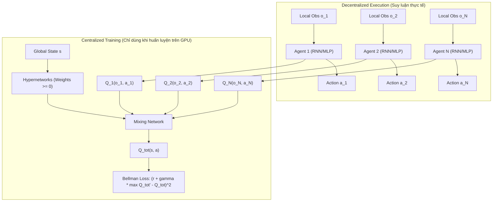

# Học tăng cường Đa tác tử (Multi-Agent Reinforcement Learning - MARL)

Học tăng cường Đa tác tử (Multi-Agent Reinforcement Learning - MARL) là phân nhánh nghiên cứu các bài toán quyết định tuần tự trong đó nhiều tác tử (Agents) cùng hoạt động, cạnh tranh hoặc hợp tác trong một môi trường chia sẻ. Khác với RL đơn tác tử (Single-Agent RL) nơi môi trường có tính dừng (Stationary), trong MARL hành động của mỗi tác tử đều làm thay đổi động lực học của môi trường từ góc nhìn của các tác tử khác, gây ra thách thức phi tĩnh (Non-stationarity) và phân bổ công lao đa tác tử (Multi-Agent Credit Assignment).

---

## Purpose

1. **Giải quyết bài toán tương tác phức hợp:** Mô hình hóa và tối ưu hóa hành vi khi có nhiều thực thể tự trị cùng tồn tại, chẳng hạn điều khiển đài radar bay không người lái (Drone Swarms), xe tự hành tại ngã tư thông minh, mạng lưới viễn thông hoặc các trò chơi đối kháng phức hợp (StarCraft II, Dota 2).
2. **Khắc phục bất ổn định phi tĩnh (Mitigating Non-stationarity):** Xây dựng cơ chế huấn luyện đồng thời mà không làm vỡ tính chất Markov của hàm giá trị thông qua cơ chế Huấn luyện tập trung - Thực thi phân tán (Centralized Training with Decentralized Execution - CTDE).
3. **Phân chia công lao đa tác tử (Credit Assignment):** Trong các tác vụ hoàn toàn hợp tác với một phần thưởng chung duy nhất (Team Reward), thuật toán phải xác định chính xác mức độ đóng góp của từng tác tử vào thành công chung thay vì chia đều bất công (Lazy Agent Problem).
4. **Cân bằng giữa Hợp tác (Cooperation) và Cạnh tranh (Competition):** Tìm kiếm trạng thái cân bằng lý thuyết trò chơi (Game Theory), tiêu biểu là Cân bằng Nash (Nash Equilibrium) hoặc Pareto Optimality trong các tác vụ cạnh tranh đối kháng hoặc hỗn hợp.

---

## Input

MARL mô hình hóa bài toán dưới dạng Trò chơi Markov bán quan sát đa tác tử (Decentralized Partially Observable Markov Decision Process - Dec-POMDP), được định nghĩa bởi bộ $`\mathcal{G} = \langle \mathcal{N}, \mathcal{S}, \mathbf{A}, \mathcal{P}, \mathbf{R}, \mathbf{\Omega}, \mathcal{O}, \gamma \rangle`$:

1. **Tập hợp các tác tử (Agents):** $`\mathcal{N} = \lbrace 1, 2, \dots, N \rbrace`$ gồm $`N`$ tác tử đang tương tác.
2. **Không gian trạng thái toàn cục (Global State Space):** $`s \in \mathcal{S}`$ mô tả toàn bộ cấu hình môi trường (chỉ được truy cập trong giai đoạn Centralized Training).
3. **Không gian hành động chung (Joint Action Space):** $`\mathbf{a} = (a_1, a_2, \dots, a_N) \in \mathbf{A} = \mathcal{A}_1 \times \dots \times \mathcal{A}_N`$, trong đó $`a_i`$ là hành động của tác tử $`i`$.
4. **Xác suất chuyển trạng thái (Transition Dynamics):** $`\mathcal{P}(s' \mid s, \mathbf{a}): \mathcal{S} \times \mathbf{A} \times \mathcal{S} \to [0, 1]`$ phụ thuộc vào toàn bộ hành động chung.
5. **Hàm phần thưởng (Reward Functions):**
   - *Hợp tác hoàn toàn (Fully Cooperative):* Phần thưởng chung $`r_1 = r_2 = \dots = r_N = r(s, \mathbf{a})`$.
   - *Cạnh tranh hoàn toàn (Zero-Sum):* $`\sum_{i=1}^N r_i(s, \mathbf{a}) = 0`$.
   - *Hỗn hợp (General-Sum):* Mỗi tác tử nhận phần thưởng riêng $`r_i(s, \mathbf{a})`$.
6. **Không gian quan sát cục bộ (Local Observations):** $`o_i \in \Omega_i`$ thu được qua hàm quan sát $`\mathcal{O}(s, i): \mathcal{S} \times \mathcal{N} \to \Omega_i`$. Trong giai đoạn thực thi (Decentralized Execution), tác tử $`i`$ chỉ nhìn thấy $`o_i`$ hoặc lịch sử quan sát $`\tau_i = (o_i^1, a_i^1, \dots, o_i^t)`$.

---

## Output

1. **Tập chính sách phi tập trung (Decentralized Policies):** $`\boldsymbol{\pi} = \lbrace \pi_1, \pi_2, \dots, \pi_N \rbrace`$, trong đó mỗi chính sách $`\pi_i(a_i \mid o_i; \theta_i)`$ là một mạng nơ-ron quyết định hành động $`a_i`$ chỉ dựa trên quan sát cục bộ $`o_i`$ mà không cần liên lạc toàn cục.
2. **Hàm giá trị tập trung (Centralized Value Functions - trong quá trình huấn luyện):**
   - $`Q_{tot}(\boldsymbol{\tau}, \mathbf{a})`$ trong các thuật toán phân rã giá trị như VDN, QMIX.
   - $`V_{\phi}(s)`$ hoặc $`Q_i^{\mu}(s, a_1, \dots, a_N)`$ trong các thuật toán Actor-Critic như MAPPO, MADDPG.
3. **Chiến lược liên lạc (Communication Protocols - nếu có):** Vector thông điệp $`m_i^t`$ được mã hóa và truyền qua kênh truyền giữa các tác tử lân cận.

---

## Evaluation metrics

| Tên chỉ số | Công thức toán học | Ý nghĩa thực tế | Ngưỡng đạt chuẩn |
|---|---|---|---|
| **Tổng thưởng đội (Team Return)** | $`R_{team} = \sum_{t=0}^T r_t^{team}`$ | Đo lường hiệu quả hợp tác tổng thể của toàn nhóm tác tử | Tiệm cận ngưỡng tối ưu toàn cục trên môi trường |
| **Tỷ lệ thắng (Win Rate)** | $`\mathrm{WR} = \frac{N_{wins}}{N_{episodes}}`$ | Đánh giá hiệu năng trong các game đối kháng (SMAC, StarCraft II) | $`\ge 0.95`$ trên các bản đồ chuẩn |
| **Khoảng cách Nash (Nash Conv)** | $`\mathrm{NashConv}(\boldsymbol{\pi}) = \sum_{i \in \mathcal{N}} \max_{\pi_i'} u_i(\pi_i', \boldsymbol{\pi}_{-i}) - u_i(\boldsymbol{\pi})`$ | Đo lường mức độ gần với Cân bằng Nash trong trò chơi cạnh tranh | $`\to 0`$ khi hội tụ về trạng thái cân bằng |
| **Hệ số công bằng Jain (Fairness Index)** | $`\mathcal{J}(r_1, \dots, r_N) = \frac{\left(\sum_{i=1}^N r_i\right)^2}{N \sum_{i=1}^N r_i^2}`$ | Đo mức độ phân bổ thưởng đều giữa các tác tử, tránh tình trạng một tác tử gánh hết | $`\mathcal{J} \ge 0.85`$ trong các tác vụ công bằng |
| **Chi phí trao đổi thông tin (Bandwidth Cost)** | $`\mathcal{C}_{comm} = \sum_{t=1}^T \sum_{i=1}^N \|m_i^t\|_0`$ | Tổng lượng bit thông tin trao đổi qua mạng trong suốt episode | Càng thấp càng tốt (tối ưu hóa tiết kiệm băng thông) |

---

## How it works

### 1. Phân loại Bài toán MARL và Ma trận Trò chơi (Game Theory Foundations)

Trong lý thuyết trò chơi, tương tác giữa 2 tác tử được thể hiện qua Ma trận trả thưởng (Payoff Matrix). Ví dụ trò chơi Thế lưỡng nan của người tù (Prisoner's Dilemma):

| Tác tử 1 \ Tác tử 2 | Hợp tác (Cooperate) | Phản bội (Defect) |
|---|---|---|
| **Hợp tác (Cooperate)** | (-1, -1) | (-3, 0) |
| **Phản bội (Defect)** | (0, -3) | (-2, -2) |

Trong bài toán này, hành động Phản bội (Defect) là chiến lược thống trị (Dominant Strategy) của cả hai bên, dẫn đến Cân bằng Nash tại $`(-2, -2)`$, mặc dù trạng thái cùng Hợp tác $`(-1, -1)`$ đem lại lợi ích Pareto vượt trội cho cả hai. MARL phải giải quyết động lực học phức hợp này trong môi trường động.

### 2. Thách thức cốt lõi: Non-stationarity

Khi mỗi tác tử $`i`$ đồng thời cập nhật chính sách $`\pi_i`$, xác suất chuyển trạng thái dưới góc nhìn của tác tử $`i`$ trở thành:

$$
\mathcal{P}_i(s' \mid s, a_i) = \sum_{\mathbf{a}_{-i}} \mathcal{P}(s' \mid s, a_i, \mathbf{a}_{-i}) \prod_{j \neq i} \pi_j(a_j \mid o_j)
$$

Vì $`\pi_j`$ của các tác tử khác thay đổi liên tục trong quá trình huấn luyện, $`\mathcal{P}_i`$ không còn là hằng số theo thời gian $`t`$. Điều này làm vi phạm giả định Markov cơ bản, khiến các thuật toán dùng Replay Buffer như DQN bị sụp đổ do dữ liệu quá khứ trở nên lạc hậu (Stale Experience Replay).

### 3. Mô hình Huấn luyện tập trung - Thực thi phân tán (CTDE)

CTDE là phương pháp tiêu chuẩn hiện đại trong MARL:
- **Centralized Training (Lúc huấn luyện):** Thuật toán được phép sử dụng trạng thái toàn cục $`s`$ và hành động chung của tất cả các tác tử $`\mathbf{a} = (a_1, \dots, a_N)`$ để huấn luyện mạng đánh giá (Critic hoặc Mixing Network), loại bỏ tính phi tĩnh.
- **Decentralized Execution (Lúc thực thi / suy luận):** Mạng Critic bị gỡ bỏ. Mỗi tác tử $`i`$ chỉ sử dụng mạng Actor $`\pi_i(a_i \mid o_i)`$ và quan sát cục bộ $`o_i`$ để ra quyết định độc lập mà không cần kênh liên lạc toàn cục.

### 4. Thuật toán Phân rã Giá trị: VDN và QMIX

#### Value-Decomposition Networks (VDN - Sunehag et al., 2017)
VDN giả định giá trị hành động toàn cục $`Q_{tot}`$ là tổng tuyến tính của các $`Q_i`$ cục bộ:

$$
Q_{tot}(\boldsymbol{\tau}, \mathbf{a}) = \sum_{i=1}^N Q_i(\tau_i, a_i)
$$

Điều này đảm bảo tính chất Individual-Global-Max (IGM):

$$
\arg\max_{\mathbf{a}} Q_{tot}(\boldsymbol{\tau}, \mathbf{a}) = \begin{pmatrix} \arg\max_{a_1} Q_1(\tau_1, a_1) \\ \vdots \\ \arg\max_{a_N} Q_N(\tau_N, a_N) \end{pmatrix}
$$

#### QMIX (Rashid et al., ICML 2018)
VDN quá đơn giản và không biểu diễn được các tương tác phi tuyến phức hợp giữa các tác tử. QMIX mở rộng IGM sang điều kiện đơn điệu (Monotonicity Condition):

$$
\frac{\partial Q_{tot}(\boldsymbol{\tau}, \mathbf{a})}{\partial Q_i(\tau_i, a_i)} \ge 0, \quad \forall i \in \mathcal{N}
$$

Để đảm bảo đạo hàm luôn không âm, QMIX sử dụng một **Mixing Network** có trọng số $`W > 0`$ được sinh ra bởi các Hypernetworks nhận trạng thái toàn cục $`s`$ làm đầu vào và đi qua hàm kích hoạt trị tuyệt đối hoặc ReLU:

$$
\mathcal{L}_{QMIX}(\theta) = \mathbb{E}_{(\mathbf{s}, \mathbf{a}, r, \mathbf{s}') \sim \mathcal{D}} \left[ \left( r + \gamma \max_{\mathbf{a}'} Q_{tot}(\mathbf{s}', \mathbf{a}'; \theta^{-}) - Q_{tot}(\mathbf{s}, \mathbf{a}; \theta) \right)^2 \right]
$$

### 5. Multi-Agent PPO (MAPPO - Yu et al., NeurIPS 2022)

MAPPO chứng minh rằng thuật toán On-Policy PPO kết hợp kiến trúc Centralized Critic có thể đạt hiệu năng vượt trội so với các thuật toán Off-Policy phức hợp trên SMAC:
- **Centralized Value Function:** Critic xấp xỉ $`V_{\phi}(s)`$ sử dụng toàn bộ trạng thái toàn cục $`s`$ (hoặc kết hợp cả vector quan sát và hành động của toàn đội).
- **Decentralized Actor:** Mỗi actor $`\pi_{\theta}(a_i \mid o_i)`$ được cập nhật dựa trên Generalized Advantage Estimation (GAE) tập trung:

$$
A_i^t = \sum_{l=0}^{\infty} (\gamma \lambda)^l \delta_{t+l}^V, \quad \text{với } \delta_t^V = r_t + \gamma V_{\phi}(s_{t+1}) - V_{\phi}(s_t)
$$

Mục tiêu Clipping của PPO đa tác tử:

$$
L^{CLIP}(\theta) = \hat{\mathbb{E}}_t \left[ \sum_{i=1}^N \min \left( r_i^t(\theta) \hat{A}_i^t, \; \mathrm{clip}(r_i^t(\theta), 1-\epsilon, 1+\epsilon) \hat{A}_i^t \right) \right]
$$

---

## Data used

| Tên môi trường benchmark | Loại bài toán | Số lượng tác tử | Đặc điểm không gian | Thách thức cốt lõi |
|---|---|---|---|---|
| **SMAC (StarCraft Multi-Agent Challenge)** | Hợp tác hoàn toàn (Cooperative) | 2 đến 27 tác tử | State liên tục, Action rời rạc | Vi mô chiến thuật, Credit assignment, Bán quan sát sâu |
| **MPE (Multi-Agent Particle Envs)** | Hợp tác, Cạnh tranh, Hỗn hợp | 2 đến 10 tác tử | State liên tục, Action liên tục/rời rạc | Điều khiển vật lý, Tránh va chạm, Săn mồi/con mồi |
| **Google Research Football (GRF)** | Hợp tác + Đối kháng | 11 vs 11 | State toàn cục lớn, Action rời rạc | Chiến thuật bóng đá dài hạn, Reward thưa thớt |
| **Overcooked-AI** | Hợp tác Người - AI | 2 tác tử | GridWorld bán quan sát | Phối hợp nhịp nhàng, Thích nghi với đối tác con người lạ |

---

## Design

### Sơ đồ Kiến trúc Centralized Training with Decentralized Execution (CTDE - QMIX)



### Triển khai Minh họa Python PyTorch: Mixing Network và CTDE Forward Pass

```python
import torch
import torch.nn as nn
import torch.nn.functional as F

class QMixNet(nn.Module):
    """
    Mixing Network của QMIX với trọng số được sinh bởi Hypernetworks
    đảm bảo điều kiện đơn điệu dQ_tot / dQ_i >= 0.
    """
    def __init__(self, n_agents: int, state_dim: int, embed_dim: int = 32):
        super().__init__()
        self.n_agents = n_agents
        self.state_dim = state_dim
        self.embed_dim = embed_dim

        # Hypernetwork cho Lớp 1: sinh ma trận trọng số W1 (n_agents x embed_dim)
        self.hyper_w1 = nn.Sequential(
            nn.Linear(state_dim, embed_dim),
            nn.ReLU(),
            nn.Linear(embed_dim, n_agents * embed_dim)
        )
        self.hyper_b1 = nn.Linear(state_dim, embed_dim)

        # Hypernetwork cho Lớp 2: sinh ma trận trọng số W2 (embed_dim x 1)
        self.hyper_w2 = nn.Sequential(
            nn.Linear(state_dim, embed_dim),
            nn.ReLU(),
            nn.Linear(embed_dim, embed_dim * 1)
        )
        # Bias cuối cùng sinh trực tiếp từ state qua MLP 2 lớp
        self.hyper_b2 = nn.Sequential(
            nn.Linear(state_dim, embed_dim),
            nn.ReLU(),
            nn.Linear(embed_dim, 1)
        )

    def forward(self, agent_qs: torch.Tensor, states: torch.Tensor) -> torch.Tensor:
        """
        Args:
            agent_qs: Tensor kích thước (batch_size, n_agents) chứa giá trị Q_i của các agent
            states: Tensor kích thước (batch_size, state_dim) chứa trạng thái toàn cục
        Returns:
            q_tot: Tensor kích thước (batch_size, 1)
        """
        batch_size = agent_qs.size(0)
        agent_qs = agent_qs.view(batch_size, 1, self.n_agents)

        # Lớp 1: W1 bắt buộc phải không âm (dùng torch.abs)
        w1 = torch.abs(self.hyper_w1(states)).view(batch_size, self.n_agents, self.embed_dim)
        b1 = self.hyper_b1(states).view(batch_size, 1, self.embed_dim)
        hidden = F.elu(torch.bmm(agent_qs, w1) + b1)

        # Lớp 2: W2 bắt buộc phải không âm (dùng torch.abs)
        w2 = torch.abs(self.hyper_w2(states)).view(batch_size, self.embed_dim, 1)
        b2 = self.hyper_b2(states).view(batch_size, 1, 1)
        
        # Q_tot toàn cục
        q_tot = torch.bmm(hidden, w2) + b2
        return q_tot.view(batch_size, 1)

# Kiểm thử đạo hàm không âm (Monotonicity Verification)
if __name__ == '__main__':
    n_agents, state_dim = 3, 16
    net = QMixNet(n_agents=n_agents, state_dim=state_dim)
    
    dummy_states = torch.randn(4, state_dim)
    dummy_qs = torch.randn(4, n_agents, requires_grad=True)
    
    q_tot = net(dummy_qs, dummy_states)
    loss = q_tot.sum()
    loss.backward()
    
    # Kiểm tra đạo hàm dQ_tot / dQ_i >= 0
    assert (dummy_qs.grad >= -1e-6).all(), 'Vi phạm điều kiện đơn điệu Monotonicity!'
    print('Xác thực thành công: dQ_tot / dQ_i >= 0 trên toàn bộ batch!')
```

### So sánh các Mô hình MARL Tiêu biểu

| Thuật toán | Kiến trúc | Loại chính sách | Cơ chế phân rã / hợp nhất | Xử lý phi tĩnh | Bài toán thích hợp |
|---|---|---|---|---|---|
| **IQL** (Tan, 1993) | Độc lập hoàn toàn | Off-Policy (DQN) | Không có (coi các agent là môi trường) | Kém, dễ bị phân kỳ | Đa tác tử đơn giản, tương tác yếu |
| **VDN** (Sunehag, 2017) | CTDE | Off-Policy (DQN) | Tổng tuyến tính $`\sum Q_i`$ | Trung bình | Hợp tác, phần thưởng cộng dồn |
| **QMIX** (Rashid, 2018) | CTDE | Off-Policy (DQN) | Hypernetworks phi tuyến ($`W \ge 0`$) | Xuất sắc | Hợp tác phức hợp, StarCraft II |
| **MADDPG** (Lowe, 2017) | CTDE | Off-Policy (DDPG) | Centralized Critic $`Q_i(s, a_1, \dots, a_N)`$ | Tốt | Liên tục, cạnh tranh hoặc hỗn hợp |
| **MAPPO** (Yu, 2022) | CTDE | On-Policy (PPO) | Centralized Value Function $`V(s)`$ | Rất tốt | Đa dạng, ổn định, dễ tinh chỉnh |

---

## Nguồn

1. **Rashid, T., Samvelyan, M., Schroeder, C., Farquhar, G., Foerster, J., & Whiteson, S.** (2018). *QMIX: Monotonic Value Function Factorisation for Deep Multi-Agent Reinforcement Learning*. Proceedings of the 35th International Conference on Machine Learning (ICML).
2. **Yu, C., Velu, A., Vinitsky, E., Gao, J., Wang, Y., Bayen, A., & Wu, Y.** (2022). *The Surprising Effectiveness of PPO in Cooperative Multi-Agent Games*. Advances in Neural Information Processing Systems (NeurIPS).
3. **Lowe, R., Wu, Y., Tamar, A., Harb, J., Abbeel, P., & Mordatch, I.** (2017). *Multi-Agent Actor-Critic for Mixed Cooperative-Competitive Environments*. Advances in Neural Information Processing Systems (NeurIPS).
4. **Sunehag, P., Lever, G., Liu, S., Merel, J., Eslami, S. M., Gomez, A., ... & Heess, N.** (2017). *Value-Decomposition Networks For Cooperative Multi-Agent Learning Based On Team Reward*. arXiv preprint arXiv:1706.05296.
5. **Samvelyan, M., Rashid, T., Schroeder de Witt, C., Shum, G., Wang, P., & Whiteson, S.** (2019). *The StarCraft Multi-Agent Challenge*. arXiv preprint arXiv:1902.04043.
