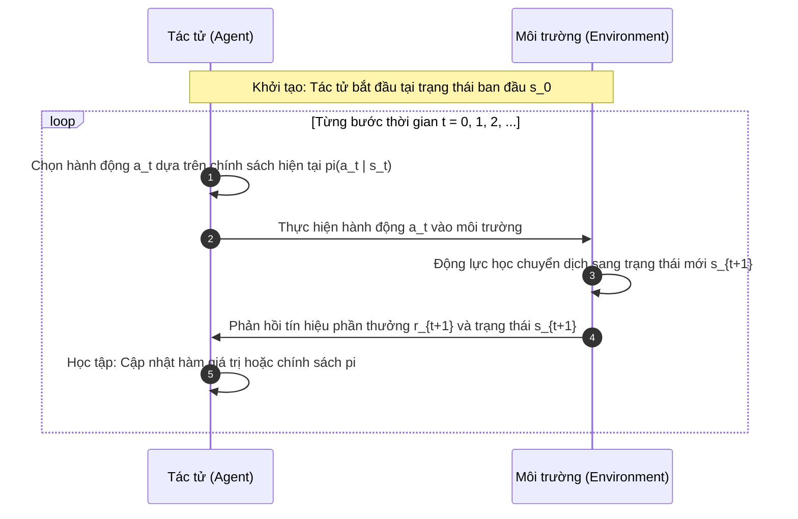

# Chương 6 — Học tăng cường (Reinforcement Learning)

> Bản ghi chú tiếng Việt dựa trên [ML_Chapter6_new.pdf](<../Tài liệu học tập/ML_Chapter6_new.pdf>) (32 trang), bài giảng của TS. Nguyễn Thị Khánh Tiên, Trường Đại học Giao thông Vận tải TP.HCM. Số trang trong ngoặc đơn là số trang slide tương ứng trong PDF. Nội dung được hệ thống hóa, chuẩn hóa công thức toán học và bổ sung các phân tích học thuật chuyên sâu.

---

## 1. Khái niệm và Các thành phần cốt lõi của Học tăng cường (tr. 2–3)

Học tăng cường (Reinforcement Learning - RL) là một nhánh của học máy trong đó tác tử (Agent) học cách đưa ra chuỗi quyết định tối ưu thông qua tương tác thử - sai trực tiếp với môi trường (Environment). Khác với học có giám sát (cung cấp nhãn đúng chuẩn cho từng mẫu) hay học không giám sát (chỉ phân tích cấu trúc tiềm ẩn), tác tử RL học hoàn toàn từ hệ quả (Consequences) của các hành động do chính nó tạo ra.

### 6 Thành phần cốt lõi trong hệ thống RL (tr. 2)
1. **Tác tử (Agent):** Thực thể ra quyết định và học tập thông qua tương tác.
2. **Môi trường (Environment):** Thế giới bên ngoài mà tác tử hoạt động và phản hồi lại hành động của tác tử.
3. **Trạng thái (State $`s \in \mathcal{S}`$):** Tình huống hoặc thông tin mô tả đầy đủ điều kiện hiện tại của môi trường.
4. **Hành động (Action $`a \in \mathcal{A}`$):** Các lựa chọn can thiệp mà tác tử có thể thực hiện.
5. **Phần thưởng (Reward $`r \in \mathbb{R}`$):** Tín hiệu phản hồi vô hướng (Scalar Feedback) định lượng mức độ thành công hay thất bại của hành động.
6. **Chính sách (Policy $`\pi`$):** Chiến lược hành vi của tác tử, ánh xạ từ trạng thái sang hành động ($`\pi: \mathcal{S} \to \mathcal{A}`$ hoặc phân phối xác suất $`\pi(a \mid s)`$).

### Quy trình Vòng lặp Tương tác 6 Bước (tr. 3)



---

## 2. So sánh Học tăng cường với Học có giám sát (tr. 4)

| Tiêu chí | Học có giám sát (Supervised Learning) | Học tăng cường (Reinforcement Learning) |
|---|---|---|
| **Dữ liệu đầu vào** | Tập mẫu được gán nhãn đúng $`(x_i, y_i)`$ | Trạng thái quan sát và tín hiệu thưởng $`(s, a, r, s')`$ |
| **Bản chất phản hồi** | Phản hồi chỉ thị (Instructive Feedback): Biết rõ nhãn đúng | Phản hồi đánh giá (Evaluative Feedback): Chỉ biết hành động tốt hay xấu |
| **Phụ thuộc thời gian** | Dữ liệu độc lập và cùng phân phối (i.i.d) | Dữ liệu dạng chuỗi tuần tự theo thời gian (Sequential data) |
| **Tác động của mô hình** | Dự đoán không làm thay đổi phân phối mẫu kiểm thử | Hành động của tác tử làm biến đổi trực tiếp trạng thái tương lai |
| **Mục tiêu học tập** | Tối thiểu hóa hàm mất mát dự đoán sai số (Loss Function) | Tối đa hóa tổng phần thưởng tích lũy kỳ vọng dài hạn (Cumulative Return) |

---

## 3. Phân loại Học tăng cường (tr. 5–8)

### Phân loại theo Tín hiệu Phản hồi (tr. 5)
- **Tăng cường dương (Positive Reinforcement):** Thưởng khi tác tử thực hiện hành vi mong muốn, làm tăng tần suất xuất hiện của hành vi đó.
  - *Ưu điểm:* Tối đa hóa hiệu năng công việc, duy trì sự biến đổi hành vi bền vững trong thời gian dài.
  - *Nhược điểm:* Nếu thưởng quá dư thừa có thể dẫn đến quá tải trạng thái và làm giảm hiệu suất khám phá.
- **Tăng cường âm (Negative Reinforcement):** Tác tử học cách hành động để loại bỏ, chấm dứt hoặc né tránh một trạng thái tiêu cực hoặc hình phạt.
  - *Ưu điểm:* Thúc đẩy tác tử vượt qua ngưỡng tiêu chuẩn tối thiểu và né tránh nguy cơ chí mạng.
  - *Nhược điểm:* Chỉ đủ để đạt ngưỡng an toàn, ít khi dẫn đến hành vi tối ưu đột phá.

### Phân loại theo Phương pháp Tiếp cận (tr. 6–8)
1. **Value-Based Methods (Dựa trên hàm giá trị):** Tác tử học cách ước lượng giá trị của từng trạng thái $`V(s)`$ hoặc cặp trạng thái - hành động $`Q(s, a)`$, sau đó hành động theo chiến lược tham lam $`\arg\max_a Q(s, a)`$. Tiêu biểu: *Q-Learning, Sarsa, DQN*.
2. **Policy-Based Methods (Dựa trên chính sách):** Tác tử tham số hóa trực tiếp chính sách $`\pi_{\theta}(a \mid s)`$ và dùng đạo hàm chính sách (Policy Gradient) để tối ưu hóa mà không cần lưu trữ bảng giá trị. Tiêu biểu: *REINFORCE*.
3. **Actor-Critic Methods (Kết hợp):** Kết hợp cả hai tiếp cận: Actor học chính sách $`\pi_{\theta}`$, Critic học hàm giá trị $`V_{\phi}`$ để đánh giá và giảm phương sai cho Actor. Tiêu biểu: *A2C, PPO*.
4. **Model-Based vs Model-Free:**
   - *Model-Free:* Học trực tiếp từ tương tác thử - sai mà không cần biết quy luật chuyển trạng thái của môi trường.
   - *Model-Based:* Học hoặc có sẵn mô hình chuyển trạng thái $`\mathcal{P}(s' \mid s, a)`$ và hàm thưởng $`\mathcal{R}(s, a)`$ để lập kế hoạch (Planning) trước khi hành động.

---

## 4. Ứng dụng Thực tế của Học tăng cường (tr. 9)

- **Robot tự hành (Robotics):** Điều khiển cánh tay robot gắp vật thể, giữ thăng bằng cho robot hai chân và định vị điều hướng thông minh.
- **Trò chơi điện tử và Trí tuệ nhân tạo đối kháng:** AlphaGo, AlphaZero đánh bại kiện tướng cờ vây; OpenAI Five chơi Dota 2; AlphaStar chơi StarCraft II.
- **Quản lý tài nguyên và Tối ưu hóa hệ thống:** Tự động hóa điều phối làm mát trung tâm dữ liệu Google, định tuyến lưu lượng gói tin mạng.
- **Giao thông và Xe tự hành:** Điều khiển đèn tín hiệu giao thông thông minh theo mật độ thực tế, thuật toán bám làn và chuyển làn cho xe tự hành.
- **Tài chính và Giao dịch định lượng (Quantitative Trading):** Tối ưu hóa danh mục đầu tư và tự động khớp lệnh thích ứng với độ biến động của thị trường.

---

## 5. Thách thức Cân bằng Khám phá và Khai thác (Exploration vs. Exploitation) (tr. 10–11)

Đây là thế lưỡng nan (Dilemma) nền tảng trong học tăng cường:
- **Khai thác (Exploitation):** Chọn hành động mang lại phần thưởng cao nhất theo những gì tác tử đã biết để tích lũy điểm số ngắn hạn. Nguy cơ: Rơi vào cực trị địa phương (Suboptimal).
- **Khám phá (Exploration):** Thử các hành động mới lạ chưa biết rõ kết quả để thu thập thêm tri thức về môi trường. Nguy cơ: Nhận phần thưởng thấp hoặc rơi vào nguy hiểm trong ngắn hạn.

### Chiến lược Cân bằng $\epsilon$-greedy
Chiến lược phổ biến nhất là $\epsilon$-greedy với hệ số suy giảm (Decay):

$$
a_t = \begin{cases} \text{hành động ngẫu nhiên } a \in \mathcal{A}, & \text{với xác suất } \epsilon \\ \arg\max_{a \in \mathcal{A}} Q(s_t, a), & \text{với xác suất } 1 - \epsilon \end{cases}
$$

Hệ số $\epsilon$ được khởi tạo lớn (ví dụ $`\epsilon = 1.0`$) ở đầu quá trình học để kích thích khám phá, sau đó giảm dần qua từng bước thời gian về ngưỡng nhỏ (ví dụ $`\epsilon_{min} = 0.01`$):

$$
\epsilon_{t+1} = \max(\epsilon_{min}, \; \epsilon_t \times \epsilon_{decay})
$$

---

## 6. Quá trình quyết định Markov (Markov Decision Process - MDP) (tr. 12–17)

### Tính chất Markov (Markov Property - tr. 12)
Một trạng thái $`s_t`$ thỏa mãn tính chất Markov nếu tương lai hoàn toàn độc lập với quá khứ một khi hiện tại đã biết:

$$
\mathbb{P}(s_{t+1} \mid s_t, a_t, s_{t-1}, a_{t-1}, \dots, s_0, a_0) = \mathbb{P}(s_{t+1} \mid s_t, a_t)
$$

### Bộ 5 thành phần của MDP: $\langle \mathcal{S}, \mathcal{A}, \mathcal{P}, \mathcal{R}, \gamma \rangle$ (tr. 14)
1. $`\mathcal{S}`$: Tập hợp tất cả các trạng thái hợp lệ.
2. $`\mathcal{A}`$: Tập hợp tất cả các hành động có thể thực hiện.
3. $`\mathcal{P}`$: Mô hình xác suất chuyển trạng thái $`\mathcal{P}(s' \mid s, a) = \mathbb{P}(s_{t+1} = s' \mid s_t = s, a_t = a)`$.
4. $`\mathcal{R}`$: Hàm phần thưởng kỳ vọng $`\mathcal{R}(s, a, s') = \mathbb{E}[r_{t+1} \mid s_t=s, a_t=a, s_{t+1}=s']`$.
5. $`\gamma \in [0, 1)`$: Hệ số chiết khấu phần thưởng trong tương lai.

### Ví dụ Thế giới Lưới 3x4 có Nhiễu (Noisy Grid World - tr. 15–16)
Xét một tác tử di chuyển trong lưới $`3 \times 4`$:
- Trạng thái bắt đầu: Ô `(1, 1)`.
- Ô đích thưởng: `(4, 3)` có phần thưởng $`+1`$. Ô bẫy nguy hiểm: `(4, 2)` có hình phạt $`-1`$. Ô chướng ngại vật: `(2, 2)`.
- Chi phí bước đi thông thường: $`r = -0.04`$ nhằm khuyến khích tìm đường ngắn nhất.
- Động lực học có nhiễu (Stochastic Transitions): Khi tác tử thực hiện hành động (ví dụ `UP`):
  - Xác suất 80% đi đúng hướng dự định (`UP`).
  - Xác suất 10% trượt vuông góc sang trái (`LEFT`).
  - Xác suất 10% trượt vuông góc sang phải (`RIGHT`).
  - Nếu va vào tường hoặc chướng ngại vật, tác tử bị bật lại vị trí cũ.

### Ví dụ Mã nguồn MDP 2 Trạng thái (tr. 17)

```python
import numpy as np

class TwoStateMDP:
    """
    Minh họa MDP 2 trạng thái S0 và S1 theo slide 17.
    Hành động: 0 (Stay), 1 (Switch)
    """
    def __init__(self):
        self.states = [0, 1]
        self.actions = [0, 1]
        # P[state, action, next_state]
        self.P = np.zeros((2, 2, 2))
        self.P[0, 0, 0] = 0.9; self.P[0, 0, 1] = 0.1
        self.P[0, 1, 0] = 0.2; self.P[0, 1, 1] = 0.8
        self.P[1, 0, 1] = 0.9; self.P[1, 0, 0] = 0.1
        self.P[1, 1, 1] = 0.2; self.P[1, 1, 0] = 0.8
        
        # Rewards R[state, action]
        self.R = np.array([
            [1.0, 0.0],
            [2.0, -1.0]
        ])

    def step(self, state: int, action: int):
        next_state = np.random.choice(self.states, p=self.P[state, action])
        reward = self.R[state, action]
        return next_state, reward
```

---

## 7. Hàm giá trị và Phương trình Bellman (tr. 18–21)

### Hàm giá trị trạng thái $V^{\pi}(s)$ và Hàm giá trị hành động $Q^{\pi}(s, a)$ (tr. 18–19)
Phần thưởng tích lũy có chiết khấu (Discounted Return):

$$
G_t = \sum_{k=0}^{\infty} \gamma^k r_{t+k+1}
$$

Hàm giá trị trạng thái là kỳ vọng lợi nhuận bắt đầu từ trạng thái $`s`$ và tuân theo chính sách $`\pi`$:

$$
V^{\pi}(s) = \mathbb{E}_{\pi} [G_t \mid s_t = s]
$$

Hàm giá trị hành động là kỳ vọng lợi nhuận khi chọn hành động $`a`$ tại trạng thái $`s`$ rồi tiếp tục theo $`\pi`$:

$$
Q^{\pi}(s, a) = \mathbb{E}_{\pi} [G_t \mid s_t = s, a_t = a]
$$

### Phương trình Bellman cho Giá trị Kỳ vọng (Bellman Expectation Equation - tr. 20)

$$
V^{\pi}(s) = \sum_{a \in \mathcal{A}} \pi(a \mid s) \sum_{s' \in \mathcal{S}} \mathcal{P}(s' \mid s, a) \left[ \mathcal{R}(s, a, s') + \gamma V^{\pi}(s') \right]
$$

$$
Q^{\pi}(s, a) = \sum_{s' \in \mathcal{S}} \mathcal{P}(s' \mid s, a) \left[ \mathcal{R}(s, a, s') + \gamma \sum_{a' \in \mathcal{A}} \pi(a' \mid s') Q^{\pi}(s', a') \right]
$$

### Phương trình Tối ưu Bellman (Bellman Optimality Equations - tr. 21)
Tại chính sách tối ưu $`\pi^{\ast}`$:

$$
V^{\ast}(s) = \max_{a \in \mathcal{A}} \sum_{s' \in \mathcal{S}} \mathcal{P}(s' \mid s, a) \left[ \mathcal{R}(s, a, s') + \gamma V^{\ast}(s') \right]
$$

$$
Q^{\ast}(s, a) = \sum_{s' \in \mathcal{S}} \mathcal{P}(s' \mid s, a) \left[ \mathcal{R}(s, a, s') + \gamma \max_{a' \in \mathcal{A}} Q^{\ast}(s', a') \right]
$$

---

## 8. Thuật toán Q-Learning (tr. 22–24)

Q-Learning (Watkins, 1989) là thuật toán điều khiển sai phân thời gian phi chính sách (Off-Policy Model-Free Temporal Difference Control). Thuật toán học trực tiếp hàm $`Q^{\ast}`$ tối ưu bất kể tác tử đang thực hiện hành động theo chính sách khám phá nào.

### Quy tắc Cập nhật Q-Table (tr. 22)

$$
Q(s_t, a_t) \leftarrow Q(s_t, a_t) + \alpha \left[ r_{t+1} + \gamma \max_{a'} Q(s_{t+1}, a') - Q(s_t, a_t) \right]
$$

Trong đó:
- $`\alpha \in (0, 1]`$ là tốc độ học (Learning Rate).
- $`\gamma \in [0, 1)`$ là hệ số chiết khấu (Discount Factor).
- $`\delta_t = r_{t+1} + \gamma \max_{a'} Q(s_{t+1}, a') - Q(s_t, a_t)`$ là sai số TD (Temporal Difference Error).
- Thuật toán có tính chất **Off-Policy** vì mục tiêu cập nhật sử dụng toán tử tham lam $`\max_{a'} Q(s_{t+1}, a')`$ độc lập với hành động thực tế mà chính sách hành vi ($\epsilon$-greedy) lựa chọn ở bước kế tiếp.

---

## 9. Khái niệm Bootstrapping và Xấp xỉ hàm (Function Approximation) (tr. 25–26)

### Bootstrapping trong RL (tr. 25)
Bootstrapping là cơ chế cập nhật ước tính của một giá trị dựa trên một ước tính khác tiếp theo thay vì chờ đợi toàn bộ chuỗi kết quả thực tế đến khi kết thúc tập (như trong Monte Carlo):
- *Monte Carlo:* Cần kết thúc toàn bộ ván đấu để biết $`G_t`$, không dùng bootstrapping.
- *Temporal Difference (TD / Q-Learning):* Cập nhật ngay lập tức ở từng bước nhờ ước tính $`r_{t+1} + \gamma \max_{a'} Q(s_{t+1}, a')`$.

### Sự cần thiết của Xấp xỉ hàm (Function Approximation - tr. 26)
- **Hạn chế của Q-Table:** Chỉ áp dụng được cho không gian trạng thái và hành động rời rạc, kích thước nhỏ. Nếu trạng thái là ảnh pixels $`210 \times 160 \times 3`$ hoặc biến liên tục, số lượng phần tử bùng nổ vô hạn (Curse of Dimensionality), không thể lưu trữ hay duyệt hết bảng.
- **Giải pháp:** Sử dụng mạng nơ-ron sâu có trọng số $`\theta`$ làm bộ xấp xỉ hàm:

$$
Q(s, a; \theta) \approx Q^{\ast}(s, a)
$$

---

## 10. Deep Q-Learning (DQN) và Các Giải pháp Ổn định (tr. 27–29)

### Hai Vấn đề Gây Bất ổn định Nền tảng (tr. 28)
1. **Tương quan giữa các mẫu liên tiếp (Correlated Samples):** Các trạng thái $`s_t, s_{t+1}, s_{t+2}`$ liên tiếp trong cùng một ván chơi có mối tương quan chuỗi rất cao, vi phạm giả định i.i.d của Gradient Descent.
2. **Mục tiêu thay đổi liên tục (Non-stationary Targets):** Khi cập nhật trọng số $`\theta`$, cả giá trị dự đoán $`Q(s, a; \theta)`$ lẫn giá trị mục tiêu $`r + \gamma \max_{a'} Q(s', a'; \theta)`$ đều cùng thay đổi, giống như đuổi theo một hồng tâm di động, gây phân kỳ.

### Hai Kỹ thuật Cốt lõi của DQN (Mnih et al., Nature 2015)
1. **Bộ đệm trải nghiệm (Experience Replay Buffer $\mathcal{D}$):**
   - Lưu trữ các bước chuyển $`e_t = (s_t, a_t, r_t, s_{t+1}, d_t)`$ vào bộ đệm vòng tròn.
   - Khi huấn luyện, lấy mẫu ngẫu nhiên (Uniform Mini-batch) để phá vỡ mối tương quan tuần tự.
2. **Mạng mục tiêu độc lập (Target Network $\theta^{-}$):**
   - Sử dụng một mạng riêng có tham số $`\theta^{-}`$ để tính toán giá trị mục tiêu:

$$
y_t = r_{t+1} + \gamma \max_{a'} Q(s_{t+1}, a'; \theta^{-})
$$

   - Trọng số $`\theta^{-}`$ được giữ cố định và chỉ sao chép định kỳ từ $`\theta`$ sau mỗi $`C`$ bước huấn luyện ($`\theta^{-} \leftarrow \theta`$).

Hàm mất mát của DQN:

$$
\mathcal{L}(\theta) = \mathbb{E}_{(s, a, r, s') \sim \mathcal{D}} \left[ \left( r + \gamma \max_{a'} Q(s', a'; \theta^{-}) - Q(s, a; \theta) \right)^2 \right]
$$

### Kết quả trên Atari 2600 Games (tr. 29)
DQN nhận đầu vào trực tiếp là các khung hình ảnh thô đã tiền xử lý ($`84 \times 84 \times 4`$ thang độ xám) và học thành công các chiến lược vượt qua trình độ chuyên gia con người trên hơn một nửa số tựa game Atari (như *Breakout, Pong, Space Invaders*) mà không cần bất kỳ tri thức đặc thù nào từ trước.

---

## 11. Tổng kết và Tài liệu tham khảo (tr. 30–32)

### Bảng Tổng hợp So sánh Mô hình trong Chương 6

| Tiêu chí | Q-Learning cổ điển | Deep Q-Network (DQN) | Policy Gradient (REINFORCE) |
|---|---|---|---|
| **Biểu diễn giá trị** | Bảng số thực $`|\mathcal{S}| \times |\mathcal{A}|`$ | Mạng nơ-ron sâu $`Q(s, a; \theta)`$ | Mạng nơ-ron chính sách $`\pi(a \mid s; \theta)`$ |
| **Không gian trạng thái** | Rời rạc, quy mô nhỏ | Rời rạc / Liên tục kích thước lớn | Rời rạc / Liên tục |
| **Chiến lược học** | Off-Policy, TD Control | Off-Policy, TD Control | On-Policy, Monte Carlo |
| **Cơ chế ổn định** | Không cần | Replay Buffer + Target Network | Baseline giảm phương sai |
| **Tính hội tụ** | Đảm bảo hội tụ về $`Q^{\ast}`$ | Không đảm bảo 100%, nhưng rất mạnh | Hội tụ về cực trị địa phương |

### Tài liệu Tham khảo Chính (tr. 32)
1. **Sutton, R. S., & Barto, A. G.** (2018). *Reinforcement Learning: An Introduction* (2nd ed.). MIT Press.
2. **Mnih, V., Kavukcuoglu, K., Silver, D., et al.** (2015). *Human-level control through deep reinforcement learning*. Nature, 518(7540), 529-533.
3. **OpenAI Gym Documentation & Tutorials:** https://www.gymlibrary.dev/ và https://www.learndatasci.com/tutorials/reinforcement-learning-with-python/
